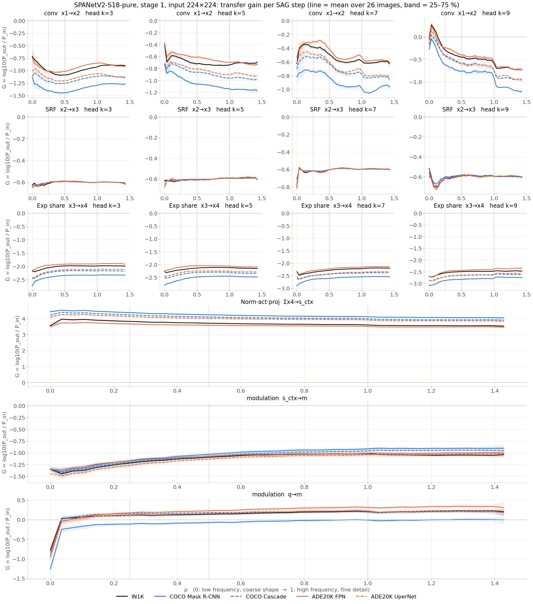
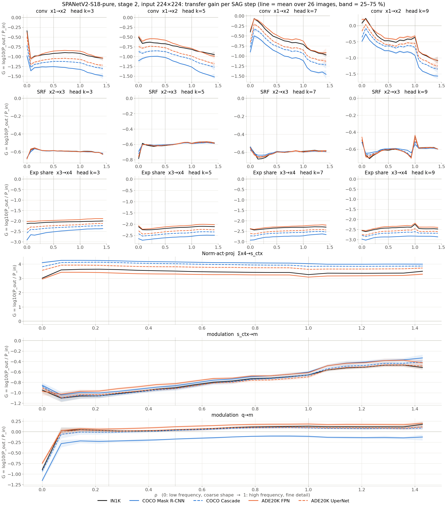
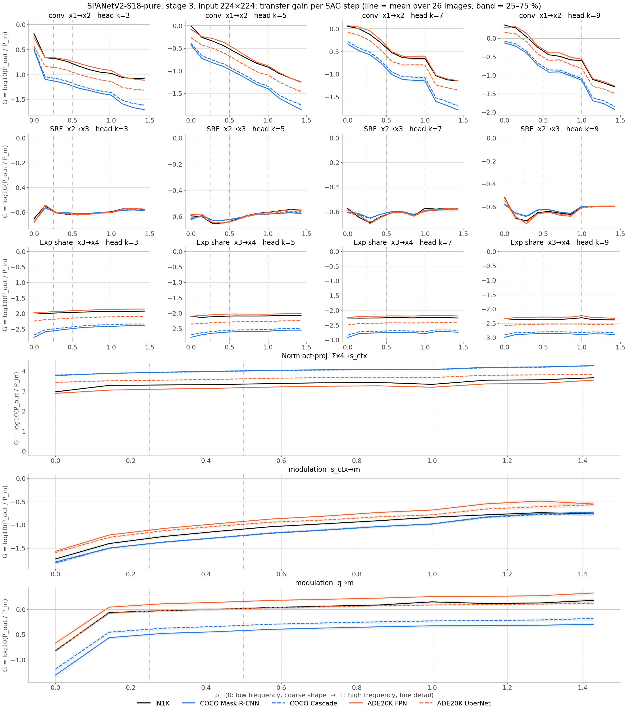
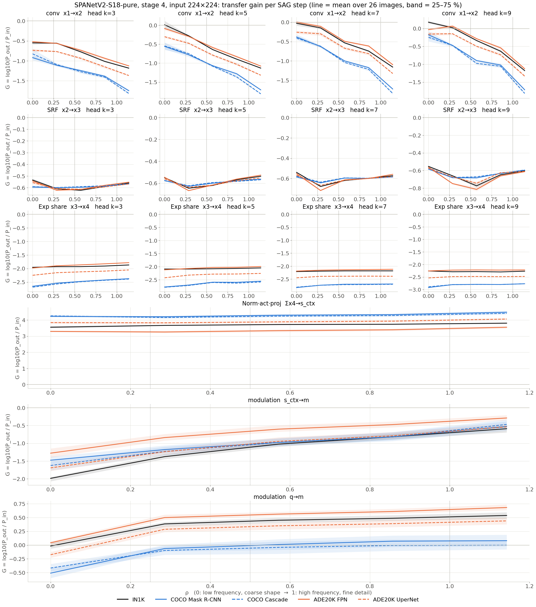
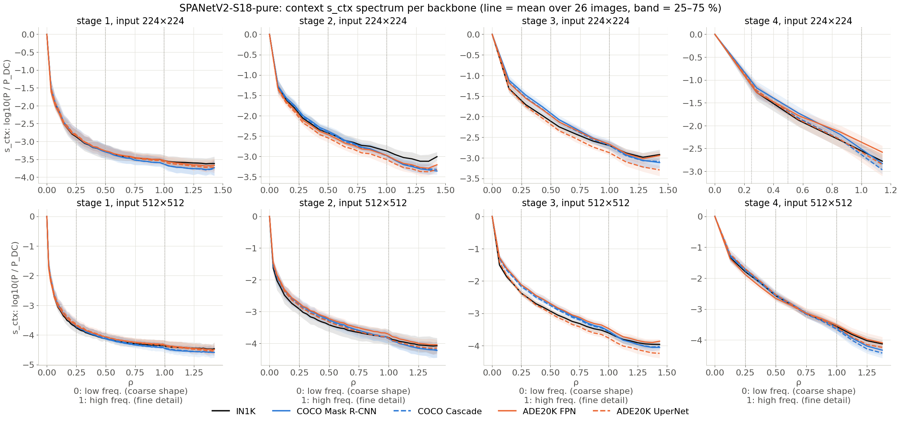
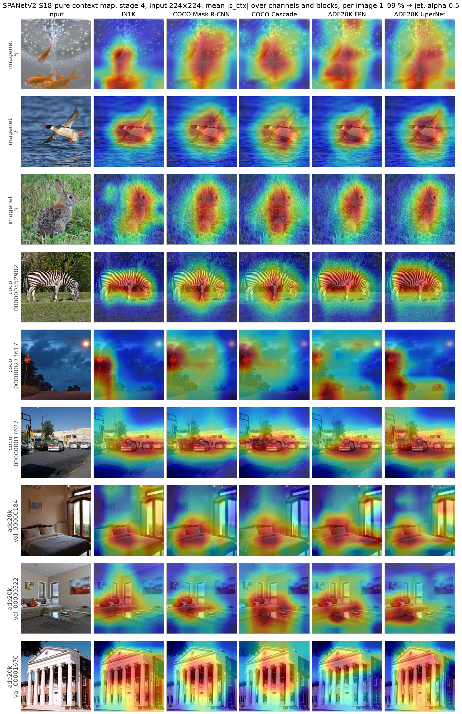

# SAG 분기별 활성 스펙트럼과 context 지도: ImageNet-1K, COCO, ADE20K 백본 비교 (추론만)

학습, 미세조정, 저장소 코드 수정은 하지 않았다(forward hook만 썼다).
- **실행 환경:** SPANetV2-official commit `130366cbf60e66a4710c9280ecc7809d93ef583c`, CPU, fp32, eval 모드.
- **다시 만들기:** `bash run_all.sh`. 체크포인트 경로는 `extract.py --ckpt LABEL=PATH` 인자로 준다.
- **범위:** 본문은 SPANetV2-S18-pure이다. S18-hybrid(단계 1–2만 SPAM)는 각 절 끝과 `_hybrid` 그림에 있다.

## 1. 체크포인트와 불러오기

| 모델 | 체크포인트 | 파일 | sha256 | torch.load | 쓴 state_dict | 버린 비백본 key 수 | 불러오지 않은 key (모듈 단위) | 남은 key |
|---|---|---|---|---|---|---|---|---|
| s18_pure | IN1K | `spanetv2_s18_pure_res-scale_Full-ExSPAM.pth` | `7450b229eddf…` | weights_only=True | flat state_dict | 0 | 없음 | 없음 |
| s18_pure | COCO/MaskRCNN | `mask-rcnn_spanetv2_s18_pure_3x_epoch_35.pth` | `7a6905417ab7…` | weights_only=False (아래 주) | ckpt['state_dict'], keys starting with 'backbone.' (prefix removed) | 42 | 없음 | norm0.weight, norm1.weight, norm2.weight, norm3.weight |
| s18_pure | COCO/Cascade | `cascade-mask-rcnn_spanetv2_s18_pure_3x_epoch_35.pth` | `62a25bdfa001…` | weights_only=False (아래 주) | ckpt['state_dict'], keys starting with 'backbone.' (prefix removed) | 148 | 없음 | norm0.weight, norm1.weight, norm2.weight, norm3.weight |
| s18_pure | ADE20K/FPN | `fpn_spanetv2_s18_pure_ade20k_467e-1.pth` | `09d2fc8a1008…` | weights_only=False (아래 주) | ckpt['state_dict'], keys starting with 'backbone.' (prefix removed) | 60 | 없음 | norm0.weight, norm1.weight, norm2.weight, norm3.weight |
| s18_pure | ADE20K/UperNet | `upernet_spanetv2_s18_pure_ade20k_4872e-2.pth` | `4ae3b5ddc229…` | weights_only=False (아래 주) | ckpt['state_dict'], keys starting with 'backbone.' (prefix removed) | 82 | 없음 | norm0.weight, norm1.weight, norm2.weight, norm3.weight |
| s18_hybrid | IN1K | `spanetv2_s18_hybrid_k7_res-scale_Full-ExSPAM.pth` | `4e27616f75cc…` | weights_only=True | flat state_dict | 0 | 없음 | 없음 |
| s18_hybrid | COCO/MaskRCNN | `mask-rcnn_spanetv2_s18_hybrid_3x_epoch_36.pth` | `1e8d0cff6ea5…` | weights_only=False (아래 주) | ckpt['state_dict'], keys starting with 'backbone.' (prefix removed) | 42 | 없음 | norm0.weight, norm1.weight, norm2.weight, norm3.weight |
| s18_hybrid | COCO/Cascade | `cascade-mask-rcnn_spanetv2_s18_hybrid_3x_epoch_35.pth` | `645968a5b007…` | weights_only=False (아래 주) | ckpt['state_dict'], keys starting with 'backbone.' (prefix removed) | 148 | 없음 | norm0.weight, norm1.weight, norm2.weight, norm3.weight |
| s18_hybrid | ADE20K/FPN | `fpn_spanetv2_s18_hybrid_ade20k_478e-1.pth` | `f1e27ab6af34…` | weights_only=False (아래 주) | ckpt['state_dict'], keys starting with 'backbone.' (prefix removed) | 60 | 없음 | norm0.weight, norm1.weight, norm2.weight, norm3.weight |
| s18_hybrid | ADE20K/UperNet | `upernet_spanetv2_s18_hybrid_ade20k_4913e-2.pth` | `b3114904af33…` | weights_only=False (아래 주) | ckpt['state_dict'], keys starting with 'backbone.' (prefix removed) | 82 | 없음 | norm0.weight, norm1.weight, norm2.weight, norm3.weight |

- **weights_only:** 하류 체크포인트(mmengine 저장본)는 `weights_only=True`에서 `mmengine.logging.history_buffer.HistoryBuffer` 때문에 실패한다. 저자 본인의 공개 파일이므로 `weights_only=False`로 읽었다.
- **불러오지 않은 key:** 없다. 하류 백본(dense spanetv2.py)도 분류 head(`head.*`)와 마지막 `norm.*`을 가지고 있어 함께 채워졌다(stage 4 뒤라 측정에 쓰이지 않는다).
- **남은 key:** 하류 백본의 출력 norm `norm0`–`norm3`은 분류 모델에 없어서 남았다.

## 2. hook 위치와 Σx4_h 확인

ExSPAM.forward(image_classification/models/spanetv2.py 237–269행)의 모든 SPAM 블록에 다음 hook을 걸었다.

| 양 | hook | 내용 |
|---|---|---|
| x1_h | `token_mixer.local_conv_{h+1}` forward hook 입력 | ctx의 head h (B, C/4, H, W) |
| x2_h | 같은 hook 출력 | depthwise conv 출력 |
| x3_h | `token_mixer.proj` forward-pre-hook 입력 s_in | s_in.view(B, C/4, 4, H, W)[:, :, h], SRF 출력(irfft2 뒤) |
| x4_h | 같은 pre-hook 안에서 계산 | proj[0](head h 외 채널을 0으로 둔 s_in). Conv2d._conv_forward를 써서 hook이 다시 불리지 않게 함 |
| Σx4_h 확인 | `token_mixer.proj[0]` forward hook 출력 | 실제 proj[0] 출력과 비교 |
| s_ctx | `token_mixer.proj` forward hook 출력 | proj 전체 출력(노트북의 vis_ctx, permute 전) |
| q | `token_mixer.query` forward hook 출력 | query 출력 (B, H, W, C) |
| m | `token_mixer.proj_out` forward-pre-hook 입력 | q ⊙ s_ctx |

| 모델 | 체크포인트 | 해상도 | SPAM 블록 수 | max \|Σx4_h − proj[0] 출력\| | max ‖차‖/‖proj[0] 출력‖ | proj[0] bias |
|---|---|---|---|---|---|---|
| s18_pure | IN1K | 224 | 18 | 5.96e-08 | 4.87e-08 | none |
| s18_pure | IN1K | 512 | 18 | 8.94e-08 | 4.83e-08 | none |
| s18_pure | COCO/MaskRCNN | 224 | 18 | 1.49e-08 | 4.94e-08 | none |
| s18_pure | COCO/MaskRCNN | 512 | 18 | 2.98e-08 | 4.98e-08 | none |
| s18_pure | COCO/Cascade | 224 | 18 | 1.49e-08 | 4.95e-08 | none |
| s18_pure | COCO/Cascade | 512 | 18 | 1.49e-08 | 4.99e-08 | none |
| s18_pure | ADE20K/FPN | 224 | 18 | 1.19e-07 | 4.84e-08 | none |
| s18_pure | ADE20K/FPN | 512 | 18 | 1.19e-07 | 4.86e-08 | none |
| s18_pure | ADE20K/UperNet | 224 | 18 | 2.98e-08 | 5.01e-08 | none |
| s18_pure | ADE20K/UperNet | 512 | 18 | 4.47e-08 | 5.04e-08 | none |
| s18_hybrid | IN1K | 224 | 6 | 2.98e-08 | 4.85e-08 | none |
| s18_hybrid | IN1K | 512 | 6 | 2.98e-08 | 4.87e-08 | none |
| s18_hybrid | COCO/MaskRCNN | 224 | 6 | 7.45e-09 | 5.82e-08 | none |
| s18_hybrid | COCO/MaskRCNN | 512 | 6 | 9.31e-09 | 5.90e-08 | none |
| s18_hybrid | COCO/Cascade | 224 | 6 | 1.49e-08 | 5.46e-08 | none |
| s18_hybrid | COCO/Cascade | 512 | 6 | 1.49e-08 | 5.59e-08 | none |
| s18_hybrid | ADE20K/FPN | 224 | 6 | 5.96e-08 | 4.78e-08 | none |
| s18_hybrid | ADE20K/FPN | 512 | 6 | 5.96e-08 | 4.79e-08 | none |
| s18_hybrid | ADE20K/UperNet | 224 | 6 | 1.49e-08 | 5.10e-08 | none |
| s18_hybrid | ADE20K/UperNet | 512 | 6 | 1.86e-08 | 5.17e-08 | none |

- **채널 배치:** s_in의 채널은 "채널 c의 head 0–3"이 연속으로 놓인다(c·4 + h).
- **proj[0]:** groups = C/4인 1×1 conv라 그룹마다 이 4채널을 섞는다. 그래서 head별 Exp 출력은 없다.
- **x4_h:** proj[0]이 선형이고 bias가 없으므로 x4_h의 합이 proj[0] 출력과 같아야 한다. 위 표의 차이는 부동소수 반올림 수준이다.

## 3. 해상도, 전처리, 영상

- **해상도:**
  - R1 224×224에서는 SRF가 저장된 격자 그대로 쓰여 C-4와 비교된다.
  - R2 512×512에서는 ExSPAM.forward가 SRF를 `resize_weight`(bicubic, align_corners=True)로 늘린다.
  - 두 해상도 모두 분류 모델 그대로(input_size 224로 생성) 넣었다.
- **전처리:** 짧은 변을 R로 PIL bicubic resize한 뒤 R×R center crop하고, (x/255 − ImageNet mean)/std로 정규화했다.
- **하류 config와의 일치:** 하류 체크포인트 8개(S18-pure·hybrid)의 학습 config는 모두 data_preprocessor mean (123.675, 116.28, 103.53), std (58.395, 57.12, 57.375), bgr_to_rgb=True이다. [0,1] 척도의 ImageNet mean/std(RGB)와 같다.
  - 하류 학습의 resize는 mmcv(cv2 bilinear)였고, 여기서는 PIL bicubic을 썼다.
- **노트북(ExSPAM_analysis.ipynb 19–21셀)과 다른 점:**
  - 노트북은 영상을 224×224로 늘린 뒤 Resize(224)를 했고, 여기서는 짧은 변 resize 뒤 center crop을 했다.
  - 노트북은 지도를 ×4 bilinear로 올려 입력 없이 그렸고, 여기서는 지시대로 입력 크기로 bilinear로 올려 jet, alpha 0.5로 겹쳤다.

영상 선택 규칙: Images for the branch-spectra / context study (fixed seeds) at R1 = 224 and R2 = 512.

    python select_images.py [--misc DIR] [--imnet-val DIR] [--coco DIR] [--ade DIR]

Groups
  imagenet : the images of image_classification/misc/imgs. All 10 are ImageNet-1K val files (byte-identical, matched by
             md5 against /home/server/dataset/ImageNet2012/val, see data/images.json). The task asks for 8 per group
             and for the misc images to be included; all 10 are kept so none of them is dropped. Order: numpy
             default_rng(0).permutation(10).
  coco     : 8 COCO val2017 images, default_rng(1).choice over the image ids sorted ascending.
  ade20k   : 8 ADE20K val images, default_rng(2).choice over the sorted file names.
Main-text figures use the first 3 images of each group in this order; the rest go to the appendix.
Preprocessing (both resolutions, every checkpoint): Resize(shorter side = R, PIL bicubic) -> CenterCrop(R); the model
input is (x / 255 - ImageNet mean) / std. Object masks (same geometry, nearest): COCO = union of all instance masks
(crowd included); ADE20K = pixels of the 100 'thing' classes of the Mask2Former ADE20K-150 panoptic split
(data/ade20k_150_isthing.json). ImageNet images have no mask.

| # | 묶음 | 파일 | ImageNet val 원본 | 객체 면적 비 (R1) | 그림 |
|---|---|---|---|---|---|
| 1 | imagenet | `misc/imgs/5.JPEG` | n01443537/ILSVRC2012_val_00045761.JPEG | — | 본문 |
| 2 | imagenet | `misc/imgs/7.JPEG` | n01855032/ILSVRC2012_val_00011488.JPEG | — | 본문 |
| 3 | imagenet | `misc/imgs/3.JPEG` | n02325366/ILSVRC2012_val_00026361.JPEG | — | 본문 |
| 4 | imagenet | `misc/imgs/8.JPEG` | n02123045/ILSVRC2012_val_00011015.JPEG | — | 부록 |
| 5 | imagenet | `misc/imgs/4.JPEG` | n03785016/ILSVRC2012_val_00031789.JPEG | — | 부록 |
| 6 | imagenet | `misc/imgs/6.JPEG` | n01877812/ILSVRC2012_val_00001036.JPEG | — | 부록 |
| 7 | imagenet | `misc/imgs/10.JPEG` | n03785016/ILSVRC2012_val_00009268.JPEG | — | 부록 |
| 8 | imagenet | `misc/imgs/1.JPEG` | n01518878/ILSVRC2012_val_00038156.JPEG | — | 부록 |
| 9 | imagenet | `misc/imgs/9.JPEG` | n02497673/ILSVRC2012_val_00021138.JPEG | — | 부록 |
| 10 | imagenet | `misc/imgs/2.JPEG` | n01494475/ILSVRC2012_val_00045925.JPEG | — | 부록 |
| 11 | coco | `000000552902.jpg` |  | 0.219 | 본문 |
| 12 | coco | `000000273617.jpg` |  | 0.006 | 본문 |
| 13 | coco | `000000017627.jpg` |  | 0.124 | 본문 |
| 14 | coco | `000000552371.jpg` |  | 0.580 | 부록 |
| 15 | coco | `000000475191.jpg` |  | 0.102 | 부록 |
| 16 | coco | `000000084477.jpg` |  | 0.277 | 부록 |
| 17 | coco | `000000438862.jpg` |  | 0.344 | 부록 |
| 18 | coco | `000000294831.jpg` |  | 0.409 | 부록 |
| 19 | ade20k | `ADE_val_00000184.jpg` |  | 0.555 | 본문 |
| 20 | ade20k | `ADE_val_00000522.jpg` |  | 0.398 | 본문 |
| 21 | ade20k | `ADE_val_00001670.jpg` |  | 0.040 | 본문 |
| 22 | ade20k | `ADE_val_00001627.jpg` |  | 0.000 | 부록 |
| 23 | ade20k | `ADE_val_00000596.jpg` |  | 0.000 | 부록 |
| 24 | ade20k | `ADE_val_00000903.jpg` |  | 0.353 | 부록 |
| 25 | ade20k | `ADE_val_00000827.jpg` |  | 0.074 | 부록 |
| 26 | ade20k | `ADE_val_00000219.jpg` |  | 0.000 | 부록 |

- **ImageNet 묶음:** `misc/imgs`의 10장 모두 ImageNet val 원본과 바이트가 같다(md5 확인). 지시대로 이 영상을 포함하되 하나도 빼지 않으려고 10장을 모두 썼다(다른 묶음은 8장).
- **객체 면적이 0인 영상:** ADE20K 영상 가운데 thing 클래스 화소가 없는 영상은 객체 비율을 계산하지 않았다(면적 0).

## 4. 스펙트럼과 전이 이득

- **정의:**
  - 텐서 X (C, H, W)마다 P = mean_c |FFT2(X_c)|²(ortho, 전체 격자)이다. profile은 log10(P/P_DC)를 정수 반경 고리로 평균한 것이고, ρ = r/(H/2)이다.
  - 대역 값은 대역 안 격자 칸의 평균이다(low 0 < ρ ≤ 0.25, mid 0.25 < ρ ≤ 0.5, high ρ > 0.5, C-4와 같음).
  - 전이 이득은 G = log10(P_out/P_in)이고, 블록마다 계산해 단계 안에서 평균했다.
  - 통계는 영상 평균(전체 26장)이고, 25–75%는 `data/band_values.csv`에 있다.
  - 블록별 원자료는 `data/raw/<arch>/<ckpt>_R<res>.npz`에, 고리별 값은 `data/profiles.csv.gz`, `data/transfer_gain.csv.gz`에 있다.

- **`figs/transfer_gain_stage{1..4}.png`(R1):** 행은 전이 단계이고, 위 세 줄은 head(커널 3, 5, 7, 9)별 열로 나뉜다. 선은 체크포인트다.
- **같은 형식의 다른 그림:** R2는 `_R512`, hybrid는 `_hybrid`.

- **`figs/sctx_spectra.png`:** s_ctx의 log10(P/P_DC) profile이다. 행은 해상도, 열은 단계다.

**s_ctx 대역 값 log10(P/P_DC), S18-pure, 224×224, 26장 평균**

| 단계 | 대역 | IN1K | COCO MR | COCO Cas | ADE FPN | ADE Uper |
|---|---|---|---|---|---|---|
| 1 | low | -2.502 | -2.454 | -2.473 | -2.502 | -2.441 |
| 1 | mid | -3.132 | -3.124 | -3.122 | -3.106 | -3.097 |
| 1 | high | -3.486 | -3.567 | -3.564 | -3.485 | -3.510 |
| 2 | low | -1.627 | -1.581 | -1.607 | -1.674 | -1.715 |
| 2 | mid | -2.227 | -2.164 | -2.201 | -2.267 | -2.339 |
| 2 | high | -2.775 | -2.845 | -2.859 | -2.869 | -2.967 |
| 3 | low | -1.317 | -1.112 | -1.163 | -1.181 | -1.331 |
| 3 | mid | -1.860 | -1.639 | -1.696 | -1.710 | -1.912 |
| 3 | high | -2.571 | -2.500 | -2.535 | -2.512 | -2.720 |
| 4 | low | nan | nan | nan | nan | nan |
| 4 | mid | -1.274 | -1.175 | -1.250 | -1.276 | -1.228 |
| 4 | high | -2.327 | -2.245 | -2.362 | -2.165 | -2.337 |

**전이 이득 G, low 대역, S18-pure, 224×224, 26장 평균**

| 단계 | 전이 | head | IN1K | COCO MR | COCO Cas | ADE FPN | ADE Uper |
|---|---|---|---|---|---|---|---|
| 1 | conv x1→x2 | k=3 | -0.858 | -1.300 | -1.099 | -0.900 | -1.014 |
| 1 | conv x1→x2 | k=5 | -0.641 | -0.886 | -0.772 | -0.571 | -0.746 |
| 1 | conv x1→x2 | k=7 | -0.355 | -0.721 | -0.540 | -0.337 | -0.468 |
| 1 | conv x1→x2 | k=9 | +0.096 | -0.227 | -0.106 | +0.058 | -0.035 |
| 1 | SRF x2→x3 | k=3 | -0.620 | -0.619 | -0.623 | -0.628 | -0.622 |
| 1 | SRF x2→x3 | k=5 | -0.619 | -0.614 | -0.619 | -0.613 | -0.614 |
| 1 | SRF x2→x3 | k=7 | -0.598 | -0.603 | -0.605 | -0.602 | -0.605 |
| 1 | SRF x2→x3 | k=9 | -0.643 | -0.630 | -0.637 | -0.663 | -0.650 |
| 1 | Exp 몫 x3→x4 | k=3 | -2.148 | -2.488 | -2.347 | -2.037 | -2.317 |
| 1 | Exp 몫 x3→x4 | k=5 | -2.263 | -2.693 | -2.473 | -2.170 | -2.403 |
| 1 | Exp 몫 x3→x4 | k=7 | -2.432 | -2.745 | -2.587 | -2.382 | -2.568 |
| 1 | Exp 몫 x3→x4 | k=9 | -2.666 | -3.015 | -2.826 | -2.662 | -2.838 |
| 1 | Σx4→s_ctx | — | +3.934 | +4.486 | +4.351 | +3.725 | +4.230 |
| 1 | s_ctx→m | — | -1.372 | -1.317 | -1.344 | -1.291 | -1.413 |
| 1 | q→m | — | +0.060 | -0.187 | +0.080 | +0.046 | +0.024 |
| 2 | conv x1→x2 | k=3 | -1.014 | -1.310 | -1.224 | -1.017 | -1.160 |
| 2 | conv x1→x2 | k=5 | -0.646 | -1.022 | -0.888 | -0.572 | -0.760 |
| 2 | conv x1→x2 | k=7 | -0.122 | -0.537 | -0.368 | -0.104 | -0.251 |
| 2 | conv x1→x2 | k=9 | +0.096 | -0.384 | -0.201 | +0.083 | -0.085 |
| 2 | SRF x2→x3 | k=3 | -0.569 | -0.583 | -0.576 | -0.565 | -0.573 |
| 2 | SRF x2→x3 | k=5 | -0.598 | -0.601 | -0.602 | -0.599 | -0.603 |
| 2 | SRF x2→x3 | k=7 | -0.637 | -0.622 | -0.628 | -0.640 | -0.633 |
| 2 | SRF x2→x3 | k=9 | -0.681 | -0.645 | -0.660 | -0.689 | -0.673 |
| 2 | Exp 몫 x3→x4 | k=3 | -2.107 | -2.662 | -2.404 | -2.012 | -2.285 |
| 2 | Exp 몫 x3→x4 | k=5 | -2.252 | -2.697 | -2.519 | -2.216 | -2.429 |
| 2 | Exp 몫 x3→x4 | k=7 | -2.433 | -2.881 | -2.704 | -2.390 | -2.613 |
| 2 | Exp 몫 x3→x4 | k=9 | -2.580 | -2.990 | -2.823 | -2.531 | -2.747 |
| 2 | Σx4→s_ctx | — | +3.620 | +4.261 | +4.123 | +3.422 | +3.923 |
| 2 | s_ctx→m | — | -1.083 | -1.021 | -1.079 | -0.999 | -1.066 |
| 2 | q→m | — | +0.032 | -0.251 | -0.035 | +0.045 | +0.015 |
| 3 | conv x1→x2 | k=3 | -0.664 | -1.098 | -1.047 | -0.661 | -0.841 |
| 3 | conv x1→x2 | k=5 | -0.261 | -0.727 | -0.667 | -0.243 | -0.429 |
| 3 | conv x1→x2 | k=7 | +0.006 | -0.482 | -0.424 | +0.042 | -0.139 |
| 3 | conv x1→x2 | k=9 | +0.281 | -0.211 | -0.149 | +0.316 | +0.120 |
| 3 | SRF x2→x3 | k=3 | -0.549 | -0.565 | -0.567 | -0.542 | -0.557 |
| 3 | SRF x2→x3 | k=5 | -0.601 | -0.591 | -0.595 | -0.580 | -0.601 |
| 3 | SRF x2→x3 | k=7 | -0.647 | -0.616 | -0.624 | -0.622 | -0.633 |
| 3 | SRF x2→x3 | k=9 | -0.701 | -0.654 | -0.659 | -0.685 | -0.700 |
| 3 | Exp 몫 x3→x4 | k=3 | -1.995 | -2.589 | -2.524 | -1.955 | -2.195 |
| 3 | Exp 몫 x3→x4 | k=5 | -2.135 | -2.698 | -2.634 | -2.075 | -2.333 |
| 3 | Exp 몫 x3→x4 | k=7 | -2.266 | -2.795 | -2.732 | -2.211 | -2.452 |
| 3 | Exp 몫 x3→x4 | k=9 | -2.364 | -2.891 | -2.828 | -2.304 | -2.556 |
| 3 | Σx4→s_ctx | — | +3.277 | +3.876 | +3.876 | +3.040 | +3.507 |
| 3 | s_ctx→m | — | -1.402 | -1.499 | -1.503 | -1.219 | -1.268 |
| 3 | q→m | — | -0.063 | -0.561 | -0.454 | +0.044 | -0.077 |
| 4 | conv x1→x2 | k=3 | +nan | +nan | +nan | +nan | +nan |
| 4 | conv x1→x2 | k=5 | +nan | +nan | +nan | +nan | +nan |
| 4 | conv x1→x2 | k=7 | +nan | +nan | +nan | +nan | +nan |
| 4 | conv x1→x2 | k=9 | +nan | +nan | +nan | +nan | +nan |
| 4 | SRF x2→x3 | k=3 | +nan | +nan | +nan | +nan | +nan |
| 4 | SRF x2→x3 | k=5 | +nan | +nan | +nan | +nan | +nan |
| 4 | SRF x2→x3 | k=7 | +nan | +nan | +nan | +nan | +nan |
| 4 | SRF x2→x3 | k=9 | +nan | +nan | +nan | +nan | +nan |
| 4 | Exp 몫 x3→x4 | k=3 | +nan | +nan | +nan | +nan | +nan |
| 4 | Exp 몫 x3→x4 | k=5 | +nan | +nan | +nan | +nan | +nan |
| 4 | Exp 몫 x3→x4 | k=7 | +nan | +nan | +nan | +nan | +nan |
| 4 | Exp 몫 x3→x4 | k=9 | +nan | +nan | +nan | +nan | +nan |
| 4 | Σx4→s_ctx | — | +nan | +nan | +nan | +nan | +nan |
| 4 | s_ctx→m | — | +nan | +nan | +nan | +nan | +nan |
| 4 | q→m | — | +nan | +nan | +nan | +nan | +nan |

**전이 이득 G, high 대역, S18-pure, 224×224, 26장 평균**

| 단계 | 전이 | head | IN1K | COCO MR | COCO Cas | ADE FPN | ADE Uper |
|---|---|---|---|---|---|---|---|
| 1 | conv x1→x2 | k=3 | -0.971 | -1.343 | -1.156 | -0.902 | -1.105 |
| 1 | conv x1→x2 | k=5 | -0.728 | -1.101 | -0.913 | -0.659 | -0.862 |
| 1 | conv x1→x2 | k=7 | -0.580 | -0.949 | -0.754 | -0.529 | -0.722 |
| 1 | conv x1→x2 | k=9 | -0.524 | -0.823 | -0.664 | -0.476 | -0.665 |
| 1 | SRF x2→x3 | k=3 | -0.597 | -0.598 | -0.598 | -0.598 | -0.599 |
| 1 | SRF x2→x3 | k=5 | -0.598 | -0.600 | -0.600 | -0.599 | -0.600 |
| 1 | SRF x2→x3 | k=7 | -0.592 | -0.593 | -0.594 | -0.591 | -0.593 |
| 1 | SRF x2→x3 | k=9 | -0.592 | -0.587 | -0.589 | -0.590 | -0.592 |
| 1 | Exp 몫 x3→x4 | k=3 | -1.981 | -2.329 | -2.165 | -1.907 | -2.117 |
| 1 | Exp 몫 x3→x4 | k=5 | -2.119 | -2.458 | -2.301 | -2.051 | -2.249 |
| 1 | Exp 몫 x3→x4 | k=7 | -2.228 | -2.560 | -2.399 | -2.168 | -2.372 |
| 1 | Exp 몫 x3→x4 | k=9 | -2.476 | -2.791 | -2.636 | -2.405 | -2.618 |
| 1 | Σx4→s_ctx | — | +3.639 | +4.154 | +4.021 | +3.538 | +3.948 |
| 1 | s_ctx→m | — | -1.036 | -0.950 | -0.989 | -1.024 | -1.062 |
| 1 | q→m | — | +0.190 | -0.027 | +0.207 | +0.290 | +0.206 |
| 2 | conv x1→x2 | k=3 | -0.908 | -1.291 | -1.135 | -0.854 | -1.056 |
| 2 | conv x1→x2 | k=5 | -0.760 | -1.169 | -0.994 | -0.711 | -0.908 |
| 2 | conv x1→x2 | k=7 | -0.666 | -1.048 | -0.882 | -0.597 | -0.803 |
| 2 | conv x1→x2 | k=9 | -0.483 | -0.870 | -0.690 | -0.410 | -0.612 |
| 2 | SRF x2→x3 | k=3 | -0.593 | -0.596 | -0.595 | -0.594 | -0.595 |
| 2 | SRF x2→x3 | k=5 | -0.592 | -0.594 | -0.595 | -0.592 | -0.595 |
| 2 | SRF x2→x3 | k=7 | -0.595 | -0.593 | -0.596 | -0.594 | -0.597 |
| 2 | SRF x2→x3 | k=9 | -0.596 | -0.602 | -0.612 | -0.596 | -0.609 |
| 2 | Exp 몫 x3→x4 | k=3 | -2.043 | -2.461 | -2.296 | -1.952 | -2.200 |
| 2 | Exp 몫 x3→x4 | k=5 | -2.151 | -2.569 | -2.401 | -2.079 | -2.298 |
| 2 | Exp 몫 x3→x4 | k=7 | -2.322 | -2.737 | -2.571 | -2.264 | -2.477 |
| 2 | Exp 몫 x3→x4 | k=9 | -2.347 | -2.843 | -2.643 | -2.277 | -2.527 |
| 2 | Σx4→s_ctx | — | +3.418 | +4.089 | +3.946 | +3.230 | +3.743 |
| 2 | s_ctx→m | — | -0.739 | -0.701 | -0.754 | -0.677 | -0.763 |
| 2 | q→m | — | +0.101 | -0.130 | +0.075 | +0.160 | +0.088 |
| 3 | conv x1→x2 | k=3 | -0.905 | -1.337 | -1.288 | -0.844 | -1.064 |
| 3 | conv x1→x2 | k=5 | -0.734 | -1.181 | -1.128 | -0.673 | -0.896 |
| 3 | conv x1→x2 | k=7 | -0.626 | -1.104 | -1.044 | -0.587 | -0.790 |
| 3 | conv x1→x2 | k=9 | -0.523 | -0.989 | -0.940 | -0.464 | -0.674 |
| 3 | SRF x2→x3 | k=3 | -0.611 | -0.606 | -0.608 | -0.613 | -0.614 |
| 3 | SRF x2→x3 | k=5 | -0.600 | -0.602 | -0.603 | -0.606 | -0.609 |
| 3 | SRF x2→x3 | k=7 | -0.604 | -0.603 | -0.605 | -0.609 | -0.614 |
| 3 | SRF x2→x3 | k=9 | -0.630 | -0.629 | -0.631 | -0.647 | -0.649 |
| 3 | Exp 몫 x3→x4 | k=3 | -1.945 | -2.442 | -2.385 | -1.886 | -2.123 |
| 3 | Exp 몫 x3→x4 | k=5 | -2.089 | -2.595 | -2.541 | -2.029 | -2.278 |
| 3 | Exp 몫 x3→x4 | k=7 | -2.247 | -2.757 | -2.700 | -2.187 | -2.426 |
| 3 | Exp 몫 x3→x4 | k=9 | -2.322 | -2.864 | -2.798 | -2.259 | -2.524 |
| 3 | Σx4→s_ctx | — | +3.380 | +4.055 | +4.042 | +3.218 | +3.661 |
| 3 | s_ctx→m | — | -0.947 | -1.091 | -1.086 | -0.784 | -0.869 |
| 3 | q→m | — | +0.079 | -0.365 | -0.264 | +0.210 | +0.057 |
| 4 | conv x1→x2 | k=3 | -0.883 | -1.315 | -1.349 | -0.832 | -1.028 |
| 4 | conv x1→x2 | k=5 | -0.764 | -1.162 | -1.200 | -0.703 | -0.894 |
| 4 | conv x1→x2 | k=7 | -0.650 | -1.090 | -1.136 | -0.575 | -0.753 |
| 4 | conv x1→x2 | k=9 | -0.484 | -0.975 | -1.044 | -0.414 | -0.611 |
| 4 | SRF x2→x3 | k=3 | -0.610 | -0.594 | -0.589 | -0.601 | -0.606 |
| 4 | SRF x2→x3 | k=5 | -0.601 | -0.594 | -0.591 | -0.597 | -0.605 |
| 4 | SRF x2→x3 | k=7 | -0.610 | -0.596 | -0.595 | -0.607 | -0.609 |
| 4 | SRF x2→x3 | k=9 | -0.733 | -0.666 | -0.657 | -0.761 | -0.707 |
| 4 | Exp 몫 x3→x4 | k=3 | -1.919 | -2.455 | -2.466 | -1.847 | -2.110 |
| 4 | Exp 몫 x3→x4 | k=5 | -2.071 | -2.591 | -2.608 | -2.025 | -2.280 |
| 4 | Exp 몫 x3→x4 | k=7 | -2.184 | -2.698 | -2.713 | -2.138 | -2.389 |
| 4 | Exp 몫 x3→x4 | k=9 | -2.289 | -2.796 | -2.798 | -2.222 | -2.482 |
| 4 | Σx4→s_ctx | — | +3.734 | +4.319 | +4.258 | +3.374 | +3.910 |
| 4 | s_ctx→m | — | -0.911 | -0.892 | -0.889 | -0.522 | -0.861 |
| 4 | q→m | — | +0.475 | +0.038 | -0.025 | +0.594 | +0.373 |

**s_ctx 대역 값 log10(P/P_DC), S18-pure, 512×512, 26장 평균**

| 단계 | 대역 | IN1K | COCO MR | COCO Cas | ADE FPN | ADE Uper |
|---|---|---|---|---|---|---|
| 1 | low | -3.388 | -3.321 | -3.317 | -3.339 | -3.272 |
| 1 | mid | -3.989 | -3.971 | -3.942 | -3.920 | -3.902 |
| 1 | high | -4.325 | -4.386 | -4.363 | -4.283 | -4.301 |
| 2 | low | -2.584 | -2.429 | -2.468 | -2.403 | -2.466 |
| 2 | mid | -3.220 | -3.051 | -3.099 | -3.024 | -3.120 |
| 2 | high | -3.740 | -3.713 | -3.736 | -3.614 | -3.731 |
| 3 | low | -1.993 | -1.744 | -1.790 | -1.739 | -1.963 |
| 3 | mid | -2.690 | -2.445 | -2.493 | -2.437 | -2.728 |
| 3 | high | -3.455 | -3.356 | -3.382 | -3.295 | -3.587 |
| 4 | low | -1.417 | -1.322 | -1.361 | -1.462 | -1.294 |
| 4 | mid | -2.192 | -2.143 | -2.190 | -2.309 | -2.137 |
| 4 | high | -3.324 | -3.341 | -3.393 | -3.304 | -3.338 |

**전이 이득 G, low 대역, S18-pure, 512×512, 26장 평균**

| 단계 | 전이 | head | IN1K | COCO MR | COCO Cas | ADE FPN | ADE Uper |
|---|---|---|---|---|---|---|---|
| 1 | conv x1→x2 | k=3 | -0.823 | -1.260 | -1.064 | -0.869 | -0.980 |
| 1 | conv x1→x2 | k=5 | -0.656 | -0.869 | -0.776 | -0.574 | -0.756 |
| 1 | conv x1→x2 | k=7 | -0.396 | -0.748 | -0.576 | -0.373 | -0.502 |
| 1 | conv x1→x2 | k=9 | +0.131 | -0.162 | -0.074 | +0.116 | +0.013 |
| 1 | SRF x2→x3 | k=3 | -0.620 | -0.623 | -0.627 | -0.634 | -0.627 |
| 1 | SRF x2→x3 | k=5 | -0.619 | -0.619 | -0.622 | -0.629 | -0.625 |
| 1 | SRF x2→x3 | k=7 | -0.594 | -0.600 | -0.602 | -0.602 | -0.605 |
| 1 | SRF x2→x3 | k=9 | -0.617 | -0.610 | -0.617 | -0.635 | -0.629 |
| 1 | Exp 몫 x3→x4 | k=3 | -2.157 | -2.492 | -2.357 | -2.046 | -2.326 |
| 1 | Exp 몫 x3→x4 | k=5 | -2.271 | -2.709 | -2.487 | -2.184 | -2.420 |
| 1 | Exp 몫 x3→x4 | k=7 | -2.438 | -2.766 | -2.604 | -2.398 | -2.582 |
| 1 | Exp 몫 x3→x4 | k=9 | -2.682 | -3.039 | -2.846 | -2.684 | -2.851 |
| 1 | Σx4→s_ctx | — | +3.899 | +4.497 | +4.360 | +3.712 | +4.237 |
| 1 | s_ctx→m | — | -1.402 | -1.338 | -1.383 | -1.312 | -1.438 |
| 1 | q→m | — | +0.011 | -0.187 | +0.054 | +0.012 | +0.002 |
| 2 | conv x1→x2 | k=3 | -1.033 | -1.326 | -1.241 | -1.024 | -1.165 |
| 2 | conv x1→x2 | k=5 | -0.630 | -1.009 | -0.877 | -0.563 | -0.751 |
| 2 | conv x1→x2 | k=7 | -0.085 | -0.514 | -0.345 | -0.078 | -0.227 |
| 2 | conv x1→x2 | k=9 | +0.165 | -0.305 | -0.132 | +0.147 | -0.024 |
| 2 | SRF x2→x3 | k=3 | -0.582 | -0.593 | -0.587 | -0.575 | -0.584 |
| 2 | SRF x2→x3 | k=5 | -0.606 | -0.606 | -0.607 | -0.607 | -0.609 |
| 2 | SRF x2→x3 | k=7 | -0.625 | -0.616 | -0.619 | -0.628 | -0.623 |
| 2 | SRF x2→x3 | k=9 | -0.656 | -0.632 | -0.642 | -0.660 | -0.649 |
| 2 | Exp 몫 x3→x4 | k=3 | -2.111 | -2.667 | -2.409 | -2.024 | -2.297 |
| 2 | Exp 몫 x3→x4 | k=5 | -2.265 | -2.705 | -2.528 | -2.224 | -2.437 |
| 2 | Exp 몫 x3→x4 | k=7 | -2.450 | -2.897 | -2.721 | -2.399 | -2.624 |
| 2 | Exp 몫 x3→x4 | k=9 | -2.591 | -3.006 | -2.841 | -2.553 | -2.770 |
| 2 | Σx4→s_ctx | — | +3.635 | +4.296 | +4.161 | +3.436 | +3.963 |
| 2 | s_ctx→m | — | -1.057 | -1.033 | -1.091 | -0.992 | -1.060 |
| 2 | q→m | — | +0.095 | -0.224 | -0.003 | +0.070 | +0.066 |
| 3 | conv x1→x2 | k=3 | -0.645 | -1.059 | -1.018 | -0.636 | -0.817 |
| 3 | conv x1→x2 | k=5 | -0.224 | -0.675 | -0.622 | -0.210 | -0.389 |
| 3 | conv x1→x2 | k=7 | +0.054 | -0.428 | -0.367 | +0.091 | -0.080 |
| 3 | conv x1→x2 | k=9 | +0.358 | -0.135 | -0.077 | +0.370 | +0.201 |
| 3 | SRF x2→x3 | k=3 | -0.571 | -0.586 | -0.587 | -0.577 | -0.586 |
| 3 | SRF x2→x3 | k=5 | -0.611 | -0.603 | -0.606 | -0.604 | -0.616 |
| 3 | SRF x2→x3 | k=7 | -0.658 | -0.630 | -0.636 | -0.653 | -0.656 |
| 3 | SRF x2→x3 | k=9 | -0.704 | -0.659 | -0.666 | -0.702 | -0.704 |
| 3 | Exp 몫 x3→x4 | k=3 | -2.001 | -2.602 | -2.535 | -1.963 | -2.203 |
| 3 | Exp 몫 x3→x4 | k=5 | -2.141 | -2.710 | -2.644 | -2.088 | -2.347 |
| 3 | Exp 몫 x3→x4 | k=7 | -2.270 | -2.807 | -2.742 | -2.222 | -2.460 |
| 3 | Exp 몫 x3→x4 | k=9 | -2.363 | -2.902 | -2.837 | -2.311 | -2.562 |
| 3 | Σx4→s_ctx | — | +3.310 | +3.910 | +3.911 | +3.096 | +3.543 |
| 3 | s_ctx→m | — | -1.404 | -1.493 | -1.500 | -1.231 | -1.277 |
| 3 | q→m | — | -0.021 | -0.505 | -0.401 | +0.077 | -0.032 |
| 4 | conv x1→x2 | k=3 | -0.460 | -1.011 | -0.982 | -0.470 | -0.693 |
| 4 | conv x1→x2 | k=5 | -0.089 | -0.566 | -0.542 | -0.055 | -0.304 |
| 4 | conv x1→x2 | k=7 | +0.099 | -0.434 | -0.403 | +0.179 | -0.091 |
| 4 | conv x1→x2 | k=9 | +0.418 | -0.165 | -0.105 | +0.403 | +0.147 |
| 4 | SRF x2→x3 | k=3 | -0.577 | -0.591 | -0.590 | -0.596 | -0.585 |
| 4 | SRF x2→x3 | k=5 | -0.626 | -0.621 | -0.617 | -0.654 | -0.625 |
| 4 | SRF x2→x3 | k=7 | -0.670 | -0.629 | -0.625 | -0.701 | -0.652 |
| 4 | SRF x2→x3 | k=9 | -0.628 | -0.630 | -0.625 | -0.678 | -0.638 |
| 4 | Exp 몫 x3→x4 | k=3 | -1.942 | -2.581 | -2.617 | -1.938 | -2.179 |
| 4 | Exp 몫 x3→x4 | k=5 | -2.092 | -2.744 | -2.751 | -2.089 | -2.345 |
| 4 | Exp 몫 x3→x4 | k=7 | -2.194 | -2.764 | -2.763 | -2.171 | -2.409 |
| 4 | Exp 몫 x3→x4 | k=9 | -2.271 | -2.823 | -2.820 | -2.235 | -2.495 |
| 4 | Σx4→s_ctx | — | +3.465 | +4.185 | +4.126 | +3.145 | +3.729 |
| 4 | s_ctx→m | — | -1.556 | -1.351 | -1.450 | -0.924 | -1.334 |
| 4 | q→m | — | +0.298 | -0.025 | -0.079 | +0.562 | +0.297 |

**전이 이득 G, high 대역, S18-pure, 512×512, 26장 평균**

| 단계 | 전이 | head | IN1K | COCO MR | COCO Cas | ADE FPN | ADE Uper |
|---|---|---|---|---|---|---|---|
| 1 | conv x1→x2 | k=3 | -0.964 | -1.334 | -1.148 | -0.893 | -1.098 |
| 1 | conv x1→x2 | k=5 | -0.732 | -1.105 | -0.917 | -0.666 | -0.869 |
| 1 | conv x1→x2 | k=7 | -0.586 | -0.965 | -0.767 | -0.537 | -0.731 |
| 1 | conv x1→x2 | k=9 | -0.535 | -0.848 | -0.686 | -0.483 | -0.678 |
| 1 | SRF x2→x3 | k=3 | -0.598 | -0.599 | -0.599 | -0.599 | -0.599 |
| 1 | SRF x2→x3 | k=5 | -0.597 | -0.600 | -0.600 | -0.599 | -0.600 |
| 1 | SRF x2→x3 | k=7 | -0.592 | -0.594 | -0.594 | -0.592 | -0.594 |
| 1 | SRF x2→x3 | k=9 | -0.593 | -0.593 | -0.594 | -0.595 | -0.596 |
| 1 | Exp 몫 x3→x4 | k=3 | -1.982 | -2.327 | -2.164 | -1.906 | -2.117 |
| 1 | Exp 몫 x3→x4 | k=5 | -2.116 | -2.458 | -2.301 | -2.052 | -2.249 |
| 1 | Exp 몫 x3→x4 | k=7 | -2.225 | -2.558 | -2.400 | -2.165 | -2.371 |
| 1 | Exp 몫 x3→x4 | k=9 | -2.473 | -2.784 | -2.632 | -2.396 | -2.610 |
| 1 | Σx4→s_ctx | — | +3.605 | +4.159 | +4.025 | +3.535 | +3.953 |
| 1 | s_ctx→m | — | -1.043 | -0.949 | -0.996 | -1.026 | -1.061 |
| 1 | q→m | — | +0.161 | -0.021 | +0.208 | +0.296 | +0.219 |
| 2 | conv x1→x2 | k=3 | -0.909 | -1.291 | -1.138 | -0.852 | -1.058 |
| 2 | conv x1→x2 | k=5 | -0.768 | -1.176 | -1.005 | -0.715 | -0.916 |
| 2 | conv x1→x2 | k=7 | -0.680 | -1.066 | -0.903 | -0.610 | -0.820 |
| 2 | conv x1→x2 | k=9 | -0.515 | -0.896 | -0.722 | -0.443 | -0.643 |
| 2 | SRF x2→x3 | k=3 | -0.593 | -0.596 | -0.595 | -0.594 | -0.595 |
| 2 | SRF x2→x3 | k=5 | -0.592 | -0.596 | -0.596 | -0.594 | -0.596 |
| 2 | SRF x2→x3 | k=7 | -0.598 | -0.596 | -0.598 | -0.598 | -0.600 |
| 2 | SRF x2→x3 | k=9 | -0.609 | -0.605 | -0.615 | -0.612 | -0.616 |
| 2 | Exp 몫 x3→x4 | k=3 | -2.048 | -2.464 | -2.300 | -1.957 | -2.204 |
| 2 | Exp 몫 x3→x4 | k=5 | -2.155 | -2.569 | -2.402 | -2.081 | -2.301 |
| 2 | Exp 몫 x3→x4 | k=7 | -2.318 | -2.733 | -2.569 | -2.258 | -2.471 |
| 2 | Exp 몫 x3→x4 | k=9 | -2.389 | -2.849 | -2.660 | -2.313 | -2.552 |
| 2 | Σx4→s_ctx | — | +3.398 | +4.088 | +3.953 | +3.230 | +3.756 |
| 2 | s_ctx→m | — | -0.661 | -0.662 | -0.710 | -0.649 | -0.730 |
| 2 | q→m | — | +0.138 | -0.104 | +0.110 | +0.171 | +0.122 |
| 3 | conv x1→x2 | k=3 | -0.900 | -1.338 | -1.290 | -0.842 | -1.066 |
| 3 | conv x1→x2 | k=5 | -0.730 | -1.180 | -1.129 | -0.673 | -0.899 |
| 3 | conv x1→x2 | k=7 | -0.637 | -1.116 | -1.059 | -0.601 | -0.809 |
| 3 | conv x1→x2 | k=9 | -0.544 | -0.995 | -0.947 | -0.477 | -0.682 |
| 3 | SRF x2→x3 | k=3 | -0.611 | -0.606 | -0.608 | -0.614 | -0.614 |
| 3 | SRF x2→x3 | k=5 | -0.601 | -0.603 | -0.604 | -0.607 | -0.610 |
| 3 | SRF x2→x3 | k=7 | -0.610 | -0.605 | -0.607 | -0.615 | -0.618 |
| 3 | SRF x2→x3 | k=9 | -0.639 | -0.632 | -0.633 | -0.653 | -0.651 |
| 3 | Exp 몫 x3→x4 | k=3 | -1.948 | -2.441 | -2.384 | -1.888 | -2.124 |
| 3 | Exp 몫 x3→x4 | k=5 | -2.088 | -2.592 | -2.537 | -2.027 | -2.274 |
| 3 | Exp 몫 x3→x4 | k=7 | -2.252 | -2.753 | -2.696 | -2.191 | -2.426 |
| 3 | Exp 몫 x3→x4 | k=9 | -2.343 | -2.866 | -2.800 | -2.273 | -2.528 |
| 3 | Σx4→s_ctx | — | +3.405 | +4.071 | +4.062 | +3.259 | +3.672 |
| 3 | s_ctx→m | — | -0.901 | -1.041 | -1.034 | -0.754 | -0.813 |
| 3 | q→m | — | +0.124 | -0.313 | -0.209 | +0.262 | +0.112 |
| 4 | conv x1→x2 | k=3 | -0.886 | -1.346 | -1.377 | -0.840 | -1.042 |
| 4 | conv x1→x2 | k=5 | -0.773 | -1.200 | -1.231 | -0.726 | -0.926 |
| 4 | conv x1→x2 | k=7 | -0.655 | -1.111 | -1.172 | -0.583 | -0.789 |
| 4 | conv x1→x2 | k=9 | -0.404 | -0.914 | -0.969 | -0.317 | -0.544 |
| 4 | SRF x2→x3 | k=3 | -0.619 | -0.597 | -0.591 | -0.612 | -0.614 |
| 4 | SRF x2→x3 | k=5 | -0.612 | -0.599 | -0.596 | -0.611 | -0.611 |
| 4 | SRF x2→x3 | k=7 | -0.627 | -0.604 | -0.603 | -0.628 | -0.622 |
| 4 | SRF x2→x3 | k=9 | -0.742 | -0.675 | -0.663 | -0.758 | -0.715 |
| 4 | Exp 몫 x3→x4 | k=3 | -1.923 | -2.444 | -2.453 | -1.842 | -2.108 |
| 4 | Exp 몫 x3→x4 | k=5 | -2.072 | -2.580 | -2.602 | -2.021 | -2.275 |
| 4 | Exp 몫 x3→x4 | k=7 | -2.187 | -2.695 | -2.707 | -2.136 | -2.388 |
| 4 | Exp 몫 x3→x4 | k=9 | -2.280 | -2.787 | -2.792 | -2.220 | -2.481 |
| 4 | Σx4→s_ctx | — | +3.552 | +4.280 | +4.201 | +3.229 | +3.836 |
| 4 | s_ctx→m | — | -0.806 | -0.796 | -0.784 | -0.338 | -0.728 |
| 4 | q→m | — | +0.397 | +0.093 | +0.019 | +0.643 | +0.409 |

## 5. 과제 비교 (C-4 (e) 방식)

- **비교 단위:** 칸 = (해상도, 영상 묶음, 단계, 양, head, 대역)이다. 양은 전이 이득 6종과 s_ctx 대역 값이다.
- **W (과제 내):** 영상 평균값에서 |Mask R-CNN − Cascade|와 |FPN − UperNet| 가운데 큰 값이다.
- **X (과제 간):** COCO 체크포인트와 ADE20K 체크포인트를 하나씩 짝지은 4쌍의 |차이|다.
- **판정:** "X_min > W"는 4쌍 모두가 과제 내 차이보다 큰 칸이다. 칸별 값은 `data/contrast.csv`에 있다.

| 모델 | 해상도 | 영상 묶음 | 양 | 칸 수 | X_min > W | 중앙값 X_min/W |
|---|---|---|---|---|---|---|
| s18_hybrid | 224 | ade20k | all quantities | 96 | 2 (2%) | 0.3036 |
| s18_hybrid | 224 | all | all quantities | 96 | 3 (3%) | 0.3176 |
| s18_hybrid | 224 | all | gain conv | 24 | 0 (0%) | 0.3607 |
| s18_hybrid | 224 | all | gain exp | 24 | 0 (0%) | 0.381 |
| s18_hybrid | 224 | all | gain mod_q | 6 | 0 (0%) | 0.04466 |
| s18_hybrid | 224 | all | gain mod_s | 6 | 0 (0%) | 0.07725 |
| s18_hybrid | 224 | all | gain proj | 6 | 0 (0%) | 0.3599 |
| s18_hybrid | 224 | all | gain srf | 24 | 1 (4%) | 0.2272 |
| s18_hybrid | 224 | all | s_ctx | 6 | 2 (33%) | 0.3728 |
| s18_hybrid | 224 | coco | all quantities | 96 | 3 (3%) | 0.3469 |
| s18_hybrid | 224 | imagenet | all quantities | 96 | 5 (5%) | 0.3354 |
| s18_hybrid | 512 | ade20k | all quantities | 96 | 7 (7%) | 0.3364 |
| s18_hybrid | 512 | all | all quantities | 96 | 7 (7%) | 0.3498 |
| s18_hybrid | 512 | all | gain conv | 24 | 0 (0%) | 0.3773 |
| s18_hybrid | 512 | all | gain exp | 24 | 0 (0%) | 0.3919 |
| s18_hybrid | 512 | all | gain mod_q | 6 | 0 (0%) | 0.06136 |
| s18_hybrid | 512 | all | gain mod_s | 6 | 0 (0%) | 0.06638 |
| s18_hybrid | 512 | all | gain proj | 6 | 0 (0%) | 0.3662 |
| s18_hybrid | 512 | all | gain srf | 24 | 6 (25%) | 0.3562 |
| s18_hybrid | 512 | all | s_ctx | 6 | 1 (17%) | 0.3908 |
| s18_hybrid | 512 | coco | all quantities | 96 | 6 (6%) | 0.3351 |
| s18_hybrid | 512 | imagenet | all quantities | 96 | 6 (6%) | 0.3513 |
| s18_pure | 224 | ade20k | all quantities | 192 | 61 (32%) | 0.4335 |
| s18_pure | 224 | all | all quantities | 192 | 61 (32%) | 0.4454 |
| s18_pure | 224 | all | gain conv | 48 | 20 (42%) | 0.6594 |
| s18_pure | 224 | all | gain exp | 48 | 20 (42%) | 0.4542 |
| s18_pure | 224 | all | gain mod_q | 12 | 5 (42%) | 0.2299 |
| s18_pure | 224 | all | gain mod_s | 12 | 3 (25%) | 0.191 |
| s18_pure | 224 | all | gain proj | 12 | 0 (0%) | 0.4464 |
| s18_pure | 224 | all | gain srf | 48 | 10 (21%) | 0.3743 |
| s18_pure | 224 | all | s_ctx | 12 | 3 (25%) | 0.214 |
| s18_pure | 224 | coco | all quantities | 192 | 62 (32%) | 0.4546 |
| s18_pure | 224 | imagenet | all quantities | 192 | 65 (34%) | 0.4445 |
| s18_pure | 512 | ade20k | all quantities | 192 | 70 (36%) | 0.4558 |
| s18_pure | 512 | all | all quantities | 192 | 72 (38%) | 0.4602 |
| s18_pure | 512 | all | gain conv | 48 | 22 (46%) | 0.8988 |
| s18_pure | 512 | all | gain exp | 48 | 24 (50%) | 0.7602 |
| s18_pure | 512 | all | gain mod_q | 12 | 6 (50%) | 0.7644 |
| s18_pure | 512 | all | gain mod_s | 12 | 3 (25%) | 0.2327 |
| s18_pure | 512 | all | gain proj | 12 | 0 (0%) | 0.5145 |
| s18_pure | 512 | all | gain srf | 48 | 16 (33%) | 0.4098 |
| s18_pure | 512 | all | s_ctx | 12 | 1 (8%) | 0.1134 |
| s18_pure | 512 | coco | all quantities | 192 | 75 (39%) | 0.5408 |
| s18_pure | 512 | imagenet | all quantities | 192 | 75 (39%) | 0.456 |

## 6. Context 지도

- **`figs/context_overlay_stage4.png`:** 본문 영상 9장(묶음마다 3장)의 4단계 context 지도다.
  - 단계 안 모든 블록의 |s_ctx|를 채널 방향으로 이어 붙여 평균하고, 입력 크기로 bilinear 업샘플한 뒤 영상마다 1–99 백분위로 0–1에 맞췄다.
  - jet 색, alpha 0.5로 입력 위에 겹쳤다. 열은 입력과 체크포인트 다섯이다.
- **부록 그림:** 1–3단계, R2, 부록 영상, hybrid는 `figs/appendix_context_overlay_*.png`에 있다.

지도 사이 Pearson 상관(같은 영상, 업샘플한 지도의 모든 화소, 영상 평균):

| 모델 | 해상도 | 단계 | IN1K 대비 | 같은 과제 안 | 과제 간 |
|---|---|---|---|---|---|
| s18_pure | 224 | 1 | 0.954 [0.943, 0.979] | 0.977 [0.972, 0.985] | 0.955 [0.937, 0.975] |
| s18_pure | 224 | 2 | 0.877 [0.859, 0.923] | 0.973 [0.967, 0.981] | 0.900 [0.881, 0.921] |
| s18_pure | 224 | 3 | 0.899 [0.876, 0.944] | 0.964 [0.962, 0.986] | 0.900 [0.863, 0.951] |
| s18_pure | 224 | 4 | 0.749 [0.664, 0.887] | 0.901 [0.857, 0.962] | 0.784 [0.731, 0.882] |
| s18_pure | 512 | 1 | 0.940 [0.931, 0.975] | 0.969 [0.963, 0.985] | 0.933 [0.925, 0.970] |
| s18_pure | 512 | 2 | 0.813 [0.785, 0.883] | 0.967 [0.955, 0.982] | 0.883 [0.865, 0.922] |
| s18_pure | 512 | 3 | 0.902 [0.874, 0.933] | 0.959 [0.955, 0.982] | 0.897 [0.871, 0.929] |
| s18_pure | 512 | 4 | 0.795 [0.756, 0.864] | 0.916 [0.897, 0.970] | 0.839 [0.808, 0.916] |
| s18_hybrid | 224 | 1 | 0.945 [0.929, 0.967] | 0.977 [0.973, 0.985] | 0.956 [0.942, 0.974] |
| s18_hybrid | 224 | 2 | 0.851 [0.823, 0.893] | 0.966 [0.959, 0.975] | 0.874 [0.847, 0.909] |
| s18_hybrid | 512 | 1 | 0.931 [0.909, 0.964] | 0.972 [0.966, 0.986] | 0.938 [0.926, 0.969] |
| s18_hybrid | 512 | 2 | 0.803 [0.759, 0.868] | 0.966 [0.960, 0.979] | 0.882 [0.849, 0.918] |

pair별·묶음별 값은 `data/map_correlation.csv`와 `data/map_correlation_summary.csv`에 있다.

객체 영역 안 context 에너지 비율(Σ_객체 지도 / Σ 지도, 영상 평균; 객체 면적 > 0인 영상만), S18-pure:

| 해상도 | 단계 | 묶음 | 영상 수 | 객체 면적 비 | IN1K | COCO MR | COCO Cas | ADE FPN | ADE Uper |
|---|---|---|---|---|---|---|---|---|---|
| 224 | 1 | coco | 8 | 0.257 | 0.287 | 0.282 | 0.287 | 0.286 | 0.291 |
| 224 | 1 | ade20k | 5 | 0.284 | 0.307 | 0.304 | 0.311 | 0.315 | 0.312 |
| 224 | 2 | coco | 8 | 0.257 | 0.273 | 0.273 | 0.273 | 0.278 | 0.276 |
| 224 | 2 | ade20k | 5 | 0.284 | 0.291 | 0.298 | 0.298 | 0.301 | 0.300 |
| 224 | 3 | coco | 8 | 0.257 | 0.281 | 0.285 | 0.283 | 0.280 | 0.281 |
| 224 | 3 | ade20k | 5 | 0.284 | 0.301 | 0.304 | 0.303 | 0.300 | 0.302 |
| 224 | 4 | coco | 8 | 0.257 | 0.310 | 0.294 | 0.288 | 0.284 | 0.290 |
| 224 | 4 | ade20k | 5 | 0.284 | 0.318 | 0.304 | 0.299 | 0.303 | 0.315 |
| 512 | 1 | coco | 8 | 0.257 | 0.278 | 0.271 | 0.277 | 0.281 | 0.284 |
| 512 | 1 | ade20k | 5 | 0.284 | 0.300 | 0.300 | 0.307 | 0.314 | 0.308 |
| 512 | 2 | coco | 8 | 0.257 | 0.277 | 0.276 | 0.277 | 0.287 | 0.285 |
| 512 | 2 | ade20k | 5 | 0.284 | 0.283 | 0.293 | 0.294 | 0.300 | 0.297 |
| 512 | 3 | coco | 8 | 0.257 | 0.289 | 0.294 | 0.291 | 0.286 | 0.287 |
| 512 | 3 | ade20k | 5 | 0.284 | 0.305 | 0.316 | 0.313 | 0.312 | 0.312 |
| 512 | 4 | coco | 8 | 0.257 | 0.324 | 0.313 | 0.308 | 0.299 | 0.304 |
| 512 | 4 | ade20k | 5 | 0.284 | 0.335 | 0.321 | 0.312 | 0.320 | 0.340 |

- **객체 영역:** COCO는 모든 인스턴스 mask의 합집합(crowd 포함)이다. ADE20K는 Mask2Former ADE20K-150 panoptic의 thing 클래스 100개 화소다.
- **에너지 지도:** 정규화 전의 업샘플 지도(채널·블록 평균 |s_ctx|)다. 영상별 값과 hybrid는 `data/object_ratio.csv`에 있다.

## 7. 결론

- **과제 간 vs 과제 내:** S18-pure의 전이 이득과 s_ctx 대역 값에서 과제 간 4쌍의 차이가 모두 같은 과제 안의 차이보다 큰 칸은 224×224에서 61/192칸(32%, 중앙값 X_min/W 0.4454), 512×512에서 72/192칸(38%, 중앙값 0.4602)이다(26장 전체).
- **4단계 context 지도의 Pearson 상관(224×224, 영상 평균):** IN1K 대비 0.749, 같은 과제 안 0.901, 과제 간 0.784이다. 512×512에서는 각각 0.795, 0.916, 0.839이다.
- **판정:** 두 해상도 모두 과제 간 차이가 과제 내 차이보다 큰 칸이 절반에 못 미쳐, 과제 간 차이는 대부분 같은 과제 안의 차이 수준이다.

## 8. 파일

- `select_images.py`: 영상과 객체 mask. `extract.py`: hook과 스펙트럼(체크포인트 경로는 인자).
- `analyze.py`: 단계 profile, 전이 이득, 과제 대비, 지도 상관과 객체 비율. `make_figs.py`, `make_report.py`, `run_all.sh`.
- `data/`:
  - `profiles.csv.gz`, `transfer_gain.csv.gz`: 고리별 값.
  - `band_values.csv`: 대역 값.
  - `contrast.csv`, `contrast_summary.csv`: 과제 대비.
  - `map_correlation*.csv`, `object_ratio.csv`: 지도 상관과 객체 비율.
  - `stage_maps_*.npz`: 업샘플한 지도.
  - `raw/`: 블록별 원자료와 불러오기·Σx4 확인 json.
  - `ade20k_150_isthing.json`: thing/stuff 목록과 출처.
