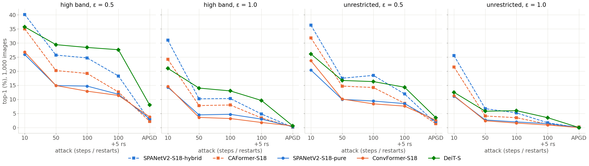
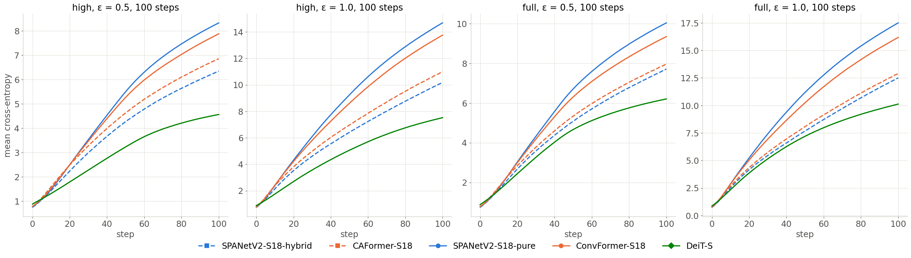
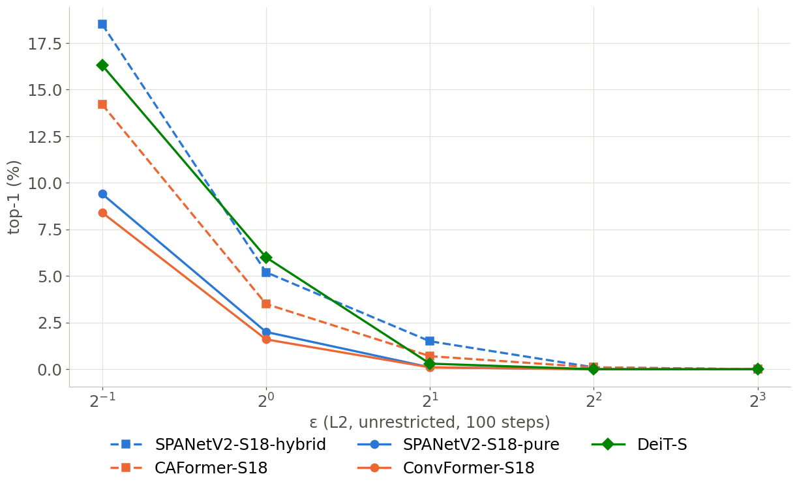
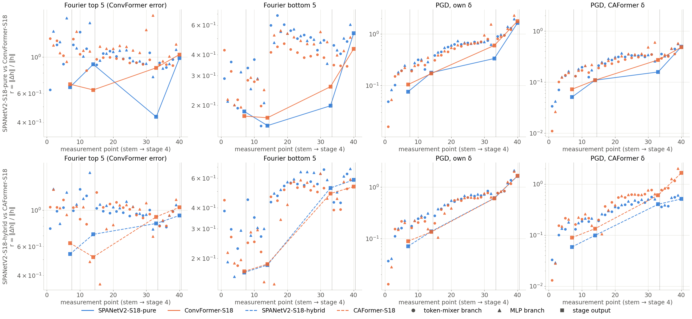
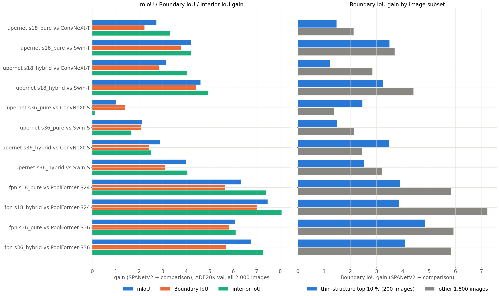

# 주파수 관련 결과의 해석 근거 (freq_interpretation, 추론만)

이 문서는 앞선 분석에서 나온 네 문장의 해석 근거를 모은다.

1. Fourier heat map에서 SPANetV2 두 모델의 평균 오류가 같은 계열(ConvFormer·DFFormer / CAFormer·CDFFormer)보다 낮다 (freq_robustness B).
2. 고역 제한·제한 없는 L2 PGD(ε ≥ 0.5)에서 SPANetV2-S18-hybrid가 9개 모델 중 가장 높고, S18-pure는 ConvFormer-S18과 비슷하다 (freq_robustness C).
3. 경계 지표에서 SPANetV2는 공개 백본보다 모두 높지만, 그 차이는 mIoU / mask AP 차이와 비슷하다 (freq_robustness D).
4. SPAM 설계 의도: 다중 크기 커널 convolution이 주파수 대역을 나눠 맡고, SRF가 부족한 대역을 보정한다.

- **조건:**
  - 학습·미세조정은 하지 않았고, 저장소의 모델 코드는 고치지 않았다.
  - 중간값은 forward hook으로 읽었다. D는 메모리 안에서만 파라미터를 바꿨다. A의 대역 제한 APGD는 autoattack을 고치지 않고 subclass로 만들었다.
  - 가중치와 전처리(crop 비율 포함)는 freq_robustness와 같다. 모든 계산은 fp32이다.
- **표본:**
  - 기준은 freq_robustness의 ImageNet val 5,000장이다(numpy default_rng(0), 클래스마다 5장).
  - 비싼 항목(A, B, D의 Fourier·PGD, E4, E3의 DFFormer 필터)은 그 가운데 1,000장을 썼다.
  - 이 1,000장은 5,000장 목록의 "앞 1,000장"이 아니라 다섯 장마다 한 장(`subset5k()[::5]`)이다. 5,000장 목록은 클래스 순으로 정렬되어 있어서, 앞 1,000장은 클래스 0–199만 담는다. 다섯 장마다 한 장을 고르면 1,000개 클래스에서 한 장씩 들어간다.
  - D의 clean top-1은 val 50,000장 전체로 쟀다.
  - C는 freq_robustness가 저장한 예측을 다시 썼다. ADE20K val 2,000장, COCO val2017 5,000장이다.
- **결정성:**
  - A·B·D는 cuDNN을 결정적 모드로 두었다(benchmark off).
  - 예외는 A의 DeiT-S이다. 결정적 역전파가 50장당 469 ms 대 44 ms로 약 10배 느려서, 기본(비결정적) 커널로 돌렸다.
  - 비결정적 커널에서 같은 공격을 반복했을 때의 차이는 A에 따로 적었다.
- **대역과 사영:** freq_robustness C와 같다. 저역은 M_l^56, 고역은 그 여집합이다. 각 step은 "gradient step → 대역 사영(rfft2/irfft2, ortho) → L2 공 → [0,1] clamp" 순서이다.
- **SRF 주파수 격자:** srf_task_analysis의 Grid(단계마다 224 기준 격자, 켤레 대칭 가중치)를 그대로 썼다.
- **결론의 형식:** 각 결론은 "측정"과 "해석"을 나눴다. 인과 주장은 하지 않는다. 효과 크기는 %p 차이, 비율, 상관계수로 적었다.

## A. PGD 결과의 신뢰성 점검

top-1 (%), 1,000장. 설정 = 변형 | ε | step | 시작(norand = 무작위 시작 없음, rand5 = 무작위 시작 5회 중 최악). apgd = APGD-CE(L2, 100 iter, 무작위 시작 1회; full은 autoattack 원본, high는 normalize만 대역 사영으로 바꾼 subclass).

| 설정 | SPANetV2-S18-hybrid | CAFormer-S18 | SPANetV2-S18-pure | ConvFormer-S18 | DeiT-S |
|---|---|---|---|---|---|
| clean | 84.2 | 83.1 | 83.4 | 83.4 | 80.2 |
| high\|0.25\|apgd | 14.1 | 13.1 | 17.7 | 18.0 | 32.2 |
| high\|0.5\|10\|norand | 40.1 | 35.0 | 25.9 | 26.8 | 35.7 |
| high\|0.5\|50\|norand | 25.7 | 20.2 | 14.9 | 14.9 | 29.4 |
| high\|0.5\|100\|norand | 24.7 | 19.2 | 14.7 | 12.9 | 28.4 |
| high\|0.5\|100\|rand5 | 18.3 | 12.6 | 11.8 | 11.4 | 27.6 |
| high\|0.5\|apgd | 2.4 | 2.2 | 3.1 | 3.8 | 8.0 |
| high\|1.0\|10\|norand | 31.0 | 24.2 | 14.3 | 14.6 | 21.0 |
| high\|1.0\|50\|norand | 10.2 | 7.8 | 4.5 | 3.6 | 14.0 |
| high\|1.0\|100\|norand | 10.3 | 8.0 | 4.7 | 3.2 | 13.0 |
| high\|1.0\|100\|rand5 | 4.8 | 3.4 | 3.0 | 1.8 | 9.6 |
| high\|1.0\|apgd | 0.1 | 0.2 | 0.3 | 0.6 | 0.6 |
| full\|0.25\|apgd | 9.5 | 9.2 | 14.5 | 14.4 | 21.3 |
| full\|0.5\|10\|norand | 36.3 | 31.8 | 20.4 | 23.7 | 26.1 |
| full\|0.5\|50\|norand | 17.5 | 14.7 | 10.0 | 10.1 | 16.7 |
| full\|0.5\|100\|norand | 18.5 | 14.2 | 9.4 | 8.4 | 16.3 |
| full\|0.5\|100\|rand5 | 11.9 | 8.6 | 8.5 | 7.6 | 14.3 |
| full\|0.5\|apgd | 1.5 | 1.4 | 2.2 | 2.6 | 3.5 |
| full\|1.0\|10\|norand | 25.5 | 21.5 | 11.1 | 11.3 | 12.5 |
| full\|1.0\|50\|norand | 6.7 | 4.1 | 2.7 | 2.4 | 5.8 |
| full\|1.0\|100\|norand | 5.2 | 3.5 | 2.0 | 1.6 | 6.0 |
| full\|1.0\|100\|rand5 | 1.7 | 1.2 | 1.4 | 0.9 | 3.5 |
| full\|1.0\|apgd | 0.0 | 0.2 | 0.1 | 0.0 | 0.0 |
| full\|2.0\|100\|norand | 1.5 | 0.7 | 0.1 | 0.1 | 0.3 |
| full\|4.0\|100\|norand | 0.1 | 0.1 | 0.0 | 0.0 | 0.0 |
| full\|8.0\|100\|norand | 0.0 | 0.0 | 0.0 | 0.0 | 0.0 |

같은 10-step 공격(high, ε = 1.0)을 비결정적 GPU 커널로 두 번 더 돌린 top-1. "본 실행"은 위 표의 값이고, 그 실행이 결정적 cuDNN이었는지를 마지막 열에 적었다(DeiT-S는 결정적 역전파가 약 10배 느려 비결정적으로 돌렸다):

| 모델 | 본 실행 | 반복 1 | 반복 2 | 본 실행 결정적 |
|---|---|---|---|---|
| SPANetV2-S18-hybrid | 31.0 | 29.6 | 29.9 | 예 |
| CAFormer-S18 | 24.2 | 24.4 | 24.7 | 예 |
| SPANetV2-S18-pure | 14.3 | 14.3 | 14.3 | 예 |
| ConvFormer-S18 | 14.6 | 14.6 | 14.6 | 예 |
| DeiT-S | 21.0 | 21.0 | 21.0 | 아니오 |

CE 수렴(100 step, 무작위 시작 없음). 평균 CE는 이미 틀린 영상에서도 계속 오르므로(상한 없음), 수렴은 top-1의 50 → 100 step 변화와 마지막 10 step에서 오른 CE가 전체 상승분에서 차지하는 비율로 본다(선형 증가면 0.10):

| 변형 | ε | 모델 | top-1 50 | top-1 100 | 차이 | CE 0 | CE 50 | CE 100 | 마지막 10 step 비율 |
|---|---|---|---|---|---|---|---|---|---|
| high | 0.5 | SPANetV2-S18-hybrid | 25.7 | 24.7 | -1.0 | 0.74 | 4.27 | 6.35 | 0.061 |
| high | 0.5 | CAFormer-S18 | 20.2 | 19.2 | -1.0 | 0.77 | 4.63 | 6.86 | 0.059 |
| high | 0.5 | SPANetV2-S18-pure | 14.9 | 14.7 | -0.2 | 0.77 | 5.50 | 8.33 | 0.054 |
| high | 0.5 | ConvFormer-S18 | 14.9 | 12.9 | -2.0 | 0.78 | 5.27 | 7.88 | 0.056 |
| high | 0.5 | DeiT-S | 29.4 | 28.4 | -1.0 | 0.88 | 3.23 | 4.56 | 0.043 |
| high | 1.0 | SPANetV2-S18-hybrid | 10.2 | 10.3 | +0.1 | 0.74 | 6.41 | 10.18 | 0.074 |
| high | 1.0 | CAFormer-S18 | 7.8 | 8.0 | +0.2 | 0.77 | 6.96 | 11.00 | 0.073 |
| high | 1.0 | SPANetV2-S18-pure | 4.5 | 4.7 | +0.2 | 0.77 | 9.24 | 14.68 | 0.062 |
| high | 1.0 | ConvFormer-S18 | 3.6 | 3.2 | -0.4 | 0.78 | 8.61 | 13.75 | 0.064 |
| high | 1.0 | DeiT-S | 14.0 | 13.0 | -1.0 | 0.88 | 5.06 | 7.52 | 0.054 |
| full | 0.5 | SPANetV2-S18-hybrid | 17.5 | 18.5 | +1.0 | 0.74 | 5.09 | 7.72 | 0.066 |
| full | 0.5 | CAFormer-S18 | 14.7 | 14.2 | -0.5 | 0.77 | 5.35 | 7.97 | 0.061 |
| full | 0.5 | SPANetV2-S18-pure | 10.0 | 9.4 | -0.6 | 0.77 | 6.72 | 10.04 | 0.054 |
| full | 0.5 | ConvFormer-S18 | 10.1 | 8.4 | -1.7 | 0.78 | 6.31 | 9.35 | 0.057 |
| full | 0.5 | DeiT-S | 16.7 | 16.3 | -0.4 | 0.88 | 4.67 | 6.21 | 0.039 |
| full | 1.0 | SPANetV2-S18-hybrid | 6.7 | 5.2 | -1.5 | 0.74 | 7.67 | 12.50 | 0.076 |
| full | 1.0 | CAFormer-S18 | 4.1 | 3.5 | -0.6 | 0.77 | 8.08 | 12.90 | 0.071 |
| full | 1.0 | SPANetV2-S18-pure | 2.7 | 2.0 | -0.7 | 0.77 | 11.19 | 17.50 | 0.060 |
| full | 1.0 | ConvFormer-S18 | 2.4 | 1.6 | -0.8 | 0.78 | 10.25 | 16.18 | 0.063 |
| full | 1.0 | DeiT-S | 5.8 | 6.0 | +0.2 | 0.88 | 7.20 | 10.13 | 0.048 |

같은 1,000장에서의 짝 차이(top-1 차이, 영상 단위 bootstrap 5,000회 95% 구간, 한쪽만 맞힌 영상 수):

| 짝 | 설정 | 차이 | 95% 구간 | 앞 모델만 맞힘 | 뒤 모델만 맞힘 |
|---|---|---|---|---|---|
| SPANetV2-S18-hybrid − CAFormer-S18 | high\|0.25\|apgd | +1.0 | [-0.7, +2.8] | 45 | 35 |
| SPANetV2-S18-hybrid − CAFormer-S18 | high\|0.5\|10\|norand | +5.1 | [+2.7, +7.5] | 102 | 51 |
| SPANetV2-S18-hybrid − CAFormer-S18 | high\|0.5\|50\|norand | +5.5 | [+2.9, +8.1] | 123 | 68 |
| SPANetV2-S18-hybrid − CAFormer-S18 | high\|0.5\|100\|norand | +5.5 | [+2.9, +8.2] | 122 | 67 |
| SPANetV2-S18-hybrid − CAFormer-S18 | high\|0.5\|100\|rand5 | +5.7 | [+3.4, +8.1] | 101 | 44 |
| SPANetV2-S18-hybrid − CAFormer-S18 | high\|0.5\|apgd | +0.2 | [-0.8, +1.2] | 15 | 13 |
| SPANetV2-S18-hybrid − CAFormer-S18 | high\|1.0\|10\|norand | +6.8 | [+4.2, +9.5] | 123 | 55 |
| SPANetV2-S18-hybrid − CAFormer-S18 | high\|1.0\|50\|norand | +2.4 | [+0.5, +4.3] | 60 | 36 |
| SPANetV2-S18-hybrid − CAFormer-S18 | high\|1.0\|100\|norand | +2.3 | [+0.2, +4.3] | 64 | 41 |
| SPANetV2-S18-hybrid − CAFormer-S18 | high\|1.0\|100\|rand5 | +1.4 | [+0.3, +2.5] | 24 | 10 |
| SPANetV2-S18-hybrid − CAFormer-S18 | high\|1.0\|apgd | -0.1 | [-0.5, +0.2] | 1 | 2 |
| SPANetV2-S18-hybrid − CAFormer-S18 | full\|0.25\|apgd | +0.3 | [-1.4, +1.9] | 36 | 33 |
| SPANetV2-S18-hybrid − CAFormer-S18 | full\|0.5\|10\|norand | +4.5 | [+1.8, +7.3] | 114 | 69 |
| SPANetV2-S18-hybrid − CAFormer-S18 | full\|0.5\|50\|norand | +2.8 | [+0.5, +5.2] | 87 | 59 |
| SPANetV2-S18-hybrid − CAFormer-S18 | full\|0.5\|100\|norand | +4.3 | [+1.7, +6.8] | 106 | 63 |
| SPANetV2-S18-hybrid − CAFormer-S18 | full\|0.5\|100\|rand5 | +3.3 | [+1.4, +5.1] | 62 | 29 |
| SPANetV2-S18-hybrid − CAFormer-S18 | full\|1.0\|10\|norand | +4.0 | [+1.5, +6.6] | 105 | 65 |
| SPANetV2-S18-hybrid − CAFormer-S18 | full\|1.0\|50\|norand | +2.6 | [+1.0, +4.2] | 44 | 18 |
| SPANetV2-S18-hybrid − CAFormer-S18 | full\|1.0\|100\|norand | +1.7 | [+0.3, +3.1] | 36 | 19 |
| SPANetV2-S18-hybrid − CAFormer-S18 | full\|1.0\|100\|rand5 | +0.5 | [-0.3, +1.4] | 12 | 7 |
| SPANetV2-S18-pure − ConvFormer-S18 | high\|0.25\|apgd | -0.3 | [-2.4, +1.8] | 55 | 58 |
| SPANetV2-S18-pure − ConvFormer-S18 | high\|0.5\|10\|norand | -0.9 | [-3.3, +1.5] | 70 | 79 |
| SPANetV2-S18-pure − ConvFormer-S18 | high\|0.5\|50\|norand | +0.0 | [-1.9, +2.0] | 50 | 50 |
| SPANetV2-S18-pure − ConvFormer-S18 | high\|0.5\|100\|norand | +1.8 | [-0.2, +3.8] | 60 | 42 |
| SPANetV2-S18-pure − ConvFormer-S18 | high\|0.5\|100\|rand5 | +0.4 | [-1.5, +2.2] | 48 | 44 |
| SPANetV2-S18-pure − ConvFormer-S18 | high\|0.5\|apgd | -0.7 | [-1.8, +0.4] | 13 | 20 |
| SPANetV2-S18-pure − ConvFormer-S18 | high\|1.0\|10\|norand | -0.3 | [-2.4, +1.7] | 56 | 59 |
| SPANetV2-S18-pure − ConvFormer-S18 | high\|1.0\|50\|norand | +0.9 | [-0.4, +2.3] | 29 | 20 |
| SPANetV2-S18-pure − ConvFormer-S18 | high\|1.0\|100\|norand | +1.5 | [+0.1, +2.9] | 34 | 19 |
| SPANetV2-S18-pure − ConvFormer-S18 | high\|1.0\|100\|rand5 | +1.2 | [+0.2, +2.2] | 20 | 8 |
| SPANetV2-S18-pure − ConvFormer-S18 | high\|1.0\|apgd | -0.3 | [-0.9, +0.2] | 2 | 5 |
| SPANetV2-S18-pure − ConvFormer-S18 | full\|0.25\|apgd | +0.1 | [-1.9, +2.1] | 54 | 53 |
| SPANetV2-S18-pure − ConvFormer-S18 | full\|0.5\|10\|norand | -3.3 | [-5.6, -0.9] | 59 | 92 |
| SPANetV2-S18-pure − ConvFormer-S18 | full\|0.5\|50\|norand | -0.1 | [-2.1, +1.8] | 47 | 48 |
| SPANetV2-S18-pure − ConvFormer-S18 | full\|0.5\|100\|norand | +1.0 | [-0.9, +2.9] | 53 | 43 |
| SPANetV2-S18-pure − ConvFormer-S18 | full\|0.5\|100\|rand5 | +0.9 | [-0.7, +2.5] | 39 | 30 |
| SPANetV2-S18-pure − ConvFormer-S18 | full\|1.0\|10\|norand | -0.2 | [-2.1, +1.6] | 43 | 45 |
| SPANetV2-S18-pure − ConvFormer-S18 | full\|1.0\|50\|norand | +0.3 | [-0.8, +1.5] | 19 | 16 |
| SPANetV2-S18-pure − ConvFormer-S18 | full\|1.0\|100\|norand | +0.4 | [-0.5, +1.3] | 13 | 9 |
| SPANetV2-S18-pure − ConvFormer-S18 | full\|1.0\|100\|rand5 | +0.5 | [-0.2, +1.2] | 9 | 4 |
| SPANetV2-S18-hybrid − DeiT-S | high\|0.25\|apgd | -18.1 | [-20.9, -15.4] | 25 | 206 |
| SPANetV2-S18-hybrid − DeiT-S | high\|0.5\|10\|norand | +4.4 | [+1.9, +6.9] | 107 | 63 |
| SPANetV2-S18-hybrid − DeiT-S | high\|0.5\|50\|norand | -3.7 | [-6.5, -1.0] | 79 | 116 |
| SPANetV2-S18-hybrid − DeiT-S | high\|0.5\|100\|norand | -3.7 | [-6.6, -0.9] | 84 | 121 |
| SPANetV2-S18-hybrid − DeiT-S | high\|0.5\|100\|rand5 | -9.3 | [-12.1, -6.5] | 58 | 151 |
| SPANetV2-S18-hybrid − DeiT-S | high\|0.5\|apgd | -5.6 | [-7.3, -4.0] | 9 | 65 |
| SPANetV2-S18-hybrid − DeiT-S | high\|1.0\|10\|norand | +10.0 | [+7.4, +12.7] | 143 | 43 |
| SPANetV2-S18-hybrid − DeiT-S | high\|1.0\|50\|norand | -3.8 | [-6.1, -1.5] | 50 | 88 |
| SPANetV2-S18-hybrid − DeiT-S | high\|1.0\|100\|norand | -2.7 | [-4.9, -0.4] | 53 | 80 |
| SPANetV2-S18-hybrid − DeiT-S | high\|1.0\|100\|rand5 | -4.8 | [-6.7, -3.0] | 21 | 69 |
| SPANetV2-S18-hybrid − DeiT-S | high\|1.0\|apgd | -0.5 | [-1.0, +0.0] | 1 | 6 |
| SPANetV2-S18-hybrid − DeiT-S | full\|0.25\|apgd | -11.8 | [-14.3, -9.4] | 27 | 145 |
| SPANetV2-S18-hybrid − DeiT-S | full\|0.5\|10\|norand | +10.2 | [+7.5, +13.0] | 151 | 49 |
| SPANetV2-S18-hybrid − DeiT-S | full\|0.5\|50\|norand | +0.8 | [-1.8, +3.4] | 91 | 83 |
| SPANetV2-S18-hybrid − DeiT-S | full\|0.5\|100\|norand | +2.2 | [-0.5, +4.8] | 99 | 77 |
| SPANetV2-S18-hybrid − DeiT-S | full\|0.5\|100\|rand5 | -2.4 | [-4.8, -0.1] | 57 | 81 |
| SPANetV2-S18-hybrid − DeiT-S | full\|1.0\|10\|norand | +13.0 | [+10.4, +15.6] | 164 | 34 |
| SPANetV2-S18-hybrid − DeiT-S | full\|1.0\|50\|norand | +0.9 | [-0.7, +2.5] | 40 | 31 |
| SPANetV2-S18-hybrid − DeiT-S | full\|1.0\|100\|norand | -0.8 | [-2.5, +0.9] | 34 | 42 |
| SPANetV2-S18-hybrid − DeiT-S | full\|1.0\|100\|rand5 | -1.8 | [-3.0, -0.6] | 9 | 27 |

전이 공격(ε = 1.0, 100 step, 무작위 시작 없음): 원천 모델에서 만든 δ를 대상 모델에 넣은 top-1과, 대상 모델 자신의 백색 공격 top-1:

| 원천 | 대상 | 변형 | 전이 top-1 | 대상의 백색 top-1 |
|---|---|---|---|---|
| CAFormer-S18 | SPANetV2-S18-hybrid | high | 74.0 | 10.3 |
| CAFormer-S18 | SPANetV2-S18-hybrid | full | 70.8 | 5.2 |
| SPANetV2-S18-hybrid | CAFormer-S18 | high | 70.9 | 8.0 |
| SPANetV2-S18-hybrid | CAFormer-S18 | full | 70.1 | 3.5 |
| ConvFormer-S18 | SPANetV2-S18-pure | high | 68.7 | 4.7 |
| ConvFormer-S18 | SPANetV2-S18-pure | full | 65.0 | 2.0 |
| SPANetV2-S18-pure | ConvFormer-S18 | high | 68.2 | 3.2 |
| SPANetV2-S18-pure | ConvFormer-S18 | full | 65.2 | 1.6 |







### 결론 (A)

**측정.**

- **공격 강도:**
  - 다섯 모델 모두 step과 무작위 시작을 늘리면 top-1이 내려간다. APGD는 모든 설정에서 가장 낮다.
  - freq_robustness C의 공격(10 step)에서 APGD로 바꾸면, 고역 ε = 0.5에서 hybrid 40.1 → 2.4%, CAFormer 35.0 → 2.2%, pure 25.9 → 3.1%, ConvFormer 26.8 → 3.8%, DeiT-S 35.7 → 8.0%이다.
  - 하락폭은 hybrid 37.7, CAFormer 32.8, DeiT-S 27.7, ConvFormer 23.0, pure 22.8%p이다. 제한 없는 ε = 0.5에서는 각각 34.8, 30.4, 22.6, 21.1, 18.2%p이다.
  - ε = 1.0의 APGD에서는 다섯 모델 모두 0.6% 이하이다.
- **hybrid − CAFormer:**
  - PGD 16개 설정에서 +0.5…+6.8%p이다. 영상 단위 bootstrap 95% 구간은 15개 설정에서 0을 포함하지 않는다.
  - APGD 6개 설정에서는 −0.2…+1.0%p이다. 영상별 결과가 있는 4개 설정의 구간은 모두 0을 포함한다. 예: 고역 ε = 0.5는 +0.2 [−0.8, +1.2], ε = 0.25는 +1.0 [−0.7, +2.8]이다.
- **pure − ConvFormer:**
  - PGD에서 −3.3…+1.8%p이다. 13개 설정에서 구간이 0을 포함한다.
  - APGD에서는 −0.7…+0.1%p이다. 영상별 결과가 있는 4개 설정의 구간은 모두 0을 포함한다.
- **hybrid − DeiT-S:**
  - 10 step에서는 +4.4…+13.0%p로 hybrid가 높다(freq_robustness C와 같은 방향).
  - 고역 ε = 0.5에서는 50 step부터 −3.7%p, 무작위 시작 5회에서 −9.3%p, APGD에서 −5.6%p로 DeiT-S가 높다.
  - 제한 없는 공격에서도 무작위 시작 5회는 −2.4%p(ε = 0.5), −1.8%p(ε = 1.0)이다.
- **바닥에서 떨어진 ε = 0.25의 APGD:**
  - 고역은 DeiT-S 32.2 > ConvFormer 18.0 ≈ pure 17.7 > hybrid 14.1 ≈ CAFormer 13.1%이다.
  - 제한 없음은 DeiT-S 21.3 > pure 14.5 ≈ ConvFormer 14.4 > hybrid 9.5 ≈ CAFormer 9.2%이다.
- **CE 수렴:**
  - 100 step 공격에서 top-1의 50 → 100 step 변화는 −2.0…+1.0%p이다.
  - 마지막 10 step에서 오른 CE는 전체 상승분의 0.039–0.076이다(선형이면 0.10). CE 상승이 느려지는 중이지만 멈추지는 않았다.
  - 같은 step에서 hybrid·CAFormer의 평균 CE는 pure·ConvFormer보다 낮다. 예: 고역 ε = 0.5, 100 step에서 6.35·6.86 대 8.33·7.88이다.
- **gradient masking 점검:**
  - ε를 키우면 모두 0으로 간다. ε = 4에서 0.1% 이하, ε = 8에서 0%이다.
  - 전이 공격 top-1(65.0–74.0%)은 대상 모델의 백색 공격 top-1(1.6–10.3%)보다 훨씬 높다.
  - step·무작위 시작·APGD로 공격을 강화하면 정확도가 내려간다.
  - APGD δ의 L2 노름은 ε과 같다. 대역 제한 APGD δ에서 대역 밖 에너지 비율은 0.008% 이하이다.
- **비결정성:**
  - 같은 10-step 공격을 비결정적 커널로 반복하면 hybrid가 31.0 → 29.6, 29.9%이다(최대 1.4%p).
  - CAFormer는 +0.5%p 이하이다. pure·ConvFormer·DeiT-S는 차이가 없다.

**해석.**

- **masking 신호:** 흔히 쓰는 gradient masking 신호(ε를 키워도 남는 정확도, 백색보다 강한 전이 공격, 강화해도 안 내려가는 정확도)는 보이지 않는다.
- **freq_robustness C 공격의 한계:**
  - freq_robustness C의 10-step 고정 step PGD는 최악의 경우에서 멀다.
  - 그 거리가 모델마다 다르다. attention이 있는 hybrid와 CAFormer에서 가장 크다.
  - 그래서 C에서 hybrid가 가장 높게 나온 것은 대부분 "이 약한 공격으로 깨기 어려운 정도"를 잰 것이다. ε-공 안의 최악 정확도를 잰 것으로 보기 어렵다.
  - 왜 hybrid·CAFormer에서 고정 step PGD의 CE가 더 느리게 오르는지는 이 측정으로 구별하지 못한다.
- **가장 강한 공격(APGD)에서:**
  - hybrid와 CAFormer는 구별되지 않는다(|차이| ≤ 1.0%p).
  - ε = 0.25에서는 두 모델이 pure·ConvFormer보다 3.6–5.2%p 낮다.
  - 다섯 모델 중 DeiT-S가 가장 높다.
- **문장 (2)에 대해:**
  - "S18-hybrid가 가장 높다"는 10-step PGD 결과로서만 재현된다. 공격을 강화하면 약화된다. DeiT-S가 hybrid보다 높아지고, CAFormer와의 차이는 사라진다.
  - "S18-pure가 ConvFormer-S18과 비슷하다"는 모든 공격에서 지지된다(PGD |차이| ≤ 3.3%p, APGD ≤ 0.7%p).
  - A는 9개 모델 중 5개만 다뤘다. DFFormer, CDFFormer, ConvNeXt-T, Swin-T는 강한 공격으로 다시 재지 않았다.

## E. SPAM 설계 의도의 검증

### E1. 커널이 대역을 나누는가

블록·채널 번호마다 네 head(k = 3, 5, 7, 9)의 |K̂|² 무게중심 ρ̄를 구해, 커널 크기 순서(k3 > k5 > k7 > k9)와 맞는지 셌다. "네 개 모두 순서" 확률은 무작위면 1/24 = 0.042, "쌍별 순서"는 0.5다.

| 모델 | 단계 | 네 개 모두 순서 | 쌍별 순서 | ρ̄ k3 | ρ̄ k5 | ρ̄ k7 | ρ̄ k9 | 고역 비중 k3 | k5 | k7 | k9 |
|---|---|---|---|---|---|---|---|---|---|---|---|
| SPANetV2-S18-hybrid | 1 | 0.208 | 0.653 | 0.765 | 0.703 | 0.689 | 0.627 | 0.785 | 0.748 | 0.719 | 0.623 |
| SPANetV2-S18-hybrid | 2 | 0.083 | 0.589 | 0.680 | 0.629 | 0.605 | 0.598 | 0.705 | 0.653 | 0.613 | 0.625 |
| SPANetV2-S18-pure | 1 | 0.104 | 0.642 | 0.769 | 0.703 | 0.665 | 0.605 | 0.791 | 0.729 | 0.667 | 0.604 |
| SPANetV2-S18-pure | 2 | 0.062 | 0.655 | 0.738 | 0.668 | 0.588 | 0.583 | 0.779 | 0.690 | 0.581 | 0.597 |
| SPANetV2-S18-pure | 3 | 0.150 | 0.676 | 0.660 | 0.565 | 0.541 | 0.510 | 0.668 | 0.550 | 0.498 | 0.466 |
| SPANetV2-S18-pure | 4 | 0.117 | 0.618 | 0.623 | 0.568 | 0.546 | 0.510 | 0.621 | 0.554 | 0.511 | 0.513 |
| SPANetV2-S36-hybrid | 1 | 0.083 | 0.594 | 0.702 | 0.710 | 0.685 | 0.629 | 0.701 | 0.736 | 0.698 | 0.638 |
| SPANetV2-S36-hybrid | 2 | 0.115 | 0.667 | 0.715 | 0.621 | 0.595 | 0.571 | 0.744 | 0.637 | 0.597 | 0.570 |
| SPANetV2-S36-pure | 1 | 0.104 | 0.590 | 0.715 | 0.692 | 0.647 | 0.635 | 0.726 | 0.710 | 0.648 | 0.640 |
| SPANetV2-S36-pure | 2 | 0.125 | 0.665 | 0.723 | 0.623 | 0.607 | 0.578 | 0.755 | 0.639 | 0.613 | 0.578 |
| SPANetV2-S36-pure | 3 | 0.145 | 0.669 | 0.636 | 0.542 | 0.522 | 0.496 | 0.627 | 0.524 | 0.471 | 0.445 |
| SPANetV2-S36-pure | 4 | 0.094 | 0.581 | 0.604 | 0.556 | 0.534 | 0.525 | 0.590 | 0.539 | 0.500 | 0.556 |

### E2. SRF가 부족한 대역을 보정하는가 (파라미터)

채널마다 2D 격자의 서로 다른 주파수 전체(DC 제외)에서 Spearman 상관을 구해 평균했다. (a)는 log ψ_h 대 −log|K̂_h|이고, (b)는 log ψ_h 대 −log(|K̃_h| / head 평균 |K̃|)이다. 대조군은 다른 head 커널과 짝지은 상관(3개 평균)과 채널 순서를 섞어 짝지은 상관이다.

| 모델 | 단계 | (a) 평균 | (a) >0 비율 | (a) 다른 head | (a) 섞은 채널 | (a) 자기>다른 head | (a) 자기>섞은 | (b) 평균 | (b) >0 비율 | (b) 다른 head | (b) 섞은 채널 | (b) 자기>다른 head | (b) 자기>섞은 |
|---|---|---|---|---|---|---|---|---|---|---|---|---|---|
| SPANetV2-S18-hybrid | 1 | +0.025 | 0.53 | +0.007 | +0.010 | 0.53 | 0.44 | +0.001 | 0.46 | -0.018 | +0.001 | 0.53 | 0.43 |
| SPANetV2-S18-hybrid | 2 | -0.011 | 0.48 | +0.034 | +0.041 | 0.45 | 0.42 | -0.049 | 0.39 | +0.008 | +0.018 | 0.43 | 0.37 |
| SPANetV2-S18-pure | 1 | +0.022 | 0.55 | +0.001 | +0.029 | 0.53 | 0.44 | -0.009 | 0.49 | -0.017 | +0.011 | 0.51 | 0.38 |
| SPANetV2-S18-pure | 2 | -0.061 | 0.42 | +0.016 | +0.023 | 0.42 | 0.37 | -0.083 | 0.37 | +0.006 | -0.010 | 0.42 | 0.39 |
| SPANetV2-S18-pure | 3 | +0.051 | 0.60 | +0.098 | +0.113 | 0.45 | 0.41 | -0.048 | 0.42 | +0.012 | +0.025 | 0.45 | 0.42 |
| SPANetV2-S18-pure | 4 | +0.081 | 0.60 | +0.104 | +0.140 | 0.50 | 0.44 | -0.018 | 0.50 | +0.005 | +0.044 | 0.51 | 0.46 |
| SPANetV2-S36-hybrid | 1 | +0.015 | 0.49 | +0.014 | +0.003 | 0.47 | 0.46 | -0.014 | 0.42 | -0.010 | -0.006 | 0.46 | 0.42 |
| SPANetV2-S36-hybrid | 2 | -0.070 | 0.31 | +0.033 | +0.040 | 0.28 | 0.26 | -0.097 | 0.23 | +0.022 | +0.003 | 0.29 | 0.26 |
| SPANetV2-S36-pure | 1 | +0.023 | 0.57 | +0.022 | +0.014 | 0.51 | 0.46 | -0.013 | 0.46 | -0.012 | -0.009 | 0.50 | 0.48 |
| SPANetV2-S36-pure | 2 | -0.069 | 0.36 | +0.029 | +0.051 | 0.35 | 0.28 | -0.099 | 0.30 | +0.020 | +0.007 | 0.34 | 0.31 |
| SPANetV2-S36-pure | 3 | +0.037 | 0.58 | +0.118 | +0.121 | 0.39 | 0.37 | -0.078 | 0.37 | +0.022 | +0.010 | 0.40 | 0.38 |
| SPANetV2-S36-pure | 4 | +0.087 | 0.60 | +0.143 | +0.172 | 0.45 | 0.39 | -0.060 | 0.44 | +0.021 | +0.050 | 0.44 | 0.39 |

커널 크기별 평균 상관 (a) / (b):

| 모델 | 단계 | k3 | k5 | k7 | k9 |
|---|---|---|---|---|---|
| SPANetV2-S18-hybrid | 1 | +0.070 / +0.047 | +0.020 / -0.023 | +0.018 / +0.003 | -0.009 / -0.023 |
| SPANetV2-S18-hybrid | 2 | -0.006 / -0.021 | -0.034 / -0.067 | +0.012 / -0.031 | -0.017 / -0.075 |
| SPANetV2-S18-pure | 1 | +0.084 / +0.032 | +0.023 / -0.010 | -0.049 / -0.065 | +0.031 / +0.006 |
| SPANetV2-S18-pure | 2 | -0.012 / -0.005 | -0.116 / -0.145 | -0.044 / -0.076 | -0.072 / -0.106 |
| SPANetV2-S18-pure | 3 | +0.091 / +0.048 | +0.029 / -0.081 | +0.018 / -0.095 | +0.068 / -0.064 |
| SPANetV2-S18-pure | 4 | +0.092 / +0.091 | +0.031 / -0.126 | -0.007 / -0.177 | +0.209 / +0.142 |
| SPANetV2-S36-hybrid | 1 | +0.024 / -0.004 | +0.024 / -0.003 | +0.001 / -0.025 | +0.008 / -0.026 |
| SPANetV2-S36-hybrid | 2 | -0.076 / -0.085 | -0.084 / -0.106 | -0.064 / -0.099 | -0.054 / -0.100 |
| SPANetV2-S36-pure | 1 | +0.109 / +0.068 | +0.023 / -0.032 | -0.021 / -0.038 | -0.018 / -0.051 |
| SPANetV2-S36-pure | 2 | -0.040 / -0.051 | -0.078 / -0.111 | -0.096 / -0.127 | -0.064 / -0.106 |
| SPANetV2-S36-pure | 3 | +0.051 / -0.003 | +0.017 / -0.103 | +0.011 / -0.122 | +0.068 / -0.086 |
| SPANetV2-S36-pure | 4 | +0.099 / +0.029 | +0.017 / -0.163 | +0.044 / -0.163 | +0.188 / +0.057 |

### E3. 보정이 mixer 전체 응답을 고르게 하는가

채널 번호 c마다 네 head를 합친 Σ_h|K̂_h|(커널만)와 Σ_h ψ_h|K̂_h|(SRF 후)의 대역(저·중·고, DC 제외) 평균 사이 변동계수(CV, 작을수록 평탄)와 고/저 비다. ConvFormer-S18은 같은 단계 7×7 depthwise 커널의 |K̂|이고, DFFormer-S18은 1,000장 평균 예측 필터 |W|이다(채널마다 계산해 평균). 4단계(7×7)는 저역 칸이 없어 CV는 중·고역 둘로 계산했다.

| 모델 | 단계 | CV 커널만 | CV SRF 후 | 차이 | CV가 줄어든 채널 비율 | 고/저 커널만 | 고/저 SRF 후 | CV ConvFormer | CV DFFormer |
|---|---|---|---|---|---|---|---|---|---|
| SPANetV2-S18-pure | 1 | 0.211 | 0.201 | -0.010 | 0.73 | 0.806 | 0.854 | 0.459 | 0.457 |
| SPANetV2-S18-pure | 2 | 0.305 | 0.292 | -0.013 | 0.69 | 0.793 | 0.846 | 0.438 | 0.395 |
| SPANetV2-S18-pure | 3 | 0.362 | 0.343 | -0.019 | 0.73 | 0.492 | 0.521 | 0.526 | 0.315 |
| SPANetV2-S18-pure | 4 | 0.369 | 0.363 | -0.006 | 0.64 | nan | nan | 0.462 | 0.288 |
| SPANetV2-S18-hybrid | 1 | 0.220 | 0.218 | -0.002 | 0.52 | 0.977 | 1.009 | 0.459 | 0.457 |
| SPANetV2-S18-hybrid | 2 | 0.270 | 0.261 | -0.010 | 0.77 | 0.695 | 0.714 | 0.438 | 0.395 |
| SPANetV2-S36-pure | 1 | 0.245 | 0.236 | -0.010 | 0.79 | 0.747 | 0.785 | 0.459 | 0.457 |
| SPANetV2-S36-pure | 2 | 0.286 | 0.275 | -0.011 | 0.71 | 0.737 | 0.782 | 0.438 | 0.395 |
| SPANetV2-S36-pure | 3 | 0.399 | 0.381 | -0.018 | 0.71 | 0.462 | 0.495 | 0.526 | 0.315 |
| SPANetV2-S36-pure | 4 | 0.373 | 0.367 | -0.006 | 0.67 | nan | nan | 0.462 | 0.288 |
| SPANetV2-S36-hybrid | 1 | 0.236 | 0.228 | -0.008 | 0.79 | 0.777 | 0.806 | 0.459 | 0.457 |
| SPANetV2-S36-hybrid | 2 | 0.296 | 0.286 | -0.009 | 0.78 | 0.662 | 0.677 | 0.438 | 0.395 |

head 사이 무게중심 ρ̄의 범위(max − min)는 커널만일 때와 SRF 후로 비교했다(넓어진 채널 비율):

| 모델 | 단계 | 범위 커널만 | 범위 SRF 후 | 넓어진 비율 |
|---|---|---|---|---|
| SPANetV2-S18-hybrid | 1 | 0.331 | 0.328 | 0.40 |
| SPANetV2-S18-hybrid | 2 | 0.307 | 0.308 | 0.51 |
| SPANetV2-S18-pure | 1 | 0.372 | 0.366 | 0.42 |
| SPANetV2-S18-pure | 2 | 0.345 | 0.335 | 0.39 |
| SPANetV2-S18-pure | 3 | 0.285 | 0.287 | 0.52 |
| SPANetV2-S18-pure | 4 | 0.241 | 0.255 | 0.60 |
| SPANetV2-S36-hybrid | 1 | 0.342 | 0.337 | 0.29 |
| SPANetV2-S36-hybrid | 2 | 0.300 | 0.297 | 0.46 |
| SPANetV2-S36-pure | 1 | 0.327 | 0.323 | 0.40 |
| SPANetV2-S36-pure | 2 | 0.308 | 0.304 | 0.43 |
| SPANetV2-S36-pure | 3 | 0.270 | 0.274 | 0.55 |
| SPANetV2-S36-pure | 4 | 0.210 | 0.223 | 0.64 |

### E4. 실제 영상에서 (IN1K val 1,000장, S18 두 모델)

head마다 x2(convolution 후)와 x3(SRF 후)의 채널 평균 power P2, P3로 이득 log(P3/P2)를 만들었다. 이것을 (a) −log P2, (b) −log(P2_h / head 평균)과 주파수마다 상관시켰다(영상·블록·head마다 Spearman, 평균). 대조군은 같은 conv 출력에 다른 head의 ψ를 적용했을 때의 이득과의 상관이다. "약한 대역 비중 증가"는 x2에서 가장 약한 대역((a) 비중 최소, (b) head 평균 대비 최소)의 비중이 x3에서 늘어난 (영상·블록·head) 비율이다.

| 모델 | 단계 | (a) 상관 | (a) >0 영상 비율 | (a) 다른 head ψ | (a) 자기>다른 | (b) 상관 | (b) >0 영상 비율 | (b) 다른 head ψ | (b) 자기>다른 | 약한 대역 비중↑ (a) | 약한 대역 비중↑ (b) |
|---|---|---|---|---|---|---|---|---|---|---|---|
| SPANetV2-S18-hybrid | 1 | +0.164 | 0.98 | +0.112 | 0.67 | +0.031 | 0.69 | -0.013 | 0.66 | 0.45 | 0.55 |
| SPANetV2-S18-hybrid | 2 | +0.328 | 0.91 | +0.249 | 0.64 | +0.052 | 0.63 | -0.029 | 0.69 | 0.41 | 0.77 |
| SPANetV2-S18-pure | 1 | +0.225 | 0.95 | +0.145 | 0.64 | +0.123 | 0.74 | -0.020 | 0.85 | 0.51 | 0.62 |
| SPANetV2-S18-pure | 2 | +0.336 | 0.80 | +0.284 | 0.65 | +0.123 | 0.78 | -0.024 | 0.75 | 0.50 | 0.87 |
| SPANetV2-S18-pure | 3 | +0.651 | 1.00 | +0.490 | 0.74 | +0.206 | 0.69 | +0.001 | 0.85 | 0.84 | 0.86 |
| SPANetV2-S18-pure | 4 | +0.694 | 1.00 | +0.449 | 0.81 | +0.201 | 0.69 | -0.032 | 0.78 | 0.64 | 0.55 |

### 결론 (E)

**측정.**

- **E1. 커널과 대역:**
  - 네 head의 |K̂|² 무게중심은 평균적으로 커널이 클수록 낮다. 예를 들어 S18-pure 1단계는 k3 0.769 > k5 0.703 > k7 0.665 > k9 0.605이다. 12개 (모델, 단계) 조합 모두에서 k3의 평균이 k9보다 높다.
  - 같은 블록·채널 번호 단위로 보면 순서는 약하다. 쌍별 순서 비율은 0.58–0.68(무작위 0.5)이다. 네 개가 모두 순서대로인 비율은 0.06–0.21(무작위 0.042)이다.
- **E2. 파라미터 수준의 보정:**
  - ψ_h와 자기 커널의 "약함" 사이 채널 평균 Spearman 상관은 절대 기준 (a)에서 −0.070…+0.087, head 상대 기준 (b)에서 −0.099…+0.001이다.
  - 다른 head 커널과 짝지은 대조군과 채널을 섞은 대조군도 같은 크기다. (a)에서 대조군은 +0.001…+0.172이다.
  - 자기 짝이 다른 head 짝보다 큰 채널 비율은 0.28–0.53이다.
- **E3. 합친 응답의 평탄도:**
  - 네 head를 합친 응답의 대역 간 CV는 SRF를 곱한 뒤 0.002–0.019 줄었다(상대 0.9–5.2%). CV가 줄어든 채널은 52–79%이다.
  - 고/저 비는 SRF 뒤 조금 커졌다(예: S18-pure 1단계 0.806 → 0.854).
  - head 사이 무게중심 범위는 −0.010…+0.014만큼 바뀌었다. 범위가 넓어진 채널은 29–64%이다.
  - 커널만 합친 SPANetV2의 CV는 1–2단계에서 0.21–0.31이다. ConvFormer-S18의 7×7 커널은 0.44–0.46, DFFormer-S18의 필터는 0.40–0.46이다.
  - 3–4단계에서 SPANetV2는 0.36–0.40으로 ConvFormer(0.46–0.53)보다 낮지만 DFFormer(0.29–0.32)보다 높다.
- **E4. 실제 활성(1,000장, S18):**
  - 자기 head의 ψ가 준 이득 log(P3/P2)는 −log P2와 양의 상관이다((a) +0.16…+0.69). 다른 head의 ψ를 같은 conv 출력에 적용해도 +0.11…+0.49가 나온다. 자기 ψ의 상관이 더 큰 경우는 64–81%이다.
  - head 상대 기준 (b)에서 자기 ψ는 +0.03…+0.21, 다른 head ψ는 −0.03…+0.00이다. 자기 ψ가 더 큰 경우는 66–85%이다.
  - conv 출력에서 가장 약한 대역의 비중이 SRF 뒤에 늘어난 비율은 (a) 0.41–0.84, (b) 0.55–0.87이다. (a)에서 S18-hybrid 1–2단계는 0.45, 0.41로 절반보다 낮다.

**해석.**

- **E1:**
  - 평균 수준에서는 "큰 커널일수록 낮은 대역" 순서가 있다.
  - i.i.d. 가중치로 초기화한 커널의 |K̂|²는 기대값이 주파수와 무관하게 평탄하다. 그래서 이 순서는 크기와 무관한 구조만으로 생긴 것이 아니라 학습된 가중치의 성질로 보인다.
  - 다만 같은 채널 번호에서 네 head가 대역을 깔끔하게 나누는 경우는 드물다(6–21%).
- **E2:**
  - 파라미터만 보면 SRF가 "자기 커널이 약한 주파수"를 키우도록 짝지어져 있다는 근거는 없다. 자기 짝의 상관이 대조군과 구별되지 않는다.
- **E3:**
  - SRF는 합친 응답을 아주 조금 평탄하게 하고, 고역 쪽 비중을 조금 올린다.
  - 1–2단계에서 ConvFormer·DFFormer보다 평탄한 정도의 대부분은 SRF가 아니라 네 커널을 합친 데서 이미 나온다.
  - 네 개의 크기 응답을 더하면 평균 효과로 변동이 줄어든다. 그래서 단일 커널(ConvFormer)과의 비교는 구조상 SPANetV2에 유리하다.
- **E4:**
  - 다른 head의 ψ로도 (a) 상관이 크게 나온다. 따라서 절대 기준의 양의 상관 대부분은 "ψ가 대체로 활성 power가 낮은 고역을 덜 깎는다"는 공통 모양에서 온다.
  - head 상대 기준 (b)에서는 자기 ψ만 작지만 일관된 양의 상관을 보인다(대조군 ≈ 0). 실제 활성에서는 "그 head의 conv 출력이 상대적으로 약한 주파수를 자기 SRF가 조금 더 키운다"는 경향이 있다.
  - 이 경향이 파라미터(E2)에서는 보이지 않고 활성(E4)에서만 보인다. 활성 power는 커널뿐 아니라 그 head로 들어오는 입력의 스펙트럼에도 달려 있다. 그래서 보정이 있다면 커널 단독이 아니라 입력과 커널을 합친 출력 기준일 가능성이 있다. 이 분석으로는 둘을 구별하지 못한다.
- **문장 (4)에 대해:**
  - "다중 크기 커널이 대역을 나눈다"는 평균 수준에서 지지되지만, 채널 수준에서는 약하다.
  - "SRF가 부족한 대역을 보정한다"는 파라미터 수준에서 지지되지 않는다(E2). 활성 수준에서는 효과가 작고(ρ = 0.03–0.21) 일관된 근거만 있다(E4 (b)).
  - SRF가 합친 응답을 평탄하게 하는 정도는 작다(CV 1–5% 감소, E3).

## B. 섭동이 네트워크 어디에서 커지는가

top-1 (%), 1,000장:

| 모델 | clean | Fourier 상위 5 | Fourier 하위 5 | PGD 자기 δ | PGD CAFormer δ |
|---|---|---|---|---|---|
| SPANetV2-S18-pure | 83.4 | 71.1 | 82.0 | 4.7 | 75.3 |
| ConvFormer-S18 | 83.4 | 62.5 | 82.0 | 3.2 | 71.2 |
| SPANetV2-S18-hybrid | 84.2 | 75.2 | 83.5 | 10.3 | 74.0 |
| CAFormer-S18 | 83.1 | 74.6 | 82.7 | 8.0 | 8.0 |
| DFFormer-S18 | 83.5 | 70.0 | 82.5 | 3.8 | 72.1 |
| CDFFormer-S18 | 84.0 | 69.0 | 82.8 | 4.5 | 71.9 |

stem과 단계 출력의 상대 변화 r(영상 평균)과 Δh의 고역 에너지 비율:

| 모델 | 섭동 | r stem | r 1단계 | r 2단계 | r 3단계 | r 4단계 | 고역비 1 | 고역비 2 | 고역비 3 | 고역비 4 |
|---|---|---|---|---|---|---|---|---|---|---|
| SPANetV2-S18-pure | Fourier 상위 5 | 0.803 | 0.657 | 0.904 | 0.433 | 0.988 | 0.38 | 0.22 | 0.69 | 0.90 |
| SPANetV2-S18-pure | Fourier 하위 5 | 0.238 | 0.184 | 0.151 | 0.199 | 0.537 | 0.22 | 0.45 | 0.78 | 0.93 |
| SPANetV2-S18-pure | PGD 자기 δ | 0.030 | 0.076 | 0.177 | 0.335 | 1.646 | 0.78 | 0.61 | 0.73 | 0.92 |
| SPANetV2-S18-pure | PGD CAFormer δ | 0.023 | 0.051 | 0.109 | 0.158 | 0.494 | 0.80 | 0.63 | 0.80 | 0.95 |
| ConvFormer-S18 | Fourier 상위 5 | 0.876 | 0.684 | 0.631 | 0.861 | 1.037 | 0.48 | 0.32 | 0.83 | 0.83 |
| ConvFormer-S18 | Fourier 하위 5 | 0.325 | 0.172 | 0.169 | 0.258 | 0.434 | 0.27 | 0.42 | 0.85 | 0.90 |
| ConvFormer-S18 | PGD 자기 δ | 0.034 | 0.104 | 0.171 | 0.601 | 1.785 | 0.77 | 0.65 | 0.87 | 0.88 |
| ConvFormer-S18 | PGD CAFormer δ | 0.026 | 0.072 | 0.109 | 0.272 | 0.483 | 0.80 | 0.68 | 0.90 | 0.91 |
| SPANetV2-S18-hybrid | Fourier 상위 5 | 0.743 | 0.541 | 0.713 | 0.830 | 0.929 | 0.43 | 0.40 | 0.93 | 0.87 |
| SPANetV2-S18-hybrid | Fourier 하위 5 | 0.260 | 0.165 | 0.183 | 0.525 | 0.586 | 0.23 | 0.46 | 0.95 | 0.92 |
| SPANetV2-S18-hybrid | PGD 자기 δ | 0.022 | 0.071 | 0.138 | 0.608 | 1.641 | 0.75 | 0.80 | 0.94 | 0.86 |
| SPANetV2-S18-hybrid | PGD CAFormer δ | 0.021 | 0.059 | 0.099 | 0.403 | 0.512 | 0.78 | 0.79 | 0.95 | 0.92 |
| CAFormer-S18 | Fourier 상위 5 | 0.849 | 0.631 | 0.519 | 0.911 | 1.042 | 0.42 | 0.42 | 0.87 | 0.88 |
| CAFormer-S18 | Fourier 하위 5 | 0.320 | 0.167 | 0.185 | 0.486 | 0.535 | 0.26 | 0.35 | 0.92 | 0.92 |
| CAFormer-S18 | PGD 자기 δ | 0.031 | 0.089 | 0.134 | 0.606 | 1.655 | 0.66 | 0.73 | 0.90 | 0.87 |
| CAFormer-S18 | PGD CAFormer δ | 0.031 | 0.089 | 0.134 | 0.606 | 1.655 | 0.66 | 0.73 | 0.90 | 0.87 |
| DFFormer-S18 | Fourier 상위 5 | 0.905 | 0.651 | 0.545 | 0.666 | 0.912 | 0.41 | 0.49 | 0.83 | 0.84 |
| DFFormer-S18 | Fourier 하위 5 | 0.308 | 0.157 | 0.155 | 0.270 | 0.472 | 0.29 | 0.46 | 0.86 | 0.90 |
| DFFormer-S18 | PGD 자기 δ | 0.033 | 0.085 | 0.170 | 0.523 | 1.585 | 0.81 | 0.69 | 0.85 | 0.87 |
| DFFormer-S18 | PGD CAFormer δ | 0.025 | 0.058 | 0.105 | 0.224 | 0.438 | 0.83 | 0.72 | 0.91 | 0.92 |
| CDFFormer-S18 | Fourier 상위 5 | 0.858 | 0.713 | 0.577 | 0.758 | 0.967 | 0.37 | 0.37 | 0.85 | 0.84 |
| CDFFormer-S18 | Fourier 하위 5 | 0.308 | 0.163 | 0.167 | 0.305 | 0.496 | 0.24 | 0.40 | 0.87 | 0.89 |
| CDFFormer-S18 | PGD 자기 δ | 0.032 | 0.085 | 0.162 | 0.582 | 1.550 | 0.69 | 0.67 | 0.85 | 0.86 |
| CDFFormer-S18 | PGD CAFormer δ | 0.024 | 0.057 | 0.105 | 0.281 | 0.487 | 0.77 | 0.70 | 0.91 | 0.91 |

짝별 단계 평균 가지 출력 r(블록 평균): mixer 가지와 MLP 가지. 배율은 SPANetV2 / 비교 모델이다.

| 짝 | 섭동 | 단계 | mixer r | mixer 배율 | MLP r | MLP 배율 |
|---|---|---|---|---|---|---|
| SPANetV2-S18-pure / ConvFormer-S18 | Fourier 상위 5 | 1 | 0.910 / 1.193 | 0.76 | 1.468 / 1.060 | 1.39 |
| SPANetV2-S18-pure / ConvFormer-S18 | Fourier 상위 5 | 2 | 1.246 / 1.054 | 1.18 | 1.254 / 1.205 | 1.04 |
| SPANetV2-S18-pure / ConvFormer-S18 | Fourier 상위 5 | 3 | 0.991 / 0.961 | 1.03 | 0.984 / 1.242 | 0.79 |
| SPANetV2-S18-pure / ConvFormer-S18 | Fourier 상위 5 | 4 | 0.919 / 0.896 | 1.03 | 0.959 / 1.051 | 0.91 |
| SPANetV2-S18-pure / ConvFormer-S18 | Fourier 하위 5 | 1 | 0.281 / 0.321 | 0.88 | 0.242 / 0.204 | 1.19 |
| SPANetV2-S18-pure / ConvFormer-S18 | Fourier 하위 5 | 2 | 0.286 / 0.252 | 1.13 | 0.249 / 0.275 | 0.90 |
| SPANetV2-S18-pure / ConvFormer-S18 | Fourier 하위 5 | 3 | 0.544 / 0.414 | 1.31 | 0.494 / 0.507 | 0.98 |
| SPANetV2-S18-pure / ConvFormer-S18 | Fourier 하위 5 | 4 | 0.447 / 0.344 | 1.30 | 0.511 / 0.443 | 1.15 |
| SPANetV2-S18-pure / ConvFormer-S18 | PGD 자기 δ | 1 | 0.116 / 0.120 | 0.96 | 0.170 / 0.147 | 1.15 |
| SPANetV2-S18-pure / ConvFormer-S18 | PGD 자기 δ | 2 | 0.241 / 0.231 | 1.05 | 0.295 / 0.298 | 0.99 |
| SPANetV2-S18-pure / ConvFormer-S18 | PGD 자기 δ | 3 | 0.611 / 0.562 | 1.09 | 0.628 / 0.725 | 0.87 |
| SPANetV2-S18-pure / ConvFormer-S18 | PGD 자기 δ | 4 | 1.051 / 0.988 | 1.06 | 1.442 / 1.496 | 0.96 |
| SPANetV2-S18-pure / ConvFormer-S18 | PGD CAFormer δ | 1 | 0.079 / 0.083 | 0.96 | 0.110 / 0.101 | 1.09 |
| SPANetV2-S18-pure / ConvFormer-S18 | PGD CAFormer δ | 2 | 0.151 / 0.152 | 0.99 | 0.187 / 0.198 | 0.94 |
| SPANetV2-S18-pure / ConvFormer-S18 | PGD CAFormer δ | 3 | 0.296 / 0.272 | 1.09 | 0.316 / 0.363 | 0.87 |
| SPANetV2-S18-pure / ConvFormer-S18 | PGD CAFormer δ | 4 | 0.378 / 0.324 | 1.17 | 0.446 / 0.460 | 0.97 |
| SPANetV2-S18-hybrid / CAFormer-S18 | Fourier 상위 5 | 1 | 0.933 / 1.081 | 0.86 | 1.154 / 1.102 | 1.05 |
| SPANetV2-S18-hybrid / CAFormer-S18 | Fourier 상위 5 | 2 | 1.187 / 0.914 | 1.30 | 1.318 / 0.862 | 1.53 |
| SPANetV2-S18-hybrid / CAFormer-S18 | Fourier 상위 5 | 3 | 0.970 / 1.040 | 0.93 | 1.008 / 0.883 | 1.14 |
| SPANetV2-S18-hybrid / CAFormer-S18 | Fourier 상위 5 | 4 | 0.861 / 0.861 | 1.00 | 0.955 / 0.987 | 0.97 |
| SPANetV2-S18-hybrid / CAFormer-S18 | Fourier 하위 5 | 1 | 0.303 / 0.298 | 1.02 | 0.213 / 0.200 | 1.07 |
| SPANetV2-S18-hybrid / CAFormer-S18 | Fourier 하위 5 | 2 | 0.356 / 0.239 | 1.49 | 0.293 / 0.242 | 1.21 |
| SPANetV2-S18-hybrid / CAFormer-S18 | Fourier 하위 5 | 3 | 0.546 / 0.508 | 1.07 | 0.594 / 0.473 | 1.26 |
| SPANetV2-S18-hybrid / CAFormer-S18 | Fourier 하위 5 | 4 | 0.499 / 0.433 | 1.15 | 0.598 / 0.538 | 1.11 |
| SPANetV2-S18-hybrid / CAFormer-S18 | PGD 자기 δ | 1 | 0.103 / 0.128 | 0.81 | 0.141 / 0.127 | 1.11 |
| SPANetV2-S18-hybrid / CAFormer-S18 | PGD 자기 δ | 2 | 0.225 / 0.195 | 1.16 | 0.270 / 0.212 | 1.28 |
| SPANetV2-S18-hybrid / CAFormer-S18 | PGD 자기 δ | 3 | 0.562 / 0.528 | 1.06 | 0.617 / 0.517 | 1.19 |
| SPANetV2-S18-hybrid / CAFormer-S18 | PGD 자기 δ | 4 | 0.988 / 0.926 | 1.07 | 1.379 / 1.371 | 1.01 |
| SPANetV2-S18-hybrid / CAFormer-S18 | PGD CAFormer δ | 1 | 0.088 / 0.128 | 0.69 | 0.115 / 0.127 | 0.90 |
| SPANetV2-S18-hybrid / CAFormer-S18 | PGD CAFormer δ | 2 | 0.168 / 0.195 | 0.86 | 0.199 / 0.212 | 0.94 |
| SPANetV2-S18-hybrid / CAFormer-S18 | PGD CAFormer δ | 3 | 0.368 / 0.528 | 0.70 | 0.417 / 0.517 | 0.81 |
| SPANetV2-S18-hybrid / CAFormer-S18 | PGD CAFormer δ | 4 | 0.427 / 0.926 | 0.46 | 0.512 / 1.371 | 0.37 |



### 결론 (B)

**측정.**

- **Fourier 상위 5개 주파수(ConvFormer-S18 heat map에서 오류가 가장 큰 칸)의 top-1:**
  - SPANetV2-S18-pure 71.1%, ConvFormer-S18 62.5%이다(+8.6%p).
  - SPANetV2-S18-hybrid 75.2%, CAFormer-S18 74.6%이다(+0.6%p).
  - DFFormer-S18 70.0%, CDFFormer-S18 69.0%이다.
  - 하위 5개 주파수에서는 여섯 모델 모두 clean보다 0.4–1.4%p 낮은 82.0–83.5%이다.
- **단계 출력의 상대 변화 r = ‖Δh‖/‖h‖:**
  - S18-pure의 3단계 출력 r은 네 섭동 모두에서 여섯 모델 중 가장 작다.
  - ConvFormer-S18 대비 비율은 Fourier 상위 0.433/0.861 = 0.50, 하위 0.77, 자기 PGD δ 0.56, CAFormer δ 0.58이다.
  - 4단계 출력에서는 이 차이가 거의 사라진다. 비율은 0.92–1.24이다.
  - stem과 1단계 출력에서는 Fourier 상위 기준 비율이 0.92, 0.96이다.
- **가지별(Fourier 상위):**
  - S18-pure의 1단계 token-mixer 가지 r은 ConvFormer의 0.76배이다. 같은 단계 MLP 가지 r은 1.39배이다.
  - 3단계에서는 mixer 1.03배, MLP 0.79배이다.
  - S18-hybrid 대 CAFormer-S18의 단계 출력 비율은 0.86, 1.37, 0.91, 0.89(1–4단계)로 방향이 섞여 있다.
- **Δh의 고역 에너지 비율:** Fourier 상위 섭동의 1단계 출력 기준 0.37–0.48이다. SPANetV2와 비교 모델 사이에 일관된 차이가 없다.
- **같은 입력 변화를 넣었을 때(CAFormer-S18의 PGD δ):**
  - CAFormer 자신을 뺀 다섯 모델의 top-1은 71.2–75.3%이다.
  - 4단계 r은 0.44–0.51로 비슷하다.

**해석.**

- **선택 편향:** Fourier 상위 5개 주파수는 ConvFormer-S18의 오류가 가장 큰 칸으로 골랐다. 그래서 그 칸에서 ConvFormer가 낮게 나오는 것은 일부 선택 편향이다. 같은 1,000장이 5,000장 heat map에 포함되어 있다.
- **pure 대 ConvFormer:**
  - 정확도 차이(+8.6%p)와 같이 나타나는 내부 차이는 주로 3단계 출력의 상대 변화가 작다는 점이다(0.50–0.77배).
  - 1단계 token mixer 가지의 변화는 작지만(0.76배), 바로 다음 MLP 가지에서 더 크게 변해(1.39배) 1단계 출력에서는 차이가 거의 없다(0.96배).
  - 따라서 이 측정은 차이를 "고해상도 첫 단계의 token mixer"에 위치시키지 않는다.
- **r의 한계:** r은 깨끗한 활성의 노름으로 나눈 값이다. 단계마다 활성 크기가 다르면(예: 일부 큰 채널) r도 달라진다. 그래서 3단계 r이 작은 것이 하류 영향이 작다는 뜻인지는 이 측정만으로 알 수 없다.
- **hybrid 대 CAFormer:** 이 칸들에서 정확도 차이가 작고(+0.6%p) 단계별 r 차이도 방향이 섞여 있다. 문장 (1)의 hybrid 쪽 차이(freq_robustness B의 평균 오류 23.83 대 24.99%)는 이 6개 주파수 선택으로는 드러나지 않는다.
- **문장 (1)에 대해:** pure 쪽 차이는 재현되고, 내부 위치로는 3단계 출력과 같이 나타난다. 다만 그 차이를 SPAM의 첫 단계 처리와 연결할 근거는 없다. 근거로서는 중립이거나 약한 지지이다.

## C. 경계 결과의 분해

ADE20K의 interior IoU는 정답 경계 띠(대각선 2%) 밖의 화소만으로 계산했다(화소 비율 평균 0.501). 얇은 구조 상위 10%(200장)의 thin-structure score 경계값은 0.0167이고, 전체 중앙값은 0.0053이다. 이득은 SPANetV2 − 비교 모델이다.

| 프레임워크 | 크기 | SPANetV2 | 비교 | 부분집합 | mIoU 이득 | Boundary IoU 이득 | interior IoU 이득 |
|---|---|---|---|---|---|---|---|
| upernet | S18 | SPANetV2-S18-pure | ConvNeXt-T | all | +2.74 | +2.23 | +3.31 |
| upernet | S18 | SPANetV2-S18-pure | ConvNeXt-T | thin_top10pct | +2.38 | +1.48 | +5.18 |
| upernet | S18 | SPANetV2-S18-pure | ConvNeXt-T | rest | +2.59 | +2.13 | +3.24 |
| upernet | S18 | SPANetV2-S18-pure | Swin-T | all | +4.22 | +3.79 | +4.23 |
| upernet | S18 | SPANetV2-S18-pure | Swin-T | thin_top10pct | +3.88 | +3.50 | +5.02 |
| upernet | S18 | SPANetV2-S18-pure | Swin-T | rest | +4.08 | +3.69 | +4.03 |
| upernet | S18 | SPANetV2-S18-hybrid | ConvNeXt-T | all | +3.14 | +2.86 | +4.03 |
| upernet | S18 | SPANetV2-S18-hybrid | ConvNeXt-T | thin_top10pct | +1.29 | +1.22 | +3.72 |
| upernet | S18 | SPANetV2-S18-hybrid | ConvNeXt-T | rest | +3.08 | +2.85 | +4.10 |
| upernet | S18 | SPANetV2-S18-hybrid | Swin-T | all | +4.62 | +4.42 | +4.95 |
| upernet | S18 | SPANetV2-S18-hybrid | Swin-T | thin_top10pct | +2.80 | +3.24 | +3.56 |
| upernet | S18 | SPANetV2-S18-hybrid | Swin-T | rest | +4.57 | +4.42 | +4.89 |
| upernet | S36 | SPANetV2-S36-pure | ConvNeXt-S | all | +1.01 | +1.40 | +0.11 |
| upernet | S36 | SPANetV2-S36-pure | ConvNeXt-S | thin_top10pct | +3.12 | +2.47 | +1.50 |
| upernet | S36 | SPANetV2-S36-pure | ConvNeXt-S | rest | +0.95 | +1.39 | +0.10 |
| upernet | S36 | SPANetV2-S36-pure | Swin-S | all | +2.12 | +2.08 | +1.67 |
| upernet | S36 | SPANetV2-S36-pure | Swin-S | thin_top10pct | +1.57 | +1.50 | +0.60 |
| upernet | S36 | SPANetV2-S36-pure | Swin-S | rest | +2.20 | +2.16 | +1.75 |
| upernet | S36 | SPANetV2-S36-hybrid | ConvNeXt-S | all | +2.89 | +2.43 | +2.49 |
| upernet | S36 | SPANetV2-S36-hybrid | ConvNeXt-S | thin_top10pct | +3.86 | +3.49 | +2.94 |
| upernet | S36 | SPANetV2-S36-hybrid | ConvNeXt-S | rest | +2.94 | +2.44 | +2.75 |
| upernet | S36 | SPANetV2-S36-hybrid | Swin-S | all | +4.00 | +3.11 | +4.05 |
| upernet | S36 | SPANetV2-S36-hybrid | Swin-S | thin_top10pct | +2.32 | +2.52 | +2.04 |
| upernet | S36 | SPANetV2-S36-hybrid | Swin-S | rest | +4.19 | +3.21 | +4.40 |
| fpn | S18 | SPANetV2-S18-pure | PoolFormer-S24 | all | +6.33 | +5.67 | +7.40 |
| fpn | S18 | SPANetV2-S18-pure | PoolFormer-S24 | thin_top10pct | +4.82 | +3.89 | +6.08 |
| fpn | S18 | SPANetV2-S18-pure | PoolFormer-S24 | rest | +6.50 | +5.84 | +7.49 |
| fpn | S18 | SPANetV2-S18-hybrid | PoolFormer-S24 | all | +7.47 | +7.03 | +8.07 |
| fpn | S18 | SPANetV2-S18-hybrid | PoolFormer-S24 | thin_top10pct | +4.37 | +3.86 | +5.45 |
| fpn | S18 | SPANetV2-S18-hybrid | PoolFormer-S24 | rest | +7.64 | +7.23 | +8.38 |
| fpn | S36 | SPANetV2-S36-pure | PoolFormer-S36 | all | +6.09 | +5.84 | +6.11 |
| fpn | S36 | SPANetV2-S36-pure | PoolFormer-S36 | thin_top10pct | +4.29 | +4.84 | +4.81 |
| fpn | S36 | SPANetV2-S36-pure | PoolFormer-S36 | rest | +6.21 | +5.94 | +6.25 |
| fpn | S36 | SPANetV2-S36-hybrid | PoolFormer-S36 | all | +6.77 | +5.70 | +7.26 |
| fpn | S36 | SPANetV2-S36-hybrid | PoolFormer-S36 | thin_top10pct | +4.62 | +4.08 | +5.22 |
| fpn | S36 | SPANetV2-S36-hybrid | PoolFormer-S36 | rest | +6.99 | +5.85 | +7.70 |

<details><summary>모델별 값</summary>

| 모델 | 부분집합 | 영상 수 | mIoU | Boundary IoU | interior IoU |
|---|---|---|---|---|---|
| upernet_spanetv2_s18_pure | all | 2000 | 48.72 | 35.59 | 54.19 |
| upernet_spanetv2_s18_pure | thin_top10pct | 200 | 37.12 | 27.46 | 44.37 |
| upernet_spanetv2_s18_pure | rest | 1800 | 49.04 | 35.89 | 54.51 |
| upernet_spanetv2_s18_hybrid | all | 2000 | 49.13 | 36.22 | 54.92 |
| upernet_spanetv2_s18_hybrid | thin_top10pct | 200 | 36.03 | 27.20 | 42.91 |
| upernet_spanetv2_s18_hybrid | rest | 1800 | 49.54 | 36.61 | 55.37 |
| upernet_spanetv2_s36_pure | all | 2000 | 49.76 | 37.26 | 54.68 |
| upernet_spanetv2_s36_pure | thin_top10pct | 200 | 38.57 | 29.00 | 44.07 |
| upernet_spanetv2_s36_pure | rest | 1800 | 50.14 | 37.66 | 55.06 |
| upernet_spanetv2_s36_hybrid | all | 2000 | 51.63 | 38.29 | 57.06 |
| upernet_spanetv2_s36_hybrid | thin_top10pct | 200 | 39.31 | 30.02 | 45.51 |
| upernet_spanetv2_s36_hybrid | rest | 1800 | 52.13 | 38.72 | 57.71 |
| upernet_convnext_tiny | all | 2000 | 45.99 | 33.35 | 50.88 |
| upernet_convnext_tiny | thin_top10pct | 200 | 34.74 | 25.98 | 39.19 |
| upernet_convnext_tiny | rest | 1800 | 46.46 | 33.76 | 51.27 |
| upernet_convnext_small | all | 2000 | 48.74 | 35.85 | 54.57 |
| upernet_convnext_small | thin_top10pct | 200 | 35.45 | 26.53 | 42.57 |
| upernet_convnext_small | rest | 1800 | 49.19 | 36.28 | 54.96 |
| upernet_swin_tiny | all | 2000 | 44.51 | 31.80 | 49.97 |
| upernet_swin_tiny | thin_top10pct | 200 | 33.24 | 23.96 | 39.35 |
| upernet_swin_tiny | rest | 1800 | 44.97 | 32.20 | 50.48 |
| upernet_swin_small | all | 2000 | 47.64 | 35.18 | 53.01 |
| upernet_swin_small | thin_top10pct | 200 | 36.99 | 27.50 | 43.47 |
| upernet_swin_small | rest | 1800 | 47.94 | 35.51 | 53.31 |
| fpn_spanetv2_s18_pure | all | 2000 | 46.68 | 33.27 | 53.17 |
| fpn_spanetv2_s18_pure | thin_top10pct | 200 | 34.95 | 25.02 | 41.02 |
| fpn_spanetv2_s18_pure | rest | 1800 | 47.08 | 33.66 | 53.57 |
| fpn_spanetv2_s18_hybrid | all | 2000 | 47.83 | 34.63 | 53.84 |
| fpn_spanetv2_s18_hybrid | thin_top10pct | 200 | 34.50 | 24.99 | 40.39 |
| fpn_spanetv2_s18_hybrid | rest | 1800 | 48.22 | 35.04 | 54.46 |
| fpn_spanetv2_s36_pure | all | 2000 | 47.90 | 34.77 | 53.70 |
| fpn_spanetv2_s36_pure | thin_top10pct | 200 | 35.20 | 26.54 | 41.62 |
| fpn_spanetv2_s36_pure | rest | 1800 | 48.28 | 35.14 | 54.12 |
| fpn_spanetv2_s36_hybrid | all | 2000 | 48.57 | 34.64 | 54.86 |
| fpn_spanetv2_s36_hybrid | thin_top10pct | 200 | 35.54 | 25.78 | 42.04 |
| fpn_spanetv2_s36_hybrid | rest | 1800 | 49.06 | 35.05 | 55.57 |
| fpn_poolformer_s24 | all | 2000 | 40.35 | 27.61 | 45.77 |
| fpn_poolformer_s24 | thin_top10pct | 200 | 30.13 | 21.13 | 34.94 |
| fpn_poolformer_s24 | rest | 1800 | 40.59 | 27.82 | 46.08 |
| fpn_poolformer_s36 | all | 2000 | 41.80 | 28.94 | 47.60 |
| fpn_poolformer_s36 | thin_top10pct | 200 | 30.91 | 21.69 | 36.81 |
| fpn_poolformer_s36 | rest | 1800 | 42.07 | 29.20 | 47.86 |

</details>

COCO val2017, 물체 크기별 이득(boundary-iou-api, Boundary AP와 같은 API의 mask AP):

| 프레임워크 | 크기 | SPANetV2 | 비교 | 지표 | Boundary AP 이득 | mask AP 이득 |
|---|---|---|---|---|---|---|
| mask_rcnn | S18 | SPANetV2-S18-pure | ConvNeXt-T | AP | +1.53 | +1.26 |
| mask_rcnn | S18 | SPANetV2-S18-pure | ConvNeXt-T | APs | +1.14 | +1.18 |
| mask_rcnn | S18 | SPANetV2-S18-pure | ConvNeXt-T | APm | +1.86 | +1.85 |
| mask_rcnn | S18 | SPANetV2-S18-pure | ConvNeXt-T | APl | +1.40 | +1.40 |
| mask_rcnn | S18 | SPANetV2-S18-pure | Swin-T | AP | +1.44 | +1.28 |
| mask_rcnn | S18 | SPANetV2-S18-pure | Swin-T | APs | +0.06 | +0.09 |
| mask_rcnn | S18 | SPANetV2-S18-pure | Swin-T | APm | +1.82 | +1.94 |
| mask_rcnn | S18 | SPANetV2-S18-pure | Swin-T | APl | +0.76 | +0.47 |
| mask_rcnn | S18 | SPANetV2-S18-hybrid | ConvNeXt-T | AP | +2.49 | +2.66 |
| mask_rcnn | S18 | SPANetV2-S18-hybrid | ConvNeXt-T | APs | +4.08 | +4.11 |
| mask_rcnn | S18 | SPANetV2-S18-hybrid | ConvNeXt-T | APm | +2.66 | +2.60 |
| mask_rcnn | S18 | SPANetV2-S18-hybrid | ConvNeXt-T | APl | +3.27 | +4.11 |
| mask_rcnn | S18 | SPANetV2-S18-hybrid | Swin-T | AP | +2.40 | +2.68 |
| mask_rcnn | S18 | SPANetV2-S18-hybrid | Swin-T | APs | +3.00 | +3.02 |
| mask_rcnn | S18 | SPANetV2-S18-hybrid | Swin-T | APm | +2.61 | +2.69 |
| mask_rcnn | S18 | SPANetV2-S18-hybrid | Swin-T | APl | +2.63 | +3.17 |
| cascade | S18 | SPANetV2-S18-pure | ConvNeXt-T | AP | +1.15 | +1.00 |
| cascade | S18 | SPANetV2-S18-pure | ConvNeXt-T | APs | +0.78 | +0.79 |
| cascade | S18 | SPANetV2-S18-pure | ConvNeXt-T | APm | +1.21 | +1.22 |
| cascade | S18 | SPANetV2-S18-pure | ConvNeXt-T | APl | +1.14 | +1.17 |
| cascade | S18 | SPANetV2-S18-pure | Swin-T | AP | +1.10 | +0.93 |
| cascade | S18 | SPANetV2-S18-pure | Swin-T | APs | +0.48 | +0.47 |
| cascade | S18 | SPANetV2-S18-pure | Swin-T | APm | +1.12 | +1.28 |
| cascade | S18 | SPANetV2-S18-pure | Swin-T | APl | +1.30 | +0.83 |
| cascade | S18 | SPANetV2-S18-hybrid | ConvNeXt-T | AP | +1.72 | +2.06 |
| cascade | S18 | SPANetV2-S18-hybrid | ConvNeXt-T | APs | +2.30 | +2.32 |
| cascade | S18 | SPANetV2-S18-hybrid | ConvNeXt-T | APm | +1.60 | +1.55 |
| cascade | S18 | SPANetV2-S18-hybrid | ConvNeXt-T | APl | +2.53 | +2.97 |
| cascade | S18 | SPANetV2-S18-hybrid | Swin-T | AP | +1.67 | +1.99 |
| cascade | S18 | SPANetV2-S18-hybrid | Swin-T | APs | +2.00 | +2.00 |
| cascade | S18 | SPANetV2-S18-hybrid | Swin-T | APm | +1.51 | +1.61 |
| cascade | S18 | SPANetV2-S18-hybrid | Swin-T | APl | +2.70 | +2.63 |
| cascade | S36 | SPANetV2-S36-pure | ConvNeXt-S | AP | +0.84 | +0.88 |
| cascade | S36 | SPANetV2-S36-pure | ConvNeXt-S | APs | +0.54 | +0.54 |
| cascade | S36 | SPANetV2-S36-pure | ConvNeXt-S | APm | +0.89 | +0.99 |
| cascade | S36 | SPANetV2-S36-pure | ConvNeXt-S | APl | +0.13 | -0.38 |
| cascade | S36 | SPANetV2-S36-pure | Swin-S | AP | +0.65 | +0.89 |
| cascade | S36 | SPANetV2-S36-pure | Swin-S | APs | +0.37 | +0.35 |
| cascade | S36 | SPANetV2-S36-pure | Swin-S | APm | +0.83 | +1.08 |
| cascade | S36 | SPANetV2-S36-pure | Swin-S | APl | -0.04 | -0.03 |
| cascade | S36 | SPANetV2-S36-hybrid | ConvNeXt-S | AP | +0.99 | +1.43 |
| cascade | S36 | SPANetV2-S36-hybrid | ConvNeXt-S | APs | +1.24 | +1.25 |
| cascade | S36 | SPANetV2-S36-hybrid | ConvNeXt-S | APm | +1.42 | +1.64 |
| cascade | S36 | SPANetV2-S36-hybrid | ConvNeXt-S | APl | +1.29 | +1.61 |
| cascade | S36 | SPANetV2-S36-hybrid | Swin-S | AP | +0.80 | +1.44 |
| cascade | S36 | SPANetV2-S36-hybrid | Swin-S | APs | +1.08 | +1.05 |
| cascade | S36 | SPANetV2-S36-hybrid | Swin-S | APm | +1.36 | +1.72 |
| cascade | S36 | SPANetV2-S36-hybrid | Swin-S | APl | +1.12 | +1.96 |



### 결론 (C)

**측정.**

- **ADE20K mIoU 대비 Boundary IoU 이득:** 12개 짝(UperNet 8, Semantic FPN 4)에서 Boundary IoU 이득 / mIoU 이득은 0.78–1.38이다. 11개 짝에서 Boundary IoU 이득이 mIoU 이득보다 작다. 예외는 UperNet S36-pure 대 ConvNeXt-S(+1.40 대 +1.01)이다.
- **interior IoU(정답 경계 띠 밖, 화소의 평균 50%) 이득:**
  - 10개 짝에서 Boundary IoU 이득 이상이다. 예: UperNet S18-pure 대 ConvNeXt-T는 경계 +2.23, 내부 +3.31이다.
  - 예외는 S36-pure의 두 짝(ConvNeXt-S +0.11 대 +1.40, Swin-S +1.67 대 +2.08)이다.
- **얇은 구조 상위 10%(200장):** Boundary IoU 이득이 나머지 1,800장보다 작은 짝이 10개이다(예: FPN S18-hybrid +3.86 대 +7.23). 예외는 S36-pure·S36-hybrid 대 ConvNeXt-S 두 짝이다.
- **COCO 전체 AP:**
  - 12개 짝에서 Boundary AP 이득 − mask AP 이득은 −0.64…+0.27이다.
  - S18-pure의 네 짝은 +0.15…+0.27이다. hybrid와 S36의 짝은 −0.04…−0.64이다.
- **COCO 크기별:** Boundary AP 이득이 가장 큰 크기는 APm 7개, APl 3개, APs 2개 짝이다. 12개 중 9개 짝에서 mask AP 이득이 가장 큰 크기와 같다.

**해석.**

- SPANetV2의 분할 이득은 경계 띠에 몰려 있지 않다. 경계 밖 내부에서도 같거나 더 크고, 얇은 구조가 많은 영상에서는 오히려 작다.
- COCO에서도 Boundary AP 이득은 mask AP 이득과 ±0.6 안이다. 작은 물체에서 경계 이득이 특별히 크지도 않다.
- **문장 (3)에 대해:** 지지한다. 경계 지표의 차이는 경계 특유의 장점이라기보다 전반적 분할 품질 차이의 일부로 보는 편이 측정과 맞는다.
- **한계:** 이 비교는 통제 비교가 아니다. 사전학습, 학습 일정, 디코더 설정이 모델마다 다르다(freq_robustness D).

## D. (선택) SRF 추론 시 개입

| 모델 | SRF | 바뀐 SRF 텐서 | clean top-1 (val 50k) | clean top-1 (1k) | Fourier 평균 오류 | − clean 오류 | Fourier 저역(ρ≤0.25) | Fourier 나머지 | high PGD ε=1, 10 step top-1 |
|---|---|---|---|---|---|---|---|---|---|
| SPANetV2-S18-pure | 원래 | 0 | 83.44 | 83.4 | 25.71 | 9.11 | 24.61 | 27.66 | 14.3 |
| SPANetV2-S18-pure | ψ 평탄화 | 72 | 82.27 | 82.3 | 30.10 | 12.40 | 28.33 | 33.22 | 12.5 |
| SPANetV2-S18-hybrid | 원래 | 0 | 83.94 | 84.2 | 22.02 | 6.22 | 21.41 | 23.09 | 31.0 |
| SPANetV2-S18-hybrid | ψ 평탄화 | 24 | 83.77 | 84.2 | 23.17 | 7.37 | 22.50 | 24.36 | 29.8 |

### 결론 (D)

**측정.**

- **방법:** 학습 없이 모든 ExSPAM의 SRF ψ를 채널마다 상수(그 채널의 격자 가중 평균 ψ)로 바꿨다. 채널의 전체 이득은 그대로 두고 주파수 모양만 없앤 것이다.
- **S18-pure(SRF 텐서 72개):**
  - clean top-1(val 50k)은 83.44 → 82.27%(−1.17%p)이다.
  - 1,000장 Fourier 평균 오류(63×63, stride 2)는 25.71 → 30.10%(+4.39%p)이다.
  - clean 오류를 뺀 값은 9.11 → 12.40(+3.29%p)이다.
  - 저역(ρ ≤ 0.25)은 +3.72%p, 나머지는 +5.56%p이다.
  - 고역 PGD(ε = 1, 10 step) top-1은 14.3 → 12.5%(−1.8%p)이다.
- **S18-hybrid(텐서 24개, 1–2단계):**
  - clean은 83.94 → 83.77%(−0.17%p)이다.
  - Fourier 평균 오류는 22.02 → 23.17%(+1.15%p)이다. 저역 +1.09%p, 나머지 +1.27%p이다.
  - PGD는 31.0 → 29.8%(−1.2%p)이다.
  - "원래" 행의 PGD 값은 A의 결정적 실행 값(14.3, 31.0)과 같다.

**해석.**

- 학습된 S18-pure에서 SRF의 주파수 모양을 없애면, clean 정확도보다 Fourier 섭동 오류가 더 많이 나빠진다(+4.4%p 대 +1.2%p). 나빠지는 정도는 높은 주파수 칸에서 더 크다.
- **같은 계열과의 거리:** 평탄화 후 Fourier 평균 오류 30.10%는 freq_robustness의 ConvFormer-S18 값(5,000장, 63×63 전체 칸 31.08%)에 가까워진다. 하지만 표본과 격자가 달라 직접 비교는 아니다.
- **한계:**
  - 바뀐 모델은 그 상태로 학습된 적이 없다. 그래서 "주파수 모양이 필요하다"와 "학습된 파라미터를 어떤 식으로든 바꾸면 뒤 층과 어긋난다"를 구별하지 못한다. 같은 크기로 모양만 섞는 대조 개입은 하지 않았다.
  - PGD 변화(−1.8, −1.2%p)는 비결정적 커널의 반복 차이(최대 1.4%p, A)와 같은 크기여서 근거로 약하다.
- **문장 (1)에 대해:** pure에서 SRF의 주파수 모양과 낮은 Fourier 오류가 연관되어 있다는 약한 지지이다(hybrid는 작음).
- **문장 (4)에 대해:** "SRF가 주파수별로 다르게 작동하는 것이 결과에 영향을 준다"는 수준에서만 지지한다. E2와 함께 보면 "부족한 대역의 보정"이라는 구체적 방식은 이 개입으로 확인되지 않는다.

## 요약: 네 문장에 대한 근거

| 문장 | 근거 | 판정 |
|---|---|---|
| (1) Fourier heat map에서 SPANetV2의 평균 오류가 같은 계열보다 낮다 | B: ConvFormer의 최악 5개 주파수에서 pure +8.6%p(선택 편향 있음), hybrid +0.6%p. 차이는 pure의 3단계 출력 r(ConvFormer의 0.50–0.77배)과 같이 나타나고, 1단계 출력에서는 거의 없다. D: S18-pure의 SRF 모양을 평탄화하면 Fourier 평균 오류 +4.4%p, clean 오류 +1.2%p. E3: 네 커널 합의 응답이 ConvFormer 단일 커널보다 평탄하다. | pure 쪽은 약한 지지. 내부 위치는 첫 단계 token mixer가 아니다. hybrid 쪽은 이 실험으로 거의 드러나지 않는다. |
| (2) 고역·제한 없는 PGD(ε ≥ 0.5)에서 hybrid가 가장 높고, pure ≈ ConvFormer | A: 10-step PGD에서는 재현된다. APGD에서 hybrid − CAFormer는 −0.2…+1.0%p로 구별되지 않고, DeiT-S가 hybrid보다 높다(고역 ε = 0.5 APGD 8.0 대 2.4%). pure − ConvFormer는 모든 공격에서 0 근처. masking 신호는 없지만 10-step PGD는 최악에서 멀고, 그 거리가 hybrid·CAFormer에서 가장 크다. | 앞부분은 약화(공격 강도에 달림). 뒷부분은 지지. |
| (3) 경계 지표의 차이는 mIoU / mask AP 차이와 비슷하다 | C: Boundary IoU 이득 / mIoU 이득 0.78–1.38(11/12 짝에서 1 미만). 경계 밖 내부 이득이 경계 이득 이상인 짝 10/12. 얇은 구조 영상에서 경계 이득이 더 작은 짝 10/12. COCO Boundary AP − mask AP 이득 −0.64…+0.27. | 지지. 이득은 경계 특유가 아니다. |
| (4) 다중 크기 커널이 대역을 나누고 SRF가 부족한 대역을 보정한다 | E1: 평균 무게중심은 커널 크기 순서(12/12)이지만, 채널 단위의 순서는 약하다(쌍별 0.58–0.68). E2: 파라미터 수준의 보정 근거 없음(자기 짝 상관 = 대조군). E3: SRF는 합친 응답의 CV를 1–5%만 줄인다. E4: 활성 수준에서 head 상대 보정 경향(ρ = 0.03–0.21, 대조군 ≈ 0). D: SRF 모양 제거가 Fourier 강건성을 떨어뜨린다(pure). | 대역 분담은 평균 수준에서 지지. "보정"은 파라미터 수준에서 지지되지 않고, 활성 수준에서만 작은 효과. |

- 모든 판정은 연관에 관한 것이다. 어느 결과도 구조 요소가 차이를 "만든다"는 인과를 보이지 않는다.
- 표본 크기: A·B·D·E4는 1,000장, C는 ADE20K 2,000장·COCO 5,000장이다. 1,000장에서 top-1 짝 차이의 95% 구간 반폭은 0.3–2.8%p이다(A의 짝 차이 표, 정확도가 낮을수록 좁다).

## 재실행과 파일

- **환경:**
  - spanetv2 conda env(`/home/server/miniforge3/envs/spanetv2`)는 A, B, D, E에 쓴다.
  - spanetv2-dense env는 C와 보고서에 쓴다(mmengine·matplotlib 포함).
  - freq_robustness의 cache(ValCache, subset5k, 분할 예측 `cache/preds`)와 `data/raw`가 있어야 한다.
- **APGD 코드:** autoattack은 `third_party/auto-attack`에 commit a39220048b3c9f2cca9a4d3a54604793c68eca7e로 둔다.
  ```
  git clone https://github.com/fra31/auto-attack third_party/auto-attack
  git -C third_party/auto-attack checkout a39220048b3c9f2cca9a4d3a54604793c68eca7e
  ```
- **A:**
  ```
  python run_jobs.py --gpus 0 1 2 3 --list a     # main / large / apgd
  python run_jobs.py --gpus 0 1 2 3 --list a2    # 대역 제한 APGD(apgd2)
  python a_pgd.py transfer                        # main(high/full) 뒤
  ```
  main은 `cache/deltas`에 δ를 남긴다. transfer와 B가 이것을 쓴다.
- **E:**
  ```
  python e_design.py params
  python e_design.py acts
  ```
- **B:** A의 high main이 끝난 뒤 실행한다.
  ```
  python run_jobs.py --gpus 0 1 --list b
  ```
- **D:**
  ```
  python run_jobs.py --gpus 0 1 --list d
  ```
- **C(dense env, CPU):**
  ```
  python c_boundary.py --workers 24
  ```
- **보고서(dense env):** `conclusions.md`의 결론을 넣어 `report.md`, `data/*.csv`(A·B 표), `figs/*.png`를 만든다.
  ```
  python fi_report.py
  ```
- **파일:**
  - 코드: `fi_common.py`(공통), `a_pgd.py`, `e_design.py`, `b_propagation.py`, `c_boundary.py`, `d_intervention.py`, `run_jobs.py`, `fi_report.py`
  - `data/`: 항목별 json/csv
  - `figs/`: 그림
  - `logs/`: 실행 로그
  - `cache/`(δ)와 `third_party/`는 저장소에 넣지 않았다.
