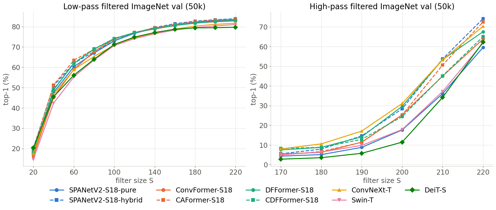
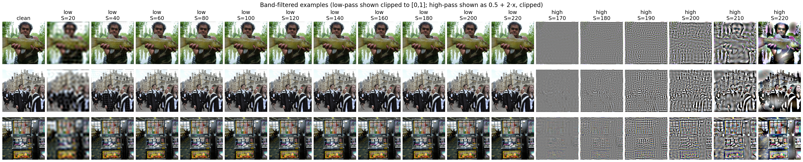
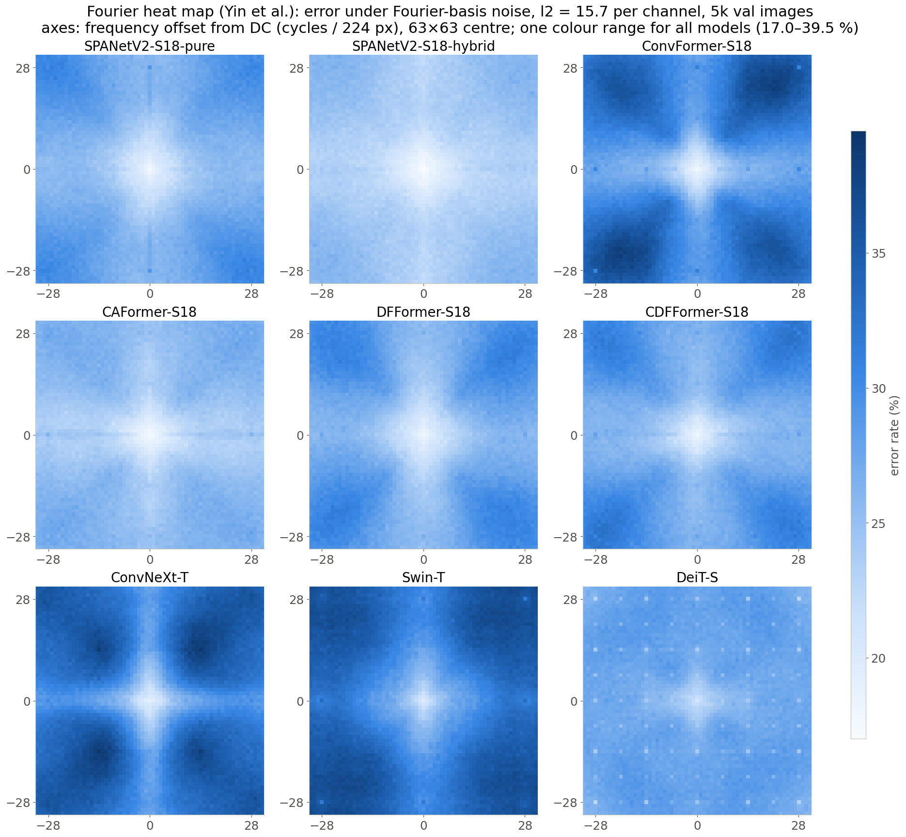
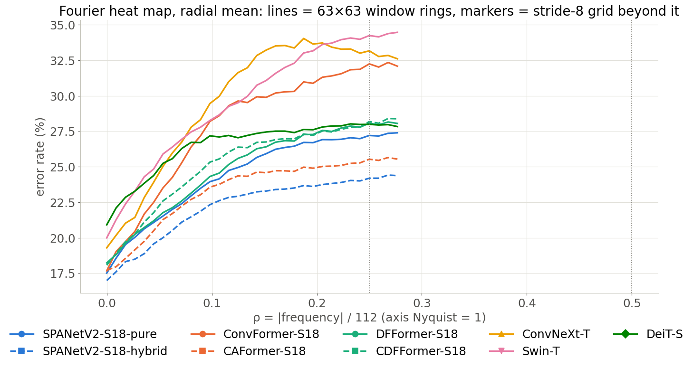
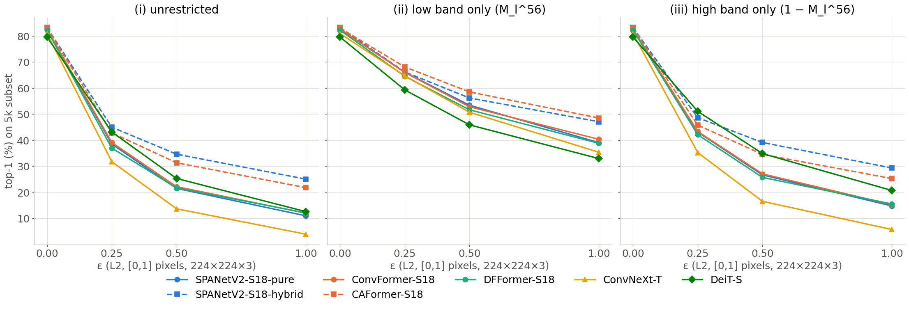
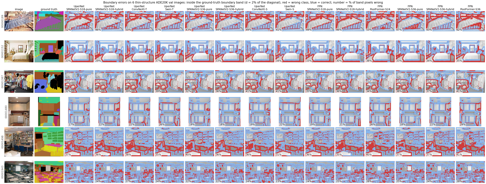

# 주파수 대역별 강건성과 미세 경계 평가 (추론만)

학습과 미세조정은 하지 않았고 저장소 코드도 고치지 않았다. 다시 실행하는 방법은 끝의 "파일" 절에 있다.

## 0. 점검

| 모델 | top-1 (fp32, val 50k) | 보고값 | 보고값 출처 | 차이 | 전처리 | 가중치 읽기 | 가중치 파일 | 참고: fp16 autocast top-1 |
|---|---|---|---|---|---|---|---|---|
| SPANetV2-S18-pure | 83.44 | 83.4 | 학위논문 표 4.2 | 0.04 | Resize 224 bicubic → CenterCrop 224 (crop_pct 1.0) | flat, weights_only=True, missing 0, unexpected 0 | `spanetv2_s18_pure_res-scale_Full-ExSPAM.pth` | 83.43 |
| SPANetV2-S18-hybrid | 83.94 | 83.9 | SPANetV2-official README (표 4.2 값은 지시문에 없음) | 0.04 | Resize 224 bicubic → CenterCrop 224 (crop_pct 1.0) | flat, weights_only=True, missing 0, unexpected 0 | `spanetv2_s18_hybrid_k7_res-scale_Full-ExSPAM.pth` | 83.95 |
| ConvFormer-S18 | 82.98 | 83.0 | sail-sg/metaformer README | -0.02 | Resize 224 bicubic → CenterCrop 224 (crop_pct 1.0) | flat, weights_only=True, missing 0, unexpected 0 | `convformer_s18.pth` | 82.97 |
| CAFormer-S18 | 83.66 | 83.6 | sail-sg/metaformer README | 0.06 | Resize 224 bicubic → CenterCrop 224 (crop_pct 1.0) | flat, weights_only=True, missing 0, unexpected 0 | `caformer_s18.pth` | 83.67 |
| DFFormer-S18 | 83.16 | 83.2 | DFFormer 논문 Table 2 (README에 정확도 표 없음) | -0.04 | Resize 224 bicubic → CenterCrop 224 (crop_pct 1.0) | flat, weights_only=True, missing 0, unexpected 0 | `dfformer_s18.pth` | 83.16 |
| CDFFormer-S18 | 83.11 | 83.1 | DFFormer 논문 Table 2 (README에 정확도 표 없음) | 0.01 | Resize 224 bicubic → CenterCrop 224 (crop_pct 1.0) | flat, weights_only=True, missing 0, unexpected 0 | `cdfformer_s18.pth` | 83.11 |
| ConvNeXt-T | 81.81 | — | README에 이 파일의 정확도 없음 (README IN-1K 표는 _ema 파일) | — | Resize 256 bicubic → CenterCrop 224 (crop_pct 0.875) | ckpt['model'], weights_only=True, missing 0, unexpected 0 | `convnext_tiny_1k_224.pth` | 81.79 |
| ConvNeXt-T (EMA 파일) | 82.05 | 82.1 | facebookresearch/ConvNeXt README | -0.05 | Resize 256 bicubic → CenterCrop 224 (crop_pct 0.875) | ckpt['model'], weights_only=True, missing 0, unexpected 0 | `convnext_tiny_1k_224_ema.pth` | 82.05 |
| Swin-T | 81.18 | 81.2 | microsoft/Swin-Transformer README | -0.02 | Resize 256 bicubic → CenterCrop 224 (crop_pct 0.875) | ckpt['model'], weights_only=True, missing 0, unexpected 0 | `swin_tiny_patch4_window7_224.pth` | 81.17 |
| DeiT-S | 79.83 | 79.9 | facebookresearch/deit README_deit.md 표 (평가 출력 79.854) | -0.07 | Resize 256 bicubic → CenterCrop 224 (crop_pct 0.875) | ckpt['model'], weights_only=True, missing 0, unexpected 0 | `deit_small_patch16_224-cd65a155.pth` | 79.82 |

- **정규화:** 모든 모델이 mean (0.485, 0.456, 0.406), std (0.229, 0.224, 0.225)를 쓴다(각 저장소의 평가 코드에서 확인).
- **보간:** Resize의 보간은 PIL bicubic이다.
- **정밀도:** 0–C의 모든 수치는 fp32이다(TF32 끔).
- **ConvFormer-S18·CAFormer-S18의 학위논문 값:** 학위논문 표 4.2의 값(각 83.0, 83.4)은 재학습한 결과다. 이번 실험은 sail-sg/metaformer의 공개 가중치를 쓰므로 위의 보고값(README)과 대조했다. 공개 가중치 값과 재학습 값은 서로 다른 모델의 수치다.
- **ConvNeXt-T:** 지시문의 `convnext_tiny_1k_224.pth`와 README IN-1K 표에 링크된 `convnext_tiny_1k_224_ema.pth`는 크기는 같고 sha256이 다른 별개 파일이다. A–C에는 지시문의 파일을 썼고, EMA 파일은 0에서만 재서 README 값(82.1)과 대조했다.
- **SPANetV2-S18-hybrid의 기준값:** 지시문은 S18-pure의 학위논문 값(83.4)만 주었다. 그래서 hybrid는 저장소 README 값과 대조했다.

코드와 커밋은 다음과 같다(모델 파일은 경로로 불러왔고 수정하지 않았다).

| 저장소 | commit |
|---|---|
| ConvNeXt | `048efcea897d999aed302f2639b6270aedf8d4c8` |
| Swin-Transformer | `f82860bfb5225915aca09c3227159ee9e1df874d` |
| Swin-Transformer-Object-Detection | `c7b20110addde0f74b1fbf812b403d16a59a87a9` |
| Swin-Transformer-Semantic-Segmentation | `87e6f90577435c94f3e92c7db1d36edc234d91f6` |
| boundary-iou-api | `37d25586a677b043ed585f10e5c42d4e80176ea9` |
| deit | `7e160fe43f0252d17191b71cbb5826254114ea5b` |
| poolformer | `a075575b8b3dc3c76ecc5c49985d156167372bfa` |
| metaformer | `64c534ab8f65105fd21713b38e3393a449ca742d` |
| dfformer | `2b757c511a1bf1e66a12d494f3b0c42daa5b3636` |
| SPANetV2-official | `893567e75c30ab0de1e29f2f232b72265db25e19` |

## A. 대역 필터 검증 데이터의 정확도 곡선

- **식:** Bai et al.(ECCV 2022) 식 (1)–(2)를 따른다. 채널마다 2D DFT를 하고 fftshift한 뒤 마스크를 곱한다. ifftshift와 역 DFT를 거쳐 실수부를 쓴다. clamp는 하지 않는다.
- **마스크 모양:** HAT 공식 저장소(jiawangbai/HAT)에는 필터 평가 코드가 공개되어 있지 않다(커밋 이력, 이슈 포함해 확인).
  - 인쇄된 식은 거리로 min(|i − H/2|, |j − W/2|)를 쓴다. 이대로면 십자 모양이 된다.
  - 그래서 지시대로 정사각형(Chebyshev, max)으로 구현했다.
  - 저역 M_l^S는 max(|i − 112|, |j − 112|) ≤ S/2, 고역 M_h^S는 같은 거리 > (224 − S)/2이다. 부등호는 식대로 비엄격(≤)이다.
- **필터 크기:** 저역 S = 20, 40, …, 220, 고역 S = 170, 180, …, 220.
- **평가 영상:** ImageNet-1K val 50,000장 전체, 각 모델의 평가 전처리 뒤 [0,1] 화소에 필터를 적용했다.
- **원문과 다른 점:** 원문 그림 2의 정확한 S 표본(축 눈금 20/60/…/220, 170–220)과 필터를 정규화 전에 적용했는지는 원문에 적혀 있지 않다.

| 모델 | L20 | L40 | L60 | L80 | L100 | L120 | L140 | L160 | L180 | L200 | L220 | H170 | H180 | H190 | H200 | H210 | H220 |
|---|---|---|---|---|---|---|---|---|---|---|---|---|---|---|---|---|---|
| SPANetV2-S18-pure | 17.14 | 47.50 | 60.26 | 66.99 | 72.99 | 76.74 | 79.14 | 80.82 | 82.16 | 82.88 | 83.41 | 4.34 | 5.11 | 8.79 | 17.62 | 36.06 | 59.54 |
| SPANetV2-S18-hybrid | 20.16 | 50.89 | 61.96 | 67.70 | 73.04 | 76.90 | 79.57 | 81.48 | 82.72 | 83.44 | 83.91 | 5.52 | 7.90 | 14.63 | 28.36 | 53.71 | 74.14 |
| ConvFormer-S18 | 16.18 | 45.26 | 58.96 | 67.73 | 73.87 | 77.03 | 78.87 | 80.52 | 81.81 | 82.39 | 82.84 | 5.45 | 6.21 | 11.43 | 25.36 | 44.97 | 63.78 |
| CAFormer-S18 | 19.68 | 51.27 | 63.45 | 68.86 | 73.85 | 77.14 | 79.37 | 81.11 | 82.38 | 83.25 | 83.60 | 4.88 | 6.70 | 11.35 | 25.25 | 50.62 | 72.51 |
| DFFormer-S18 | 18.63 | 48.75 | 61.93 | 68.91 | 74.09 | 77.04 | 79.12 | 80.61 | 81.73 | 82.57 | 83.08 | 7.50 | 8.76 | 14.13 | 29.65 | 53.35 | 67.54 |
| CDFFormer-S18 | 17.78 | 49.12 | 62.02 | 69.03 | 74.22 | 77.10 | 79.01 | 80.64 | 81.77 | 82.55 | 83.04 | 8.24 | 8.82 | 12.85 | 24.42 | 45.14 | 65.03 |
| ConvNeXt-T | 17.55 | 46.59 | 58.88 | 65.29 | 70.91 | 74.57 | 76.91 | 78.76 | 80.29 | 81.14 | 81.71 | 7.99 | 10.55 | 17.07 | 31.07 | 53.27 | 70.32 |
| Swin-T | 14.75 | 42.36 | 55.23 | 63.54 | 70.68 | 74.11 | 76.46 | 78.34 | 79.59 | 80.35 | 81.05 | 5.01 | 6.42 | 9.78 | 17.87 | 37.16 | 61.84 |
| DeiT-S | 20.38 | 45.49 | 56.10 | 63.94 | 71.23 | 74.88 | 77.11 | 78.74 | 79.42 | 79.47 | 79.72 | 2.79 | 3.54 | 5.77 | 11.44 | 34.18 | 62.27 |

L = 저역 통과 크기 S, H = 고역 통과 크기 S, top-1 (%).

## B. Fourier heat map

- **방법:** Yin et al.(NeurIPS 2019)을 Bai et al. 5.6절의 설정으로 따랐다.
  - 주파수 (u, v)마다 단일 Fourier 기저 U_{u,v}를 만든다. ‖U‖₂ = 1이고, fftshift 스펙트럼의 (u, v)에 0.5+0.5j, 대칭 좌표에 0.5−0.5j를 둔다.
  - 영상 x ∈ [0,1]에 x + r·v·U를 더한다. v = 15.7은 채널마다의 ℓ2 노름이고, 세 채널에 같은 U를 더한다.
  - 부호 r ∈ {−1, 1}은 영상·채널마다 독립으로 뽑았다(원문 "perturb every channel independently"). clamp는 하지 않았다.
- **척도 확인:** Yin et al. 원문("pixels take values in [0,1]", 각 채널 독립)과 공식 코드(google-research frequency_analysis/freq_heatmap.py)를 확인했다.
  - 공식 코드는 같은 기저를 모든 채널에 더한다. 그래서 v는 채널당 노름이고 전체 노름은 v·√3이다.
  - 공식 코드의 기본값(rand_flip=False)은 부호를 바꾸지 않는다. 여기서는 원문 기술(무작위 부호)을 따랐다.
- **원문 대비 표본:** 표본은 클래스마다 5장, 5,000장(numpy default_rng(0))이다. Bai et al.과 Yin et al.은 val 50,000장 전체를 썼다.
- **표시 영역과 대역 평균:**
  - 중심 63×63 영역의 오프셋 |u|, |v| ≤ 31은 ρ = |freq|/112 ≤ 0.28(모서리 0.39)에 해당한다. 그래서 지시문의 고역(ρ > 0.5)이 이 영역 안에 없다.
  - 고역 평균과 반경 곡선을 위해, 63×63 영역 밖 전 스펙트럼을 stride 8 격자(켤레 쌍 369개, 그중 ρ > 0.5인 것 319개)로 추가로 쟀다.
  - 저역 평균(ρ ≤ 0.25)은 63×63 영역에서, 고역 평균(ρ > 0.5)은 stride 8 격자에서 계산했다.

| 모델 | 저역 ρ ≤ 0.25 (63×63) | 0.25 < ρ ≤ 0.39 (63×63 안) | 중역 0.25 < ρ ≤ 0.5 (stride 8) | 고역 ρ > 0.5 (stride 8) | 63×63 전체 평균 | 63×63 최대 |
|---|---|---|---|---|---|---|
| SPANetV2-S18-pure | 25.67 | 28.30 | — | — | 26.67 | 31.40 |
| SPANetV2-S18-hybrid | 23.10 | 25.01 | — | — | 23.83 | 27.00 |
| ConvFormer-S18 | 29.79 | 33.18 | — | — | 31.08 | 38.70 |
| CAFormer-S18 | 24.34 | 26.05 | — | — | 24.99 | 28.06 |
| DFFormer-S18 | 26.22 | 28.95 | — | — | 27.26 | 31.78 |
| CDFFormer-S18 | 26.50 | 29.39 | — | — | 27.61 | 32.88 |
| ConvNeXt-T | 31.92 | 33.66 | — | — | 32.58 | 39.52 |
| Swin-T | 31.41 | 35.16 | — | — | 32.84 | 37.52 |
| DeiT-S | 27.31 | 27.74 | — | — | 27.47 | 29.36 |

값은 오류율(%)이다.

## C. 대역을 제한한 적대적 공격

- **공격 설정:**
  - L2 PGD, ε ∈ {0.25, 0.5, 1.0}([0,1] 화소, 224×224×3), 10 step, step 크기 ε/4.
  - 무작위 시작 없음, untargeted, cross-entropy, fp32. 표본 5,000장(B와 같은 집합).
- **매 step의 순서:**
  1. δ ← δ + α·g/‖g‖₂.
  2. 대역 사영 δ ← irfft2(rfft2(δ, norm="ortho") ⊙ M, norm="ortho"). M은 켤레 대칭인 실수 마스크로, 저역은 M_l^56(A와 같은 정사각형, max ≤ 28), 고역은 그 여집합이다.
  3. L2 공 δ ← δ·min(1, ε/‖δ‖₂).
  4. δ ← clamp(x + δ, 0, 1) − x.
- **clamp가 대역을 깨뜨리는 정도:** 마지막 clamp 때문에 δ의 일부가 대역 밖으로 나간다. 마지막 step 뒤 δ 에너지 가운데 대역 밖 비율의 평균을 아래 표에 함께 적었다.

| 모델 | clean | 제한없음 ε=0.25 | 제한없음 ε=0.5 | 제한없음 ε=1.0 | 저역 ε=0.25 | 저역 ε=0.5 | 저역 ε=1.0 | 고역 ε=0.25 | 고역 ε=0.5 | 고역 ε=1.0 | 대역 밖 에너지 % (저역, 고역; ε=1.0) |
|---|---|---|---|---|---|---|---|---|---|---|---|
| SPANetV2-S18-pure | 82.58 | 38.58 | 21.56 | 11.02 | 66.14 | 53.48 | 39.12 | 43.18 | 26.74 | 14.82 | 0.09, 0.13 |
| SPANetV2-S18-hybrid | 83.28 | 45.04 | 34.70 | 25.10 | 66.24 | 56.26 | 47.14 | 48.70 | 39.18 | 29.38 | 0.10, 0.28 |
| ConvFormer-S18 | 82.68 | 39.16 | 22.24 | 12.02 | 66.08 | 52.90 | 40.40 | 43.40 | 27.14 | 15.28 | 0.09, 0.13 |
| CAFormer-S18 | 83.10 | 42.90 | 31.40 | 21.84 | 68.16 | 58.58 | 48.56 | 45.86 | 34.62 | 25.32 | 0.10, 0.24 |
| DFFormer-S18 | 82.26 | 37.02 | 21.76 | 12.14 | 64.58 | 51.72 | 38.86 | 42.16 | 25.78 | 15.58 | 0.09, 0.14 |
| ConvNeXt-T | 80.96 | 31.82 | 13.74 | 3.98 | 64.76 | 50.78 | 35.44 | 35.32 | 16.60 | 5.78 | 0.09, 0.11 |
| DeiT-S | 79.64 | 43.22 | 25.38 | 12.64 | 59.36 | 45.94 | 33.00 | 51.14 | 34.92 | 20.76 | 0.08, 0.12 |

top-1 (%), 5,000장.

## D. 미세 경계 지표

- **통제 비교가 아님:** 같은 골격의 비교 모델(ConvFormer, CAFormer, DFFormer, CDFFormer)은 하류 과제 가중치가 공개되어 있지 않다.
  - 그래서 골격이 다르고 공식 가중치가 공개된 백본과 비교했다.
  - 사전학습, 학습 일정, 학습 설정, 디코더 채널이 모델마다 달라 통제 비교가 아니다.
- **실행 환경:** 모두 한 환경(SPANetV2-official의 mmseg 1.x / mmdet 3.x 사본, mmcv 2.1.0, torch 2.1.0)에서 단일 스케일, flip 없이 추론했다.
  - SPANetV2는 체크포인트에 저장된 학습 config를 그대로 썼다.
  - 비교 모델(mmcv 1.x 저장소)은 공식 백본 파일을 수정 없이 경로로 불러왔다. 불러오는 동안만 `mmcv_custom`, `*.models.builder`, `get_root_logger`를 대신하는 작은 객체를 sys.modules에 두었다(seg_eval.py, det_eval.py 주석).
  - head와 데이터 설정은 공식 config를 mmseg 1.x / mmdet 3.x 형식으로 옮겼다.
  - 가중치 key는 변환 없이 그대로 들어갔다. 아래 표의 missing / unexpected 열 참고.
- **PoolFormer:** sail-sg/poolformer README의 FPN 가중치는 Google Drive에만 있는데, 이 서버에서는 접속이 되지 않는다(SSL_ERROR_SYSCALL). 그래서 지시문이 허용한 mmseg model zoo의 같은 모델 가중치와 config를 썼다.
- **Boundary IoU:**
  - Cheng et al.(CVPR 2021)의 정의와 기본 경계 폭 d = 영상 대각선의 2%를 따랐고, 공식 boundary-iou-api의 `mask_to_boundary`를 그대로 썼다.
  - API에 의미론적 분할 모드가 없어서 클래스마다 GT·예측 이진 마스크의 경계 영역 교집합과 합집합을 val 전체에서 합했다.
  - 클래스별 IoU를 낸 뒤 평균했다(mIoU와 같은 방식, GT가 255인 화소 제외).
- **PoolFormer 테스트 전처리:** 체크포인트 안의 학습 config(mmseg 0.24)는 `AlignResize(keep_ratio, size_divisor=32)`이다. 여기서는 mmseg 1.x model zoo config의 Resize + ResizeToMultiple(32)을 썼다.
- **COCO Boundary AP:** 같은 API의 COCO 평가(iouType="boundary", dilation 0.02, mask IoU와 boundary IoU의 min)를 썼다.
  - API(2021)는 numpy 1.24에서 없어진 `np.float`를 쓴다. 그래서 API 코드는 고치지 않고 평가 프로세스 안에서만 `np.float = float`를 두었다.
  - 같은 API의 segm 평가로 잰 mask AP를 mmdet CocoMetric의 mask AP와 대조했다.
- **다중 스케일 값과의 관계:** 학위논문 표 4.6의 Swin-T·ConvNeXt-T UperNet 값은 다중 스케일이다. 여기 값은 모두 단일 스케일이고, 공개 수치도 단일 스케일 값과 대조했다.

### D1. ADE20K UperNet (160k, 512×512)

| 짝 | 모델 | mIoU (이번) | mIoU (저장 예측에서 재계산) | Boundary IoU | 공개 mIoU (단일 스케일) | test mode | 가중치 읽기 |
|---|---|---|---|---|---|---|---|
| S18 | ConvNeXt-T | 45.99 | 45.99 | 33.35 | 46.00 | slide | weights_only=True, missing 0, unexpected 0 |
| S18 | SPANetV2-S18-hybrid | 49.13 | 49.13 | 36.22 | 49.10 | slide | weights_only=False, missing 0, unexpected 0 |
| S18 | SPANetV2-S18-pure | 48.72 | 48.72 | 35.59 | 48.70 | slide | weights_only=False, missing 0, unexpected 0 |
| S18 | Swin-T | 44.51 | 44.51 | 31.80 | 44.51 | whole | weights_only=True, missing 0, unexpected 0 |
| S36 | ConvNeXt-S | 48.74 | 48.74 | 35.85 | 48.70 | slide | weights_only=True, missing 0, unexpected 0 |
| S36 | SPANetV2-S36-hybrid | 51.63 | 51.63 | 38.29 | 51.60 | slide | weights_only=False, missing 0, unexpected 0 |
| S36 | SPANetV2-S36-pure | 49.76 | 49.76 | 37.26 | 49.80 | slide | weights_only=False, missing 0, unexpected 0 |
| S36 | Swin-S | 47.64 | 47.64 | 35.18 | 47.64 | whole | weights_only=True, missing 0, unexpected 0 |

공개 mIoU의 출처: SPANetV2는 SPANetV2-official README, ConvNeXt는 facebookresearch/ConvNeXt semantic_segmentation README의 ss 값, Swin은 Swin-Transformer-Semantic-Segmentation README의 단일 스케일 값, PoolFormer는 mmseg model zoo README의 mIoU*(Resize + ResizeToMultiple; ResizeToMultiple 없이 S24 40.12, S36 41.61; 저장소 README 40.3, 42.0)이다.

### D2. ADE20K Semantic FPN (40k, 512×512)

| 짝 | 모델 | mIoU (이번) | mIoU (저장 예측에서 재계산) | Boundary IoU | 공개 mIoU (단일 스케일) | test mode | 가중치 읽기 |
|---|---|---|---|---|---|---|---|
| S18 | PoolFormer-S24 | 40.35 | 40.35 | 27.61 | 40.36 | whole | weights_only=True, missing 0, unexpected 0 |
| S18 | SPANetV2-S18-hybrid | 47.83 | 47.83 | 34.64 | 47.80 | whole | weights_only=False, missing 0, unexpected 0 |
| S18 | SPANetV2-S18-pure | 46.68 | 46.68 | 33.27 | 46.70 | whole | weights_only=False, missing 0, unexpected 0 |
| S36 | PoolFormer-S36 | 41.80 | 41.80 | 28.94 | 41.81 | whole | weights_only=True, missing 0, unexpected 0 |
| S36 | SPANetV2-S36-hybrid | 48.57 | 48.57 | 34.64 | 48.60 | whole | weights_only=False, missing 0, unexpected 0 |
| S36 | SPANetV2-S36-pure | 47.90 | 47.90 | 34.77 | 47.90 | whole | weights_only=False, missing 0, unexpected 0 |

공개 mIoU의 출처: SPANetV2는 SPANetV2-official README, ConvNeXt는 facebookresearch/ConvNeXt semantic_segmentation README의 ss 값, Swin은 Swin-Transformer-Semantic-Segmentation README의 단일 스케일 값, PoolFormer는 mmseg model zoo README의 mIoU*(Resize + ResizeToMultiple; ResizeToMultiple 없이 S24 40.12, S36 41.61; 저장소 README 40.3, 42.0)이다.

### D3. COCO val2017 (3× 일정, 단일 스케일 1333×800)

| 프레임워크 | 짝 | 모델 | box AP | mask AP | Boundary AP | 공개 box AP | 공개 mask AP | 가중치 읽기 |
|---|---|---|---|---|---|---|---|---|
| cascade | S18 | ConvNeXt-T | 50.4 | 43.6 | 28.9 | 50.4 | 43.7 | weights_only=True, missing 0, unexpected 0 |
| cascade | S18 | SPANetV2-S18-hybrid | 52.8 | 45.7 | 30.6 | 52.8 | 45.7 | weights_only=False, missing 0, unexpected 0 |
| cascade | S18 | SPANetV2-S18-pure | 51.6 | 44.7 | 30.1 | 51.6 | 44.7 | weights_only=False, missing 0, unexpected 0 |
| cascade | S18 | Swin-T | 50.4 | 43.7 | 29.0 | 50.4 | 43.7 | weights_only=True, missing 0, unexpected 0 |
| cascade | S36 | ConvNeXt-S | 51.9 | 45.0 | 30.0 | 51.9 | 45.0 | weights_only=True, missing 0, unexpected 0 |
| cascade | S36 | SPANetV2-S36-hybrid | 53.8 | 46.4 | 31.0 | 53.8 | 46.4 | weights_only=False, missing 0, unexpected 0 |
| cascade | S36 | SPANetV2-S36-pure | 53.1 | 45.9 | 30.9 | 53.1 | 45.9 | weights_only=False, missing 0, unexpected 0 |
| cascade | S36 | Swin-S | 52.0 | 45.0 | 30.2 | 51.9 | 45.0 | weights_only=True, missing 0, unexpected 0 |
| mask_rcnn | S18 | ConvNeXt-T | 46.2 | 41.7 | 26.7 | 46.2 | 41.7 | weights_only=True, missing 0, unexpected 0 |
| mask_rcnn | S18 | SPANetV2-S18-hybrid | 49.6 | 44.3 | 29.2 | 49.6 | 44.3 | weights_only=False, missing 0, unexpected 0 |
| mask_rcnn | S18 | SPANetV2-S18-pure | 48.0 | 42.9 | 28.3 | 48.0 | 42.9 | weights_only=False, missing 0, unexpected 0 |
| mask_rcnn | S18 | Swin-T | 46.0 | 41.7 | 26.8 | 46.0 | 41.6 | weights_only=True, missing 0, unexpected 0 |

경계 오류 지도 영상 선택 규칙: thin-structure score = fraction of labelled pixels removed by a per-class 5x5 opening; top 60 of 2000 images, then 6 drawn with numpy default_rng(0). 고른 영상: ADE_val_00000189, ADE_val_00001152, ADE_val_00001387, ADE_val_00001480, ADE_val_00001498, ADE_val_00001943.

## 파일

- `download_weights.py`: 가중치를 파일마다 새 디렉터리(`weights/<group>/<이름>/`)로 받는다. `data/weights_manifest.json`에 URL과 sha256을 적는다.
- `make_cache.py`: ImageNet val을 모델별 평가 전처리(crop_pct 1.0 / 0.875)로 한 번 디코딩해 uint8로 저장한다. 5,000장 표본도 만든다.
- `exp_cls.py`: 0, A, B, C 실행(`--weight`로 가중치 경로를 받는다). `scheduler.py`는 GPU마다 작업을 배분한다.
- `seg_eval.py`, `det_eval.py`: D 추론. `boundary_eval.py`: mIoU, Boundary IoU, 예시 영상 선택. `boundary_ap.py`: COCO Boundary AP.
- `make_figs.py`: figs/와 `data/summary.csv`(열 model, experiment, setting, value). `make_report.py`: 이 보고서.
- `data/raw/`: 실험별 원자료(json, npy).
