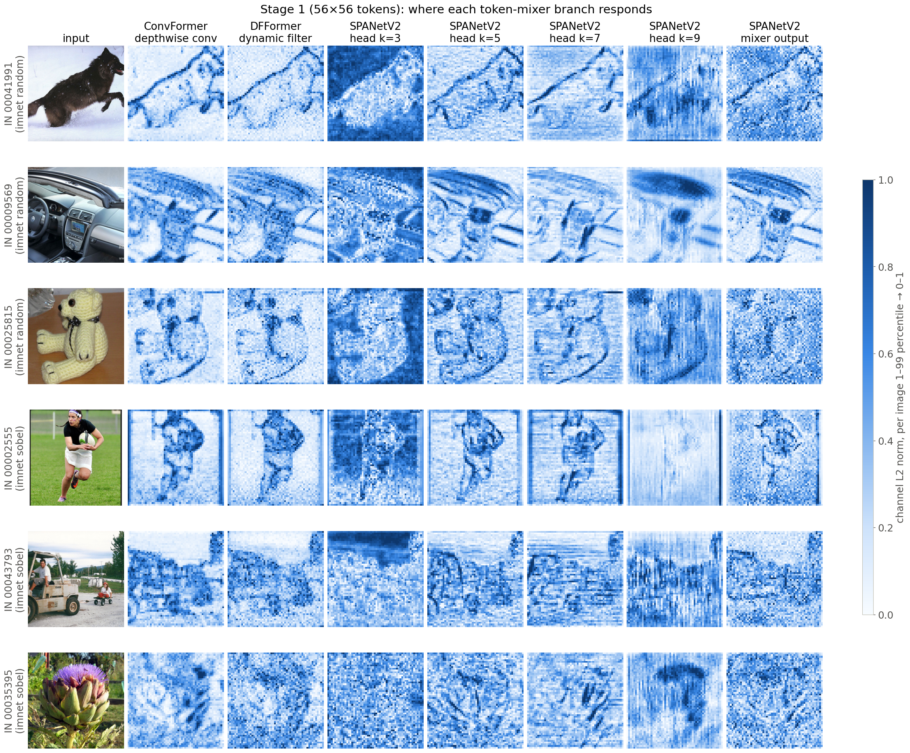
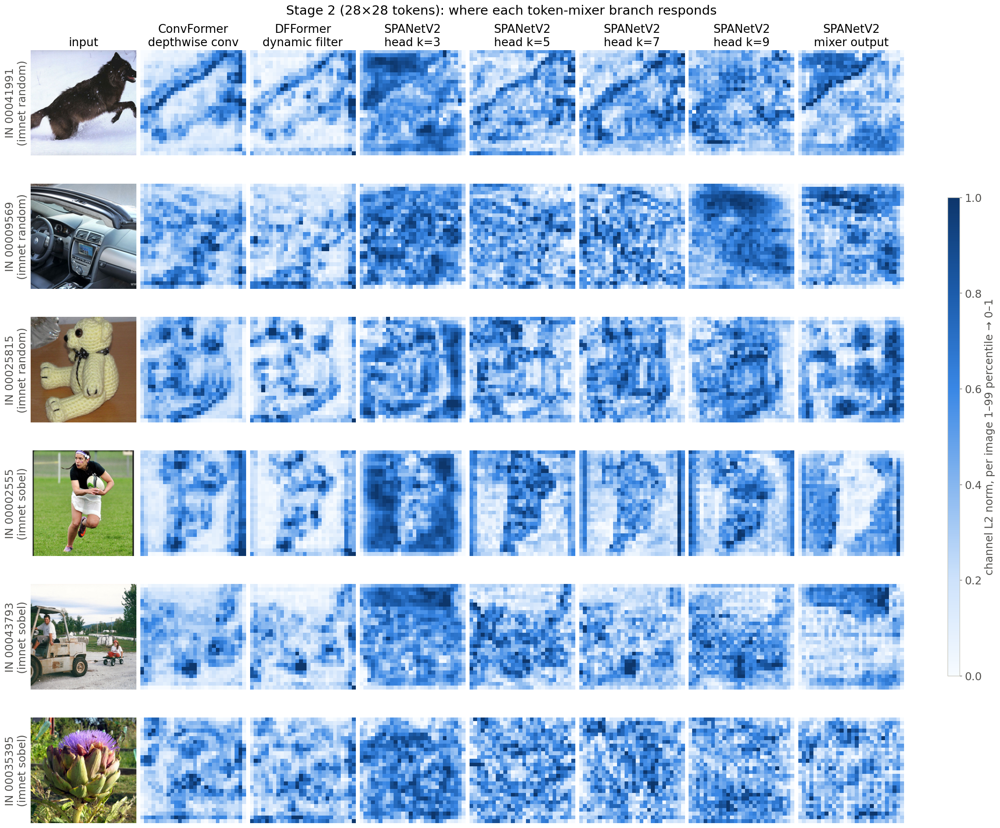
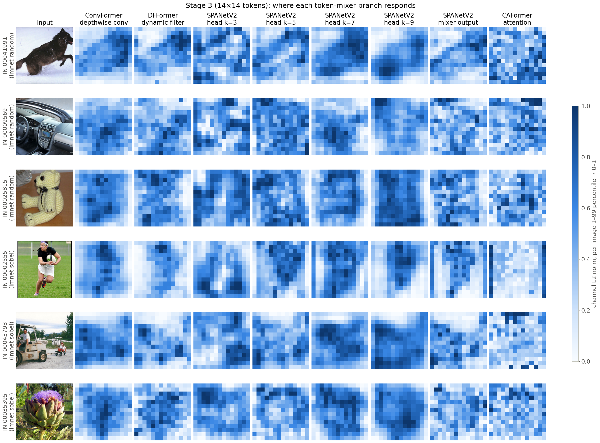
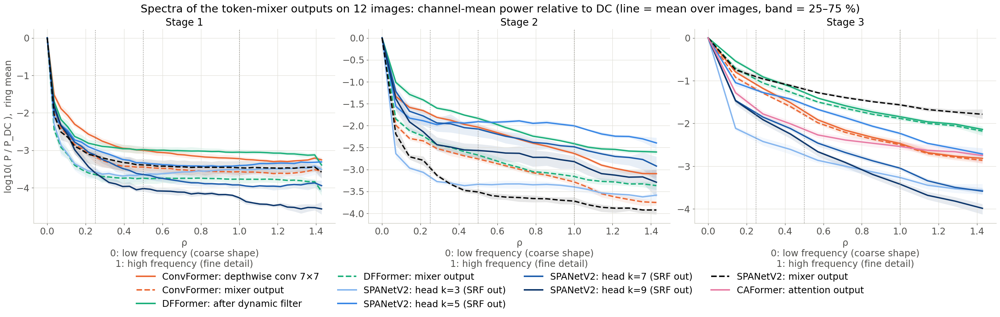
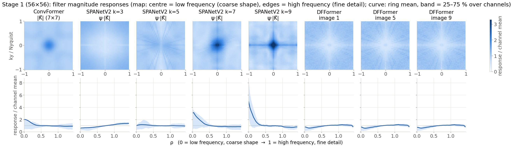
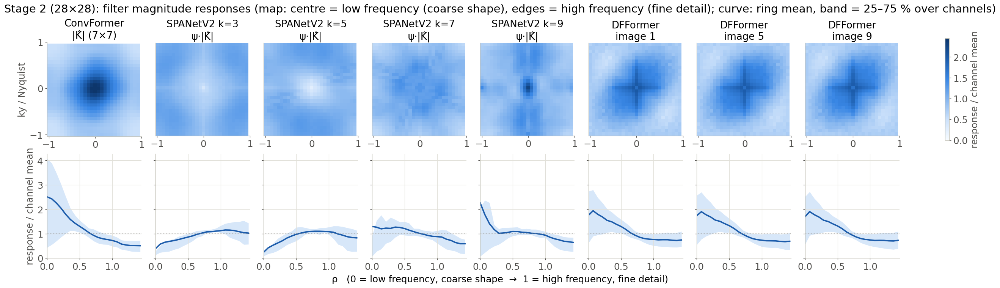
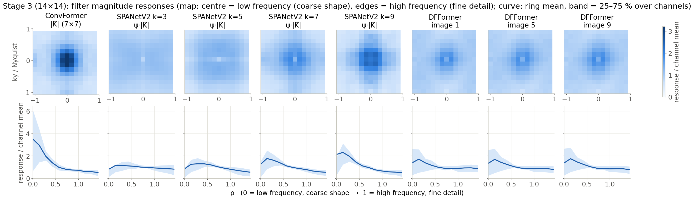
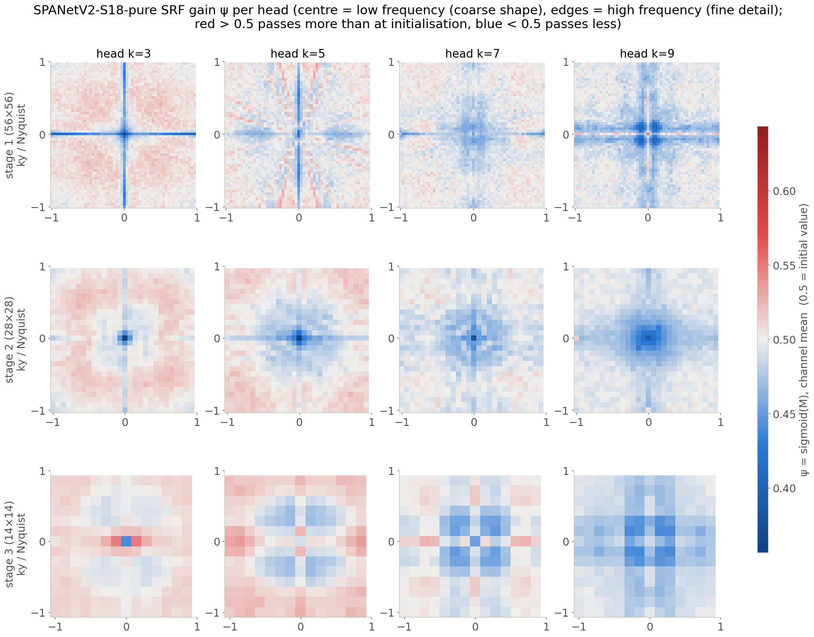

# Token mixer의 주파수 처리 정성 비교 (추론만)

학습과 미세조정은 하지 않았고 저장소 코드도 고치지 않았다(forward hook과 파라미터 읽기만 했다).
- **실행 환경:** SPANetV2-official commit `24e7bd89cd3a51b1f21d899e33c41f8896eba0a6`, torch 2.8.0+cu128, CPU, fp32, eval 모드.
- **가중치:** ../freq_robustness와 같은 공개 가중치 파일이다(sha256 아래).
- **다시 만들기:** `python select_images.py && python extract.py && python make_figs.py && python make_report.py` (앞의 둘은 spanetv2 conda env, 뒤의 둘은 spanetv2-dense env).

## 모델, 가중치, hook 위치

| 모델 | 가중치 파일 | sha256 | torch.load |
|---|---|---|---|
| SPANetV2-S18-pure | `freq_robustness/weights/cls/spanetv2_s18_pure_res-scale_Full-ExSPAM/spanetv2_s18_pure_res-scale_Full-ExSPAM.pth` | `7450b229eddf819f…` | weights_only=True, missing 0, unexpected 0 |
| ConvFormer-S18 | `freq_robustness/weights/cls/convformer_s18/convformer_s18.pth` | `0daa1afe607d4611…` | weights_only=True, missing 0, unexpected 0 |
| DFFormer-S18 | `freq_robustness/weights/cls/dfformer_s18/dfformer_s18.pth` | `f6a4a2c06a5209e9…` | weights_only=True, missing 0, unexpected 0 |
| CAFormer-S18 | `freq_robustness/weights/cls/caformer_s18/caformer_s18.pth` | `6c396866b2457ae5…` | weights_only=True, missing 0, unexpected 0 |

| 모델 | 단계 | 블록 번호 | token mixer | hook (모듈 이름 → 얻은 것) |
|---|---|---|---|---|
| SPANetV2-S18-pure | 1 | 2 (0부터, 단계의 블록 3개 중 마지막) | ExSPAM | `stages.0.2.token_mixer.proj (pre-hook, input)` → SRF outputs s_i of the 4 heads `stages.0.2.token_mixer (output)` → mixer output |
| SPANetV2-S18-pure | 2 | 2 (0부터, 단계의 블록 3개 중 마지막) | ExSPAM | `stages.1.2.token_mixer.proj (pre-hook, input)` → SRF outputs s_i of the 4 heads `stages.1.2.token_mixer (output)` → mixer output |
| SPANetV2-S18-pure | 3 | 4 (0부터, 단계의 블록 9개 중 가운데) | ExSPAM | `stages.2.4.token_mixer.proj (pre-hook, input)` → SRF outputs s_i of the 4 heads `stages.2.4.token_mixer (output)` → mixer output |
| ConvFormer-S18 | 1 | 2 (0부터, 단계의 블록 3개 중 마지막) | SepConv | `stages.0.2.token_mixer.dwconv (output)` → depthwise convolution output `stages.0.2.token_mixer (output)` → mixer output |
| ConvFormer-S18 | 2 | 2 (0부터, 단계의 블록 3개 중 마지막) | SepConv | `stages.1.2.token_mixer.dwconv (output)` → depthwise convolution output `stages.1.2.token_mixer (output)` → mixer output |
| ConvFormer-S18 | 3 | 4 (0부터, 단계의 블록 9개 중 가운데) | SepConv | `stages.2.4.token_mixer.dwconv (output)` → depthwise convolution output `stages.2.4.token_mixer (output)` → mixer output |
| DFFormer-S18 | 1 | 2 (0부터, 단계의 블록 3개 중 마지막) | DynamicFilter | `stages.0.2.token_mixer.act2 (pre-hook, input; act2 = Identity)` → irfft2 output right after the dynamic filter `stages.0.2.token_mixer.reweight (output)` → routing logits -> softmax over filters `stages.0.2.token_mixer (output)` → mixer output |
| DFFormer-S18 | 2 | 2 (0부터, 단계의 블록 3개 중 마지막) | DynamicFilter | `stages.1.2.token_mixer.act2 (pre-hook, input; act2 = Identity)` → irfft2 output right after the dynamic filter `stages.1.2.token_mixer.reweight (output)` → routing logits -> softmax over filters `stages.1.2.token_mixer (output)` → mixer output |
| DFFormer-S18 | 3 | 4 (0부터, 단계의 블록 9개 중 가운데) | DynamicFilter | `stages.2.4.token_mixer.act2 (pre-hook, input; act2 = Identity)` → irfft2 output right after the dynamic filter `stages.2.4.token_mixer.reweight (output)` → routing logits -> softmax over filters `stages.2.4.token_mixer (output)` → mixer output |
| CAFormer-S18 | 3 | 4 (0부터, 단계의 블록 9개 중 가운데) | Attention | `stages.2.4.token_mixer (output)` → attention (token mixer) output |

- **블록 위치:** 1·2단계는 마지막 블록, 3단계는 가운데 블록이다. 네 모델 모두 S18(블록 수 3-3-9-3)이라 같은 번호다.
- **SPANetV2 head 출력:** `proj`의 입력 s_ctx는 ExSPAM.forward가 head마다 irfft2로 만든 s_i를 (B, C/4, 4, H, W)로 쌓아 (B, C, H, W)로 편 것이다. 그래서 view(B, C/4, 4, H, W)[:, :, i]가 head i(커널 3+2i)의 SRF 출력이다. 따로 다시 계산하지 않았다.
- **DFFormer 필터 직후 출력:** `act2`는 nn.Identity이고, 그 입력이 동적 필터를 곱한 뒤 irfft2한 출력이다.
- **DFFormer 예측 필터:** 예측 필터는 forward 안의 식 weight = einsum("bfc,hwf->bhwc", routing, complex_weights)와 같다. `reweight` 출력에서 얻은 routing(softmax)과 파라미터 basis `complex_weights`를 써서 만들었다.

## 영상 12장

선택 규칙: Pick the 12 images (fixed seeds) and store them after the models' evaluation preprocessing.

    python select_images.py [--imnet-cache ../freq_robustness/cache] [--ade ../freq_robustness/cache/datasets/ade20k/ADEChallengeData2016]

All four models (SPANetV2-S18-pure, ConvFormer-S18, DFFormer-S18, CAFormer-S18) evaluate with
Resize(224, bicubic) on the shorter side -> CenterCrop(224) (crop_pct 1.0, see ../freq_robustness/report.md 0), so one
224x224 crop per image serves every model.
  group 'imnet_random' : 4 ImageNet-1K val images, numpy default_rng(0).choice(50000, 4)
  group 'imnet_sobel'  : 4 images drawn with default_rng(1) from the ImageNet val images whose Sobel gradient energy
                         (mean of gx^2 + gy^2 on the grey 224x224 crop, cv2.Sobel ksize 3) is in the top 25 %,
                         excluding the 'imnet_random' images
  group 'ade_random'   : 4 ADE20K val images, default_rng(2).choice(2000, 4) over the sorted file list
Main-text figures use the first 3 images of 'imnet_random' and of 'imnet_sobel' (in drawing order); the other 6
(1 + 1 + 4 ADE20K) go to the appendix figures.

| # | 묶음 | 출처 | 파일 | Sobel 에너지 | 그림 |
|---|---|---|---|---|---|
| 1 | imnet_random | ImageNet-1K val | `n02114367/ILSVRC2012_val_00041991.JPEG` | 0.1854 | 본문 |
| 2 | imnet_random | ImageNet-1K val | `n03100240/ILSVRC2012_val_00009569.JPEG` | 0.5442 | 본문 |
| 3 | imnet_random | ImageNet-1K val | `n04399382/ILSVRC2012_val_00025815.JPEG` | 0.1211 | 본문 |
| 4 | imnet_random | ImageNet-1K val | `n03709823/ILSVRC2012_val_00046592.JPEG` | 0.3379 | 부록 |
| 5 | imnet_sobel | ImageNet-1K val | `n04118538/ILSVRC2012_val_00002555.JPEG` | 0.4832 | 본문 |
| 6 | imnet_sobel | ImageNet-1K val | `n03384352/ILSVRC2012_val_00043793.JPEG` | 0.4091 | 본문 |
| 7 | imnet_sobel | ImageNet-1K val | `n07718747/ILSVRC2012_val_00035395.JPEG` | 0.5195 | 본문 |
| 8 | imnet_sobel | ImageNet-1K val | `n03207743/ILSVRC2012_val_00009860.JPEG` | 0.4887 | 부록 |
| 9 | ade_random | ADE20K val | `ADE_val_00000597.jpg` | 0.2477 | 부록 |
| 10 | ade_random | ADE20K val | `ADE_val_00001673.jpg` | 0.3967 | 부록 |
| 11 | ade_random | ADE20K val | `ADE_val_00000219.jpg` | 0.2258 | 부록 |
| 12 | ade_random | ADE20K val | `ADE_val_00000523.jpg` | 0.4557 | 부록 |

- **Sobel 기준:** ImageNet val 전체의 Sobel 에너지 상위 25% 경계는 0.3753이고, 전체 중앙값은 0.2415이다.
- **전처리:** 네 모델 모두 같은 평가 전처리(Resize 224 bicubic → CenterCrop 224, crop_pct 1.0)를 쓰므로 같은 crop을 넣었다.
- **E2에 쓴 DFFormer 영상:** #1, #5, #9(세 묶음의 첫 영상)이다.

## 정의

- **스펙트럼:**
  - 특징 X (C, H, W)에 대해 P = mean_c |FFT2(X_c)|²(전체 격자)를 구한다.
  - L = log10(P / P_DC)를 정수 반경 고리 r = round(√(ky² + kx²)·H)로 평균한다.
  - ρ = r / (H/2)로 둔다(축 방향 Nyquist = 1).
- **고역/저역 power 비:** 선형 P를 ρ > 0.5 칸과 0 < ρ ≤ 0.25 칸에서 각각 평균한 뒤의 비로, DC는 뺐다.
- **기울기:** 0 < ρ ≤ 1 고리에서 log10(P/P_DC)를 log10 ρ에 최소제곱으로 맞춘 기울기다.
- **E1 지도:** 각 출력의 채널 L2 노름을 영상·출력마다 1·99 백분위로 0–1에 맞췄다.
- **E2 정의(../srf_task_analysis, C-4와 같음):**
  - 커널 응답 |K̂|는 그 단계 격자(H×H)에서의 DTFT로, zero-pad한 rfft2와 같다.
  - |K̂|와 ψ·|K̂|는 채널마다 전 주파수(켤레 대칭 가중) 평균으로 나눈 뒤 채널 평균했다.
  - ψ = sigmoid(M)은 나누지 않은 값이다.
  - DFFormer 예측 필터 크기 |W|도 |K̂|와 같게 정규화했다.
  - C-4 분석은 단계 안 모든 블록을 모았고, 여기는 위 표의 블록 하나만 쓴다.

## 그림

### E1. 실제 영상에서 mixer가 남기는 성분

- **`figs/e1_maps_stage{1,2,3}.png`:**
  - 본문 영상 6장(ImageNet 무작위 3장, Sobel 상위 3장)에 대해, 블록의 token mixer 각 분기 출력에서 채널 L2 노름의 공간 분포를 그렸다.
  - 열은 다음 순서다: 입력, ConvFormer depthwise conv 출력, DFFormer 동적 필터 직후 출력, SPANetV2 head k = 3, 5, 7, 9의 SRF 출력, SPANetV2 mixer 출력, (3단계) CAFormer attention 출력.
- **부록 영상:** 나머지 6장은 `figs/e1_maps_stage{1,2,3}_appendix.png`에 있다.

- **`figs/e1_spectra.png`:**
  - 같은 출력들과 ConvFormer·DFFormer의 mixer 출력의 log10(P/P_DC) 반경 profile을 단계마다 겹쳤다.
  - 선은 12장 평균이고 띠는 25–75%이다. 원자료는 `data/e1_radial.csv`에 있다.

| 단계 | 분기 | 채널 | 격자 | 고역/저역 power 비 (12장 평균) | 25–75% | 기울기 (평균) | 25–75% |
|---|---|---|---|---|---|---|---|
| 1 | SPANetV2\|mixer | 64 | 56×56 | 0.1928 | 0.1571–0.2298 | -0.894 | -0.962 – -0.818 |
| 1 | SPANetV2\|head k=3 | 16 | 56×56 | 0.3194 | 0.2351–0.3333 | -0.610 | -0.725 – -0.578 |
| 1 | SPANetV2\|head k=5 | 16 | 56×56 | 0.1837 | 0.1518–0.2125 | -0.985 | -1.038 – -0.907 |
| 1 | SPANetV2\|head k=7 | 16 | 56×56 | 0.0651 | 0.0486–0.0747 | -1.465 | -1.529 – -1.399 |
| 1 | SPANetV2\|head k=9 | 16 | 56×56 | 0.0418 | 0.0334–0.0492 | -1.655 | -1.693 – -1.575 |
| 1 | ConvFormer\|mixer | 64 | 56×56 | 0.1474 | 0.1359–0.1600 | -1.041 | -1.096 – -0.968 |
| 1 | ConvFormer\|dwconv | 128 | 56×56 | 0.1054 | 0.1011–0.1107 | -1.184 | -1.217 – -1.143 |
| 1 | DFFormer\|mixer | 64 | 56×56 | 0.2619 | 0.2472–0.2877 | -0.743 | -0.773 – -0.686 |
| 1 | DFFormer\|dynamic filter | 128 | 56×56 | 0.2386 | 0.2109–0.2645 | -0.779 | -0.838 – -0.725 |
| 2 | SPANetV2\|mixer | 128 | 28×28 | 0.0612 | 0.0378–0.0583 | -1.363 | -1.534 – -1.330 |
| 2 | SPANetV2\|head k=3 | 32 | 28×28 | 0.3225 | 0.2347–0.3106 | -0.579 | -0.670 – -0.557 |
| 2 | SPANetV2\|head k=5 | 32 | 28×28 | 0.6211 | 0.5296–0.6604 | -0.253 | -0.274 – -0.225 |
| 2 | SPANetV2\|head k=7 | 32 | 28×28 | 0.1376 | 0.1152–0.1638 | -1.040 | -1.106 – -0.948 |
| 2 | SPANetV2\|head k=9 | 32 | 28×28 | 0.1102 | 0.0797–0.1321 | -1.137 | -1.248 – -1.033 |
| 2 | ConvFormer\|mixer | 128 | 28×28 | 0.1220 | 0.1015–0.1325 | -1.107 | -1.168 – -1.048 |
| 2 | ConvFormer\|dwconv | 256 | 28×28 | 0.1221 | 0.1040–0.1337 | -1.123 | -1.169 – -1.062 |
| 2 | DFFormer\|mixer | 128 | 28×28 | 0.1115 | 0.0969–0.1266 | -1.193 | -1.243 – -1.106 |
| 2 | DFFormer\|dynamic filter | 256 | 28×28 | 0.1064 | 0.0949–0.1120 | -1.242 | -1.301 – -1.182 |
| 3 | SPANetV2\|mixer | 320 | 14×14 | 0.1828 | 0.1554–0.2100 | -0.992 | -1.073 – -0.904 |
| 3 | SPANetV2\|head k=3 | 80 | 14×14 | 0.0978 | 0.0837–0.1090 | -1.371 | -1.409 – -1.301 |
| 3 | SPANetV2\|head k=5 | 80 | 14×14 | 0.1135 | 0.0946–0.1285 | -1.398 | -1.484 – -1.315 |
| 3 | SPANetV2\|head k=7 | 80 | 14×14 | 0.0426 | 0.0366–0.0457 | -1.903 | -1.958 – -1.851 |
| 3 | SPANetV2\|head k=9 | 80 | 14×14 | 0.0275 | 0.0254–0.0316 | -2.331 | -2.425 – -2.256 |
| 3 | ConvFormer\|mixer | 320 | 14×14 | 0.0416 | 0.0378–0.0451 | -1.952 | -2.020 – -1.887 |
| 3 | ConvFormer\|dwconv | 640 | 14×14 | 0.0352 | 0.0331–0.0371 | -2.069 | -2.122 – -1.995 |
| 3 | DFFormer\|mixer | 320 | 14×14 | 0.0908 | 0.0858–0.1001 | -1.410 | -1.437 – -1.348 |
| 3 | DFFormer\|dynamic filter | 640 | 14×14 | 0.0691 | 0.0609–0.0754 | -1.570 | -1.602 – -1.499 |
| 3 | CAFormer\|attention | 320 | 14×14 | 0.0596 | 0.0505–0.0709 | -1.509 | -1.552 – -1.439 |

**관찰 (E1).**
- **고역/저역 power 비:** SPANetV2 head k = 3, 5, 7, 9 / ConvFormer depthwise / DFFormer 동적 필터 출력의 값은 다음과 같다: 1단계 0.319, 0.184, 0.065, 0.042 / ConvFormer 0.105 / DFFormer 0.239; 2단계 0.322, 0.621, 0.138, 0.110 / ConvFormer 0.122 / DFFormer 0.106; 3단계 0.098, 0.114, 0.043, 0.027 / ConvFormer 0.035 / DFFormer 0.069, CAFormer attention 0.060.
- **3단계 반경 profile 기울기:** SPANetV2 head가 -1.37 ~ -2.33이고, ConvFormer -2.07, DFFormer -1.57, CAFormer -1.51이다.
- **mixer 출력의 같은 비:** 1단계에서 SPANetV2 0.193, ConvFormer 0.147, DFFormer 0.262이고, 3단계에서 각각 0.183, 0.042, 0.091이다.

### E2. 필터 응답

- **`figs/e2_filters_stage{1,2,3}.png`:** 윗줄은 fftshift한 2D 크기 응답(중심 = DC, 그림 안 공통 색 범위)이고, 아랫줄은 반경 profile(채널 평균과 25–75%)이다.
  - ConvFormer: depthwise 7×7 커널의 |K̂|.
  - SPANetV2: head k = 3, 5, 7, 9의 실효 응답 ψ·|K̂|.
  - DFFormer: 영상 #1, #5, #9에 대해 그 블록이 예측한 필터 |W|. 원자료는 `data/e2_radial.csv`(|K̂|, ψ, ψ·|K̂| 따로)에 있다.
- **DFFormer 필터의 구성:** DFFormer의 필터는 basis 4개(`complex_weights`)를 영상·채널마다 routing 가중치로 더한 것이다. basis와 12장의 routing은 `data/e2_dfformer_basis_and_routing.npz`에 저장했다.

- **`figs/e2_srf_gain.png`:** SPANetV2 head 4개의 SRF 이득 ψ = sigmoid(M)을 채널 평균해 단계마다 2D 지도로 그렸다.
  - 색은 0.5(초기화 값)를 중심으로 한 발산형이다. 붉으면 초기값보다 더 통과시키고, 푸르면 덜 통과시킨다.

| 단계 | 분기 | DC | 저역 0<ρ≤0.25 | 중역 | 고역 ρ>0.5 | 고역/저역 |
|---|---|---|---|---|---|---|
| 1 | SPANetV2 k=3 psi | 0.367 | 0.480 | 0.503 | 0.505 | 1.052 |
| 1 | SPANetV2 k=5 psi | 0.423 | 0.487 | 0.493 | 0.498 | 1.023 |
| 1 | SPANetV2 k=7 psi | 0.450 | 0.469 | 0.486 | 0.498 | 1.062 |
| 1 | SPANetV2 k=9 psi | 0.552 | 0.451 | 0.479 | 0.492 | 1.089 |
| 1 | ConvFormer \|K\| dwconv | 2.010 | 1.629 | 1.075 | 0.949 | 0.583 |
| 1 | SPANetV2 k=3 effective | 0.572 | 0.649 | 0.736 | 1.069 | 1.647 |
| 1 | SPANetV2 k=5 effective | 1.003 | 1.149 | 1.076 | 0.977 | 0.850 |
| 1 | SPANetV2 k=7 effective | 3.087 | 2.236 | 1.272 | 0.877 | 0.392 |
| 1 | SPANetV2 k=9 effective | 4.946 | 2.298 | 1.100 | 0.904 | 0.393 |
| 1 | DFFormer predicted \|filter\| image 1 | 0.779 | 0.635 | 0.799 | 1.059 | 1.667 |
| 1 | DFFormer predicted \|filter\| image 5 | 0.788 | 0.611 | 0.786 | 1.062 | 1.740 |
| 1 | DFFormer predicted \|filter\| image 9 | 0.719 | 0.632 | 0.811 | 1.057 | 1.672 |
| 2 | SPANetV2 k=3 psi | 0.356 | 0.486 | 0.497 | 0.508 | 1.045 |
| 2 | SPANetV2 k=5 psi | 0.357 | 0.465 | 0.480 | 0.504 | 1.084 |
| 2 | SPANetV2 k=7 psi | 0.381 | 0.468 | 0.475 | 0.495 | 1.059 |
| 2 | SPANetV2 k=9 psi | 0.393 | 0.441 | 0.470 | 0.491 | 1.115 |
| 2 | ConvFormer \|K\| dwconv | 2.507 | 2.196 | 1.559 | 0.831 | 0.379 |
| 2 | SPANetV2 k=3 effective | 0.384 | 0.647 | 0.776 | 1.060 | 1.639 |
| 2 | SPANetV2 k=5 effective | 0.243 | 0.544 | 0.833 | 1.057 | 1.941 |
| 2 | SPANetV2 k=7 effective | 1.296 | 1.226 | 1.245 | 0.944 | 0.770 |
| 2 | SPANetV2 k=9 effective | 2.260 | 1.386 | 1.041 | 0.969 | 0.699 |
| 2 | DFFormer predicted \|filter\| image 1 | 1.753 | 1.778 | 1.453 | 0.875 | 0.492 |
| 2 | DFFormer predicted \|filter\| image 5 | 1.735 | 1.761 | 1.473 | 0.872 | 0.495 |
| 2 | DFFormer predicted \|filter\| image 9 | 1.688 | 1.763 | 1.464 | 0.874 | 0.496 |
| 3 | SPANetV2 k=3 psi | 0.440 | 0.526 | 0.502 | 0.505 | 0.961 |
| 3 | SPANetV2 k=5 psi | 0.491 | 0.502 | 0.485 | 0.508 | 1.013 |
| 3 | SPANetV2 k=7 psi | 0.453 | 0.481 | 0.469 | 0.498 | 1.035 |
| 3 | SPANetV2 k=9 psi | 0.487 | 0.456 | 0.462 | 0.484 | 1.060 |
| 3 | ConvFormer \|K\| dwconv | 3.508 | 2.946 | 1.634 | 0.775 | 0.263 |
| 3 | SPANetV2 k=3 effective | 0.801 | 1.136 | 1.126 | 0.972 | 0.856 |
| 3 | SPANetV2 k=5 effective | 0.851 | 1.257 | 1.297 | 0.936 | 0.745 |
| 3 | SPANetV2 k=7 effective | 1.243 | 1.767 | 1.483 | 0.875 | 0.495 |
| 3 | SPANetV2 k=9 effective | 2.127 | 2.313 | 1.668 | 0.809 | 0.350 |
| 3 | DFFormer predicted \|filter\| image 1 | 1.393 | 1.711 | 1.252 | 0.917 | 0.536 |
| 3 | DFFormer predicted \|filter\| image 5 | 1.337 | 1.692 | 1.304 | 0.910 | 0.538 |
| 3 | DFFormer predicted \|filter\| image 9 | 1.373 | 1.751 | 1.334 | 0.901 | 0.515 |

ψ 행은 정규화하지 않은 이득이고, 나머지 행은 채널마다 전 주파수 평균으로 나눈 값이다.

**관찰 (E2).**
- **SPANetV2 실효 응답과 ConvFormer |K̂|의 고역/저역 비:**
  - SPANetV2 실효 응답 ψ·|K̂|는 단계마다 head 사이에서 1단계 0.39–1.65, 2단계 0.70–1.94, 3단계 0.35–0.86이다.
  - ConvFormer |K̂|는 1단계 0.58, 2단계 0.38, 3단계 0.26이다.
- **DFFormer 예측 필터 |W|의 고역/저역 비:** 세 영상 사이에서 1단계 1.667–1.740, 2단계 0.492–0.496, 3단계 0.515–0.538이다.
- **SPANetV2 ψ의 대역 평균:** 3단계 × head 4개에서 저역 0.441–0.526, 고역 0.484–0.508이다.

## 파일

- `select_images.py`: 영상 선택. 결과는 `data/images.json`, `data/images_u8.npy`이다.
- `extract.py`: hook과 파라미터 읽기. 결과는 `data/hooks.json`, `data/e1_*`, `data/e2_params_*`이다.
- `make_figs.py`: 그림, `data/e1_radial.csv`, `data/e2_radial.csv`, `data/e2_band_summary.json`, `data/e2_dfformer_basis_and_routing.npz`를 만든다.
- `make_report.py`: 이 보고서를 만든다.
- **CSV 열:** model, stage, branch, ring, rho, mean, p25, p75이다. E1의 p25·p75는 12장 사이 값이고, E2는 채널 사이 값이다.
