# 과제별로 미세조정된 SPANetV2의 SRF 마스크 분석

ImageNet-1K로 학습한 SPANetV2와, 그 가중치에서 출발해 COCO·ADE20K로 미세조정한 백본의 SRF 마스크(ExSPAM `filter_{1..4}`)를 대역별로 비교했다. 재현은 `python download_ckpts.py && bash run_all.sh`로 한다.

- 저장소 commit `ea376fcfad12670acb5ebedc755b8b33de719191` (코드는 읽기만 함), Python 3.10.22, torch 2.1.0+cu121, numpy 1.25.2, mmengine 0.10.7 (체크포인트 메타데이터 읽기와 scheduler 재현), matplotlib 3.10.9. CPU만 사용.
- 데이터셋(`~/dataset`의 COCO·ADE20K)은 쓰지 않았다. SRF는 입력과 무관한 파라미터라 체크포인트만으로 계산했다. 추론·학습·평가는 하지 않았다.

## 0. 먼저 확인한 것

### 0.1 체크포인트 파일

모두 GitHub Release `DoranLyong/SPANetV2-official`에서 파일마다 새 디렉터리(`ckpts/<tag>/<파일 이름>/`)로 받았다 (`download_ckpts.py`).

| 모델 | 체크포인트 | Release 파일 | 크기 (bytes) | sha256 | Release API 대조 | torch.load |
|---|---|---|---|---|---|---|
| SPANetV2-S18-pure | IN1K | `ImageNet-1K/spanetv2_s18_pure_res-scale_Full-ExSPAM.pth` | 116,857,189 | `7450b229eddf819fae7bb882a073db1371489173ad4110807e83c92693c83804` | 크기 같음, sha256 (Release에 digest 없음) | weights_only=True · 저장소 `image_classification/ckpt/` 사본과 sha256 같음 |
| SPANetV2-S18-pure | COCO Mask R-CNN | `COCO2017/mask-rcnn_spanetv2_s18_pure_3x_epoch_35.pth` | 672,288,049 | `7a6905417ab7797e2f3036ebd1ffb9d1ba3359460663f8f7fd76024db4cde7c4` | 크기 같음, sha256 (Release에 digest 없음) | weights_only=False (아래 주) |
| SPANetV2-S18-pure | COCO Cascade | `COCO2017/cascade-mask-rcnn_spanetv2_s18_pure_3x_epoch_35.pth` | 1,201,530,229 | `62a25bdfa0018e6b102e0f1ea986642ee05862ac1b9278302f5887fdbcfac341` | 크기 같음, sha256 (Release에 digest 없음) | weights_only=False (아래 주) |
| SPANetV2-S18-pure | ADE20K FPN | `ADE20K/fpn_spanetv2_s18_pure_ade20k_467e-1.pth` | 381,589,865 | `09d2fc8a1008401ec2aa89002605d47aaf4ec86ea38339ba888f98385e342233` | 크기 같음, sha256 (Release에 digest 없음) | weights_only=False (아래 주) |
| SPANetV2-S18-pure | ADE20K UperNet | `ADE20K/upernet_spanetv2_s18_pure_ade20k_4872e-2.pth` | 508,884,806 | `4ae3b5ddc2294470940f7792dc7db9e5093125786af47fcb91a451cc24485ff3` | 크기 같음, sha256 (Release에 digest 없음) | weights_only=False (아래 주) |
| SPANetV2-S36-pure | IN1K | `ImageNet-1K/spanetv2_s36_pure_res-scale_Full-ExSPAM.pth` | 176,796,349 | `4b41a2e361065512b57d6343d292bbe67841a21bee6bb21dfa0d81215a3db41e` | 크기 같음, sha256 (Release에 digest 없음) | weights_only=True · 저장소 `image_classification/ckpt/` 사본과 sha256 같음 |
| SPANetV2-S36-pure | COCO Cascade | `COCO2017/cascade-mask-rcnn_spanetv2_s36_pure_3x_epoch_36.pth` | 1,386,166,373 | `d25239c20894e5e4132e5f8e7c2d0b55f01757a8a33508addf2eff303addf811` | 크기 같음, sha256 같음 | weights_only=False (아래 주) |
| SPANetV2-S36-pure | ADE20K FPN | `ADE20K/fpn_spanetv2_s36_pure_ade20k_479e-1.pth` | 561,419,097 | `953a903878f98ba118f45496a3e54564a4232232e7a984cd2a12d96d146b8a3f` | 크기 같음, sha256 (Release에 digest 없음) | weights_only=False (아래 주) |
| SPANetV2-S36-pure | ADE20K UperNet | `ADE20K/upernet_spanetv2_s36_pure_ade20k_4976e-2.pth` | 691,502,838 | `5add3fd5805e0b8c5e97aab58dd7340e1bf0f2d5d198df024dc60176adfd709a` | 크기 같음, sha256 (Release에 digest 없음) | weights_only=False (아래 주) |
| SPANetV2-S18-hybrid | IN1K | `ImageNet-1K/spanetv2_s18_hybrid_k7_res-scale_Full-ExSPAM.pth` | 108,085,611 | `4e27616f75cc7e7323d9a8b1846bfffb9b001db93d071879a0c6729cb5f6e7d4` | 크기 같음, sha256 (Release에 digest 없음) | weights_only=True · 저장소 `image_classification/ckpt/` 사본과 sha256 같음 |
| SPANetV2-S18-hybrid | COCO Mask R-CNN | `COCO2017/mask-rcnn_spanetv2_s18_hybrid_3x_epoch_36.pth` | 743,101,565 | `1e8d0cff6ea534f50b16f8033121ac5c6cb77887083bbc01d9608b88fc9bd878` | 크기 같음, sha256 (Release에 digest 없음) | weights_only=False (아래 주) |
| SPANetV2-S18-hybrid | COCO Cascade | `COCO2017/cascade-mask-rcnn_spanetv2_s18_hybrid_3x_epoch_35.pth` | 1,342,689,857 | `645968a5b00752cce6140d1f677b93110c91547905046e74da15390327b141d3` | 크기 같음, sha256 (Release에 digest 없음) | weights_only=False (아래 주) |
| SPANetV2-S18-hybrid | ADE20K FPN | `ADE20K/fpn_spanetv2_s18_hybrid_ade20k_478e-1.pth` | 355,305,973 | `f1e27ab6af34e7c88f04448c8139725c61dd528d9bbbaccd7d000e366d1011f5` | 크기 같음, sha256 (Release에 digest 없음) | weights_only=False (아래 주) |
| SPANetV2-S18-hybrid | ADE20K UperNet | `ADE20K/upernet_spanetv2_s18_hybrid_ade20k_4913e-2.pth` | 477,294,226 | `b3114904af334cb1ae111c495aded207f15a34c8e5cbf0c4805e812d57304109` | 크기 같음, sha256 (Release에 digest 없음) | weights_only=False (아래 주) |
| SPANetV2-S36-hybrid | IN1K | `ImageNet-1K/spanetv2_s36_hybrid_k7_res-scale_Full-ExSPAM.pth` | 162,922,467 | `06a748156b00e9dcf0c0efab41a9443d5d5326886c7ec97ee964ae30acac88df` | 크기 같음, sha256 (Release에 digest 없음) | weights_only=True · 저장소 `image_classification/ckpt/` 사본과 sha256 같음 |
| SPANetV2-S36-hybrid | COCO Cascade | `COCO2017/cascade-mask-rcnn_spanetv2_s36_hybrid_3x_epoch_35.pth` | 1,509,369,457 | `e30613cf5dff93a49be761435f752344289fabbafad7b38ec7a04cb3bde8a2f9` | 크기 같음, sha256 같음 | weights_only=False (아래 주) |
| SPANetV2-S36-hybrid | ADE20K FPN | `ADE20K/fpn_spanetv2_s36_hybrid_ade20k_486e-1.pth` | 519,797,221 | `20068bbcaa24e0f5101bcc818c7661f823e40d447cbe35e87ab39f858f375d83` | 크기 같음, sha256 (Release에 digest 없음) | weights_only=False (아래 주) |
| SPANetV2-S36-hybrid | ADE20K UperNet | `ADE20K/upernet_spanetv2_s36_hybrid_ade20k_5163e-2.pth` | 647,306,946 | `45870e831a259ae382fe955044047324e7d445f62f8f03fc7499b540b0f1e154` | 크기 같음, sha256 (Release에 digest 없음) | weights_only=False (아래 주) |

Release API 대조는 GitHub API의 자산 크기·digest(`data/release_assets.json`)와 비교한 결과다. digest는 일부 자산에만 공개되어 있다.

주: `torch.load(path, map_location="cpu", weights_only=True)`를 먼저 시도했다. IN1K 파일은 모두 그대로 읽혔다. COCO·ADE20K 파일(mmengine 저장본)은 모두 다음 오류로 실패했다.

> `UnpicklingError: Weights only load failed. Re-running `torch.load` with `weights_only` set to `False` will likely succeed, but it can result in arbitrary code execution.Do it only if you get the file from a trusted source. WeightsUnpickler error: Unsupported class mmengine.logging.history_buffer.HistoryBuffer`

오류는 학습 메타데이터(`message_hub`의 `HistoryBuffer`) 때문이다. 저자 본인의 공개 체크포인트이므로 `weights_only=False`로 읽었다.

SRF key는 정규식 `filter_[1-4]$`로 찾았다. 이름 형식은 `<접두>stages.<s-1>.<block>.token_mixer.filter_<h>`이고, 같은 블록의 커널은 `local_conv_<h>.weight`, shape (C/4, 1, k, k), k = 3, 5, 7, 9이다. shape 열은 (C/4, H, W//2+1)×블록 수이다.

| 모델 | 체크포인트 | 최상위 key | 쓴 state_dict | SRF key 접두 | SRF key 수 | SRF shape (단계별) | IN1K와 key·shape 같음 |
|---|---|---|---|---|---|---|---|
| SPANetV2-S18-pure | IN1K | flat state_dict (494 tensors) | ckpt (flat state_dict) | `` | 72 | s1: (16, 56, 29)×3 · s2: (32, 28, 15)×3 · s3: (80, 14, 8)×9 · s4: (128, 7, 4)×3 | 예 |
| SPANetV2-S18-pure | COCO Mask R-CNN | 'meta', 'state_dict', 'message_hub', 'optimizer', 'param_schedulers' | ckpt['state_dict'] | `backbone.` | 72 | s1: (16, 56, 29)×3 · s2: (32, 28, 15)×3 · s3: (80, 14, 8)×9 · s4: (128, 7, 4)×3 | 예 |
| SPANetV2-S18-pure | COCO Cascade | 'meta', 'state_dict', 'message_hub', 'optimizer', 'param_schedulers' | ckpt['state_dict'] | `backbone.` | 72 | s1: (16, 56, 29)×3 · s2: (32, 28, 15)×3 · s3: (80, 14, 8)×9 · s4: (128, 7, 4)×3 | 예 |
| SPANetV2-S18-pure | ADE20K FPN | 'meta', 'state_dict', 'message_hub', 'optimizer', 'param_schedulers' | ckpt['state_dict'] | `backbone.` | 72 | s1: (16, 56, 29)×3 · s2: (32, 28, 15)×3 · s3: (80, 14, 8)×9 · s4: (128, 7, 4)×3 | 예 |
| SPANetV2-S18-pure | ADE20K UperNet | 'meta', 'state_dict', 'message_hub', 'optimizer', 'param_schedulers' | ckpt['state_dict'] | `backbone.` | 72 | s1: (16, 56, 29)×3 · s2: (32, 28, 15)×3 · s3: (80, 14, 8)×9 · s4: (128, 7, 4)×3 | 예 |
| SPANetV2-S36-pure | IN1K | flat state_dict (962 tensors) | ckpt (flat state_dict) | `` | 144 | s1: (16, 56, 29)×3 · s2: (32, 28, 15)×12 · s3: (80, 14, 8)×18 · s4: (128, 7, 4)×3 | 예 |
| SPANetV2-S36-pure | COCO Cascade | 'meta', 'state_dict', 'message_hub', 'optimizer', 'param_schedulers' | ckpt['state_dict'] | `backbone.` | 144 | s1: (16, 56, 29)×3 · s2: (32, 28, 15)×12 · s3: (80, 14, 8)×18 · s4: (128, 7, 4)×3 | 예 |
| SPANetV2-S36-pure | ADE20K FPN | 'meta', 'state_dict', 'message_hub', 'optimizer', 'param_schedulers' | ckpt['state_dict'] | `backbone.` | 144 | s1: (16, 56, 29)×3 · s2: (32, 28, 15)×12 · s3: (80, 14, 8)×18 · s4: (128, 7, 4)×3 | 예 |
| SPANetV2-S36-pure | ADE20K UperNet | 'meta', 'state_dict', 'message_hub', 'optimizer', 'param_schedulers' | ckpt['state_dict'] | `backbone.` | 144 | s1: (16, 56, 29)×3 · s2: (32, 28, 15)×12 · s3: (80, 14, 8)×18 · s4: (128, 7, 4)×3 | 예 |
| SPANetV2-S18-hybrid | IN1K | flat state_dict (299 tensors) | ckpt (flat state_dict) | `` | 24 | s1: (16, 56, 29)×3 · s2: (32, 28, 15)×3 | 예 |
| SPANetV2-S18-hybrid | COCO Mask R-CNN | 'meta', 'state_dict', 'message_hub', 'optimizer', 'param_schedulers' | ckpt['state_dict'] | `backbone.` | 24 | s1: (16, 56, 29)×3 · s2: (32, 28, 15)×3 | 예 |
| SPANetV2-S18-hybrid | COCO Cascade | 'meta', 'state_dict', 'message_hub', 'optimizer', 'param_schedulers' | ckpt['state_dict'] | `backbone.` | 24 | s1: (16, 56, 29)×3 · s2: (32, 28, 15)×3 | 예 |
| SPANetV2-S18-hybrid | ADE20K FPN | 'meta', 'state_dict', 'message_hub', 'optimizer', 'param_schedulers' | ckpt['state_dict'] | `backbone.` | 24 | s1: (16, 56, 29)×3 · s2: (32, 28, 15)×3 | 예 |
| SPANetV2-S18-hybrid | ADE20K UperNet | 'meta', 'state_dict', 'message_hub', 'optimizer', 'param_schedulers' | ckpt['state_dict'] | `backbone.` | 24 | s1: (16, 56, 29)×3 · s2: (32, 28, 15)×3 | 예 |
| SPANetV2-S36-hybrid | IN1K | flat state_dict (623 tensors) | ckpt (flat state_dict) | `` | 60 | s1: (16, 56, 29)×3 · s2: (32, 28, 15)×12 | 예 |
| SPANetV2-S36-hybrid | COCO Cascade | 'meta', 'state_dict', 'message_hub', 'optimizer', 'param_schedulers' | ckpt['state_dict'] | `backbone.` | 60 | s1: (16, 56, 29)×3 · s2: (32, 28, 15)×12 | 예 |
| SPANetV2-S36-hybrid | ADE20K FPN | 'meta', 'state_dict', 'message_hub', 'optimizer', 'param_schedulers' | ckpt['state_dict'] | `backbone.` | 60 | s1: (16, 56, 29)×3 · s2: (32, 28, 15)×12 | 예 |
| SPANetV2-S36-hybrid | ADE20K UperNet | 'meta', 'state_dict', 'message_hub', 'optimizer', 'param_schedulers' | ckpt['state_dict'] | `backbone.` | 60 | s1: (16, 56, 29)×3 · s2: (32, 28, 15)×12 | 예 |

### 0.2 IN1K 가중치: EMA 여부와 하류 학습이 실제로 불러온 쪽

- IN1K 파일 4개는 모두 평면 state_dict이다. 최상위에 'state_dict', 'model', 'state_dict_ema' 같은 묶음 key가 없다. EMA 가중치가 따로 들어 있지 않다. 파일 안의 텐서 한 벌이 곧 IN1K 기준이다.
- 하류 백본의 불러오기 경로(코드 확인):
  - `SPANetV2.__init__`은 `init_cfg`가 있으면 `self.init_weights(pretrained)`를 직접 부른다 (object_detection/mmdet/models/backbones/spanetv2.py:556, semantic_segmentation/mmseg/models/backbones/spanetv2.py:555).
  - `init_weights`는 `ckpt["state_dict"]` → `ckpt["model"]` → `ckpt` 순서로 고른다(같은 파일 585–590 / 584–589행). 그리고 `load_state_dict(state_dict, False)`로 넣는다(594 / 593행).
  - mmengine `BaseModule.init_weights`는 자식 모듈의 `init_weights()`를 호출한다(mmengine/model/base_module.py:136). SPANetV2가 이 메서드를 덮어쓰므로 백본에는 mmengine `PretrainedInit`이 아니라 위 함수가 적용된다.
  - 따라서 IN1K 파일 전체(평면 dict)가 그대로 쓰인다. EMA를 고를 분기는 없다.
- 각 하류 체크포인트에 저장된 학습 config(`meta["cfg"]`)의 `model.backbone.init_cfg`는 다음과 같다.

| 모델 | 체크포인트 | backbone type | init_cfg.type | init_cfg.checkpoint | IN1K 파일 이름과 | load_from |
|---|---|---|---|---|---|---|
| SPANetV2-S18-pure | COCO Mask R-CNN | `spanetv2_s18_pure` | `Pretrained` | `ckpt/spanetv2_s18_pure_res-scale_Full-ExSPAM.pth` | 같음 | `None` |
| SPANetV2-S18-pure | COCO Cascade | `spanetv2_s18_pure` | `Pretrained` | `ckpt/spanetv2_s18_pure_res-scale_Full-ExSPAM.pth` | 같음 | `None` |
| SPANetV2-S18-pure | ADE20K FPN | `spanetv2_s18_pure` | `Pretrained` | `ckpt/spanetv2_s18_pure_res-scale_Full-ExSPAM.pth` | 같음 | `None` |
| SPANetV2-S18-pure | ADE20K UperNet | `spanetv2_s18_pure` | `Pretrained` | `./ckpt/spanetv2_s18_pure_res-scale_Full-ExSPAM.pth` | 같음 | `None` |
| SPANetV2-S36-pure | COCO Cascade | `spanetv2_s36_pure` | `Pretrained` | `ckpt/spanetv2_s36_pure_res-scale_Full-ExSPAM.pth` | 같음 | `None` |
| SPANetV2-S36-pure | ADE20K FPN | `spanetv2_s36_pure` | `Pretrained` | `/workspace/projects/semantic_segmentation/ckpt/spanetv2_s36_pure_res-scale_Full-ExSPAM.pth` | 같음 | `None` |
| SPANetV2-S36-pure | ADE20K UperNet | `spanetv2_s36_pure` | `Pretrained` | `ckpt/spanetv2_s36_pure_res-scale_Full-ExSPAM.pth` | 같음 | `None` |
| SPANetV2-S18-hybrid | COCO Mask R-CNN | `spanetv2_s18_hybrid` | `Pretrained` | `ckpt/spanetv2_s18_hybrid_k7_res-scale_Full-ExSPAM.pth` | 같음 | `None` |
| SPANetV2-S18-hybrid | COCO Cascade | `spanetv2_s18_hybrid` | `Pretrained` | `ckpt/spanetv2_s18_hybrid_k7_res-scale_Full-ExSPAM.pth` | 같음 | `None` |
| SPANetV2-S18-hybrid | ADE20K FPN | `spanetv2_s18_hybrid` | `Pretrained` | `ckpt/spanetv2_s18_hybrid_k7_res-scale_Full-ExSPAM.pth` | 같음 | `None` |
| SPANetV2-S18-hybrid | ADE20K UperNet | `spanetv2_s18_hybrid` | `Pretrained` | `ckpt/spanetv2_s18_hybrid_k7_res-scale_Full-ExSPAM.pth` | 같음 | `None` |
| SPANetV2-S36-hybrid | COCO Cascade | `spanetv2_s36_hybrid` | `Pretrained` | `ckpt/spanetv2_s36_hybrid_k7_res-scale_Full-ExSPAM.pth` | 같음 | `None` |
| SPANetV2-S36-hybrid | ADE20K FPN | `spanetv2_s36_hybrid` | `Pretrained` | `ckpt/spanetv2_s36_hybrid_k7_res-scale_Full-ExSPAM.pth` | 같음 | `None` |
| SPANetV2-S36-hybrid | ADE20K UperNet | `spanetv2_s36_hybrid` | `Pretrained` | `ckpt/spanetv2_s36_hybrid_k7_res-scale_Full-ExSPAM.pth` | 같음 | `None` |

저장소에는 S36 Cascade config(`cascade-mask-rcnn_spanetv2_s36_*`)가 없다. 그래서 위 표의 S36 Cascade 행은 체크포인트 안의 config로 확인했다. 체크포인트별 config 전문은 `data/per_model/<모델>/cfg_<과제>.py`에 저장했다.

### 0.3 하류 학습에서 filter가 받은 weight decay와 학습률 배율

코드 규칙(object_detection/mmdet/engine/optimizers/layer_decay_optimizer_constructor.py, semantic_segmentation/mmseg/engine/optimizers/layer_decay_optimizer_constructor.py의 `SPANetV2LearningRateDecayOptimizerConstructor.add_params`):

- `requires_grad=False`면 건너뛴다(det 144행, seg 165행).
- no_decay 조건은 `len(param.shape) == 1 or name.endswith('.bias') or name in ('pos_embed', 'cls_token')`이다(det 146행, seg 167행). filter는 3차원 `(C/4, H, W//2+1)`이므로 `decay` 그룹이고 weight decay = config의 `weight_decay`다.
- 백본에 `no_weight_decay()`가 `{'norm'}`을 돌려주는 skip list가 있다(det spanetv2.py:603). 하지만 mmdet·mmseg 사본의 어디에서도 이 함수를 부르지 않는다(grep 결과 0건). 따라서 이 skip list는 적용되지 않는다.
- layer_wise일 때 `get_layer_id_for_spanetv2(name, num_layers)`: stages.0 → 1, stages.1 → 2, stages.2 → 3 + block//3, stages.3 → num_layers.
- stage_wise일 때 `get_stage_id_for_spanetv2(name, num_layers+2)`: stages.i → i+1.
- 배율 = `decay_rate ** (num_layers + 2 − layer_id − 1)`(det 169행, seg 191행).
- `paramwise_cfg`가 없으면(FPN config) mmengine 기본 constructor가 `model.parameters()` 전체를 한 그룹으로 만든다 (default_constructor.py:310). 이때 배율 1, weight decay = config 값이다.

아래 표의 lr_scale과 wd는 체크포인트에 저장된 optimizer `param_groups`에서 filter 파라미터가 속한 그룹을 직접 읽은 값이다. "코드 규칙"은 위 규칙을 그 config에 적용해 다시 계산한 값이다. a_wd만은 저장된 일정(param_scheduler, 총 iteration, `accumulative_counts`)을 mmengine scheduler로 그대로 재현해 계산했다. AdamW의 decoupled decay(`p ← p·(1 − lr·wd)`)만 작용했을 때 M에 남는 배율 Π(1 − lr_k·wd)이다.

| 모델 | 체크포인트 | constructor | decay_type, rate, num_layers | optimizer, base lr | weight_decay | accum | batch/GPU | param_scheduler | config 길이 | 저장 시점 (meta) | Adam step (저장값) | 재현한 optimizer step 수 | 저장된 lr ÷ lr_scale | 재현한 저장 시점 lr |
|---|---|---|---|---|---|---|---|---|---|---|---|---|---|---|
| SPANetV2-S18-pure | COCO Mask R-CNN | SPANetV2LearningRateDecayOptimizerConstructor | layer_wise, 0.95, 6 | AdamW 0.0001 | 0.05 | 2 | 2 | LinearLR 0.001→1 (0–1000 it); MultiStep ×0.1 @ [27, 33] ep | 36 ep | 35 ep / 513,065 it | 256428 | 256532 | 1e-06 | 1e-06 |
| SPANetV2-S18-pure | COCO Cascade | SPANetV2LearningRateDecayOptimizerConstructor | layer_wise, 0.7, 6 | AdamW 0.0002 | 0.05 | 2 | 2 | LinearLR 0.001→1 (0–1000 it); MultiStep ×0.1 @ [27, 33] ep | 36 ep | 35 ep / 513,065 it | 256427 | 256532 | 2e-06 | 2e-06 |
| SPANetV2-S18-pure | ADE20K FPN | Default | — (기본) | AdamW 0.0002 | 0.0001 | 1 | 8 | Poly p=0.9, η_min=0 (0–40000 it) | 40,000 it | 40,000 it | 39982 | 40000 | 0 | 0 |
| SPANetV2-S18-pure | ADE20K UperNet | SPANetV2LearningRateDecayOptimizerConstructor | stage_wise, 0.9, 7 | AdamW 0.0001 | 0.05 | 1 | 4 | LinearLR 1e-06→1 (0–1500 it); Poly p=1, η_min=0 (1500–160000 it) | 160,000 it | 144,000 it | 143943 | 144000 | 1.009e-05 | 1.009e-05 |
| SPANetV2-S36-pure | COCO Cascade | SPANetV2LearningRateDecayOptimizerConstructor | layer_wise, 0.7, 12 | AdamW 0.0002 | 0.05 | 2 | 2 | LinearLR 0.001→1 (0–1000 it); MultiStep ×0.1 @ [27, 33] ep | 36 ep | 36 ep / 527,724 it | 263755 | 263862 | 2e-06 | 2e-06 |
| SPANetV2-S36-pure | ADE20K FPN | Default | — (기본) | AdamW 0.0002 | 0.0001 | 1 | 8 | Poly p=0.9, η_min=0 (0–40000 it) | 40,000 it | 40,000 it | 39983 | 40000 | 0 | 0 |
| SPANetV2-S36-pure | ADE20K UperNet | SPANetV2LearningRateDecayOptimizerConstructor | stage_wise, 0.9, 9 | AdamW 0.0001 | 0.05 | 1 | 4 | LinearLR 1e-06→1 (0–1500 it); Poly p=1, η_min=0 (1500–160000 it) | 160,000 it | 160,000 it | 159935 | 160000 | 0 | 0 |
| SPANetV2-S18-hybrid | COCO Mask R-CNN | SPANetV2LearningRateDecayOptimizerConstructor | layer_wise, 0.95, 6 | AdamW 0.0001 | 0.05 | 4 | 1 | LinearLR 0.001→1 (0–1000 it); MultiStep ×0.1 @ [27, 33] ep | 36 ep | 36 ep / 1,055,412 it | 263746 | 263853 | 1e-06 | 1e-06 |
| SPANetV2-S18-hybrid | COCO Cascade | SPANetV2LearningRateDecayOptimizerConstructor | layer_wise, 0.7, 6 | AdamW 0.0002 | 0.05 | 4 | 1 | LinearLR 0.001→1 (0–1000 it); MultiStep ×0.1 @ [27, 33] ep | 36 ep | 35 ep / 1,026,095 it | 256418 | 256523 | 2e-06 | 2e-06 |
| SPANetV2-S18-hybrid | ADE20K FPN | Default | — (기본) | AdamW 0.0002 | 0.0001 | 1 | 8 | Poly p=0.9, η_min=0 (0–40000 it) | 40,000 it | 40,000 it | 39983 | 40000 | 0 | 0 |
| SPANetV2-S18-hybrid | ADE20K UperNet | SPANetV2LearningRateDecayOptimizerConstructor | stage_wise, 0.9, 7 | AdamW 0.0001 | 0.05 | 1 | 4 | LinearLR 1e-06→1 (0–1500 it); Poly p=1, η_min=0 (1500–160000 it) | 160,000 it | 112,000 it | 111957 | 112000 | 3.028e-05 | 3.028e-05 |
| SPANetV2-S36-hybrid | COCO Cascade | SPANetV2LearningRateDecayOptimizerConstructor | layer_wise, 0.7, 12 | AdamW 0.0002 | 0.05 | 8 | 1 | LinearLR 0.001→1 (0–1000 it); MultiStep ×0.1 @ [27, 33] ep | 36 ep | 35 ep / 2,169,421 it | 256418 | 271177 | 2e-06 | 2e-06 |
| SPANetV2-S36-hybrid | ADE20K FPN | Default | — (기본) | AdamW 0.0002 | 0.0001 | 2 | 4 | Poly p=0.9, η_min=0 (0–40000 it) | 40,000 it | 40,000 it | 19990 | 20000 | 0 | 0 |
| SPANetV2-S36-hybrid | ADE20K UperNet | SPANetV2LearningRateDecayOptimizerConstructor | stage_wise, 0.9, 11 | AdamW 0.0001 | 0.05 | 1 | 4 | LinearLR 1e-06→1 (0–1500 it); Poly p=1, η_min=0 (1500–160000 it) | 160,000 it | 144,000 it | 143940 | 144000 | 1.009e-05 | 1.009e-05 |

마지막 두 열은 일정 재현을 검증하는 값이다. 저장된 filter 그룹의 lr을 lr_scale로 나눈 값과, 같은 iteration까지 scheduler를 돌린 lr을 나란히 적었다.

배치 크기는 GPU 하나당 값이다. GPU 수는 체크포인트에 기록되어 있지 않다.

저장소 config(`*/local_configs/...`)와 체크포인트에 저장된 학습 config의 대조. 항목은 backbone type, drop_path_rate, init_cfg, constructor, paramwise_cfg, optimizer, accumulative_counts, batch/GPU, param_scheduler, train_cfg이다(init_cfg의 경로는 파일 이름만 비교). 위 표와 이 보고서의 모든 계산은 체크포인트 쪽 값을 쓴다.

| 모델 | 체크포인트 | 저장소 config | 차이 |
|---|---|---|---|
| SPANetV2-S18-pure | COCO Mask R-CNN | `object_detection/local_configs/SPANetV2/mask-rcnn_spanetv2_s18_pure_3x.py` | 같음 |
| SPANetV2-S18-pure | COCO Cascade | `object_detection/local_configs/SPANetV2/cascade-mask-rcnn_spanetv2_s18_pure_fpn-3x_coco.py` | accumulative_counts: 저장소 `4` / 체크포인트 `2` batch/GPU: 저장소 `1` / 체크포인트 `2` |
| SPANetV2-S18-pure | ADE20K FPN | `semantic_segmentation/local_configs/fpn/SPANetV2/fpn_spanet_s18_pure_ade20k-40k.py` | 같음 |
| SPANetV2-S18-pure | ADE20K UperNet | `semantic_segmentation/local_configs/upernet/SPANetV2/upernet_spanet_s18_pure_ade20k-160k.py` | 같음 |
| SPANetV2-S36-pure | COCO Cascade | (저장소에 config 없음) | — |
| SPANetV2-S36-pure | ADE20K FPN | `semantic_segmentation/local_configs/fpn/SPANetV2/fpn_spanet_s36_pure_ade20k-40k.py` | drop_path_rate: 저장소 `0.3` / 체크포인트 `null` |
| SPANetV2-S36-pure | ADE20K UperNet | `semantic_segmentation/local_configs/upernet/SPANetV2/upernet_spanet_s36_pure_ade20k-160k.py` | paramwise_cfg: 저장소 `{"decay_rate": 0.9, "decay_type": "stage_wise", "num_layers": 11}` / 체크포인트 `{"decay_rate": 0.9, "decay_type": "stage_wise", "num_layers": 9}` |
| SPANetV2-S18-hybrid | COCO Mask R-CNN | `object_detection/local_configs/SPANetV2/mask-rcnn_spanetv2_s18_hybrid_3x.py` | accumulative_counts: 저장소 `2` / 체크포인트 `4` batch/GPU: 저장소 `2` / 체크포인트 `1` |
| SPANetV2-S18-hybrid | COCO Cascade | `object_detection/local_configs/SPANetV2/cascade-mask-rcnn_spanetv2_s18_hybrid_fpn-3x_coco.py` | 같음 |
| SPANetV2-S18-hybrid | ADE20K FPN | `semantic_segmentation/local_configs/fpn/SPANetV2/fpn_spanet_s18_hybrid_ade20k-40k.py` | 같음 |
| SPANetV2-S18-hybrid | ADE20K UperNet | `semantic_segmentation/local_configs/upernet/SPANetV2/upernet_spanet_s18_hybrid_ade20k-160k.py` | 같음 |
| SPANetV2-S36-hybrid | COCO Cascade | (저장소에 config 없음) | — |
| SPANetV2-S36-hybrid | ADE20K FPN | `semantic_segmentation/local_configs/fpn/SPANetV2/fpn_spanet_s36_hybrid_ade20k-40k.py` | accumulative_counts: 저장소 `1` / 체크포인트 `2` batch/GPU: 저장소 `8` / 체크포인트 `4` |
| SPANetV2-S36-hybrid | ADE20K UperNet | `semantic_segmentation/local_configs/upernet/SPANetV2/upernet_spanet_s36_hybrid_ade20k-160k.py` | 같음 |

config 끝보다 앞선 시점에 저장된 체크포인트(Release 파일이 그 시점 것): SPANetV2-S18-pure COCO Mask R-CNN (35/36 ep); SPANetV2-S18-pure COCO Cascade (35/36 ep); SPANetV2-S18-pure ADE20K UperNet (144,000/160,000 it); SPANetV2-S18-hybrid COCO Cascade (35/36 ep); SPANetV2-S18-hybrid ADE20K UperNet (112,000/160,000 it); SPANetV2-S36-hybrid COCO Cascade (35/36 ep); SPANetV2-S36-hybrid ADE20K UperNet (144,000/160,000 it).

저장된 Adam step은 재현한 optimizer step 수보다 0.038–0.050% 적다(13개 체크포인트). AmpOptimWrapper(동적 loss scale)는 기울기에 inf/NaN이 있으면 그 step을 건너뛰는데, 이 차이는 그런 경우와 맞는다. a_wd는 재현한 step 전체로 계산했다.

**예외 — SPANetV2-S36-hybrid COCO Cascade:** 저장된 Adam step 256,418은 재현한 271,177보다 5.44% 적다. meta의 iter 2,169,421가 epoch 35로 나누어떨어지지 않으므로(iter/epoch = 61,983.46), iteration 기반 재현이 실제 optimizer step 수와 맞지 않는 체크포인트다. 보고서의 a_wd는 재현값을 그대로 쓴다. Σlr를 이 비율(0.9456)로 줄여 다시 계산하면 a_wd는 0.9608–0.9724이다(재현값 그대로는 0.9586–0.9708).

| 모델 | 체크포인트 | 단계 | filter lr_scale (저장값) | filter wd (저장값) | 코드 규칙 lr_scale | 저장값 = 코드 규칙 | param group | a_wd (decay만의 잔존 배율) |
|---|---|---|---|---|---|---|---|---|
| SPANetV2-S18-pure | COCO Mask R-CNN | 1 | 0.7351 | 0.05 | 0.7351 | 같음 | layer_1_decay | 0.4756 |
| SPANetV2-S18-pure | COCO Mask R-CNN | 2 | 0.7738 | 0.05 | 0.7738 | 같음 | layer_2_decay | 0.4574 |
| SPANetV2-S18-pure | COCO Mask R-CNN | 3 | 0.8145, 0.8574, 0.9025 | 0.05 | 0.8145, 0.8574, 0.9025 | 같음 | layer_3_decay, layer_4_decay, layer_5_decay | 0.4016–0.4389 |
| SPANetV2-S18-pure | COCO Mask R-CNN | 4 | 0.95 | 0.05 | 0.95 | 같음 | layer_6_decay | 0.3827 |
| SPANetV2-S18-pure | COCO Cascade | 1 | 0.1176 | 0.05 | 0.1176 | 같음 | layer_1_decay | 0.7883 |
| SPANetV2-S18-pure | COCO Cascade | 2 | 0.1681 | 0.05 | 0.1681 | 같음 | layer_2_decay | 0.7119 |
| SPANetV2-S18-pure | COCO Cascade | 3 | 0.2401, 0.343, 0.49 | 0.05 | 0.2401, 0.343, 0.49 | 같음 | layer_3_decay, layer_4_decay, layer_5_decay | 0.3713–0.6154 |
| SPANetV2-S18-pure | COCO Cascade | 4 | 0.7 | 0.05 | 0.7 | 같음 | layer_6_decay | 0.2428 |
| SPANetV2-S18-pure | ADE20K FPN | 1 | 1 | 0.0001 | 1 | 같음 | (그룹 1개) | 0.9996 |
| SPANetV2-S18-pure | ADE20K FPN | 2 | 1 | 0.0001 | 1 | 같음 | (그룹 1개) | 0.9996 |
| SPANetV2-S18-pure | ADE20K FPN | 3 | 1 | 0.0001 | 1 | 같음 | (그룹 1개) | 0.9996 |
| SPANetV2-S18-pure | ADE20K FPN | 4 | 1 | 0.0001 | 1 | 같음 | (그룹 1개) | 0.9996 |
| SPANetV2-S18-pure | ADE20K UperNet | 1 | 0.4783 | 0.05 | 0.4783 | 같음 | layer_1_decay | 0.8275 |
| SPANetV2-S18-pure | ADE20K UperNet | 2 | 0.5314 | 0.05 | 0.5314 | 같음 | layer_2_decay | 0.8102 |
| SPANetV2-S18-pure | ADE20K UperNet | 3 | 0.5905 | 0.05 | 0.5905 | 같음 | layer_3_decay | 0.7915 |
| SPANetV2-S18-pure | ADE20K UperNet | 4 | 0.6561 | 0.05 | 0.6561 | 같음 | layer_4_decay | 0.7712 |
| SPANetV2-S36-pure | COCO Cascade | 1 | 0.01384 | 0.05 | 0.01384 | 같음 | layer_1_decay | 0.9724 |
| SPANetV2-S36-pure | COCO Cascade | 2 | 0.01977 | 0.05 | 0.01977 | 같음 | layer_2_decay | 0.9608 |
| SPANetV2-S36-pure | COCO Cascade | 3 | 0.02825, 0.04035, 0.05765, 0.08235, 0.1176, 0.1681 | 0.05 | 0.02825, 0.04035, 0.05765, 0.08235, 0.1176, 0.1681 | 같음 | layer_3_decay, layer_4_decay, layer_5_decay, layer_6_decay, layer_7_decay, layer_8_decay | 0.7118–0.9445 |
| SPANetV2-S36-pure | COCO Cascade | 4 | 0.7 | 0.05 | 0.7 | 같음 | layer_12_decay | 0.2427 |
| SPANetV2-S36-pure | ADE20K FPN | 1 | 1 | 0.0001 | 1 | 같음 | (그룹 1개) | 0.9996 |
| SPANetV2-S36-pure | ADE20K FPN | 2 | 1 | 0.0001 | 1 | 같음 | (그룹 1개) | 0.9996 |
| SPANetV2-S36-pure | ADE20K FPN | 3 | 1 | 0.0001 | 1 | 같음 | (그룹 1개) | 0.9996 |
| SPANetV2-S36-pure | ADE20K FPN | 4 | 1 | 0.0001 | 1 | 같음 | (그룹 1개) | 0.9996 |
| SPANetV2-S36-pure | ADE20K UperNet | 1 | 0.3874 | 0.05 | 0.3874 | 같음 | layer_1_decay | 0.8564 |
| SPANetV2-S36-pure | ADE20K UperNet | 2 | 0.4305 | 0.05 | 0.4305 | 같음 | layer_2_decay | 0.8418 |
| SPANetV2-S36-pure | ADE20K UperNet | 3 | 0.4783 | 0.05 | 0.4783 | 같음 | layer_3_decay | 0.8259 |
| SPANetV2-S36-pure | ADE20K UperNet | 4 | 0.5314 | 0.05 | 0.5314 | 같음 | layer_4_decay | 0.8085 |
| SPANetV2-S18-hybrid | COCO Mask R-CNN | 1 | 0.7351 | 0.05 | 0.7351 | 같음 | layer_1_decay | 0.4753 |
| SPANetV2-S18-hybrid | COCO Mask R-CNN | 2 | 0.7738 | 0.05 | 0.7738 | 같음 | layer_2_decay | 0.4570 |
| SPANetV2-S18-hybrid | COCO Cascade | 1 | 0.1176 | 0.05 | 0.1176 | 같음 | layer_1_decay | 0.7882 |
| SPANetV2-S18-hybrid | COCO Cascade | 2 | 0.1681 | 0.05 | 0.1681 | 같음 | layer_2_decay | 0.7118 |
| SPANetV2-S18-hybrid | ADE20K FPN | 1 | 1 | 0.0001 | 1 | 같음 | (그룹 1개) | 0.9996 |
| SPANetV2-S18-hybrid | ADE20K FPN | 2 | 1 | 0.0001 | 1 | 같음 | (그룹 1개) | 0.9996 |
| SPANetV2-S18-hybrid | ADE20K UperNet | 1 | 0.4783 | 0.05 | 0.4783 | 같음 | layer_1_decay | 0.8403 |
| SPANetV2-S18-hybrid | ADE20K UperNet | 2 | 0.5314 | 0.05 | 0.5314 | 같음 | layer_2_decay | 0.8243 |
| SPANetV2-S36-hybrid | COCO Cascade | 1 | 0.01384 | 0.05 | 0.01384 | 같음 | layer_1_decay | 0.9708 |
| SPANetV2-S36-hybrid | COCO Cascade | 2 | 0.01977 | 0.05 | 0.01977 | 같음 | layer_2_decay | 0.9586 |
| SPANetV2-S36-hybrid | ADE20K FPN | 1 | 1 | 0.0001 | 1 | 같음 | (그룹 1개) | 0.9998 |
| SPANetV2-S36-hybrid | ADE20K FPN | 2 | 1 | 0.0001 | 1 | 같음 | (그룹 1개) | 0.9998 |
| SPANetV2-S36-hybrid | ADE20K UperNet | 1 | 0.3138 | 0.05 | 0.3138 | 같음 | layer_1_decay | 0.8832 |
| SPANetV2-S36-hybrid | ADE20K UperNet | 2 | 0.3487 | 0.05 | 0.3487 | 같음 | layer_2_decay | 0.8710 |

단계 안에서 값이 여러 개인 것은 블록마다 layer_id가 다르기 때문이다(layer_wise의 stages.2는 3 + block//3).

### 0.4 filter가 하류 학습에서 실제로 바뀌었는가

| 모델 | 체크포인트 | optimizer에 있는 filter / 전체 | optimizer에 없는 filter | ΔM = 0인 텐서 (블록·head) | ‖ΔM‖/‖M_IN1K‖ 범위 (단계·head) | max \|ΔM\| | 저장된 Adam mean\|exp_avg\| 범위 |
|---|---|---|---|---|---|---|---|
| SPANetV2-S18-pure | COCO Mask R-CNN | 72 / 72 | 0 | 0 / 72 | 0.504 – 0.616 | 3.389 | 2.01e-07 – 2.87e-06 |
| SPANetV2-S18-pure | COCO Cascade | 72 / 72 | 0 | 0 / 72 | 0.212 – 0.742 | 4.060 | 2.56e-07 – 3.38e-06 |
| SPANetV2-S18-pure | ADE20K FPN | 72 / 72 | 0 | 0 / 72 | 0.157 – 0.413 | 1.251 | 1.57e-07 – 4.58e-06 |
| SPANetV2-S18-pure | ADE20K UperNet | 72 / 72 | 0 | 0 / 72 | 0.186 – 0.239 | 1.322 | 3.06e-07 – 4.67e-06 |
| SPANetV2-S36-pure | COCO Cascade | 144 / 144 | 0 | 0 / 144 | 0.025 – 0.778 | 4.226 | 1.69e-07 – 3.20e-06 |
| SPANetV2-S36-pure | ADE20K FPN | 144 / 144 | 0 | 0 / 144 | 0.150 – 0.446 | 0.979 | 6.09e-08 – 2.00e-06 |
| SPANetV2-S36-pure | ADE20K UperNet | 144 / 144 | 0 | 0 / 144 | 0.155 – 0.210 | 1.072 | 1.68e-07 – 2.15e-06 |
| SPANetV2-S18-hybrid | COCO Mask R-CNN | 24 / 24 | 0 | 0 / 24 | 0.537 – 0.575 | 1.218 | 2.24e-07 – 1.21e-06 |
| SPANetV2-S18-hybrid | COCO Cascade | 24 / 24 | 0 | 0 / 24 | 0.227 – 0.312 | 0.776 | 3.47e-07 – 1.95e-06 |
| SPANetV2-S18-hybrid | ADE20K FPN | 24 / 24 | 0 | 0 / 24 | 0.218 – 0.295 | 0.513 | 1.66e-07 – 1.02e-06 |
| SPANetV2-S18-hybrid | ADE20K UperNet | 24 / 24 | 0 | 0 / 24 | 0.184 – 0.203 | 0.431 | 2.99e-07 – 1.70e-06 |
| SPANetV2-S36-hybrid | COCO Cascade | 60 / 60 | 0 | 0 / 60 | 0.028 – 0.049 | 0.161 | 4.58e-07 – 2.23e-06 |
| SPANetV2-S36-hybrid | ADE20K FPN | 60 / 60 | 0 | 0 / 60 | 0.189 – 0.232 | 0.242 | 2.21e-07 – 1.21e-06 |
| SPANetV2-S36-hybrid | ADE20K UperNet | 60 / 60 | 0 | 0 / 60 | 0.137 – 0.158 | 0.314 | 2.51e-07 – 1.35e-06 |

- **동결 여부:** constructor는 `requires_grad=False`인 파라미터를 optimizer에 넣지 않는다. 모든 filter가 optimizer 그룹 안에 있으면 동결되지 않은 것이다. SPANetV2 백본과 위 config에는 `frozen_stages` 같은 동결 설정이 없다.
- **변화량 기준:** ‖·‖는 반쪽 격자를 켤레 대칭 가중으로 전체 격자처럼 계산한 Frobenius 노름이다.

## 1. 측정

### 1.0 규약

- **주파수 격자:** ky = fftfreq(H), kx = rfftfreq(W) [cycles/pixel], ρ = √(ky² + kx²) / 0.5이다(축 방향 Nyquist = 1, 모서리 √2). 224 입력의 저장 격자를 쓰므로 H = W다.
- **반쪽 격자 가중:** 주파수 평균은 반쪽 격자를 켤레 대칭으로 펼친 전체 격자 평균이다. kx = 0 열과, W가 짝수일 때 Nyquist 열은 가중 1, 나머지 열은 가중 2다. 전체 격자 FFT와 같은지는 단위 시험으로 확인했다.
- **대역:** DC ρ = 0 | low 0 < ρ ≤ 0.25 | mid 0.25 < ρ ≤ 0.5 | high ρ > 0.5.
- **단계 4의 low 대역:** 7×7에서 가장 작은 0이 아닌 ρ는 2/7 = 0.286이다. 그래서 low 대역이 비고 ψ_low와 high/low는 정의되지 않는다(표에서 —).
- **반경 profile:** 정수 주파수 반경 r = round(√(iy² + ix²))의 고리로 나눈다(고리 중심 ρ = 2r/H).
- **"채널 간" 통계:** 단계 안의 모든 블록을 모아 (블록, 채널) 쌍 n = 블록 수 × C/4개를 모집단으로 삼는다. 평균은 채널 평균, p25·p75는 그 모집단의 백분위다. CSV의 `high/low` 행은 mean = mean(ψ_high)/mean(ψ_low), p25·p75 = 채널별 비의 백분위다.
- **|K̂|:** `local_conv_h.weight`의 DTFT를 같은 (ky, kx)에서 계산했다. k ≤ H이면 H×W로 zero-pad한 rfft2와 같다. 단계 4의 k = 9(9 > 7)는 커널을 H로 감아 접은 rfft2와 같다. bias는 넣지 않았다. "norm"이 붙은 양은 채널마다 전 주파수 평균으로 나눈 뒤 평균한 값이다.
- **IN1K 대비 변화:** Δψ = ψ_task − ψ_IN1K. ‖ΔM‖/‖M_IN1K‖는 단계·head 안의 모든 (블록, 채널, 주파수)를 묶어 계산했다.
- **weight decay 대조:** a = ⟨M_task, M_IN1K⟩ / ⟨M_IN1K, M_IN1K⟩(같은 가중 내적), R = M_task − a·M_IN1K다. "residual"은 σ(a·M_IN1K + R) − σ(a·M_IN1K) = ψ_task − σ(a·M_IN1K)이다. "decay_part"는 σ(a·M_IN1K) − ψ_IN1K이다(Δψ = decay_part + residual).

격자별 대역 칸 수(전체 격자 기준):

| 단계 | 격자 | 고리 수 | DC | low | mid | high |
|---|---|---|---|---|---|---|
| 1 | 56×56 (저장 56×29) | 41 | 1 | 148 | 464 | 2523 |
| 2 | 28×28 (저장 28×15) | 21 | 1 | 36 | 112 | 635 |
| 3 | 14×14 (저장 14×8) | 11 | 1 | 8 | 28 | 159 |
| 4 | 7×7 (저장 7×4) | 5 | 1 | 0 | 8 | 40 |

### 1.1 (a) 마스크 ψ = σ(M): 대역 평균

- **값:** 각 칸은 (블록, 채널) 평균이다. Δ는 같은 단계·head의 IN1K 대비 차이다.
- **채널 분포:** 채널 간 p25·p75는 `data/srf_summary.csv`(quantity = psi)에 있다.
- **그림:** `figs/psi_radial_<모델>.png`(반경 profile, 회색 띠 = IN1K p25–p75), `figs/dpsi_radial_<모델>.png`(Δψ), `figs/psi_map_<모델>.png`(2D 지도).

#### SPANetV2-S18-pure

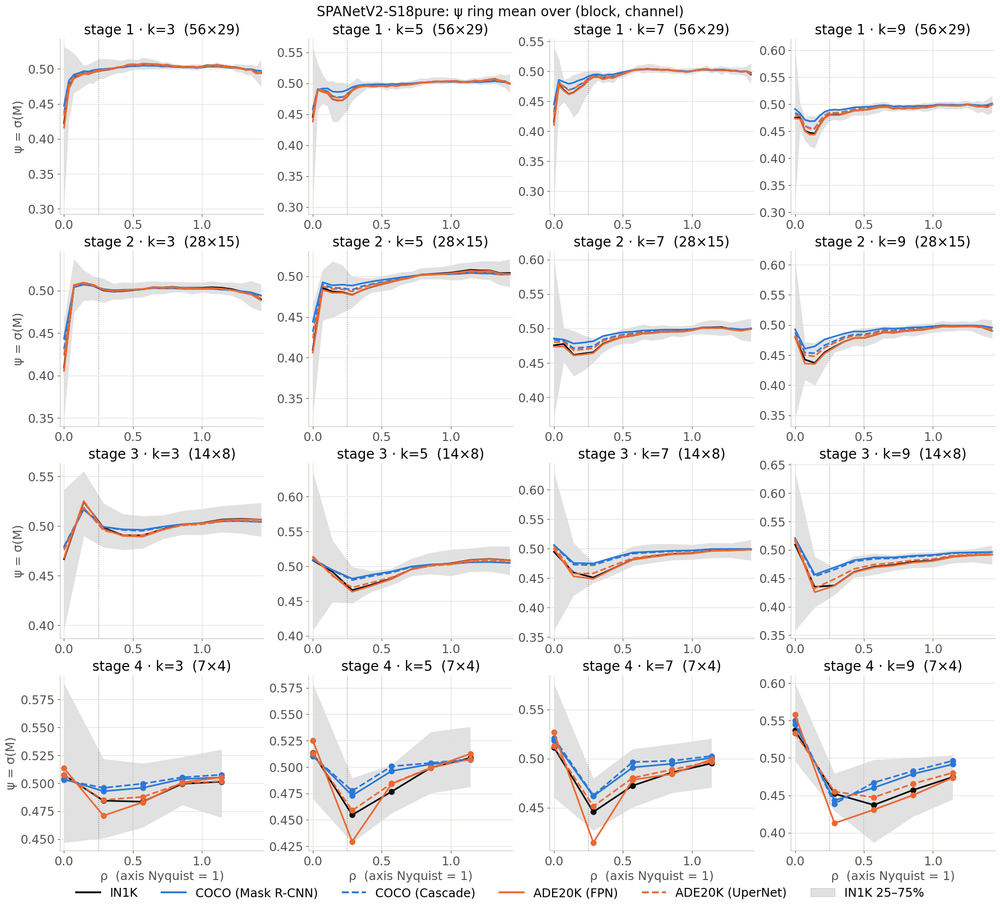

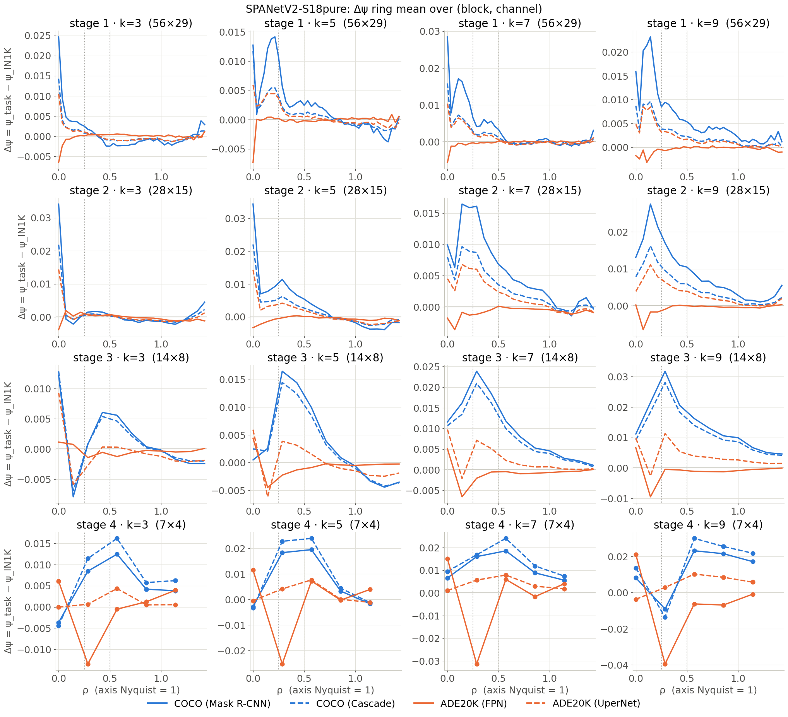

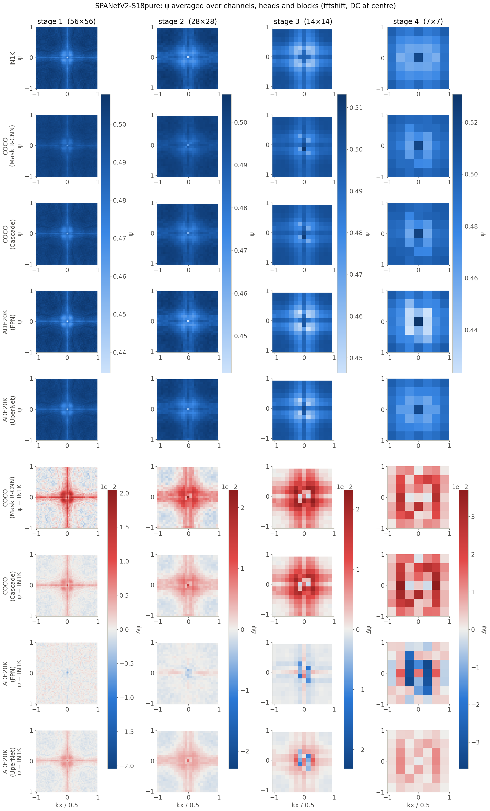

| 단계 | k | 체크포인트 | ψ_DC | ψ_low | ψ_mid | ψ_high | ψ_high/ψ_low | Δψ_low | Δψ_high | Δ(high/low) |
|---|---|---|---|---|---|---|---|---|---|---|
| 1 | 3 | IN1K | 0.4226 | 0.4917 | 0.5019 | 0.5045 | 1.0260 |  |  |  |
| 1 | 3 | COCO Mask R-CNN | 0.4472 | 0.4957 | 0.5017 | 0.5029 | 1.0147 | +0.0040 | -0.0015 | -0.0114 |
| 1 | 3 | COCO Cascade | 0.4368 | 0.4934 | 0.5019 | 0.5036 | 1.0207 | +0.0018 | -0.0008 | -0.0054 |
| 1 | 3 | ADE20K FPN | 0.4160 | 0.4914 | 0.5023 | 0.5046 | 1.0269 | -0.0003 | +0.0002 | +0.0009 |
| 1 | 3 | ADE20K UperNet | 0.4331 | 0.4932 | 0.5020 | 0.5036 | 1.0211 | +0.0015 | -0.0008 | -0.0049 |
| 1 | 5 | IN1K | 0.4456 | 0.4764 | 0.4935 | 0.5011 | 1.0519 |  |  |  |
| 1 | 5 | COCO Mask R-CNN | 0.4583 | 0.4878 | 0.4969 | 0.5012 | 1.0275 | +0.0114 | +0.0001 | -0.0244 |
| 1 | 5 | COCO Cascade | 0.4573 | 0.4809 | 0.4948 | 0.5009 | 1.0415 | +0.0046 | -0.0002 | -0.0104 |
| 1 | 5 | ADE20K FPN | 0.4382 | 0.4766 | 0.4933 | 0.5011 | 1.0515 | +0.0002 | +0.0000 | -0.0004 |
| 1 | 5 | ADE20K UperNet | 0.4515 | 0.4804 | 0.4944 | 0.5008 | 1.0423 | +0.0041 | -0.0003 | -0.0096 |
| 1 | 7 | IN1K | 0.4161 | 0.4712 | 0.4900 | 0.5016 | 1.0647 |  |  |  |
| 1 | 7 | COCO Mask R-CNN | 0.4446 | 0.4841 | 0.4948 | 0.5016 | 1.0360 | +0.0130 | -0.0001 | -0.0287 |
| 1 | 7 | COCO Cascade | 0.4319 | 0.4765 | 0.4920 | 0.5013 | 1.0521 | +0.0054 | -0.0003 | -0.0125 |
| 1 | 7 | ADE20K FPN | 0.4105 | 0.4705 | 0.4897 | 0.5016 | 1.0661 | -0.0006 | -0.0000 | +0.0014 |
| 1 | 7 | ADE20K UperNet | 0.4265 | 0.4759 | 0.4914 | 0.5012 | 1.0530 | +0.0048 | -0.0005 | -0.0117 |
| 1 | 9 | IN1K | 0.4751 | 0.4615 | 0.4851 | 0.4941 | 1.0705 |  |  |  |
| 1 | 9 | COCO Mask R-CNN | 0.4911 | 0.4779 | 0.4922 | 0.4971 | 1.0403 | +0.0163 | +0.0031 | -0.0301 |
| 1 | 9 | COCO Cascade | 0.4839 | 0.4685 | 0.4881 | 0.4952 | 1.0570 | +0.0070 | +0.0011 | -0.0135 |
| 1 | 9 | ADE20K FPN | 0.4734 | 0.4603 | 0.4848 | 0.4940 | 1.0733 | -0.0012 | -0.0000 | +0.0028 |
| 1 | 9 | ADE20K UperNet | 0.4800 | 0.4676 | 0.4875 | 0.4949 | 1.0585 | +0.0060 | +0.0009 | -0.0120 |
| 2 | 3 | IN1K | 0.4093 | 0.5064 | 0.4993 | 0.5030 | 0.9933 |  |  |  |
| 2 | 3 | COCO Mask R-CNN | 0.4434 | 0.5055 | 0.5008 | 0.5019 | 0.9928 | -0.0008 | -0.0011 | -0.0005 |
| 2 | 3 | COCO Cascade | 0.4311 | 0.5063 | 0.5001 | 0.5021 | 0.9917 | -0.0001 | -0.0009 | -0.0016 |
| 2 | 3 | ADE20K FPN | 0.4055 | 0.5075 | 0.4999 | 0.5026 | 0.9903 | +0.0012 | -0.0003 | -0.0029 |
| 2 | 3 | ADE20K UperNet | 0.4236 | 0.5065 | 0.4999 | 0.5021 | 0.9915 | +0.0001 | -0.0008 | -0.0018 |
| 2 | 5 | IN1K | 0.4097 | 0.4819 | 0.4833 | 0.5017 | 1.0410 |  |  |  |
| 2 | 5 | COCO Mask R-CNN | 0.4440 | 0.4902 | 0.4917 | 0.5014 | 1.0230 | +0.0082 | -0.0003 | -0.0180 |
| 2 | 5 | COCO Cascade | 0.4317 | 0.4867 | 0.4878 | 0.5012 | 1.0299 | +0.0047 | -0.0005 | -0.0111 |
| 2 | 5 | ADE20K FPN | 0.4064 | 0.4806 | 0.4834 | 0.5012 | 1.0428 | -0.0013 | -0.0005 | +0.0018 |
| 2 | 5 | ADE20K UperNet | 0.4240 | 0.4850 | 0.4865 | 0.5010 | 1.0330 | +0.0031 | -0.0007 | -0.0080 |
| 2 | 7 | IN1K | 0.4755 | 0.4660 | 0.4776 | 0.4954 | 1.0632 |  |  |  |
| 2 | 7 | COCO Mask R-CNN | 0.4854 | 0.4799 | 0.4886 | 0.4982 | 1.0380 | +0.0139 | +0.0027 | -0.0252 |
| 2 | 7 | COCO Cascade | 0.4835 | 0.4741 | 0.4835 | 0.4966 | 1.0475 | +0.0081 | +0.0012 | -0.0157 |
| 2 | 7 | ADE20K FPN | 0.4737 | 0.4643 | 0.4769 | 0.4950 | 1.0662 | -0.0017 | -0.0004 | +0.0030 |
| 2 | 7 | ADE20K UperNet | 0.4800 | 0.4715 | 0.4816 | 0.4959 | 1.0516 | +0.0056 | +0.0005 | -0.0116 |
| 2 | 9 | IN1K | 0.4796 | 0.4459 | 0.4734 | 0.4908 | 1.1006 |  |  |  |
| 2 | 9 | COCO Mask R-CNN | 0.4927 | 0.4686 | 0.4864 | 0.4955 | 1.0574 | +0.0227 | +0.0048 | -0.0432 |
| 2 | 9 | COCO Cascade | 0.4874 | 0.4591 | 0.4807 | 0.4931 | 1.0742 | +0.0131 | +0.0024 | -0.0264 |
| 2 | 9 | ADE20K FPN | 0.4798 | 0.4431 | 0.4731 | 0.4904 | 1.1067 | -0.0028 | -0.0003 | +0.0061 |
| 2 | 9 | ADE20K UperNet | 0.4834 | 0.4547 | 0.4782 | 0.4922 | 1.0825 | +0.0088 | +0.0014 | -0.0181 |
| 3 | 3 | IN1K | 0.4666 | 0.5245 | 0.4940 | 0.4997 | 0.9527 |  |  |  |
| 3 | 3 | COCO Mask R-CNN | 0.4788 | 0.5166 | 0.4978 | 0.5010 | 0.9698 | -0.0079 | +0.0013 | +0.0171 |
| 3 | 3 | COCO Cascade | 0.4794 | 0.5176 | 0.4974 | 0.5007 | 0.9673 | -0.0069 | +0.0010 | +0.0146 |
| 3 | 3 | ADE20K FPN | 0.4677 | 0.5253 | 0.4930 | 0.4992 | 0.9503 | +0.0008 | -0.0006 | -0.0024 |
| 3 | 3 | ADE20K UperNet | 0.4759 | 0.5187 | 0.4930 | 0.4990 | 0.9619 | -0.0058 | -0.0008 | +0.0092 |
| 3 | 5 | IN1K | 0.5085 | 0.4921 | 0.4702 | 0.4987 | 1.0133 |  |  |  |
| 3 | 5 | COCO Mask R-CNN | 0.5090 | 0.4947 | 0.4855 | 0.5008 | 1.0124 | +0.0026 | +0.0021 | -0.0009 |
| 3 | 5 | COCO Cascade | 0.5110 | 0.4942 | 0.4835 | 0.5003 | 1.0122 | +0.0021 | +0.0016 | -0.0011 |
| 3 | 5 | ADE20K FPN | 0.5129 | 0.4876 | 0.4684 | 0.4982 | 1.0216 | -0.0045 | -0.0005 | +0.0083 |
| 3 | 5 | ADE20K UperNet | 0.5145 | 0.4860 | 0.4736 | 0.4980 | 1.0247 | -0.0062 | -0.0007 | +0.0114 |
| 3 | 7 | IN1K | 0.4948 | 0.4597 | 0.4599 | 0.4899 | 1.0658 |  |  |  |
| 3 | 7 | COCO Mask R-CNN | 0.5064 | 0.4758 | 0.4807 | 0.4964 | 1.0431 | +0.0162 | +0.0064 | -0.0227 |
| 3 | 7 | COCO Cascade | 0.5055 | 0.4731 | 0.4782 | 0.4954 | 1.0470 | +0.0134 | +0.0054 | -0.0188 |
| 3 | 7 | ADE20K FPN | 0.4999 | 0.4531 | 0.4587 | 0.4892 | 1.0797 | -0.0066 | -0.0007 | +0.0139 |
| 3 | 7 | ADE20K UperNet | 0.5046 | 0.4576 | 0.4659 | 0.4909 | 1.0729 | -0.0021 | +0.0010 | +0.0071 |
| 3 | 9 | IN1K | 0.5095 | 0.4350 | 0.4511 | 0.4786 | 1.1002 |  |  |  |
| 3 | 9 | COCO Mask R-CNN | 0.5206 | 0.4565 | 0.4765 | 0.4898 | 1.0731 | +0.0215 | +0.0112 | -0.0272 |
| 3 | 9 | COCO Cascade | 0.5186 | 0.4534 | 0.4736 | 0.4884 | 1.0772 | +0.0184 | +0.0097 | -0.0231 |
| 3 | 9 | ADE20K FPN | 0.5161 | 0.4256 | 0.4505 | 0.4776 | 1.1224 | -0.0095 | -0.0010 | +0.0221 |
| 3 | 9 | ADE20K UperNet | 0.5192 | 0.4324 | 0.4590 | 0.4816 | 1.1136 | -0.0026 | +0.0029 | +0.0134 |
| 4 | 3 | IN1K | 0.5074 | — | 0.4844 | 0.4953 | — |  |  |  |
| 4 | 3 | COCO Mask R-CNN | 0.5038 | — | 0.4928 | 0.5018 | — | — | +0.0065 | — |
| 4 | 3 | COCO Cascade | 0.5029 | — | 0.4958 | 0.5043 | — | — | +0.0090 | — |
| 4 | 3 | ADE20K FPN | 0.5135 | — | 0.4710 | 0.4968 | — | — | +0.0015 | — |
| 4 | 3 | ADE20K UperNet | 0.5073 | — | 0.4850 | 0.4969 | — | — | +0.0017 | — |
| 4 | 5 | IN1K | 0.5136 | — | 0.4547 | 0.4954 | — |  |  |  |
| 4 | 5 | COCO Mask R-CNN | 0.5108 | — | 0.4730 | 0.5021 | — | — | +0.0067 | — |
| 4 | 5 | COCO Cascade | 0.5103 | — | 0.4775 | 0.5040 | — | — | +0.0086 | — |
| 4 | 5 | ADE20K FPN | 0.5251 | — | 0.4294 | 0.4986 | — | — | +0.0032 | — |
| 4 | 5 | ADE20K UperNet | 0.5131 | — | 0.4588 | 0.4974 | — | — | +0.0020 | — |
| 4 | 7 | IN1K | 0.5116 | — | 0.4457 | 0.4847 | — |  |  |  |
| 4 | 7 | COCO Mask R-CNN | 0.5182 | — | 0.4617 | 0.4955 | — | — | +0.0108 | — |
| 4 | 7 | COCO Cascade | 0.5210 | — | 0.4625 | 0.4989 | — | — | +0.0142 | — |
| 4 | 7 | ADE20K FPN | 0.5267 | — | 0.4144 | 0.4870 | — | — | +0.0024 | — |
| 4 | 7 | ADE20K UperNet | 0.5126 | — | 0.4514 | 0.4888 | — | — | +0.0041 | — |
| 4 | 9 | IN1K | 0.5368 | — | 0.4522 | 0.4564 | — |  |  |  |
| 4 | 9 | COCO Mask R-CNN | 0.5450 | — | 0.4431 | 0.4770 | — | — | +0.0207 | — |
| 4 | 9 | COCO Cascade | 0.5505 | — | 0.4387 | 0.4821 | — | — | +0.0257 | — |
| 4 | 9 | ADE20K FPN | 0.5579 | — | 0.4127 | 0.4515 | — | — | -0.0049 | — |
| 4 | 9 | ADE20K UperNet | 0.5331 | — | 0.4550 | 0.4645 | — | — | +0.0082 | — |

#### SPANetV2-S36-pure

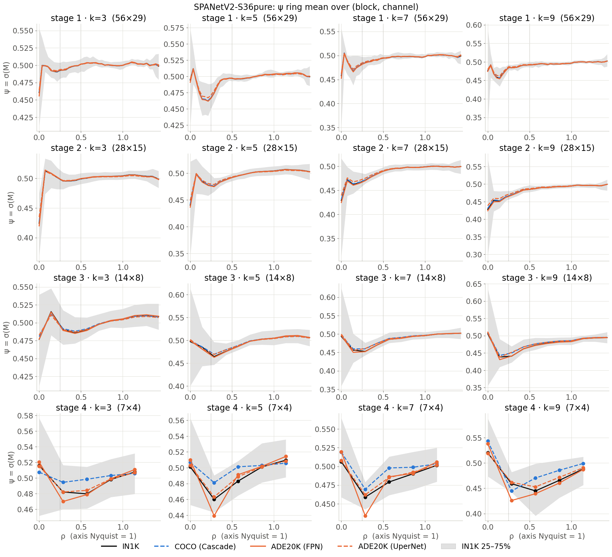

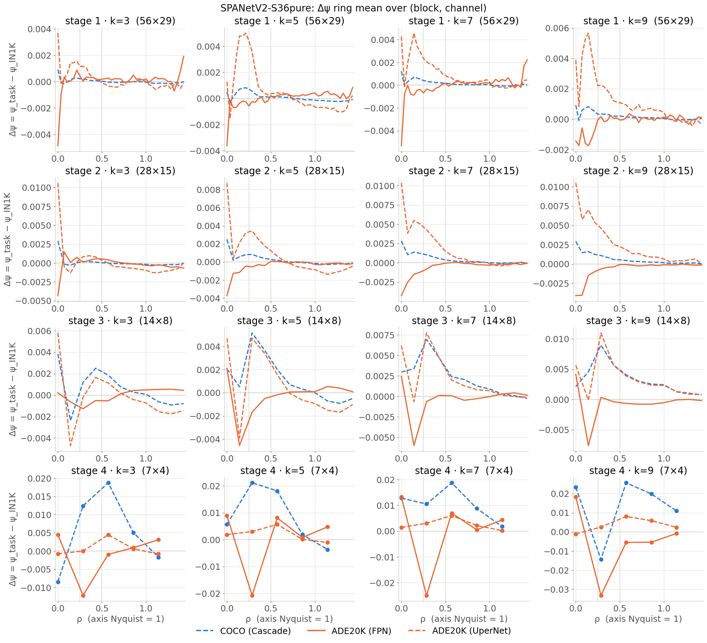

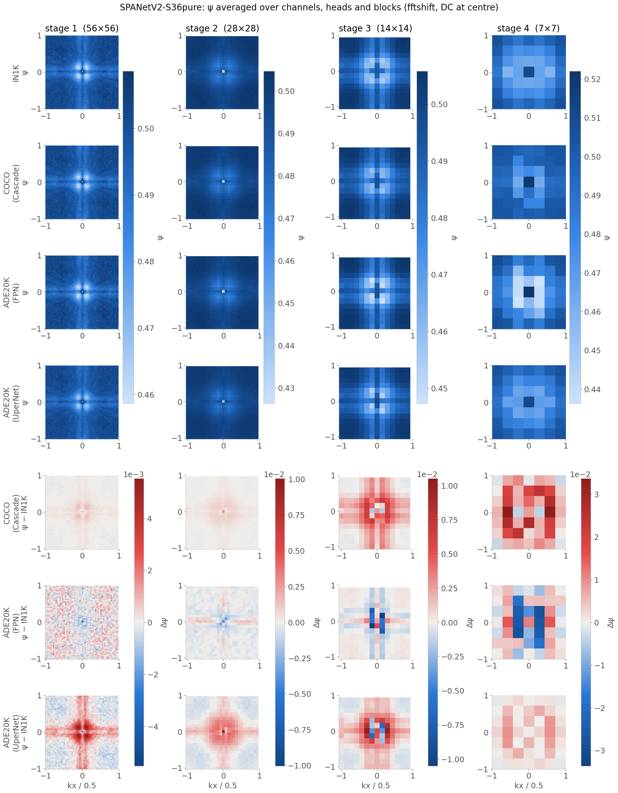

| 단계 | k | 체크포인트 | ψ_DC | ψ_low | ψ_mid | ψ_high | ψ_high/ψ_low | Δψ_low | Δψ_high | Δ(high/low) |
|---|---|---|---|---|---|---|---|---|---|---|
| 1 | 3 | IN1K | 0.4606 | 0.4931 | 0.4971 | 0.5014 | 1.0167 |  |  |  |
| 1 | 3 | COCO Cascade | 0.4615 | 0.4933 | 0.4972 | 0.5013 | 1.0163 | +0.0001 | -0.0001 | -0.0004 |
| 1 | 3 | ADE20K FPN | 0.4557 | 0.4934 | 0.4974 | 0.5015 | 1.0165 | +0.0003 | +0.0002 | -0.0003 |
| 1 | 3 | ADE20K UperNet | 0.4643 | 0.4943 | 0.4976 | 0.5012 | 1.0140 | +0.0012 | -0.0002 | -0.0027 |
| 1 | 5 | IN1K | 0.4947 | 0.4704 | 0.4901 | 0.5010 | 1.0651 |  |  |  |
| 1 | 5 | COCO Cascade | 0.4951 | 0.4710 | 0.4904 | 0.5010 | 1.0636 | +0.0006 | -0.0000 | -0.0015 |
| 1 | 5 | ADE20K FPN | 0.4910 | 0.4700 | 0.4900 | 0.5013 | 1.0666 | -0.0004 | +0.0003 | +0.0015 |
| 1 | 5 | ADE20K UperNet | 0.4959 | 0.4744 | 0.4915 | 0.5008 | 1.0556 | +0.0040 | -0.0003 | -0.0095 |
| 1 | 7 | IN1K | 0.4580 | 0.4774 | 0.4894 | 0.4979 | 1.0428 |  |  |  |
| 1 | 7 | COCO Cascade | 0.4592 | 0.4780 | 0.4896 | 0.4979 | 1.0418 | +0.0005 | +0.0000 | -0.0011 |
| 1 | 7 | ADE20K FPN | 0.4527 | 0.4769 | 0.4891 | 0.4981 | 1.0445 | -0.0006 | +0.0002 | +0.0017 |
| 1 | 7 | ADE20K UperNet | 0.4622 | 0.4806 | 0.4909 | 0.4981 | 1.0366 | +0.0031 | +0.0002 | -0.0062 |
| 1 | 9 | IN1K | 0.4757 | 0.4693 | 0.4883 | 0.4956 | 1.0561 |  |  |  |
| 1 | 9 | COCO Cascade | 0.4766 | 0.4699 | 0.4886 | 0.4957 | 1.0549 | +0.0006 | +0.0001 | -0.0012 |
| 1 | 9 | ADE20K FPN | 0.4743 | 0.4681 | 0.4884 | 0.4957 | 1.0588 | -0.0011 | +0.0001 | +0.0027 |
| 1 | 9 | ADE20K UperNet | 0.4796 | 0.4733 | 0.4900 | 0.4961 | 1.0481 | +0.0040 | +0.0005 | -0.0080 |
| 2 | 3 | IN1K | 0.4243 | 0.5062 | 0.4960 | 0.5033 | 0.9942 |  |  |  |
| 2 | 3 | COCO Cascade | 0.4272 | 0.5061 | 0.4961 | 0.5031 | 0.9942 | -0.0001 | -0.0001 | -0.0000 |
| 2 | 3 | ADE20K FPN | 0.4199 | 0.5069 | 0.4964 | 0.5032 | 0.9927 | +0.0007 | -0.0001 | -0.0015 |
| 2 | 3 | ADE20K UperNet | 0.4349 | 0.5057 | 0.4968 | 0.5025 | 0.9938 | -0.0005 | -0.0007 | -0.0004 |
| 2 | 5 | IN1K | 0.4403 | 0.4846 | 0.4836 | 0.5019 | 1.0357 |  |  |  |
| 2 | 5 | COCO Cascade | 0.4427 | 0.4852 | 0.4841 | 0.5019 | 1.0344 | +0.0006 | -0.0001 | -0.0014 |
| 2 | 5 | ADE20K FPN | 0.4365 | 0.4837 | 0.4832 | 0.5018 | 1.0374 | -0.0009 | -0.0001 | +0.0016 |
| 2 | 5 | ADE20K UperNet | 0.4490 | 0.4868 | 0.4860 | 0.5014 | 1.0300 | +0.0022 | -0.0005 | -0.0057 |
| 2 | 7 | IN1K | 0.4290 | 0.4659 | 0.4793 | 0.4973 | 1.0674 |  |  |  |
| 2 | 7 | COCO Cascade | 0.4318 | 0.4671 | 0.4800 | 0.4974 | 1.0648 | +0.0012 | +0.0001 | -0.0026 |
| 2 | 7 | ADE20K FPN | 0.4247 | 0.4643 | 0.4789 | 0.4971 | 1.0708 | -0.0016 | -0.0002 | +0.0033 |
| 2 | 7 | ADE20K UperNet | 0.4393 | 0.4708 | 0.4824 | 0.4975 | 1.0568 | +0.0049 | +0.0002 | -0.0107 |
| 2 | 9 | IN1K | 0.4282 | 0.4570 | 0.4780 | 0.4924 | 1.0773 |  |  |  |
| 2 | 9 | COCO Cascade | 0.4311 | 0.4584 | 0.4787 | 0.4926 | 1.0745 | +0.0014 | +0.0002 | -0.0028 |
| 2 | 9 | ADE20K FPN | 0.4241 | 0.4552 | 0.4776 | 0.4922 | 1.0813 | -0.0018 | -0.0002 | +0.0040 |
| 2 | 9 | ADE20K UperNet | 0.4387 | 0.4631 | 0.4813 | 0.4934 | 1.0655 | +0.0060 | +0.0010 | -0.0118 |
| 3 | 3 | IN1K | 0.4769 | 0.5156 | 0.4877 | 0.5010 | 0.9717 |  |  |  |
| 3 | 3 | COCO Cascade | 0.4807 | 0.5132 | 0.4897 | 0.5015 | 0.9771 | -0.0024 | +0.0005 | +0.0054 |
| 3 | 3 | ADE20K FPN | 0.4771 | 0.5150 | 0.4869 | 0.5012 | 0.9733 | -0.0006 | +0.0002 | +0.0016 |
| 3 | 3 | ADE20K UperNet | 0.4827 | 0.5109 | 0.4886 | 0.5007 | 0.9801 | -0.0047 | -0.0003 | +0.0084 |
| 3 | 5 | IN1K | 0.4971 | 0.4852 | 0.4709 | 0.5002 | 1.0309 |  |  |  |
| 3 | 5 | COCO Cascade | 0.4991 | 0.4857 | 0.4752 | 0.5006 | 1.0308 | +0.0005 | +0.0005 | -0.0001 |
| 3 | 5 | ADE20K FPN | 0.4992 | 0.4806 | 0.4699 | 0.5003 | 1.0409 | -0.0046 | +0.0001 | +0.0100 |
| 3 | 5 | ADE20K UperNet | 0.5018 | 0.4813 | 0.4748 | 0.4999 | 1.0386 | -0.0039 | -0.0003 | +0.0077 |
| 3 | 7 | IN1K | 0.4934 | 0.4562 | 0.4627 | 0.4927 | 1.0800 |  |  |  |
| 3 | 7 | COCO Cascade | 0.4964 | 0.4596 | 0.4684 | 0.4941 | 1.0750 | +0.0034 | +0.0014 | -0.0050 |
| 3 | 7 | ADE20K FPN | 0.4959 | 0.4502 | 0.4625 | 0.4926 | 1.0942 | -0.0060 | -0.0001 | +0.0142 |
| 3 | 7 | ADE20K UperNet | 0.4996 | 0.4556 | 0.4688 | 0.4937 | 1.0837 | -0.0007 | +0.0010 | +0.0037 |
| 3 | 9 | IN1K | 0.5058 | 0.4384 | 0.4530 | 0.4816 | 1.0987 |  |  |  |
| 3 | 9 | COCO Cascade | 0.5079 | 0.4429 | 0.4601 | 0.4843 | 1.0933 | +0.0046 | +0.0027 | -0.0054 |
| 3 | 9 | ADE20K FPN | 0.5099 | 0.4308 | 0.4529 | 0.4810 | 1.1167 | -0.0076 | -0.0006 | +0.0180 |
| 3 | 9 | ADE20K UperNet | 0.5114 | 0.4383 | 0.4609 | 0.4842 | 1.1047 | -0.0001 | +0.0025 | +0.0061 |
| 4 | 3 | IN1K | 0.5159 | — | 0.4821 | 0.4954 | — |  |  |  |
| 4 | 3 | COCO Cascade | 0.5075 | — | 0.4945 | 0.5026 | — | — | +0.0071 | — |
| 4 | 3 | ADE20K FPN | 0.5204 | — | 0.4699 | 0.4965 | — | — | +0.0010 | — |
| 4 | 3 | ADE20K UperNet | 0.5152 | — | 0.4820 | 0.4968 | — | — | +0.0013 | — |
| 4 | 5 | IN1K | 0.5012 | — | 0.4601 | 0.4982 | — |  |  |  |
| 4 | 5 | COCO Cascade | 0.5069 | — | 0.4812 | 0.5033 | — | — | +0.0051 | — |
| 4 | 5 | ADE20K FPN | 0.5101 | — | 0.4393 | 0.5024 | — | — | +0.0042 | — |
| 4 | 5 | ADE20K UperNet | 0.5031 | — | 0.4631 | 0.4996 | — | — | +0.0014 | — |
| 4 | 7 | IN1K | 0.5063 | — | 0.4589 | 0.4902 | — |  |  |  |
| 4 | 7 | COCO Cascade | 0.5191 | — | 0.4694 | 0.4999 | — | — | +0.0097 | — |
| 4 | 7 | ADE20K FPN | 0.5195 | — | 0.4339 | 0.4938 | — | — | +0.0036 | — |
| 4 | 7 | ADE20K UperNet | 0.5077 | — | 0.4619 | 0.4930 | — | — | +0.0028 | — |
| 4 | 9 | IN1K | 0.5201 | — | 0.4590 | 0.4662 | — |  |  |  |
| 4 | 9 | COCO Cascade | 0.5434 | — | 0.4446 | 0.4851 | — | — | +0.0189 | — |
| 4 | 9 | ADE20K FPN | 0.5383 | — | 0.4258 | 0.4621 | — | — | -0.0041 | — |
| 4 | 9 | ADE20K UperNet | 0.5190 | — | 0.4616 | 0.4717 | — | — | +0.0055 | — |

#### SPANetV2-S18-hybrid

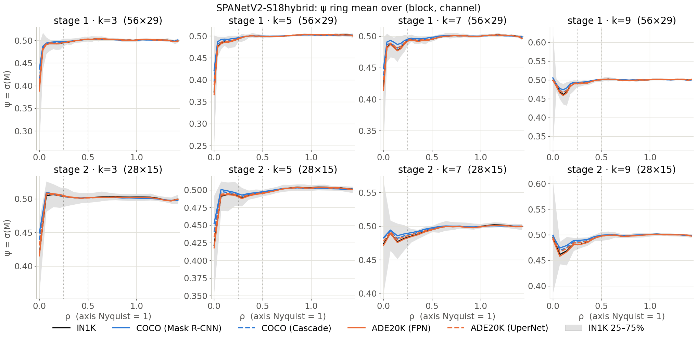

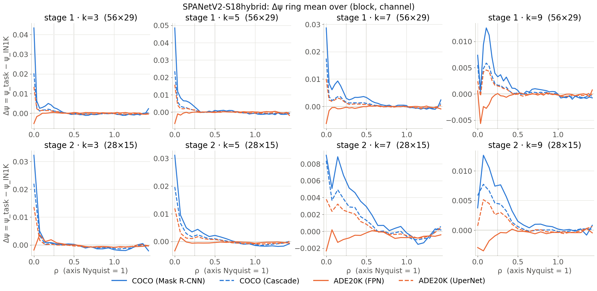

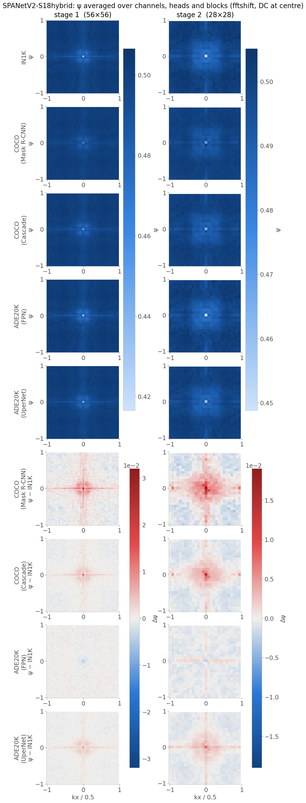

| 단계 | k | 체크포인트 | ψ_DC | ψ_low | ψ_mid | ψ_high | ψ_high/ψ_low | Δψ_low | Δψ_high | Δ(high/low) |
|---|---|---|---|---|---|---|---|---|---|---|
| 1 | 3 | IN1K | 0.3933 | 0.4921 | 0.4995 | 0.5018 | 1.0196 |  |  |  |
| 1 | 3 | COCO Mask R-CNN | 0.4367 | 0.4962 | 0.5000 | 0.5012 | 1.0102 | +0.0041 | -0.0005 | -0.0094 |
| 1 | 3 | COCO Cascade | 0.4136 | 0.4939 | 0.4997 | 0.5014 | 1.0152 | +0.0018 | -0.0004 | -0.0044 |
| 1 | 3 | ADE20K FPN | 0.3881 | 0.4921 | 0.4996 | 0.5020 | 1.0201 | -0.0000 | +0.0002 | +0.0004 |
| 1 | 3 | ADE20K UperNet | 0.4067 | 0.4934 | 0.4996 | 0.5015 | 1.0162 | +0.0014 | -0.0003 | -0.0034 |
| 1 | 5 | IN1K | 0.3724 | 0.4869 | 0.4989 | 0.5014 | 1.0298 |  |  |  |
| 1 | 5 | COCO Mask R-CNN | 0.4209 | 0.4930 | 0.4994 | 0.5012 | 1.0166 | +0.0061 | -0.0002 | -0.0132 |
| 1 | 5 | COCO Cascade | 0.3959 | 0.4892 | 0.4990 | 0.5011 | 1.0243 | +0.0023 | -0.0003 | -0.0056 |
| 1 | 5 | ADE20K FPN | 0.3658 | 0.4865 | 0.4988 | 0.5015 | 1.0310 | -0.0004 | +0.0001 | +0.0011 |
| 1 | 5 | ADE20K UperNet | 0.3882 | 0.4888 | 0.4991 | 0.5012 | 1.0252 | +0.0019 | -0.0003 | -0.0046 |
| 1 | 7 | IN1K | 0.4198 | 0.4833 | 0.4933 | 0.4999 | 1.0343 |  |  |  |
| 1 | 7 | COCO Mask R-CNN | 0.4485 | 0.4903 | 0.4965 | 0.5003 | 1.0204 | +0.0070 | +0.0004 | -0.0139 |
| 1 | 7 | COCO Cascade | 0.4373 | 0.4862 | 0.4946 | 0.4999 | 1.0281 | +0.0029 | -0.0000 | -0.0062 |
| 1 | 7 | ADE20K FPN | 0.4136 | 0.4827 | 0.4930 | 0.4999 | 1.0357 | -0.0006 | +0.0000 | +0.0014 |
| 1 | 7 | ADE20K UperNet | 0.4298 | 0.4857 | 0.4942 | 0.4998 | 1.0291 | +0.0024 | -0.0001 | -0.0052 |
| 1 | 9 | IN1K | 0.4980 | 0.4783 | 0.4954 | 0.5002 | 1.0459 |  |  |  |
| 1 | 9 | COCO Mask R-CNN | 0.5054 | 0.4857 | 0.4973 | 0.5005 | 1.0304 | +0.0074 | +0.0002 | -0.0154 |
| 1 | 9 | COCO Cascade | 0.5035 | 0.4818 | 0.4961 | 0.5002 | 1.0381 | +0.0035 | -0.0000 | -0.0078 |
| 1 | 9 | ADE20K FPN | 0.4986 | 0.4769 | 0.4951 | 0.5002 | 1.0488 | -0.0014 | -0.0001 | +0.0029 |
| 1 | 9 | ADE20K UperNet | 0.5004 | 0.4811 | 0.4959 | 0.5001 | 1.0394 | +0.0028 | -0.0001 | -0.0065 |
| 2 | 3 | IN1K | 0.4170 | 0.5050 | 0.5015 | 0.5024 | 0.9947 |  |  |  |
| 2 | 3 | COCO Mask R-CNN | 0.4492 | 0.5068 | 0.5018 | 0.5012 | 0.9889 | +0.0018 | -0.0012 | -0.0058 |
| 2 | 3 | COCO Cascade | 0.4390 | 0.5062 | 0.5016 | 0.5014 | 0.9907 | +0.0011 | -0.0009 | -0.0040 |
| 2 | 3 | ADE20K FPN | 0.4152 | 0.5071 | 0.5019 | 0.5018 | 0.9894 | +0.0021 | -0.0006 | -0.0052 |
| 2 | 3 | ADE20K UperNet | 0.4306 | 0.5056 | 0.5014 | 0.5017 | 0.9922 | +0.0005 | -0.0007 | -0.0024 |
| 2 | 5 | IN1K | 0.4211 | 0.4926 | 0.4918 | 0.5020 | 1.0191 |  |  |  |
| 2 | 5 | COCO Mask R-CNN | 0.4523 | 0.4979 | 0.4947 | 0.5015 | 1.0074 | +0.0053 | -0.0004 | -0.0117 |
| 2 | 5 | COCO Cascade | 0.4408 | 0.4957 | 0.4933 | 0.5014 | 1.0114 | +0.0032 | -0.0006 | -0.0077 |
| 2 | 5 | ADE20K FPN | 0.4178 | 0.4926 | 0.4912 | 0.5017 | 1.0185 | -0.0000 | -0.0003 | -0.0006 |
| 2 | 5 | ADE20K UperNet | 0.4331 | 0.4941 | 0.4929 | 0.5014 | 1.0149 | +0.0015 | -0.0005 | -0.0042 |
| 2 | 7 | IN1K | 0.4736 | 0.4818 | 0.4891 | 0.4993 | 1.0363 |  |  |  |
| 2 | 7 | COCO Mask R-CNN | 0.4827 | 0.4888 | 0.4933 | 0.4996 | 1.0221 | +0.0070 | +0.0003 | -0.0143 |
| 2 | 7 | COCO Cascade | 0.4820 | 0.4859 | 0.4914 | 0.4991 | 1.0270 | +0.0042 | -0.0002 | -0.0093 |
| 2 | 7 | ADE20K FPN | 0.4713 | 0.4809 | 0.4887 | 0.4987 | 1.0371 | -0.0008 | -0.0005 | +0.0007 |
| 2 | 7 | ADE20K UperNet | 0.4774 | 0.4845 | 0.4908 | 0.4990 | 1.0300 | +0.0027 | -0.0003 | -0.0064 |
| 2 | 9 | IN1K | 0.4939 | 0.4725 | 0.4885 | 0.4991 | 1.0563 |  |  |  |
| 2 | 9 | COCO Mask R-CNN | 0.4977 | 0.4821 | 0.4933 | 0.4997 | 1.0364 | +0.0096 | +0.0006 | -0.0199 |
| 2 | 9 | COCO Cascade | 0.4997 | 0.4785 | 0.4911 | 0.4991 | 1.0431 | +0.0060 | -0.0000 | -0.0132 |
| 2 | 9 | ADE20K FPN | 0.4910 | 0.4707 | 0.4883 | 0.4987 | 1.0595 | -0.0018 | -0.0004 | +0.0032 |
| 2 | 9 | ADE20K UperNet | 0.4946 | 0.4763 | 0.4903 | 0.4989 | 1.0474 | +0.0038 | -0.0002 | -0.0088 |

#### SPANetV2-S36-hybrid

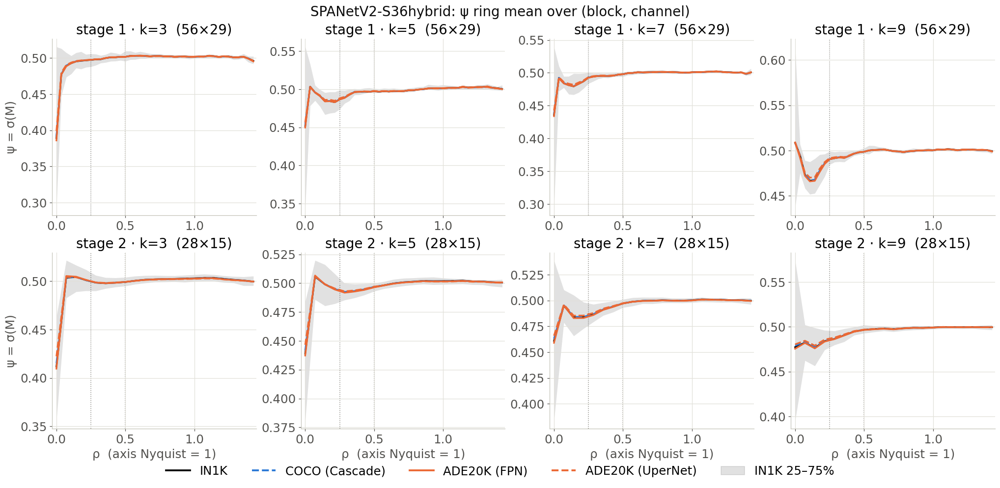

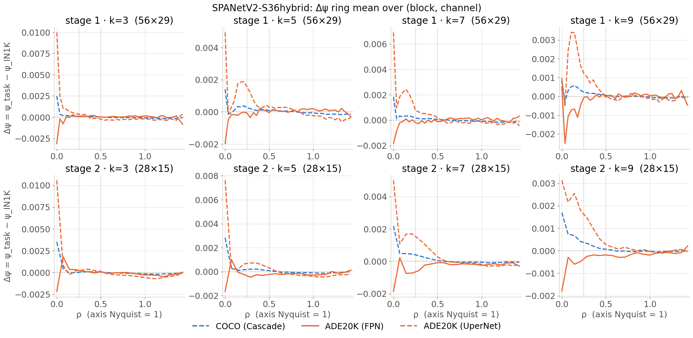

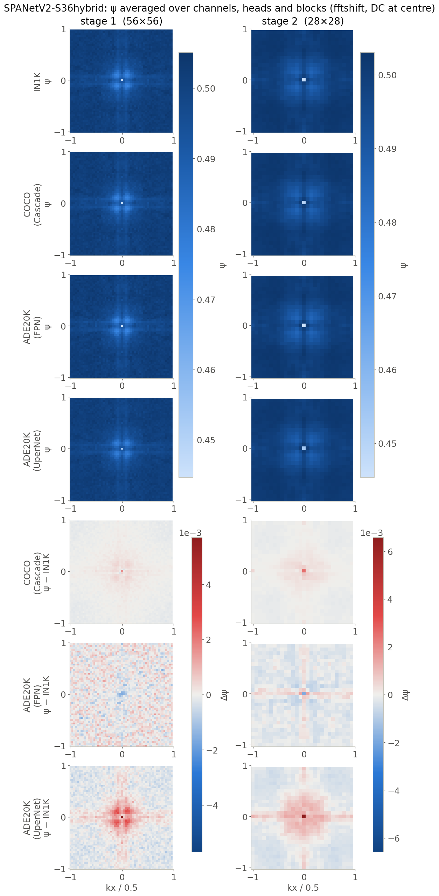

| 단계 | k | 체크포인트 | ψ_DC | ψ_low | ψ_mid | ψ_high | ψ_high/ψ_low | Δψ_low | Δψ_high | Δ(high/low) |
|---|---|---|---|---|---|---|---|---|---|---|
| 1 | 3 | IN1K | 0.3890 | 0.4941 | 0.5000 | 0.5021 | 1.0162 |  |  |  |
| 1 | 3 | COCO Cascade | 0.3915 | 0.4943 | 0.5000 | 0.5021 | 1.0158 | +0.0002 | -0.0001 | -0.0005 |
| 1 | 3 | ADE20K FPN | 0.3860 | 0.4941 | 0.5001 | 0.5022 | 1.0163 | +0.0000 | +0.0001 | +0.0001 |
| 1 | 3 | ADE20K UperNet | 0.3990 | 0.4948 | 0.5000 | 0.5019 | 1.0143 | +0.0007 | -0.0003 | -0.0020 |
| 1 | 5 | IN1K | 0.4518 | 0.4871 | 0.4948 | 0.5000 | 1.0265 |  |  |  |
| 1 | 5 | COCO Cascade | 0.4532 | 0.4873 | 0.4950 | 0.5000 | 1.0259 | +0.0003 | -0.0000 | -0.0006 |
| 1 | 5 | ADE20K FPN | 0.4498 | 0.4870 | 0.4948 | 0.5001 | 1.0270 | -0.0001 | +0.0001 | +0.0005 |
| 1 | 5 | ADE20K UperNet | 0.4567 | 0.4885 | 0.4954 | 0.4999 | 1.0234 | +0.0014 | -0.0000 | -0.0031 |
| 1 | 7 | IN1K | 0.4358 | 0.4843 | 0.4956 | 0.5008 | 1.0341 |  |  |  |
| 1 | 7 | COCO Cascade | 0.4376 | 0.4846 | 0.4957 | 0.5008 | 1.0333 | +0.0003 | -0.0001 | -0.0007 |
| 1 | 7 | ADE20K FPN | 0.4340 | 0.4843 | 0.4955 | 0.5009 | 1.0344 | -0.0001 | +0.0001 | +0.0003 |
| 1 | 7 | ADE20K UperNet | 0.4427 | 0.4862 | 0.4961 | 0.5007 | 1.0298 | +0.0018 | -0.0002 | -0.0042 |
| 1 | 9 | IN1K | 0.5084 | 0.4779 | 0.4946 | 0.5000 | 1.0464 |  |  |  |
| 1 | 9 | COCO Cascade | 0.5092 | 0.4782 | 0.4947 | 0.5000 | 1.0456 | +0.0004 | -0.0000 | -0.0009 |
| 1 | 9 | ADE20K FPN | 0.5089 | 0.4771 | 0.4946 | 0.5001 | 1.0481 | -0.0007 | +0.0000 | +0.0017 |
| 1 | 9 | ADE20K UperNet | 0.5093 | 0.4801 | 0.4952 | 0.5000 | 1.0413 | +0.0023 | -0.0001 | -0.0051 |
| 2 | 3 | IN1K | 0.4117 | 0.5027 | 0.4984 | 0.5022 | 0.9990 |  |  |  |
| 2 | 3 | COCO Cascade | 0.4152 | 0.5028 | 0.4984 | 0.5021 | 0.9986 | +0.0001 | -0.0001 | -0.0004 |
| 2 | 3 | ADE20K FPN | 0.4096 | 0.5034 | 0.4984 | 0.5021 | 0.9974 | +0.0007 | -0.0002 | -0.0016 |
| 2 | 3 | ADE20K UperNet | 0.4223 | 0.5029 | 0.4986 | 0.5018 | 0.9978 | +0.0002 | -0.0004 | -0.0012 |
| 2 | 5 | IN1K | 0.4389 | 0.4986 | 0.4937 | 0.5010 | 1.0048 |  |  |  |
| 2 | 5 | COCO Cascade | 0.4418 | 0.4988 | 0.4939 | 0.5010 | 1.0043 | +0.0002 | -0.0001 | -0.0005 |
| 2 | 5 | ADE20K FPN | 0.4373 | 0.4987 | 0.4933 | 0.5008 | 1.0042 | +0.0001 | -0.0002 | -0.0006 |
| 2 | 5 | ADE20K UperNet | 0.4466 | 0.4990 | 0.4943 | 0.5008 | 1.0035 | +0.0004 | -0.0003 | -0.0013 |
| 2 | 7 | IN1K | 0.4608 | 0.4862 | 0.4914 | 0.4999 | 1.0283 |  |  |  |
| 2 | 7 | COCO Cascade | 0.4630 | 0.4866 | 0.4916 | 0.4999 | 1.0272 | +0.0005 | -0.0000 | -0.0011 |
| 2 | 7 | ADE20K FPN | 0.4590 | 0.4856 | 0.4911 | 0.4997 | 1.0290 | -0.0005 | -0.0002 | +0.0007 |
| 2 | 7 | ADE20K UperNet | 0.4658 | 0.4877 | 0.4924 | 0.4998 | 1.0248 | +0.0016 | -0.0001 | -0.0035 |
| 2 | 9 | IN1K | 0.4774 | 0.4812 | 0.4918 | 0.4986 | 1.0363 |  |  |  |
| 2 | 9 | COCO Cascade | 0.4791 | 0.4817 | 0.4920 | 0.4986 | 1.0350 | +0.0006 | -0.0000 | -0.0013 |
| 2 | 9 | ADE20K FPN | 0.4756 | 0.4807 | 0.4916 | 0.4985 | 1.0369 | -0.0005 | -0.0002 | +0.0007 |
| 2 | 9 | ADE20K UperNet | 0.4805 | 0.4833 | 0.4927 | 0.4987 | 1.0318 | +0.0021 | +0.0000 | -0.0045 |

### 1.2 (b) 커널 |K̂|와 실효 응답 ψ·|K̂|

- **값:** 채널마다 전 주파수 평균으로 나눈 값(norm)의 (블록, 채널) 평균이다.
- **정규화 전 값:** 정규화하지 않은 |K̂|·ψ|K̂|와 p25·p75는 `data/srf_summary.csv`(quantity = kernel, effective, kernel_norm, effective_norm)에 있다.
- **그림:** `figs/effective_radial_<모델>.png`, `figs/kernel_radial_<모델>.png`.

#### SPANetV2-S18-pure

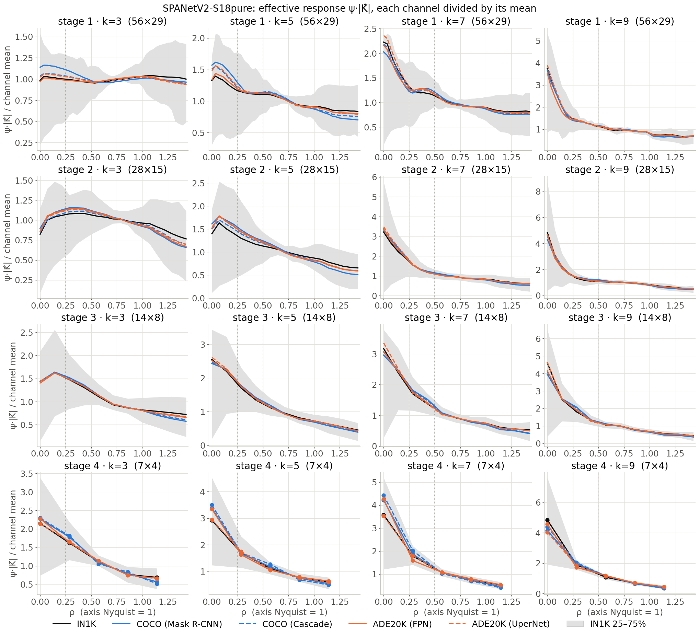

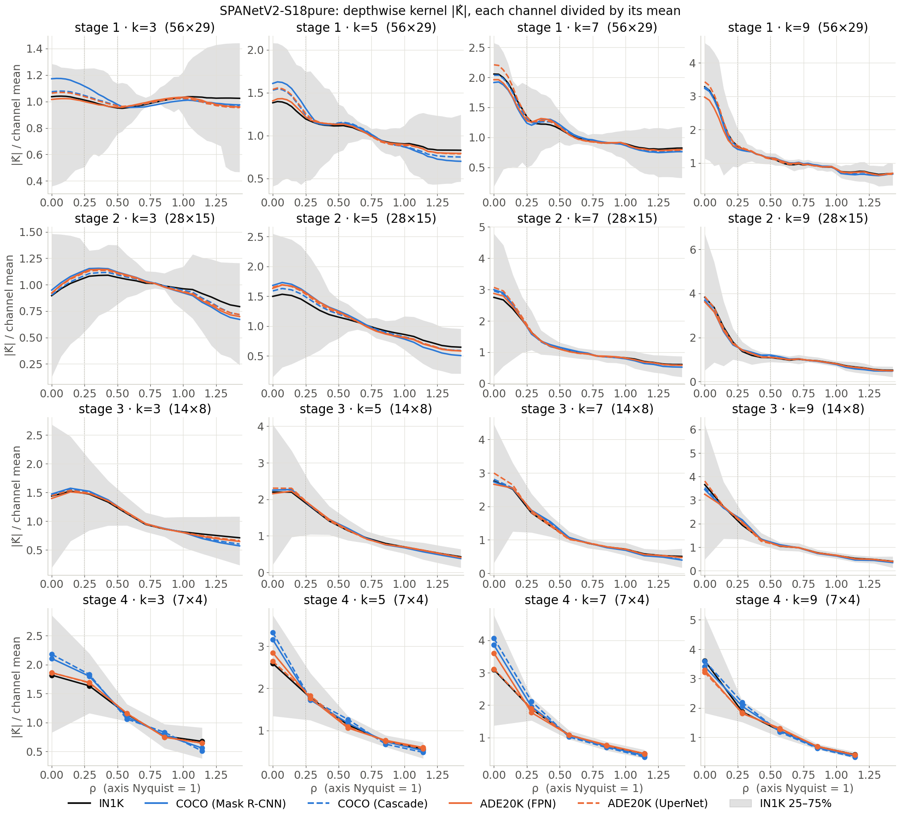

| 단계 | k | 체크포인트 | \|K̂\| low | \|K̂\| high | \|K̂\| high/low | ψ\|K̂\| DC | ψ\|K̂\| low | ψ\|K̂\| mid | ψ\|K̂\| high | ψ\|K̂\| high/low |
|---|---|---|---|---|---|---|---|---|---|---|
| 1 | 3 | IN1K | 1.028 | 1.003 | 0.975 | 0.983 | 1.010 | 0.975 | 1.004 | 0.994 |
| 1 | 3 | COCO Mask R-CNN | 1.150 | 0.984 | 0.855 | 1.138 | 1.138 | 1.041 | 0.984 | 0.865 |
| 1 | 3 | COCO Cascade | 1.066 | 0.996 | 0.934 | 1.034 | 1.051 | 1.003 | 0.997 | 0.949 |
| 1 | 3 | ADE20K FPN | 1.014 | 1.004 | 0.990 | 0.968 | 0.997 | 0.972 | 1.005 | 1.009 |
| 1 | 3 | ADE20K UperNet | 1.057 | 0.997 | 0.943 | 1.022 | 1.042 | 0.998 | 0.998 | 0.958 |
| 1 | 5 | IN1K | 1.301 | 0.958 | 0.736 | 1.327 | 1.260 | 1.121 | 0.962 | 0.764 |
| 1 | 5 | COCO Mask R-CNN | 1.492 | 0.942 | 0.631 | 1.569 | 1.463 | 1.151 | 0.945 | 0.646 |
| 1 | 5 | COCO Cascade | 1.408 | 0.949 | 0.674 | 1.510 | 1.368 | 1.137 | 0.953 | 0.697 |
| 1 | 5 | ADE20K FPN | 1.343 | 0.952 | 0.709 | 1.336 | 1.307 | 1.137 | 0.957 | 0.732 |
| 1 | 5 | ADE20K UperNet | 1.420 | 0.946 | 0.666 | 1.481 | 1.385 | 1.148 | 0.950 | 0.686 |
| 1 | 7 | IN1K | 1.674 | 0.920 | 0.550 | 2.225 | 1.608 | 1.199 | 0.927 | 0.577 |
| 1 | 7 | COCO Mask R-CNN | 1.555 | 0.919 | 0.591 | 2.026 | 1.510 | 1.249 | 0.924 | 0.612 |
| 1 | 7 | COCO Cascade | 1.642 | 0.917 | 0.558 | 2.183 | 1.581 | 1.230 | 0.923 | 0.584 |
| 1 | 7 | ADE20K FPN | 1.581 | 0.916 | 0.579 | 2.161 | 1.512 | 1.249 | 0.924 | 0.611 |
| 1 | 7 | ADE20K UperNet | 1.728 | 0.910 | 0.527 | 2.360 | 1.664 | 1.240 | 0.916 | 0.551 |
| 1 | 9 | IN1K | 2.087 | 0.884 | 0.424 | 3.735 | 1.982 | 1.274 | 0.891 | 0.450 |
| 1 | 9 | COCO Mask R-CNN | 1.994 | 0.891 | 0.447 | 3.658 | 1.928 | 1.266 | 0.896 | 0.465 |
| 1 | 9 | COCO Cascade | 2.060 | 0.886 | 0.430 | 3.701 | 1.973 | 1.272 | 0.892 | 0.452 |
| 1 | 9 | ADE20K FPN | 1.896 | 0.895 | 0.472 | 3.528 | 1.792 | 1.273 | 0.902 | 0.504 |
| 1 | 9 | ADE20K UperNet | 2.119 | 0.881 | 0.415 | 3.902 | 2.024 | 1.281 | 0.887 | 0.438 |
| 2 | 3 | IN1K | 1.016 | 0.984 | 0.969 | 0.823 | 1.040 | 1.079 | 0.984 | 0.947 |
| 2 | 3 | COCO Mask R-CNN | 1.082 | 0.969 | 0.896 | 0.898 | 1.099 | 1.148 | 0.968 | 0.881 |
| 2 | 3 | COCO Cascade | 1.032 | 0.979 | 0.948 | 0.846 | 1.054 | 1.107 | 0.978 | 0.929 |
| 2 | 3 | ADE20K FPN | 1.064 | 0.972 | 0.913 | 0.856 | 1.095 | 1.137 | 0.971 | 0.887 |
| 2 | 3 | ADE20K UperNet | 1.057 | 0.974 | 0.922 | 0.861 | 1.082 | 1.127 | 0.973 | 0.900 |
| 2 | 5 | IN1K | 1.490 | 0.927 | 0.622 | 1.399 | 1.489 | 1.219 | 0.933 | 0.627 |
| 2 | 5 | COCO Mask R-CNN | 1.673 | 0.892 | 0.533 | 1.613 | 1.670 | 1.371 | 0.896 | 0.537 |
| 2 | 5 | COCO Cascade | 1.582 | 0.909 | 0.575 | 1.504 | 1.581 | 1.298 | 0.914 | 0.578 |
| 2 | 5 | ADE20K FPN | 1.646 | 0.895 | 0.544 | 1.516 | 1.648 | 1.347 | 0.901 | 0.547 |
| 2 | 5 | ADE20K UperNet | 1.637 | 0.900 | 0.550 | 1.535 | 1.638 | 1.326 | 0.905 | 0.553 |
| 2 | 7 | IN1K | 2.287 | 0.863 | 0.377 | 3.216 | 2.175 | 1.319 | 0.874 | 0.402 |
| 2 | 7 | COCO Mask R-CNN | 2.395 | 0.855 | 0.357 | 3.325 | 2.319 | 1.339 | 0.862 | 0.372 |
| 2 | 7 | COCO Cascade | 2.389 | 0.860 | 0.360 | 3.341 | 2.300 | 1.310 | 0.868 | 0.377 |
| 2 | 7 | ADE20K FPN | 2.348 | 0.860 | 0.366 | 3.381 | 2.236 | 1.315 | 0.871 | 0.389 |
| 2 | 7 | ADE20K UperNet | 2.457 | 0.852 | 0.347 | 3.485 | 2.362 | 1.329 | 0.861 | 0.364 |
| 2 | 9 | IN1K | 2.370 | 0.883 | 0.373 | 4.838 | 2.179 | 1.180 | 0.895 | 0.411 |
| 2 | 9 | COCO Mask R-CNN | 2.200 | 0.874 | 0.397 | 4.301 | 2.094 | 1.295 | 0.881 | 0.421 |
| 2 | 9 | COCO Cascade | 2.314 | 0.878 | 0.379 | 4.570 | 2.176 | 1.233 | 0.887 | 0.407 |
| 2 | 9 | ADE20K FPN | 2.233 | 0.882 | 0.395 | 4.674 | 2.045 | 1.232 | 0.894 | 0.437 |
| 2 | 9 | ADE20K UperNet | 2.333 | 0.879 | 0.377 | 4.725 | 2.175 | 1.220 | 0.889 | 0.409 |
| 3 | 3 | IN1K | 1.522 | 0.902 | 0.593 | 1.439 | 1.626 | 1.378 | 0.899 | 0.553 |
| 3 | 3 | COCO Mask R-CNN | 1.571 | 0.892 | 0.568 | 1.437 | 1.638 | 1.428 | 0.890 | 0.543 |
| 3 | 3 | COCO Cascade | 1.559 | 0.894 | 0.574 | 1.434 | 1.627 | 1.418 | 0.892 | 0.548 |
| 3 | 3 | ADE20K FPN | 1.507 | 0.900 | 0.597 | 1.400 | 1.618 | 1.396 | 0.897 | 0.554 |
| 3 | 3 | ADE20K UperNet | 1.536 | 0.898 | 0.585 | 1.441 | 1.621 | 1.396 | 0.896 | 0.553 |
| 3 | 5 | IN1K | 2.196 | 0.831 | 0.378 | 2.548 | 2.195 | 1.499 | 0.842 | 0.384 |
| 3 | 5 | COCO Mask R-CNN | 2.272 | 0.820 | 0.361 | 2.431 | 2.258 | 1.573 | 0.827 | 0.366 |
| 3 | 5 | COCO Cascade | 2.265 | 0.822 | 0.363 | 2.466 | 2.250 | 1.560 | 0.829 | 0.369 |
| 3 | 5 | ADE20K FPN | 2.225 | 0.822 | 0.369 | 2.516 | 2.222 | 1.543 | 0.833 | 0.375 |
| 3 | 5 | ADE20K UperNet | 2.303 | 0.821 | 0.357 | 2.614 | 2.275 | 1.532 | 0.832 | 0.366 |
| 3 | 7 | IN1K | 2.512 | 0.810 | 0.323 | 3.170 | 2.382 | 1.511 | 0.827 | 0.347 |
| 3 | 7 | COCO Mask R-CNN | 2.526 | 0.791 | 0.313 | 2.958 | 2.448 | 1.646 | 0.801 | 0.327 |
| 3 | 7 | COCO Cascade | 2.547 | 0.795 | 0.312 | 3.055 | 2.458 | 1.610 | 0.806 | 0.328 |
| 3 | 7 | ADE20K FPN | 2.545 | 0.800 | 0.314 | 3.072 | 2.421 | 1.556 | 0.817 | 0.338 |
| 3 | 7 | ADE20K UperNet | 2.643 | 0.802 | 0.303 | 3.355 | 2.512 | 1.522 | 0.817 | 0.325 |
| 3 | 9 | IN1K | 2.721 | 0.792 | 0.291 | 4.598 | 2.509 | 1.529 | 0.808 | 0.322 |
| 3 | 9 | COCO Mask R-CNN | 2.662 | 0.779 | 0.293 | 3.944 | 2.549 | 1.651 | 0.789 | 0.309 |
| 3 | 9 | COCO Cascade | 2.665 | 0.783 | 0.294 | 4.078 | 2.540 | 1.622 | 0.794 | 0.312 |
| 3 | 9 | ADE20K FPN | 2.724 | 0.787 | 0.289 | 4.140 | 2.527 | 1.560 | 0.805 | 0.319 |
| 3 | 9 | ADE20K UperNet | 2.735 | 0.793 | 0.290 | 4.635 | 2.540 | 1.517 | 0.809 | 0.318 |
| 4 | 3 | IN1K | — | 0.853 | — | 2.147 | — | 1.622 | 0.847 | — |
| 4 | 3 | COCO Mask R-CNN | — | 0.812 | — | 2.266 | — | 1.781 | 0.812 | — |
| 4 | 3 | COCO Cascade | — | 0.805 | — | 2.291 | — | 1.812 | 0.805 | — |
| 4 | 3 | ADE20K FPN | — | 0.840 | — | 2.277 | — | 1.633 | 0.842 | — |
| 4 | 3 | ADE20K UperNet | — | 0.842 | — | 2.134 | — | 1.664 | 0.839 | — |
| 4 | 5 | IN1K | — | 0.805 | — | 2.916 | — | 1.698 | 0.812 | — |
| 4 | 5 | COCO Mask R-CNN | — | 0.801 | — | 3.373 | — | 1.671 | 0.806 | — |
| 4 | 5 | COCO Cascade | — | 0.793 | — | 3.491 | — | 1.699 | 0.798 | — |
| 4 | 5 | ADE20K FPN | — | 0.801 | — | 3.340 | — | 1.625 | 0.816 | — |
| 4 | 5 | ADE20K UperNet | — | 0.794 | — | 2.943 | — | 1.748 | 0.802 | — |
| 4 | 7 | IN1K | — | 0.772 | — | 3.577 | — | 1.786 | 0.778 | — |
| 4 | 7 | COCO Mask R-CNN | — | 0.739 | — | 4.216 | — | 1.858 | 0.748 | — |
| 4 | 7 | COCO Cascade | — | 0.700 | — | 4.421 | — | 2.018 | 0.711 | — |
| 4 | 7 | ADE20K FPN | — | 0.781 | — | 4.261 | — | 1.584 | 0.802 | — |
| 4 | 7 | ADE20K UperNet | — | 0.769 | — | 3.524 | — | 1.798 | 0.777 | — |
| 4 | 9 | IN1K | — | 0.761 | — | 4.844 | — | 1.887 | 0.726 | — |
| 4 | 9 | COCO Mask R-CNN | — | 0.730 | — | 4.146 | — | 1.951 | 0.731 | — |
| 4 | 9 | COCO Cascade | — | 0.698 | — | 4.386 | — | 2.033 | 0.709 | — |
| 4 | 9 | ADE20K FPN | — | 0.781 | — | 4.562 | — | 1.723 | 0.766 | — |
| 4 | 9 | ADE20K UperNet | — | 0.777 | — | 4.039 | — | 1.849 | 0.754 | — |

#### SPANetV2-S36-pure

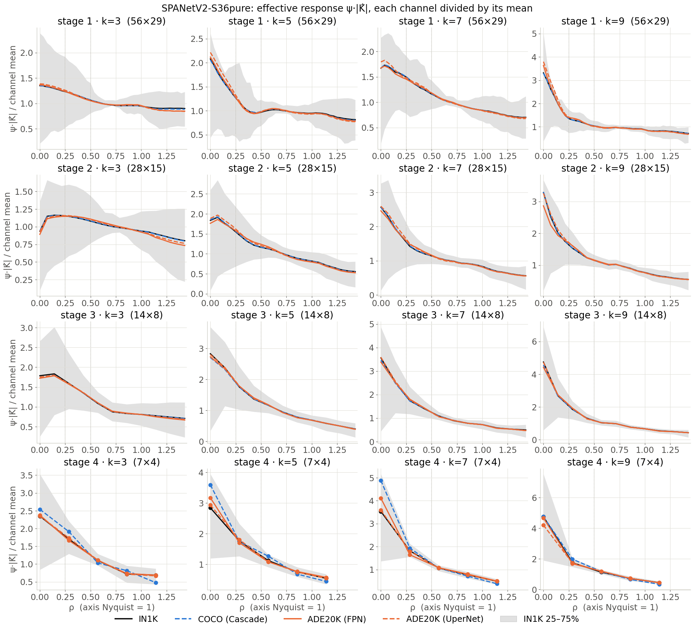

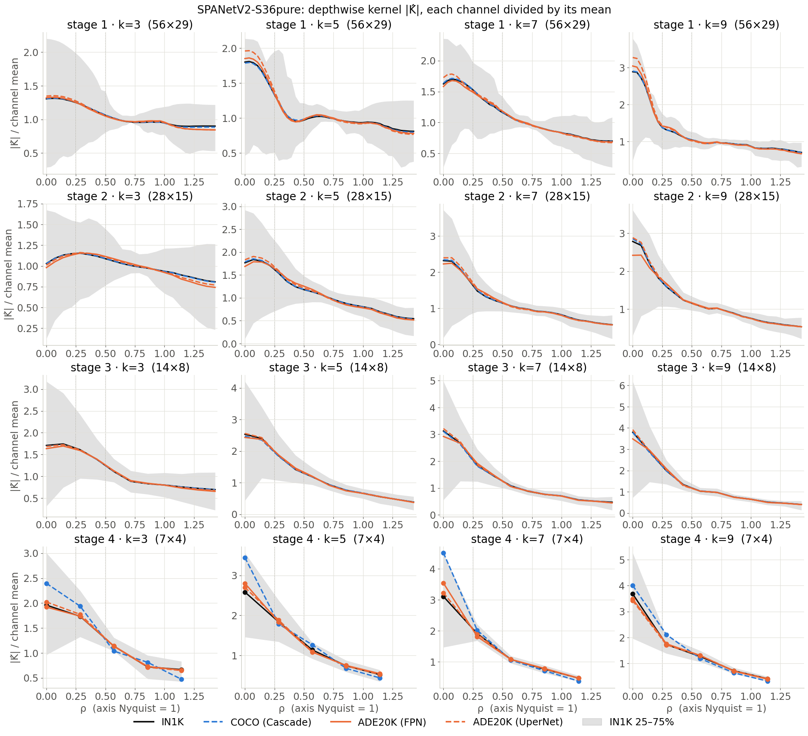

| 단계 | k | 체크포인트 | \|K̂\| low | \|K̂\| high | \|K̂\| high/low | ψ\|K̂\| DC | ψ\|K̂\| low | ψ\|K̂\| mid | ψ\|K̂\| high | ψ\|K̂\| high/low |
|---|---|---|---|---|---|---|---|---|---|---|
| 1 | 3 | IN1K | 1.288 | 0.956 | 0.742 | 1.349 | 1.281 | 1.141 | 0.957 | 0.747 |
| 1 | 3 | COCO Cascade | 1.293 | 0.954 | 0.738 | 1.349 | 1.286 | 1.148 | 0.956 | 0.743 |
| 1 | 3 | ADE20K FPN | 1.299 | 0.957 | 0.737 | 1.365 | 1.292 | 1.132 | 0.958 | 0.742 |
| 1 | 3 | ADE20K UperNet | 1.322 | 0.953 | 0.721 | 1.385 | 1.316 | 1.146 | 0.954 | 0.725 |
| 1 | 5 | IN1K | 1.590 | 0.957 | 0.602 | 2.078 | 1.522 | 1.024 | 0.965 | 0.634 |
| 1 | 5 | COCO Cascade | 1.583 | 0.956 | 0.604 | 2.057 | 1.516 | 1.033 | 0.963 | 0.635 |
| 1 | 5 | ADE20K FPN | 1.631 | 0.957 | 0.587 | 2.116 | 1.557 | 1.012 | 0.965 | 0.620 |
| 1 | 5 | ADE20K UperNet | 1.700 | 0.950 | 0.559 | 2.214 | 1.636 | 1.031 | 0.957 | 0.585 |
| 1 | 7 | IN1K | 1.633 | 0.905 | 0.554 | 1.670 | 1.592 | 1.298 | 0.910 | 0.572 |
| 1 | 7 | COCO Cascade | 1.643 | 0.904 | 0.550 | 1.669 | 1.602 | 1.304 | 0.908 | 0.567 |
| 1 | 7 | ADE20K FPN | 1.591 | 0.906 | 0.569 | 1.672 | 1.550 | 1.308 | 0.911 | 0.588 |
| 1 | 7 | ADE20K UperNet | 1.643 | 0.899 | 0.547 | 1.793 | 1.606 | 1.329 | 0.904 | 0.563 |
| 1 | 9 | IN1K | 1.976 | 0.909 | 0.460 | 3.315 | 1.891 | 1.175 | 0.915 | 0.484 |
| 1 | 9 | COCO Cascade | 1.976 | 0.907 | 0.459 | 3.301 | 1.893 | 1.183 | 0.913 | 0.482 |
| 1 | 9 | ADE20K FPN | 2.006 | 0.901 | 0.449 | 3.633 | 1.918 | 1.207 | 0.907 | 0.473 |
| 1 | 9 | ADE20K UperNet | 2.119 | 0.896 | 0.423 | 3.795 | 2.038 | 1.198 | 0.902 | 0.442 |
| 2 | 3 | IN1K | 1.130 | 0.970 | 0.858 | 0.936 | 1.158 | 1.121 | 0.970 | 0.837 |
| 2 | 3 | COCO Cascade | 1.129 | 0.969 | 0.859 | 0.940 | 1.156 | 1.123 | 0.970 | 0.839 |
| 2 | 3 | ADE20K FPN | 1.102 | 0.969 | 0.879 | 0.892 | 1.135 | 1.137 | 0.968 | 0.853 |
| 2 | 3 | ADE20K UperNet | 1.122 | 0.968 | 0.863 | 0.932 | 1.148 | 1.138 | 0.967 | 0.843 |
| 2 | 5 | IN1K | 1.765 | 0.894 | 0.507 | 1.837 | 1.733 | 1.310 | 0.902 | 0.521 |
| 2 | 5 | COCO Cascade | 1.777 | 0.892 | 0.502 | 1.854 | 1.746 | 1.317 | 0.900 | 0.516 |
| 2 | 5 | ADE20K FPN | 1.750 | 0.884 | 0.505 | 1.763 | 1.722 | 1.374 | 0.892 | 0.518 |
| 2 | 5 | ADE20K UperNet | 1.829 | 0.882 | 0.482 | 1.885 | 1.804 | 1.364 | 0.889 | 0.493 |
| 2 | 7 | IN1K | 1.995 | 0.886 | 0.444 | 2.569 | 1.896 | 1.284 | 0.897 | 0.473 |
| 2 | 7 | COCO Cascade | 2.014 | 0.883 | 0.439 | 2.569 | 1.918 | 1.293 | 0.894 | 0.466 |
| 2 | 7 | ADE20K FPN | 1.978 | 0.876 | 0.443 | 2.462 | 1.884 | 1.345 | 0.887 | 0.471 |
| 2 | 7 | ADE20K UperNet | 2.084 | 0.872 | 0.419 | 2.595 | 2.001 | 1.335 | 0.882 | 0.441 |
| 2 | 9 | IN1K | 2.138 | 0.867 | 0.406 | 3.279 | 2.002 | 1.351 | 0.878 | 0.438 |
| 2 | 9 | COCO Cascade | 2.148 | 0.866 | 0.403 | 3.297 | 2.016 | 1.356 | 0.876 | 0.435 |
| 2 | 9 | ADE20K FPN | 2.058 | 0.865 | 0.420 | 2.862 | 1.933 | 1.391 | 0.875 | 0.453 |
| 2 | 9 | ADE20K UperNet | 2.206 | 0.858 | 0.389 | 3.255 | 2.090 | 1.380 | 0.868 | 0.415 |
| 3 | 3 | IN1K | 1.743 | 0.873 | 0.501 | 1.786 | 1.833 | 1.454 | 0.873 | 0.476 |
| 3 | 3 | COCO Cascade | 1.727 | 0.875 | 0.507 | 1.743 | 1.800 | 1.453 | 0.875 | 0.486 |
| 3 | 3 | ADE20K FPN | 1.694 | 0.877 | 0.518 | 1.722 | 1.786 | 1.449 | 0.877 | 0.491 |
| 3 | 3 | ADE20K UperNet | 1.727 | 0.874 | 0.506 | 1.752 | 1.797 | 1.459 | 0.874 | 0.487 |
| 3 | 5 | IN1K | 2.400 | 0.814 | 0.339 | 2.826 | 2.375 | 1.529 | 0.826 | 0.348 |
| 3 | 5 | COCO Cascade | 2.351 | 0.818 | 0.348 | 2.702 | 2.321 | 1.530 | 0.829 | 0.357 |
| 3 | 5 | ADE20K FPN | 2.372 | 0.810 | 0.341 | 2.726 | 2.342 | 1.565 | 0.822 | 0.351 |
| 3 | 5 | ADE20K UperNet | 2.426 | 0.810 | 0.334 | 2.800 | 2.383 | 1.553 | 0.822 | 0.345 |
| 3 | 7 | IN1K | 2.666 | 0.795 | 0.298 | 3.564 | 2.521 | 1.542 | 0.812 | 0.322 |
| 3 | 7 | COCO Cascade | 2.623 | 0.799 | 0.305 | 3.461 | 2.485 | 1.544 | 0.814 | 0.328 |
| 3 | 7 | ADE20K FPN | 2.668 | 0.787 | 0.295 | 3.382 | 2.515 | 1.590 | 0.805 | 0.320 |
| 3 | 7 | ADE20K UperNet | 2.718 | 0.789 | 0.290 | 3.590 | 2.564 | 1.569 | 0.805 | 0.314 |
| 3 | 9 | IN1K | 2.895 | 0.779 | 0.269 | 4.744 | 2.682 | 1.545 | 0.796 | 0.297 |
| 3 | 9 | COCO Cascade | 2.847 | 0.783 | 0.275 | 4.562 | 2.658 | 1.542 | 0.799 | 0.300 |
| 3 | 9 | ADE20K FPN | 2.952 | 0.773 | 0.262 | 4.424 | 2.742 | 1.563 | 0.792 | 0.289 |
| 3 | 9 | ADE20K UperNet | 2.921 | 0.779 | 0.267 | 4.730 | 2.718 | 1.544 | 0.794 | 0.292 |
| 4 | 3 | IN1K | — | 0.829 | — | 2.348 | — | 1.702 | 0.826 | — |
| 4 | 3 | COCO Cascade | — | 0.778 | — | 2.540 | — | 1.913 | 0.779 | — |
| 4 | 3 | ADE20K FPN | — | 0.830 | — | 2.378 | — | 1.666 | 0.832 | — |
| 4 | 3 | ADE20K UperNet | — | 0.820 | — | 2.351 | — | 1.736 | 0.819 | — |
| 4 | 5 | IN1K | — | 0.793 | — | 2.846 | — | 1.763 | 0.801 | — |
| 4 | 5 | COCO Cascade | — | 0.782 | — | 3.596 | — | 1.744 | 0.786 | — |
| 4 | 5 | ADE20K FPN | — | 0.788 | — | 3.174 | — | 1.707 | 0.804 | — |
| 4 | 5 | ADE20K UperNet | — | 0.781 | — | 2.937 | — | 1.808 | 0.790 | — |
| 4 | 7 | IN1K | — | 0.765 | — | 3.530 | — | 1.816 | 0.773 | — |
| 4 | 7 | COCO Cascade | — | 0.708 | — | 4.878 | — | 1.931 | 0.717 | — |
| 4 | 7 | ADE20K FPN | — | 0.774 | — | 4.107 | — | 1.642 | 0.794 | — |
| 4 | 7 | ADE20K UperNet | — | 0.767 | — | 3.591 | — | 1.796 | 0.776 | — |
| 4 | 9 | IN1K | — | 0.787 | — | 4.755 | — | 1.748 | 0.756 | — |
| 4 | 9 | COCO Cascade | — | 0.703 | — | 4.754 | — | 1.977 | 0.711 | — |
| 4 | 9 | ADE20K FPN | — | 0.787 | — | 4.667 | — | 1.682 | 0.772 | — |
| 4 | 9 | ADE20K UperNet | — | 0.797 | — | 4.199 | — | 1.727 | 0.775 | — |

#### SPANetV2-S18-hybrid

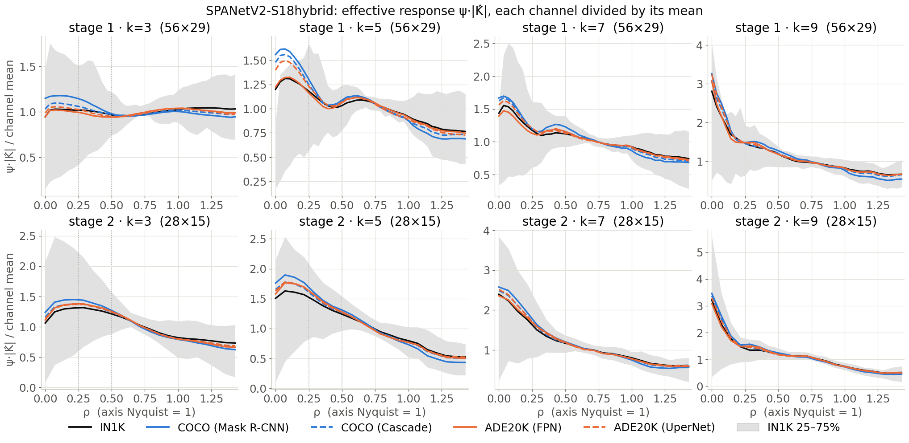

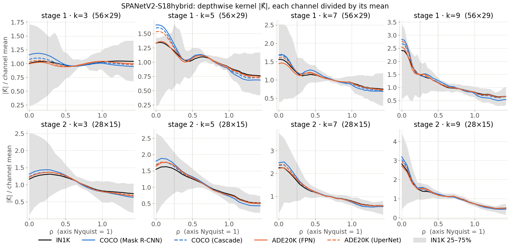

| 단계 | k | 체크포인트 | \|K̂\| low | \|K̂\| high | \|K̂\| high/low | ψ\|K̂\| DC | ψ\|K̂\| low | ψ\|K̂\| mid | ψ\|K̂\| high | ψ\|K̂\| high/low |
|---|---|---|---|---|---|---|---|---|---|---|
| 1 | 3 | IN1K | 1.034 | 0.998 | 0.965 | 0.945 | 1.024 | 0.999 | 0.999 | 0.976 |
| 1 | 3 | COCO Mask R-CNN | 1.175 | 0.979 | 0.833 | 1.150 | 1.169 | 1.057 | 0.980 | 0.838 |
| 1 | 3 | COCO Cascade | 1.090 | 0.993 | 0.911 | 1.031 | 1.082 | 1.009 | 0.994 | 0.918 |
| 1 | 3 | ADE20K FPN | 1.017 | 1.006 | 0.990 | 0.945 | 1.008 | 0.958 | 1.007 | 0.999 |
| 1 | 3 | ADE20K UperNet | 1.050 | 1.001 | 0.953 | 0.989 | 1.042 | 0.980 | 1.001 | 0.961 |
| 1 | 5 | IN1K | 1.281 | 0.972 | 0.759 | 1.198 | 1.257 | 1.058 | 0.974 | 0.775 |
| 1 | 5 | COCO Mask R-CNN | 1.500 | 0.952 | 0.635 | 1.558 | 1.480 | 1.095 | 0.954 | 0.645 |
| 1 | 5 | COCO Cascade | 1.449 | 0.958 | 0.661 | 1.476 | 1.425 | 1.081 | 0.960 | 0.674 |
| 1 | 5 | ADE20K FPN | 1.288 | 0.974 | 0.756 | 1.223 | 1.262 | 1.044 | 0.977 | 0.774 |
| 1 | 5 | ADE20K UperNet | 1.405 | 0.961 | 0.684 | 1.398 | 1.382 | 1.078 | 0.963 | 0.697 |
| 1 | 7 | IN1K | 1.363 | 0.954 | 0.700 | 1.435 | 1.341 | 1.123 | 0.957 | 0.714 |
| 1 | 7 | COCO Mask R-CNN | 1.443 | 0.932 | 0.646 | 1.668 | 1.425 | 1.219 | 0.935 | 0.656 |
| 1 | 7 | COCO Cascade | 1.420 | 0.942 | 0.663 | 1.625 | 1.399 | 1.171 | 0.945 | 0.676 |
| 1 | 7 | ADE20K FPN | 1.294 | 0.951 | 0.735 | 1.392 | 1.273 | 1.157 | 0.955 | 0.750 |
| 1 | 7 | ADE20K UperNet | 1.405 | 0.945 | 0.673 | 1.563 | 1.385 | 1.157 | 0.948 | 0.685 |
| 1 | 9 | IN1K | 1.777 | 0.893 | 0.503 | 2.805 | 1.716 | 1.325 | 0.897 | 0.523 |
| 1 | 9 | COCO Mask R-CNN | 1.846 | 0.873 | 0.473 | 3.258 | 1.796 | 1.415 | 0.876 | 0.488 |
| 1 | 9 | COCO Cascade | 1.822 | 0.889 | 0.488 | 3.050 | 1.767 | 1.332 | 0.893 | 0.505 |
| 1 | 9 | ADE20K FPN | 1.721 | 0.891 | 0.518 | 3.077 | 1.656 | 1.353 | 0.896 | 0.541 |
| 1 | 9 | ADE20K UperNet | 1.838 | 0.887 | 0.483 | 3.237 | 1.779 | 1.337 | 0.891 | 0.501 |
| 2 | 3 | IN1K | 1.276 | 0.935 | 0.733 | 1.062 | 1.291 | 1.279 | 0.934 | 0.724 |
| 2 | 3 | COCO Mask R-CNN | 1.420 | 0.910 | 0.641 | 1.239 | 1.438 | 1.377 | 0.908 | 0.632 |
| 2 | 3 | COCO Cascade | 1.345 | 0.923 | 0.686 | 1.163 | 1.362 | 1.324 | 0.922 | 0.677 |
| 2 | 3 | ADE20K FPN | 1.334 | 0.922 | 0.691 | 1.113 | 1.358 | 1.334 | 0.921 | 0.678 |
| 2 | 3 | ADE20K UperNet | 1.334 | 0.924 | 0.693 | 1.138 | 1.351 | 1.325 | 0.923 | 0.683 |
| 2 | 5 | IN1K | 1.608 | 0.896 | 0.557 | 1.505 | 1.594 | 1.366 | 0.901 | 0.565 |
| 2 | 5 | COCO Mask R-CNN | 1.831 | 0.867 | 0.474 | 1.759 | 1.826 | 1.461 | 0.871 | 0.477 |
| 2 | 5 | COCO Cascade | 1.730 | 0.883 | 0.510 | 1.654 | 1.721 | 1.406 | 0.886 | 0.515 |
| 2 | 5 | ADE20K FPN | 1.737 | 0.877 | 0.505 | 1.581 | 1.728 | 1.434 | 0.881 | 0.510 |
| 2 | 5 | ADE20K UperNet | 1.741 | 0.879 | 0.505 | 1.629 | 1.732 | 1.421 | 0.883 | 0.510 |
| 2 | 7 | IN1K | 1.978 | 0.881 | 0.445 | 2.394 | 1.930 | 1.334 | 0.886 | 0.459 |
| 2 | 7 | COCO Mask R-CNN | 2.187 | 0.854 | 0.390 | 2.575 | 2.155 | 1.422 | 0.858 | 0.398 |
| 2 | 7 | COCO Cascade | 2.086 | 0.869 | 0.417 | 2.488 | 2.048 | 1.368 | 0.873 | 0.426 |
| 2 | 7 | ADE20K FPN | 2.011 | 0.866 | 0.431 | 2.357 | 1.970 | 1.405 | 0.871 | 0.442 |
| 2 | 7 | ADE20K UperNet | 2.089 | 0.866 | 0.414 | 2.512 | 2.052 | 1.386 | 0.870 | 0.424 |
| 2 | 9 | IN1K | 1.845 | 0.892 | 0.484 | 3.216 | 1.759 | 1.308 | 0.899 | 0.511 |
| 2 | 9 | COCO Mask R-CNN | 1.951 | 0.866 | 0.444 | 3.463 | 1.893 | 1.423 | 0.871 | 0.460 |
| 2 | 9 | COCO Cascade | 1.924 | 0.882 | 0.458 | 3.374 | 1.856 | 1.343 | 0.887 | 0.478 |
| 2 | 9 | ADE20K FPN | 1.796 | 0.881 | 0.490 | 3.083 | 1.722 | 1.387 | 0.888 | 0.516 |
| 2 | 9 | ADE20K UperNet | 1.870 | 0.884 | 0.472 | 3.299 | 1.802 | 1.349 | 0.889 | 0.494 |

#### SPANetV2-S36-hybrid

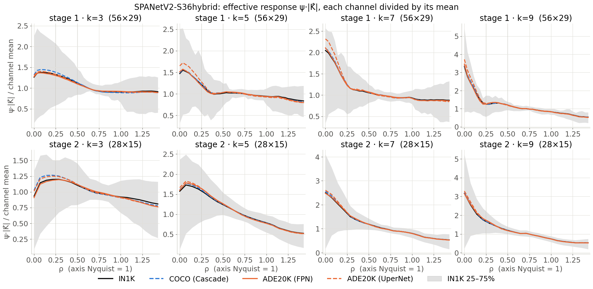

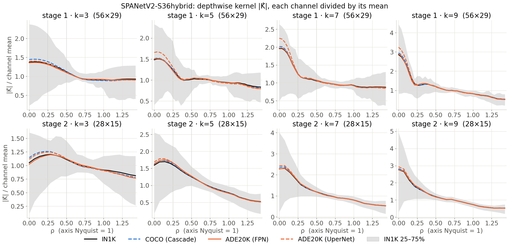

| 단계 | k | 체크포인트 | \|K̂\| low | \|K̂\| high | \|K̂\| high/low | ψ\|K̂\| DC | ψ\|K̂\| low | ψ\|K̂\| mid | ψ\|K̂\| high | ψ\|K̂\| high/low |
|---|---|---|---|---|---|---|---|---|---|---|
| 1 | 3 | IN1K | 1.367 | 0.937 | 0.685 | 1.262 | 1.360 | 1.225 | 0.937 | 0.689 |
| 1 | 3 | COCO Cascade | 1.430 | 0.927 | 0.649 | 1.321 | 1.422 | 1.254 | 0.928 | 0.653 |
| 1 | 3 | ADE20K FPN | 1.346 | 0.943 | 0.701 | 1.275 | 1.339 | 1.197 | 0.944 | 0.705 |
| 1 | 3 | ADE20K UperNet | 1.379 | 0.938 | 0.680 | 1.301 | 1.373 | 1.215 | 0.938 | 0.683 |
| 1 | 5 | IN1K | 1.396 | 0.968 | 0.693 | 1.470 | 1.376 | 1.041 | 0.970 | 0.705 |
| 1 | 5 | COCO Cascade | 1.406 | 0.964 | 0.686 | 1.488 | 1.387 | 1.056 | 0.967 | 0.697 |
| 1 | 5 | ADE20K FPN | 1.389 | 0.969 | 0.698 | 1.512 | 1.368 | 1.036 | 0.972 | 0.710 |
| 1 | 5 | ADE20K UperNet | 1.510 | 0.957 | 0.633 | 1.649 | 1.492 | 1.065 | 0.959 | 0.643 |
| 1 | 7 | IN1K | 1.584 | 0.944 | 0.596 | 2.046 | 1.546 | 1.108 | 0.948 | 0.613 |
| 1 | 7 | COCO Cascade | 1.607 | 0.941 | 0.586 | 2.096 | 1.569 | 1.116 | 0.945 | 0.602 |
| 1 | 7 | ADE20K FPN | 1.585 | 0.942 | 0.594 | 2.107 | 1.547 | 1.117 | 0.946 | 0.611 |
| 1 | 7 | ADE20K UperNet | 1.695 | 0.935 | 0.551 | 2.317 | 1.658 | 1.124 | 0.938 | 0.566 |
| 1 | 9 | IN1K | 1.789 | 0.902 | 0.504 | 3.334 | 1.715 | 1.273 | 0.907 | 0.529 |
| 1 | 9 | COCO Cascade | 1.831 | 0.899 | 0.491 | 3.394 | 1.758 | 1.278 | 0.904 | 0.514 |
| 1 | 9 | ADE20K FPN | 1.733 | 0.901 | 0.520 | 3.461 | 1.658 | 1.296 | 0.906 | 0.546 |
| 1 | 9 | ADE20K UperNet | 1.895 | 0.892 | 0.471 | 3.718 | 1.824 | 1.291 | 0.897 | 0.492 |
| 2 | 3 | IN1K | 1.169 | 0.960 | 0.821 | 0.932 | 1.183 | 1.169 | 0.960 | 0.812 |
| 2 | 3 | COCO Cascade | 1.244 | 0.949 | 0.763 | 1.028 | 1.257 | 1.203 | 0.950 | 0.756 |
| 2 | 3 | ADE20K FPN | 1.149 | 0.960 | 0.836 | 0.909 | 1.165 | 1.171 | 0.961 | 0.825 |
| 2 | 3 | ADE20K UperNet | 1.224 | 0.951 | 0.777 | 1.012 | 1.237 | 1.200 | 0.951 | 0.769 |
| 2 | 5 | IN1K | 1.672 | 0.887 | 0.531 | 1.573 | 1.673 | 1.398 | 0.891 | 0.533 |
| 2 | 5 | COCO Cascade | 1.707 | 0.883 | 0.517 | 1.614 | 1.708 | 1.412 | 0.886 | 0.519 |
| 2 | 5 | ADE20K FPN | 1.725 | 0.877 | 0.508 | 1.600 | 1.730 | 1.439 | 0.880 | 0.509 |
| 2 | 5 | ADE20K UperNet | 1.754 | 0.877 | 0.500 | 1.664 | 1.756 | 1.433 | 0.880 | 0.501 |
| 2 | 7 | IN1K | 2.028 | 0.875 | 0.431 | 2.499 | 1.973 | 1.349 | 0.881 | 0.446 |
| 2 | 7 | COCO Cascade | 2.074 | 0.872 | 0.420 | 2.558 | 2.021 | 1.354 | 0.877 | 0.434 |
| 2 | 7 | ADE20K FPN | 2.052 | 0.869 | 0.423 | 2.475 | 2.001 | 1.378 | 0.874 | 0.437 |
| 2 | 7 | ADE20K UperNet | 2.108 | 0.867 | 0.411 | 2.605 | 2.060 | 1.370 | 0.872 | 0.423 |
| 2 | 9 | IN1K | 2.106 | 0.861 | 0.409 | 3.161 | 2.031 | 1.407 | 0.866 | 0.427 |
| 2 | 9 | COCO Cascade | 2.138 | 0.860 | 0.402 | 3.209 | 2.065 | 1.403 | 0.865 | 0.419 |
| 2 | 9 | ADE20K FPN | 2.162 | 0.855 | 0.395 | 3.144 | 2.089 | 1.421 | 0.861 | 0.412 |
| 2 | 9 | ADE20K UperNet | 2.195 | 0.855 | 0.390 | 3.287 | 2.128 | 1.409 | 0.860 | 0.404 |

### 1.3 (c) IN1K 대비 변화량

- **IN1K 기준값:** mean|M_IN1K|와 std(M_IN1K)도 함께 적었다. 초기화 randn × 0.02의 기대값은 mean|M| = 0.02·√(2/π) = 0.0160, std = 0.02다.
- **Δψ 대역 평균:** 1.1절 표와 `data/srf_summary.csv`(quantity = delta_psi)에 있다.

#### SPANetV2-S18-pure

| 단계 | k | mean\|M_IN1K\| | std(M_IN1K) | ‖ΔM‖/‖M_IN1K‖ COCO Mask R-CNN | ‖ΔM‖/‖M_IN1K‖ COCO Cascade | ‖ΔM‖/‖M_IN1K‖ ADE20K FPN | ‖ΔM‖/‖M_IN1K‖ ADE20K UperNet |
|---|---|---|---|---|---|---|---|
| 1 | 3 | 0.0805 | 0.1111 | 0.537 | 0.224 | 0.225 | 0.196 |
| 1 | 5 | 0.0934 | 0.1459 | 0.528 | 0.219 | 0.171 | 0.186 |
| 1 | 7 | 0.0875 | 0.1240 | 0.530 | 0.223 | 0.199 | 0.192 |
| 1 | 9 | 0.0988 | 0.1369 | 0.504 | 0.212 | 0.170 | 0.186 |
| 2 | 3 | 0.0973 | 0.1300 | 0.533 | 0.292 | 0.218 | 0.208 |
| 2 | 5 | 0.1065 | 0.1508 | 0.532 | 0.292 | 0.185 | 0.207 |
| 2 | 7 | 0.1167 | 0.1662 | 0.534 | 0.290 | 0.161 | 0.204 |
| 2 | 9 | 0.1172 | 0.1548 | 0.519 | 0.286 | 0.165 | 0.202 |
| 3 | 3 | 0.1325 | 0.1836 | 0.551 | 0.488 | 0.192 | 0.236 |
| 3 | 5 | 0.1490 | 0.2070 | 0.543 | 0.481 | 0.180 | 0.233 |
| 3 | 7 | 0.1570 | 0.2225 | 0.551 | 0.490 | 0.170 | 0.235 |
| 3 | 9 | 0.1787 | 0.2417 | 0.546 | 0.492 | 0.157 | 0.238 |
| 4 | 3 | 0.1863 | 0.2441 | 0.608 | 0.737 | 0.343 | 0.227 |
| 4 | 5 | 0.1995 | 0.2707 | 0.616 | 0.736 | 0.389 | 0.233 |
| 4 | 7 | 0.2059 | 0.2808 | 0.611 | 0.742 | 0.413 | 0.239 |
| 4 | 9 | 0.2962 | 0.5116 | 0.615 | 0.741 | 0.255 | 0.232 |

#### SPANetV2-S36-pure

| 단계 | k | mean\|M_IN1K\| | std(M_IN1K) | ‖ΔM‖/‖M_IN1K‖ COCO Cascade | ‖ΔM‖/‖M_IN1K‖ ADE20K FPN | ‖ΔM‖/‖M_IN1K‖ ADE20K UperNet |
|---|---|---|---|---|---|---|
| 1 | 3 | 0.0833 | 0.1196 | 0.026 | 0.198 | 0.159 |
| 1 | 5 | 0.0838 | 0.1219 | 0.026 | 0.192 | 0.158 |
| 1 | 7 | 0.0882 | 0.1306 | 0.025 | 0.176 | 0.155 |
| 1 | 9 | 0.0900 | 0.1251 | 0.025 | 0.177 | 0.155 |
| 2 | 3 | 0.0942 | 0.1273 | 0.041 | 0.203 | 0.174 |
| 2 | 5 | 0.0968 | 0.1312 | 0.040 | 0.191 | 0.173 |
| 2 | 7 | 0.0966 | 0.1309 | 0.041 | 0.184 | 0.172 |
| 2 | 9 | 0.1019 | 0.1380 | 0.040 | 0.166 | 0.169 |
| 3 | 3 | 0.1283 | 0.1761 | 0.183 | 0.178 | 0.193 |
| 3 | 5 | 0.1366 | 0.1922 | 0.172 | 0.170 | 0.190 |
| 3 | 7 | 0.1366 | 0.1944 | 0.181 | 0.169 | 0.198 |
| 3 | 9 | 0.1625 | 0.2252 | 0.179 | 0.150 | 0.199 |
| 4 | 3 | 0.1812 | 0.2444 | 0.744 | 0.324 | 0.193 |
| 4 | 5 | 0.1770 | 0.2454 | 0.742 | 0.422 | 0.201 |
| 4 | 7 | 0.1738 | 0.2333 | 0.778 | 0.446 | 0.210 |
| 4 | 9 | 0.2550 | 0.4930 | 0.751 | 0.250 | 0.197 |

#### SPANetV2-S18-hybrid

| 단계 | k | mean\|M_IN1K\| | std(M_IN1K) | ‖ΔM‖/‖M_IN1K‖ COCO Mask R-CNN | ‖ΔM‖/‖M_IN1K‖ COCO Cascade | ‖ΔM‖/‖M_IN1K‖ ADE20K FPN | ‖ΔM‖/‖M_IN1K‖ ADE20K UperNet |
|---|---|---|---|---|---|---|---|
| 1 | 3 | 0.0592 | 0.0862 | 0.555 | 0.234 | 0.278 | 0.192 |
| 1 | 5 | 0.0513 | 0.0798 | 0.575 | 0.243 | 0.295 | 0.202 |
| 1 | 7 | 0.0589 | 0.1019 | 0.542 | 0.227 | 0.229 | 0.184 |
| 1 | 9 | 0.0522 | 0.0845 | 0.537 | 0.228 | 0.276 | 0.192 |
| 2 | 3 | 0.0722 | 0.1027 | 0.553 | 0.308 | 0.259 | 0.203 |
| 2 | 5 | 0.0695 | 0.1093 | 0.563 | 0.312 | 0.238 | 0.203 |
| 2 | 7 | 0.0752 | 0.1206 | 0.556 | 0.311 | 0.227 | 0.203 |
| 2 | 9 | 0.0736 | 0.1214 | 0.558 | 0.309 | 0.218 | 0.200 |

#### SPANetV2-S36-hybrid

| 단계 | k | mean\|M_IN1K\| | std(M_IN1K) | ‖ΔM‖/‖M_IN1K‖ COCO Cascade | ‖ΔM‖/‖M_IN1K‖ ADE20K FPN | ‖ΔM‖/‖M_IN1K‖ ADE20K UperNet |
|---|---|---|---|---|---|---|
| 1 | 3 | 0.0499 | 0.0755 | 0.031 | 0.218 | 0.145 |
| 1 | 5 | 0.0545 | 0.0866 | 0.028 | 0.189 | 0.137 |
| 1 | 7 | 0.0448 | 0.0702 | 0.031 | 0.232 | 0.149 |
| 1 | 9 | 0.0472 | 0.0772 | 0.030 | 0.208 | 0.143 |
| 2 | 3 | 0.0582 | 0.0859 | 0.049 | 0.203 | 0.158 |
| 2 | 5 | 0.0539 | 0.0832 | 0.049 | 0.212 | 0.157 |
| 2 | 7 | 0.0542 | 0.0882 | 0.048 | 0.198 | 0.154 |
| 2 | 9 | 0.0542 | 0.0926 | 0.048 | 0.190 | 0.151 |

### 1.4 (d) weight decay 대조: M_task ≈ a·M_IN1K

- **두 배율:** a는 최소제곱 배율이다. a_wd는 0.3절의 decay만 작용했을 때의 잔존 배율로, 단계 안 블록 사이의 범위다.
- **나머지 비:** ‖R‖/‖ΔM‖는 변화 가운데 a·M_IN1K로 설명되지 않는 나머지의 비다.
- **ψ 단위 분해:** residual과 decay_part는 ψ 단위의 대역 평균이다.
- **블록별 값:** `data/fit_decay_by_block.csv`에 있다.

#### SPANetV2-S18-pure

| 단계 | k | 체크포인트 | a | a_wd | ‖R‖/‖ΔM‖ | corr(M_task, M_IN1K) | decay_part low | decay_part high | residual low | residual mid | residual high |
|---|---|---|---|---|---|---|---|---|---|---|---|
| 1 | 3 | COCO Mask R-CNN | 0.520 | 0.476 | 0.449 | 0.906 | +0.0039 | -0.0021 | +0.0001 | +0.0007 | +0.0006 |
| 1 | 3 | COCO Cascade | 0.799 | 0.788 | 0.444 | 0.992 | +0.0016 | -0.0009 | +0.0001 | +0.0003 | +0.0001 |
| 1 | 3 | ADE20K FPN | 1.014 | 1.000 | 0.998 | 0.976 | -0.0001 | +0.0001 | -0.0002 | +0.0003 | +0.0001 |
| 1 | 3 | ADE20K UperNet | 0.834 | 0.827 | 0.530 | 0.992 | +0.0013 | -0.0007 | +0.0002 | +0.0004 | -0.0001 |
| 1 | 5 | COCO Mask R-CNN | 0.507 | 0.476 | 0.356 | 0.938 | +0.0115 | -0.0006 | -0.0001 | +0.0003 | +0.0007 |
| 1 | 5 | COCO Cascade | 0.796 | 0.788 | 0.358 | 0.995 | +0.0047 | -0.0002 | -0.0002 | -0.0000 | +0.0000 |
| 1 | 5 | ADE20K FPN | 1.010 | 1.000 | 0.998 | 0.986 | -0.0002 | +0.0000 | +0.0004 | -0.0002 | +0.0000 |
| 1 | 5 | ADE20K UperNet | 0.832 | 0.827 | 0.424 | 0.996 | +0.0039 | -0.0002 | +0.0002 | -0.0002 | -0.0001 |
| 1 | 7 | COCO Mask R-CNN | 0.518 | 0.476 | 0.415 | 0.921 | +0.0137 | -0.0008 | -0.0008 | +0.0000 | +0.0007 |
| 1 | 7 | COCO Cascade | 0.797 | 0.788 | 0.406 | 0.994 | +0.0057 | -0.0003 | -0.0004 | +0.0000 | +0.0001 |
| 1 | 7 | ADE20K FPN | 1.010 | 1.000 | 0.999 | 0.981 | -0.0003 | +0.0000 | -0.0003 | -0.0002 | -0.0000 |
| 1 | 7 | ADE20K UperNet | 0.832 | 0.827 | 0.481 | 0.994 | +0.0047 | -0.0003 | +0.0000 | -0.0002 | -0.0002 |
| 1 | 9 | COCO Mask R-CNN | 0.538 | 0.476 | 0.400 | 0.933 | +0.0176 | +0.0027 | -0.0012 | +0.0002 | +0.0003 |
| 1 | 9 | COCO Cascade | 0.806 | 0.788 | 0.401 | 0.994 | +0.0073 | +0.0011 | -0.0003 | +0.0001 | +0.0000 |
| 1 | 9 | ADE20K FPN | 1.011 | 1.000 | 0.998 | 0.985 | -0.0004 | -0.0001 | -0.0008 | -0.0001 | +0.0000 |
| 1 | 9 | ADE20K UperNet | 0.833 | 0.827 | 0.433 | 0.995 | +0.0063 | +0.0010 | -0.0003 | -0.0001 | -0.0001 |
| 2 | 3 | COCO Mask R-CNN | 0.531 | 0.457 | 0.475 | 0.902 | -0.0030 | -0.0014 | +0.0021 | +0.0012 | +0.0003 |
| 2 | 3 | COCO Cascade | 0.744 | 0.712 | 0.476 | 0.983 | -0.0016 | -0.0008 | +0.0015 | +0.0005 | -0.0001 |
| 2 | 3 | ADE20K FPN | 1.033 | 1.000 | 0.989 | 0.979 | +0.0002 | +0.0001 | +0.0010 | +0.0005 | -0.0004 |
| 2 | 3 | ADE20K UperNet | 0.831 | 0.810 | 0.585 | 0.989 | -0.0011 | -0.0005 | +0.0011 | +0.0005 | -0.0003 |
| 2 | 5 | COCO Mask R-CNN | 0.514 | 0.457 | 0.407 | 0.922 | +0.0087 | -0.0008 | -0.0005 | +0.0004 | +0.0006 |
| 2 | 5 | COCO Cascade | 0.733 | 0.712 | 0.402 | 0.987 | +0.0048 | -0.0005 | -0.0000 | +0.0002 | -0.0000 |
| 2 | 5 | ADE20K FPN | 1.020 | 1.000 | 0.994 | 0.984 | -0.0003 | +0.0000 | -0.0009 | +0.0004 | -0.0005 |
| 2 | 5 | ADE20K UperNet | 0.820 | 0.810 | 0.500 | 0.992 | +0.0032 | -0.0003 | -0.0001 | +0.0003 | -0.0004 |
| 2 | 7 | COCO Mask R-CNN | 0.499 | 0.457 | 0.350 | 0.934 | +0.0168 | +0.0023 | -0.0028 | -0.0001 | +0.0005 |
| 2 | 7 | COCO Cascade | 0.728 | 0.712 | 0.347 | 0.990 | +0.0090 | +0.0012 | -0.0009 | -0.0001 | -0.0000 |
| 2 | 7 | ADE20K FPN | 1.016 | 1.000 | 0.995 | 0.987 | -0.0005 | -0.0001 | -0.0012 | -0.0003 | -0.0003 |
| 2 | 7 | ADE20K UperNet | 0.817 | 0.810 | 0.440 | 0.994 | +0.0060 | +0.0008 | -0.0005 | +0.0000 | -0.0004 |
| 2 | 9 | COCO Mask R-CNN | 0.523 | 0.457 | 0.394 | 0.925 | +0.0254 | +0.0044 | -0.0027 | +0.0004 | +0.0004 |
| 2 | 9 | COCO Cascade | 0.736 | 0.712 | 0.388 | 0.987 | +0.0139 | +0.0024 | -0.0008 | +0.0004 | -0.0000 |
| 2 | 9 | ADE20K FPN | 1.020 | 1.000 | 0.993 | 0.986 | -0.0010 | -0.0002 | -0.0017 | +0.0003 | -0.0002 |
| 2 | 9 | ADE20K UperNet | 0.820 | 0.810 | 0.448 | 0.993 | +0.0095 | +0.0016 | -0.0007 | +0.0001 | -0.0002 |
| 3 | 3 | COCO Mask R-CNN | 0.495 | 0.402–0.439 | 0.401 | 0.914 | -0.0121 | +0.0001 | +0.0042 | +0.0008 | +0.0012 |
| 3 | 3 | COCO Cascade | 0.560 | 0.371–0.615 | 0.433 | 0.936 | -0.0105 | +0.0001 | +0.0036 | +0.0008 | +0.0009 |
| 3 | 3 | ADE20K FPN | 1.048 | 1.000 | 0.968 | 0.985 | +0.0011 | -0.0000 | -0.0003 | -0.0006 | -0.0005 |
| 3 | 3 | ADE20K UperNet | 0.832 | 0.792 | 0.702 | 0.981 | -0.0039 | +0.0000 | -0.0019 | -0.0020 | -0.0008 |
| 3 | 5 | COCO Mask R-CNN | 0.498 | 0.402–0.439 | 0.384 | 0.924 | +0.0037 | +0.0006 | -0.0012 | +0.0006 | +0.0015 |
| 3 | 5 | COCO Cascade | 0.564 | 0.371–0.615 | 0.420 | 0.942 | +0.0032 | +0.0006 | -0.0012 | +0.0005 | +0.0010 |
| 3 | 5 | ADE20K FPN | 1.050 | 1.000 | 0.960 | 0.987 | -0.0003 | -0.0001 | -0.0042 | -0.0003 | -0.0004 |
| 3 | 5 | ADE20K UperNet | 0.843 | 0.792 | 0.742 | 0.980 | +0.0011 | +0.0002 | -0.0073 | -0.0011 | -0.0009 |
| 3 | 7 | COCO Mask R-CNN | 0.490 | 0.402–0.439 | 0.379 | 0.917 | +0.0197 | +0.0051 | -0.0036 | +0.0007 | +0.0014 |
| 3 | 7 | COCO Cascade | 0.554 | 0.371–0.615 | 0.417 | 0.935 | +0.0171 | +0.0044 | -0.0037 | +0.0007 | +0.0010 |
| 3 | 7 | ADE20K FPN | 1.047 | 1.000 | 0.961 | 0.987 | -0.0017 | -0.0005 | -0.0049 | +0.0006 | -0.0002 |
| 3 | 7 | ADE20K UperNet | 0.844 | 0.792 | 0.747 | 0.977 | +0.0058 | +0.0015 | -0.0079 | -0.0001 | -0.0005 |
| 3 | 9 | COCO Mask R-CNN | 0.494 | 0.402–0.439 | 0.376 | 0.911 | +0.0313 | +0.0107 | -0.0098 | +0.0011 | +0.0005 |
| 3 | 9 | COCO Cascade | 0.551 | 0.371–0.615 | 0.405 | 0.929 | +0.0276 | +0.0095 | -0.0093 | +0.0010 | +0.0003 |
| 3 | 9 | ADE20K FPN | 1.041 | 1.000 | 0.966 | 0.987 | -0.0023 | -0.0008 | -0.0071 | +0.0013 | -0.0002 |
| 3 | 9 | ADE20K UperNet | 0.840 | 0.792 | 0.741 | 0.974 | +0.0094 | +0.0033 | -0.0120 | +0.0004 | -0.0004 |
| 4 | 3 | COCO Mask R-CNN | 0.436 | 0.383 | 0.373 | 0.893 | — | +0.0026 | — | -0.0002 | +0.0039 |
| 4 | 3 | COCO Cascade | 0.316 | 0.243 | 0.373 | 0.774 | — | +0.0032 | — | +0.0009 | +0.0058 |
| 4 | 3 | ADE20K FPN | 1.088 | 1.000 | 0.966 | 0.956 | — | -0.0004 | — | -0.0121 | +0.0019 |
| 4 | 3 | ADE20K UperNet | 0.804 | 0.771 | 0.508 | 0.990 | — | +0.0009 | — | -0.0023 | +0.0008 |
| 4 | 5 | COCO Mask R-CNN | 0.437 | 0.383 | 0.403 | 0.872 | — | +0.0025 | — | -0.0066 | +0.0041 |
| 4 | 5 | COCO Cascade | 0.320 | 0.243 | 0.380 | 0.761 | — | +0.0031 | — | -0.0075 | +0.0055 |
| 4 | 5 | ADE20K FPN | 1.098 | 1.000 | 0.968 | 0.945 | — | -0.0004 | — | -0.0212 | +0.0036 |
| 4 | 5 | ADE20K UperNet | 0.798 | 0.771 | 0.493 | 0.990 | — | +0.0009 | — | -0.0046 | +0.0011 |
| 4 | 7 | COCO Mask R-CNN | 0.457 | 0.383 | 0.459 | 0.842 | — | +0.0081 | — | -0.0126 | +0.0027 |
| 4 | 7 | COCO Cascade | 0.346 | 0.243 | 0.472 | 0.690 | — | +0.0099 | — | -0.0179 | +0.0043 |
| 4 | 7 | ADE20K FPN | 1.096 | 1.000 | 0.973 | 0.933 | — | -0.0014 | — | -0.0266 | +0.0037 |
| 4 | 7 | ADE20K UperNet | 0.788 | 0.771 | 0.466 | 0.989 | — | +0.0031 | — | -0.0051 | +0.0010 |
| 4 | 9 | COCO Mask R-CNN | 0.435 | 0.383 | 0.394 | 0.853 | — | +0.0222 | — | -0.0357 | -0.0015 |
| 4 | 9 | COCO Cascade | 0.317 | 0.243 | 0.387 | 0.697 | — | +0.0276 | — | -0.0458 | -0.0019 |
| 4 | 9 | ADE20K FPN | 1.020 | 1.000 | 0.997 | 0.967 | — | -0.0007 | — | -0.0385 | -0.0042 |
| 4 | 9 | ADE20K UperNet | 0.777 | 0.771 | 0.274 | 0.996 | — | +0.0081 | — | -0.0075 | +0.0001 |

#### SPANetV2-S36-pure

| 단계 | k | 체크포인트 | a | a_wd | ‖R‖/‖ΔM‖ | corr(M_task, M_IN1K) | decay_part low | decay_part high | residual low | residual mid | residual high |
|---|---|---|---|---|---|---|---|---|---|---|---|
| 1 | 3 | COCO Cascade | 0.979 | 0.972 | 0.578 | 1.000 | +0.0001 | -0.0000 | +0.0000 | +0.0000 | -0.0000 |
| 1 | 3 | ADE20K FPN | 1.009 | 1.000 | 0.999 | 0.981 | -0.0001 | +0.0000 | +0.0003 | +0.0003 | +0.0001 |
| 1 | 3 | ADE20K UperNet | 0.860 | 0.856 | 0.470 | 0.996 | +0.0010 | -0.0002 | +0.0002 | +0.0001 | +0.0000 |
| 1 | 5 | COCO Cascade | 0.978 | 0.972 | 0.560 | 1.000 | +0.0006 | -0.0000 | -0.0000 | +0.0000 | -0.0000 |
| 1 | 5 | ADE20K FPN | 1.008 | 1.000 | 0.999 | 0.982 | -0.0002 | +0.0000 | -0.0002 | -0.0000 | +0.0003 |
| 1 | 5 | ADE20K UperNet | 0.860 | 0.856 | 0.462 | 0.996 | +0.0041 | -0.0001 | -0.0001 | -0.0000 | -0.0001 |
| 1 | 7 | COCO Cascade | 0.979 | 0.972 | 0.549 | 1.000 | +0.0005 | +0.0000 | +0.0001 | +0.0000 | -0.0000 |
| 1 | 7 | ADE20K FPN | 1.009 | 1.000 | 0.999 | 0.985 | -0.0002 | -0.0000 | -0.0004 | -0.0001 | +0.0002 |
| 1 | 7 | ADE20K UperNet | 0.860 | 0.856 | 0.433 | 0.997 | +0.0031 | +0.0003 | -0.0000 | +0.0001 | -0.0000 |
| 1 | 9 | COCO Cascade | 0.979 | 0.972 | 0.552 | 1.000 | +0.0006 | +0.0001 | -0.0001 | +0.0000 | -0.0000 |
| 1 | 9 | ADE20K FPN | 1.011 | 1.000 | 0.998 | 0.984 | -0.0003 | -0.0000 | -0.0008 | +0.0002 | +0.0001 |
| 1 | 9 | ADE20K UperNet | 0.861 | 0.856 | 0.441 | 0.997 | +0.0042 | +0.0006 | -0.0002 | +0.0000 | -0.0001 |
| 2 | 3 | COCO Cascade | 0.965 | 0.961 | 0.534 | 1.000 | -0.0002 | -0.0001 | +0.0001 | +0.0000 | -0.0000 |
| 2 | 3 | ADE20K FPN | 1.025 | 1.000 | 0.992 | 0.981 | +0.0001 | +0.0001 | +0.0005 | +0.0005 | -0.0002 |
| 2 | 3 | ADE20K UperNet | 0.853 | 0.842 | 0.532 | 0.994 | -0.0009 | -0.0005 | +0.0004 | +0.0002 | -0.0002 |
| 2 | 5 | COCO Cascade | 0.966 | 0.961 | 0.524 | 1.000 | +0.0005 | -0.0001 | +0.0001 | -0.0000 | -0.0000 |
| 2 | 5 | ADE20K FPN | 1.020 | 1.000 | 0.994 | 0.983 | -0.0003 | +0.0000 | -0.0006 | -0.0000 | -0.0001 |
| 2 | 5 | ADE20K UperNet | 0.851 | 0.842 | 0.508 | 0.995 | +0.0023 | -0.0003 | -0.0000 | -0.0000 | -0.0002 |
| 2 | 7 | COCO Cascade | 0.965 | 0.961 | 0.498 | 1.000 | +0.0012 | +0.0001 | +0.0001 | +0.0000 | -0.0000 |
| 2 | 7 | ADE20K FPN | 1.019 | 1.000 | 0.995 | 0.984 | -0.0006 | -0.0000 | -0.0010 | -0.0000 | -0.0001 |
| 2 | 7 | ADE20K UperNet | 0.850 | 0.842 | 0.486 | 0.995 | +0.0050 | +0.0004 | -0.0001 | +0.0000 | -0.0002 |
| 2 | 9 | COCO Cascade | 0.965 | 0.961 | 0.474 | 1.000 | +0.0015 | +0.0003 | -0.0000 | +0.0000 | -0.0000 |
| 2 | 9 | ADE20K FPN | 1.015 | 1.000 | 0.996 | 0.986 | -0.0006 | -0.0001 | -0.0012 | -0.0001 | -0.0000 |
| 2 | 9 | ADE20K UperNet | 0.849 | 0.842 | 0.444 | 0.996 | +0.0063 | +0.0011 | -0.0003 | +0.0000 | -0.0001 |
| 3 | 3 | COCO Cascade | 0.854 | 0.712–0.944 | 0.600 | 0.992 | -0.0022 | -0.0002 | -0.0001 | +0.0002 | +0.0006 |
| 3 | 3 | ADE20K FPN | 1.036 | 1.000 | 0.980 | 0.986 | +0.0005 | +0.0000 | -0.0012 | -0.0004 | +0.0002 |
| 3 | 3 | ADE20K UperNet | 0.850 | 0.826 | 0.626 | 0.990 | -0.0023 | -0.0002 | -0.0024 | -0.0009 | -0.0001 |
| 3 | 5 | COCO Cascade | 0.864 | 0.712–0.944 | 0.609 | 0.993 | +0.0019 | -0.0000 | -0.0014 | +0.0004 | +0.0005 |
| 3 | 5 | ADE20K FPN | 1.041 | 1.000 | 0.970 | 0.988 | -0.0006 | +0.0000 | -0.0040 | +0.0001 | +0.0001 |
| 3 | 5 | ADE20K UperNet | 0.860 | 0.826 | 0.677 | 0.989 | +0.0019 | -0.0000 | -0.0058 | +0.0000 | -0.0003 |
| 3 | 7 | COCO Cascade | 0.856 | 0.712–0.944 | 0.606 | 0.991 | +0.0059 | +0.0010 | -0.0025 | +0.0005 | +0.0003 |
| 3 | 7 | ADE20K FPN | 1.040 | 1.000 | 0.971 | 0.987 | -0.0016 | -0.0003 | -0.0044 | +0.0012 | +0.0002 |
| 3 | 7 | ADE20K UperNet | 0.862 | 0.826 | 0.719 | 0.986 | +0.0057 | +0.0010 | -0.0063 | +0.0010 | -0.0000 |
| 3 | 9 | COCO Cascade | 0.856 | 0.712–0.944 | 0.594 | 0.991 | +0.0081 | +0.0026 | -0.0035 | +0.0006 | +0.0001 |
| 3 | 9 | ADE20K FPN | 1.035 | 1.000 | 0.973 | 0.988 | -0.0019 | -0.0006 | -0.0057 | +0.0015 | +0.0000 |
| 3 | 9 | ADE20K UperNet | 0.855 | 0.826 | 0.687 | 0.985 | +0.0081 | +0.0026 | -0.0082 | +0.0014 | -0.0000 |
| 4 | 3 | COCO Cascade | 0.304 | 0.243 | 0.355 | 0.766 | — | +0.0031 | — | +0.0001 | +0.0040 |
| 4 | 3 | ADE20K FPN | 1.091 | 1.000 | 0.960 | 0.961 | — | -0.0004 | — | -0.0107 | +0.0014 |
| 4 | 3 | ADE20K UperNet | 0.834 | 0.808 | 0.504 | 0.993 | — | +0.0007 | — | -0.0029 | +0.0006 |
| 4 | 5 | COCO Cascade | 0.315 | 0.243 | 0.385 | 0.746 | — | +0.0012 | — | -0.0058 | +0.0039 |
| 4 | 5 | ADE20K FPN | 1.105 | 1.000 | 0.969 | 0.937 | — | -0.0002 | — | -0.0169 | +0.0043 |
| 4 | 5 | ADE20K UperNet | 0.830 | 0.808 | 0.531 | 0.992 | — | +0.0003 | — | -0.0034 | +0.0011 |
| 4 | 7 | COCO Cascade | 0.314 | 0.243 | 0.473 | 0.637 | — | +0.0066 | — | -0.0174 | +0.0031 |
| 4 | 7 | ADE20K FPN | 1.075 | 1.000 | 0.986 | 0.921 | — | -0.0007 | — | -0.0220 | +0.0043 |
| 4 | 7 | ADE20K UperNet | 0.819 | 0.808 | 0.506 | 0.991 | — | +0.0017 | — | -0.0042 | +0.0011 |
| 4 | 9 | COCO Cascade | 0.302 | 0.243 | 0.369 | 0.701 | — | +0.0217 | — | -0.0428 | -0.0028 |
| 4 | 9 | ADE20K FPN | 1.002 | 1.000 | 1.000 | 0.968 | — | -0.0001 | — | -0.0331 | -0.0040 |
| 4 | 9 | ADE20K UperNet | 0.809 | 0.808 | 0.252 | 0.998 | — | +0.0052 | — | -0.0051 | +0.0003 |

#### SPANetV2-S18-hybrid

| 단계 | k | 체크포인트 | a | a_wd | ‖R‖/‖ΔM‖ | corr(M_task, M_IN1K) | decay_part low | decay_part high | residual low | residual mid | residual high |
|---|---|---|---|---|---|---|---|---|---|---|---|
| 1 | 3 | COCO Mask R-CNN | 0.542 | 0.475 | 0.564 | 0.866 | +0.0036 | -0.0008 | +0.0004 | +0.0003 | +0.0003 |
| 1 | 3 | COCO Cascade | 0.806 | 0.788 | 0.563 | 0.987 | +0.0015 | -0.0003 | +0.0002 | +0.0001 | -0.0000 |
| 1 | 3 | ADE20K FPN | 1.025 | 1.000 | 0.996 | 0.965 | -0.0002 | +0.0000 | +0.0002 | +0.0001 | +0.0002 |
| 1 | 3 | ADE20K UperNet | 0.852 | 0.840 | 0.639 | 0.990 | +0.0012 | -0.0003 | +0.0002 | +0.0001 | -0.0001 |
| 1 | 5 | COCO Mask R-CNN | 0.532 | 0.475 | 0.580 | 0.847 | +0.0061 | -0.0007 | -0.0000 | -0.0000 | +0.0004 |
| 1 | 5 | COCO Cascade | 0.801 | 0.788 | 0.577 | 0.985 | +0.0026 | -0.0003 | -0.0002 | -0.0001 | -0.0000 |
| 1 | 5 | ADE20K FPN | 1.018 | 1.000 | 0.998 | 0.961 | -0.0002 | +0.0000 | -0.0002 | -0.0001 | +0.0001 |
| 1 | 5 | ADE20K UperNet | 0.848 | 0.840 | 0.657 | 0.988 | +0.0020 | -0.0002 | -0.0000 | +0.0000 | -0.0000 |
| 1 | 7 | COCO Mask R-CNN | 0.527 | 0.475 | 0.487 | 0.894 | +0.0079 | +0.0000 | -0.0008 | -0.0000 | +0.0004 |
| 1 | 7 | COCO Cascade | 0.801 | 0.788 | 0.487 | 0.991 | +0.0033 | +0.0000 | -0.0004 | -0.0000 | -0.0000 |
| 1 | 7 | ADE20K FPN | 1.011 | 1.000 | 0.999 | 0.975 | -0.0002 | -0.0000 | -0.0005 | -0.0003 | +0.0000 |
| 1 | 7 | ADE20K UperNet | 0.846 | 0.840 | 0.553 | 0.993 | +0.0025 | +0.0000 | -0.0002 | -0.0002 | -0.0001 |
| 1 | 9 | COCO Mask R-CNN | 0.584 | 0.475 | 0.633 | 0.864 | +0.0090 | -0.0001 | -0.0016 | +0.0001 | +0.0003 |
| 1 | 9 | COCO Cascade | 0.824 | 0.788 | 0.636 | 0.985 | +0.0038 | -0.0000 | -0.0002 | -0.0001 | +0.0000 |
| 1 | 9 | ADE20K FPN | 1.028 | 1.000 | 0.995 | 0.966 | -0.0006 | +0.0000 | -0.0008 | -0.0001 | -0.0001 |
| 1 | 9 | ADE20K UperNet | 0.854 | 0.840 | 0.651 | 0.989 | +0.0031 | -0.0000 | -0.0003 | -0.0001 | -0.0001 |
| 2 | 3 | COCO Mask R-CNN | 0.565 | 0.457 | 0.618 | 0.855 | -0.0022 | -0.0010 | +0.0039 | +0.0010 | -0.0001 |
| 2 | 3 | COCO Cascade | 0.761 | 0.712 | 0.629 | 0.969 | -0.0012 | -0.0006 | +0.0023 | +0.0004 | -0.0003 |
| 2 | 3 | ADE20K FPN | 1.042 | 1.000 | 0.987 | 0.971 | +0.0002 | +0.0001 | +0.0019 | +0.0003 | -0.0007 |
| 2 | 3 | ADE20K UperNet | 0.848 | 0.824 | 0.667 | 0.987 | -0.0007 | -0.0004 | +0.0013 | +0.0002 | -0.0003 |
| 2 | 5 | COCO Mask R-CNN | 0.532 | 0.457 | 0.557 | 0.862 | +0.0034 | -0.0009 | +0.0019 | -0.0009 | +0.0005 |
| 2 | 5 | COCO Cascade | 0.743 | 0.712 | 0.571 | 0.972 | +0.0019 | -0.0005 | +0.0013 | -0.0005 | -0.0001 |
| 2 | 5 | ADE20K FPN | 1.027 | 1.000 | 0.993 | 0.975 | -0.0002 | +0.0001 | +0.0002 | -0.0003 | -0.0004 |
| 2 | 5 | ADE20K UperNet | 0.840 | 0.824 | 0.616 | 0.989 | +0.0012 | -0.0003 | +0.0004 | -0.0002 | -0.0002 |
| 2 | 7 | COCO Mask R-CNN | 0.546 | 0.457 | 0.578 | 0.860 | +0.0081 | +0.0003 | -0.0011 | -0.0007 | -0.0000 |
| 2 | 7 | COCO Cascade | 0.752 | 0.712 | 0.604 | 0.970 | +0.0044 | +0.0002 | -0.0002 | -0.0004 | -0.0004 |
| 2 | 7 | ADE20K FPN | 1.027 | 1.000 | 0.993 | 0.977 | -0.0005 | -0.0000 | -0.0004 | -0.0002 | -0.0005 |
| 2 | 7 | ADE20K UperNet | 0.839 | 0.824 | 0.614 | 0.989 | +0.0028 | +0.0001 | -0.0001 | -0.0000 | -0.0004 |
| 2 | 9 | COCO Mask R-CNN | 0.528 | 0.457 | 0.533 | 0.869 | +0.0128 | +0.0004 | -0.0032 | -0.0005 | +0.0002 |
| 2 | 9 | COCO Cascade | 0.742 | 0.712 | 0.551 | 0.974 | +0.0069 | +0.0002 | -0.0010 | -0.0003 | -0.0002 |
| 2 | 9 | ADE20K FPN | 1.024 | 1.000 | 0.994 | 0.978 | -0.0006 | -0.0000 | -0.0012 | +0.0001 | -0.0004 |
| 2 | 9 | ADE20K UperNet | 0.837 | 0.824 | 0.584 | 0.990 | +0.0044 | +0.0001 | -0.0006 | -0.0001 | -0.0003 |

#### SPANetV2-S36-hybrid

| 단계 | k | 체크포인트 | a | a_wd | ‖R‖/‖ΔM‖ | corr(M_task, M_IN1K) | decay_part low | decay_part high | residual low | residual mid | residual high |
|---|---|---|---|---|---|---|---|---|---|---|---|
| 1 | 3 | COCO Cascade | 0.980 | 0.971 | 0.747 | 1.000 | +0.0001 | -0.0000 | +0.0000 | +0.0001 | -0.0000 |
| 1 | 3 | ADE20K FPN | 1.007 | 1.000 | 1.000 | 0.977 | -0.0000 | +0.0000 | +0.0001 | +0.0001 | +0.0001 |
| 1 | 3 | ADE20K UperNet | 0.887 | 0.883 | 0.625 | 0.995 | +0.0007 | -0.0002 | +0.0000 | +0.0000 | -0.0000 |
| 1 | 5 | COCO Cascade | 0.980 | 0.971 | 0.699 | 1.000 | +0.0003 | +0.0000 | -0.0000 | +0.0000 | -0.0000 |
| 1 | 5 | ADE20K FPN | 1.010 | 1.000 | 0.999 | 0.983 | -0.0001 | -0.0000 | -0.0000 | +0.0000 | +0.0001 |
| 1 | 5 | ADE20K UperNet | 0.889 | 0.883 | 0.582 | 0.996 | +0.0014 | +0.0000 | +0.0000 | -0.0000 | -0.0000 |
| 1 | 7 | COCO Cascade | 0.979 | 0.971 | 0.754 | 1.000 | +0.0003 | -0.0000 | -0.0000 | +0.0000 | -0.0000 |
| 1 | 7 | ADE20K FPN | 1.007 | 1.000 | 0.999 | 0.975 | -0.0001 | +0.0000 | +0.0001 | -0.0001 | +0.0001 |
| 1 | 7 | ADE20K UperNet | 0.887 | 0.883 | 0.650 | 0.994 | +0.0018 | -0.0001 | +0.0001 | -0.0000 | -0.0001 |
| 1 | 9 | COCO Cascade | 0.981 | 0.971 | 0.759 | 1.000 | +0.0004 | -0.0000 | -0.0000 | +0.0000 | -0.0000 |
| 1 | 9 | ADE20K FPN | 1.007 | 1.000 | 0.999 | 0.979 | -0.0001 | +0.0000 | -0.0006 | +0.0000 | +0.0000 |
| 1 | 9 | ADE20K UperNet | 0.889 | 0.883 | 0.627 | 0.995 | +0.0024 | -0.0000 | -0.0001 | -0.0001 | -0.0001 |
| 2 | 3 | COCO Cascade | 0.966 | 0.959 | 0.720 | 0.999 | -0.0001 | -0.0001 | +0.0002 | +0.0000 | -0.0000 |
| 2 | 3 | ADE20K FPN | 1.014 | 1.000 | 0.998 | 0.981 | +0.0000 | +0.0000 | +0.0006 | +0.0001 | -0.0002 |
| 2 | 3 | ADE20K UperNet | 0.878 | 0.871 | 0.635 | 0.994 | -0.0003 | -0.0003 | +0.0005 | +0.0001 | -0.0001 |
| 2 | 5 | COCO Cascade | 0.969 | 0.959 | 0.766 | 0.999 | +0.0000 | -0.0000 | +0.0001 | -0.0000 | -0.0000 |
| 2 | 5 | ADE20K FPN | 1.020 | 1.000 | 0.996 | 0.979 | -0.0000 | +0.0000 | +0.0001 | -0.0002 | -0.0002 |
| 2 | 5 | ADE20K UperNet | 0.885 | 0.871 | 0.678 | 0.993 | +0.0002 | -0.0001 | +0.0002 | -0.0001 | -0.0001 |
| 2 | 7 | COCO Cascade | 0.968 | 0.959 | 0.744 | 0.999 | +0.0004 | +0.0000 | +0.0000 | -0.0001 | -0.0000 |
| 2 | 7 | ADE20K FPN | 1.017 | 1.000 | 0.996 | 0.982 | -0.0002 | -0.0000 | -0.0003 | -0.0001 | -0.0002 |
| 2 | 7 | ADE20K UperNet | 0.882 | 0.871 | 0.644 | 0.994 | +0.0016 | +0.0000 | -0.0000 | -0.0001 | -0.0001 |
| 2 | 9 | COCO Cascade | 0.968 | 0.959 | 0.750 | 0.999 | +0.0006 | +0.0000 | -0.0000 | -0.0001 | -0.0001 |
| 2 | 9 | ADE20K FPN | 1.018 | 1.000 | 0.995 | 0.983 | -0.0003 | -0.0000 | -0.0001 | -0.0001 | -0.0001 |
| 2 | 9 | ADE20K UperNet | 0.884 | 0.871 | 0.643 | 0.994 | +0.0021 | +0.0002 | -0.0000 | -0.0001 | -0.0001 |

### 1.5 (e) 같은 과제 안의 차이와 과제 간 차이

- **비교 단위:** 단계 × head × 대역마다 각 체크포인트의 대역 값을 비교했다.
- **W (과제 내):** |Mask R-CNN − Cascade|와 |FPN − UperNet| 가운데 큰 값이다. S36 모델은 COCO 체크포인트가 Cascade 하나뿐이라 ADE20K 쌍만 쓴다.
- **X (과제 간):**
  - X_mean = |COCO 쪽 평균 − ADE20K 쪽 평균|.
  - X_min·X_max = COCO 체크포인트와 ADE20K 체크포인트를 하나씩 짝지은 모든 쌍의 |차이| 가운데 최솟값·최댓값.
- **판정:** "X_min > W"는 모든 과제 간 쌍의 차이가 과제 내 차이보다 큰 칸이다.
- **두 수준:**
  - "평균": (블록, 채널) 평균값의 차이.
  - "채널 RMS": 같은 (블록, 채널)끼리의 대역 값 차이의 제곱평균제곱근으로, 평균에서 상쇄되는 채널별 변화까지 잡는다.
- **대상:** ψ 자체와 (d)의 residual(ψ 단위, decay로 설명되지 않는 부분) 두 가지에 대해 계산했다.
- **전체 값:** `data/contrast_e.csv`에 있다.

#### 칸 수 요약

| 모델 | 양 | 수준 | 대역 | 칸 수 | X_min > W | X_max > W | 중앙값 X_min/W |
|---|---|---|---|---|---|---|---|
| SPANetV2-S18-pure | psi | 평균 | DC·low·mid·high | 60 | 14 (23%) | 56 (93%) | 0.38 |
| SPANetV2-S18-pure | psi | 평균 | high/low | 12 | 3 (25%) | 12 (100%) | 0.30 |
| SPANetV2-S18-pure | psi | 채널 RMS | DC·low·mid·high | 60 | 23 (38%) | 59 (98%) | 0.51 |
| SPANetV2-S18-pure | residual | 평균 | DC·low·mid·high | 60 | 11 (18%) | 46 (77%) | 0.29 |
| SPANetV2-S18-pure | residual | 채널 RMS | DC·low·mid·high | 60 | 24 (40%) | 57 (95%) | 0.89 |
| SPANetV2-S36-pure | psi | 평균 | DC·low·mid·high | 60 | 8 (13%) | 25 (42%) | 0.36 |
| SPANetV2-S36-pure | psi | 평균 | high/low | 12 | 1 (8%) | 4 (33%) | 0.42 |
| SPANetV2-S36-pure | psi | 채널 RMS | DC·low·mid·high | 60 | 11 (18%) | 24 (40%) | 0.54 |
| SPANetV2-S36-pure | residual | 평균 | DC·low·mid·high | 60 | 16 (27%) | 39 (65%) | 0.36 |
| SPANetV2-S36-pure | residual | 채널 RMS | DC·low·mid·high | 60 | 21 (35%) | 57 (95%) | 0.84 |
| SPANetV2-S18-hybrid | psi | 평균 | DC·low·mid·high | 32 | 1 (3%) | 30 (94%) | 0.27 |
| SPANetV2-S18-hybrid | psi | 평균 | high/low | 8 | 0 (0%) | 8 (100%) | 0.20 |
| SPANetV2-S18-hybrid | psi | 채널 RMS | DC·low·mid·high | 32 | 0 (0%) | 32 (100%) | 0.48 |
| SPANetV2-S18-hybrid | residual | 평균 | DC·low·mid·high | 32 | 4 (12%) | 25 (78%) | 0.18 |
| SPANetV2-S18-hybrid | residual | 채널 RMS | DC·low·mid·high | 32 | 1 (3%) | 32 (100%) | 0.68 |
| SPANetV2-S36-hybrid | psi | 평균 | DC·low·mid·high | 32 | 2 (6%) | 5 (16%) | 0.38 |
| SPANetV2-S36-hybrid | psi | 평균 | high/low | 8 | 1 (12%) | 2 (25%) | 0.33 |
| SPANetV2-S36-hybrid | psi | 채널 RMS | DC·low·mid·high | 32 | 0 (0%) | 0 (0%) | 0.58 |
| SPANetV2-S36-hybrid | residual | 평균 | DC·low·mid·high | 32 | 6 (19%) | 22 (69%) | 0.25 |
| SPANetV2-S36-hybrid | residual | 채널 RMS | DC·low·mid·high | 32 | 3 (9%) | 32 (100%) | 0.75 |

#### ψ 대역 평균: 칸별 값 (W | X_mean, 단위 10⁻³; * = X_min > W)

##### SPANetV2-S18-pure

| 단계 | k | DC: W \| X | low: W \| X | mid: W \| X | high: W \| X | high/low: W \| X |
|---|---|---|---|---|---|---|
| 1 | 3 | 17.03 \| 17.46 | 2.24 \| 2.24 | 0.31 \| 0.33 | 1.00 \| 0.84 | 6.00 \| 6.33 |
| 1 | 5 | 13.28 \| 12.91 | 6.89 \| 5.86 | 2.16 \| 2.04 | 0.34 \| 0.11 | 14.02 \| 12.41 |
| 1 | 7 | 15.99 \| 19.78 | 7.63 \| 7.10 | 2.76 \| 2.84 | 0.45 \| 0.07 | 16.13 \| 15.48 |
| 1 | 9 | 7.21 \| 10.79 | 9.35 \| 9.25 | 4.07 \| 4.01 | 1.92 \| 1.70 | 16.66 \| 17.20 |
| 2 | 3 | 18.19 \| 22.71 | 1.06 \| 1.07 | 0.79 \| 0.56 | 0.47 \| 0.40 | 1.15 \| 1.32 |
| 2 | 5 | 17.66 \| 22.71 | 4.38 \| 5.59 | 3.88 \| 4.85 | 0.20 \| 0.22 | 9.78 \| 11.45 |
| 2 | 7 | 6.33 \| 7.58 | 7.24 \| 9.09 | 5.11 \| 6.79 | 1.52 \| 1.93 | 14.53 \| 16.16 |
| 2 | 9 | 5.27 \| 8.47 | 11.56 \| 14.94 | 5.72 \| 7.92 | 2.39 \| 3.02 | 24.25 \| 28.80 |
| 3 | 3 | 8.16 \| 7.30 | 6.59 \| 4.86 | 0.35 \| 4.57* | 0.30 \| 1.82* | 11.67 \| 12.46 |
| 3 | 5 | 1.99 \| 3.69 | 1.68 \| 7.65* | 5.16 \| 13.46* | 0.56 \| 2.45* | 3.09 \| 10.89* |
| 3 | 7 | 4.70 \| 3.72 | 4.44 \| 19.14* | 7.19 \| 17.13* | 1.67 \| 5.78* | 6.84 \| 31.26* |
| 3 | 9 | 3.15 \| 1.99 | 6.86 \| 25.95* | 8.47 \| 20.27* | 3.92 \| 9.52* | 8.76 \| 42.87* |
| 4 | 3 | 6.10 \| 7.05 | — | 14.07 \| 16.33 | 2.46 \| 6.19* | — |
| 4 | 5 | 12.04 \| 8.56 | — | 29.41 \| 31.13 | 1.91 \| 5.02* | — |
| 4 | 7 | 14.02 \| 0.03 | — | 36.95 \| 29.23 | 3.41 \| 9.26* | — |
| 4 | 9 | 24.76 \| 2.22 | — | 42.28 \| 7.01 | 13.08 \| 21.56 | — |

##### SPANetV2-S36-pure

| 단계 | k | DC: W \| X | low: W \| X | mid: W \| X | high: W \| X | high/low: W \| X |
|---|---|---|---|---|---|---|
| 1 | 3 | 8.53 \| 1.49 | 0.88 \| 0.57 | 0.28 \| 0.27 | 0.33 \| 0.04 | 2.48 \| 1.08 |
| 1 | 5 | 4.88 \| 1.65 | 4.38 \| 1.15 | 1.44 \| 0.35 | 0.56 \| 0.05 | 11.01 \| 2.47 |
| 1 | 7 | 9.59 \| 1.74 | 3.68 \| 0.75 | 1.75 \| 0.40 | 0.04 \| 0.20* | 7.91 \| 1.20 |
| 1 | 9 | 5.33 \| 0.30 | 5.19 \| 0.86 | 1.56 \| 0.57 | 0.43 \| 0.21 | 10.69 \| 1.44 |
| 2 | 3 | 14.91 \| 0.21 | 1.18 \| 0.22 | 0.44 \| 0.46 | 0.63 \| 0.26 | 1.07 \| 0.95 |
| 2 | 5 | 12.45 \| 0.00 | 3.10 \| 0.09 | 2.74 \| 0.48 | 0.38 \| 0.23 | 7.39 \| 0.65 |
| 2 | 7 | 14.61 \| 0.22 | 6.51 \| 0.42 | 3.51 \| 0.64 | 0.38 \| 0.06 | 14.01 \| 1.04 |
| 2 | 9 | 14.59 \| 0.28 | 7.86 \| 0.68 | 3.72 \| 0.68 | 1.16 \| 0.17 | 15.85 \| 1.16 |
| 3 | 3 | 5.57 \| 0.82 | 4.06 \| 0.29 | 1.69 \| 1.93 | 0.49 \| 0.49 | 6.79 \| 0.39 |
| 3 | 5 | 2.59 \| 1.35 | 0.66 \| 4.74* | 4.96 \| 2.83 | 0.42 \| 0.57 | 2.29 \| 8.97* |
| 3 | 7 | 3.75 \| 1.37 | 5.35 \| 6.71 | 6.23 \| 2.77 | 1.06 \| 0.93 | 10.51 \| 13.91 |
| 3 | 9 | 1.49 \| 2.75* | 7.48 \| 8.42 | 7.99 \| 3.16 | 3.12 \| 1.67 | 11.93 \| 17.41 |
| 4 | 3 | 5.18 \| 10.32* | — | 12.16 \| 18.51* | 0.32 \| 5.94* | — |
| 4 | 5 | 7.01 \| 0.31 | — | 23.79 \| 30.01 | 2.75 \| 2.31 | — |
| 4 | 7 | 11.81 \| 5.48 | — | 28.02 \| 21.47 | 0.85 \| 6.51* | — |
| 4 | 9 | 19.26 \| 14.74 | — | 35.73 \| 0.91 | 9.54 \| 18.21* | — |

##### SPANetV2-S18-hybrid

| 단계 | k | DC: W \| X | low: W \| X | mid: W \| X | high: W \| X | high/low: W \| X |
|---|---|---|---|---|---|---|
| 1 | 3 | 23.09 \| 27.78 | 2.31 \| 2.25 | 0.27 \| 0.21 | 0.51 \| 0.39 | 4.98 \| 5.43 |
| 1 | 5 | 24.97 \| 31.45 | 3.76 \| 3.47 | 0.35 \| 0.25 | 0.37 \| 0.20 | 7.64 \| 7.67 |
| 1 | 7 | 16.23 \| 21.18 | 4.12 \| 4.10 | 1.85 \| 1.97 | 0.46 \| 0.24 | 7.71 \| 8.16 |
| 1 | 9 | 1.87 \| 4.95* | 4.26 \| 4.76 | 1.29 \| 1.21 | 0.25 \| 0.21 | 9.40 \| 9.84 |
| 2 | 3 | 15.43 \| 21.22 | 1.53 \| 0.14 | 0.43 \| 0.04 | 0.25 \| 0.39 | 2.77 \| 1.06 |
| 2 | 5 | 15.33 \| 21.11 | 2.14 \| 3.46 | 1.66 \| 1.95 | 0.21 \| 0.10 | 4.06 \| 7.28 |
| 2 | 7 | 6.11 \| 7.95 | 3.54 \| 4.66 | 2.15 \| 2.63 | 0.50 \| 0.45 | 7.11 \| 8.97 |
| 2 | 9 | 3.65 \| 5.90 | 5.61 \| 6.78 | 2.28 \| 2.92 | 0.59 \| 0.56 | 12.07 \| 13.73 |

##### SPANetV2-S36-hybrid

| 단계 | k | DC: W \| X | low: W \| X | mid: W \| X | high: W \| X | high/low: W \| X |
|---|---|---|---|---|---|---|
| 1 | 3 | 13.07 \| 0.96 | 0.68 \| 0.20 | 0.09 \| 0.01 | 0.34 \| 0.03 | 2.07 \| 0.47 |
| 1 | 5 | 6.91 \| 0.08 | 1.58 \| 0.41 | 0.55 \| 0.14 | 0.15 \| 0.05 | 3.62 \| 0.75 |
| 1 | 7 | 8.74 \| 0.71 | 1.90 \| 0.60 | 0.58 \| 0.06 | 0.23 \| 0.02 | 4.51 \| 1.24 |
| 1 | 9 | 0.46 \| 0.08 | 3.02 \| 0.39 | 0.56 \| 0.13 | 0.11 \| 0.00 | 6.83 \| 0.84 |
| 2 | 3 | 12.74 \| 0.70 | 0.47 \| 0.34 | 0.20 \| 0.10 | 0.25 \| 0.18 | 0.44 \| 1.04* |
| 2 | 5 | 9.27 \| 0.17 | 0.30 \| 0.09 | 0.96 \| 0.03 | 0.04 \| 0.16* | 0.70 \| 0.50 |
| 2 | 7 | 6.86 \| 0.60 | 2.07 \| 0.05 | 1.21 \| 0.10 | 0.06 \| 0.10* | 4.24 \| 0.31 |
| 2 | 9 | 4.94 \| 1.03 | 2.60 \| 0.25 | 1.07 \| 0.14 | 0.22 \| 0.04 | 5.12 \| 0.63 |

#### residual 대역 평균: 칸별 값 (W | X_mean, 단위 10⁻³; * = X_min > W)

##### SPANetV2-S18-pure

| 단계 | k | DC: W \| X | low: W \| X | mid: W \| X | high: W \| X |
|---|---|---|---|---|---|
| 1 | 3 | 10.33 \| 1.16 | 0.34 \| 0.07 | 0.40 \| 0.19 | 0.56 \| 0.34 |
| 1 | 5 | 14.11 \| 0.44 | 0.26 \| 0.44 | 0.29 \| 0.31 | 0.66 \| 0.41 |
| 1 | 7 | 9.04 \| 0.81 | 0.39 \| 0.42 | 0.04 \| 0.22* | 0.67 \| 0.49 |
| 1 | 9 | 3.36 \| 5.58 | 0.89 \| 0.25 | 0.09 \| 0.31* | 0.34 \| 0.23 |
| 2 | 3 | 6.66 \| 2.55 | 0.60 \| 0.78 | 0.65 \| 0.36 | 0.44 \| 0.47 |
| 2 | 5 | 6.94 \| 2.04 | 0.83 \| 0.27 | 0.24 \| 0.07 | 0.57 \| 0.72 |
| 2 | 7 | 3.54 \| 0.80 | 1.92 \| 1.04 | 0.38 \| 0.07 | 0.48 \| 0.57 |
| 2 | 9 | 1.29 \| 3.79* | 1.91 \| 0.51 | 0.18 \| 0.24 | 0.43 \| 0.37 |
| 3 | 3 | 2.82 \| 5.03 | 1.54 \| 5.05* | 1.31 \| 2.12* | 0.28 \| 1.71* |
| 3 | 5 | 3.39 \| 0.12 | 3.14 \| 4.54 | 0.79 \| 1.25* | 0.48 \| 1.92* |
| 3 | 7 | 4.01 \| 1.96 | 3.05 \| 2.76 | 0.68 \| 0.42 | 0.35 \| 1.58* |
| 3 | 9 | 5.16 \| 6.14 | 4.87 \| 0.03 | 0.88 \| 0.24 | 0.26 \| 0.69* |
| 4 | 3 | 3.67 \| 2.58 | — | 9.84 \| 7.54 | 1.88 \| 3.53* |
| 4 | 5 | 7.71 \| 0.66 | — | 16.62 \| 5.80 | 2.54 \| 2.46 |
| 4 | 7 | 10.19 \| 6.39 | — | 21.43 \| 0.61 | 2.73 \| 1.12 |
| 4 | 9 | 15.79 \| 21.50 | — | 31.07 \| 17.74 | 4.30 \| 0.33 |

##### SPANetV2-S36-pure

| 단계 | k | DC: W \| X | low: W \| X | mid: W \| X | high: W \| X |
|---|---|---|---|---|---|
| 1 | 3 | 4.17 \| 2.83 | 0.14 \| 0.27* | 0.15 \| 0.14 | 0.13 \| 0.10 |
| 1 | 5 | 4.58 \| 1.76 | 0.06 \| 0.14* | 0.00 \| 0.08* | 0.40 \| 0.09 |
| 1 | 7 | 4.37 \| 3.35 | 0.36 \| 0.26 | 0.19 \| 0.07 | 0.26 \| 0.10 |
| 1 | 9 | 2.83 \| 0.44 | 0.65 \| 0.43 | 0.18 \| 0.08 | 0.22 \| 0.03 |
| 2 | 3 | 2.95 \| 1.70 | 0.18 \| 0.38* | 0.25 \| 0.36 | 0.07 \| 0.18* |
| 2 | 5 | 3.46 \| 1.65 | 0.54 \| 0.36 | 0.01 \| 0.01 | 0.06 \| 0.17* |
| 2 | 7 | 3.79 \| 1.81 | 0.88 \| 0.61 | 0.05 \| 0.00 | 0.07 \| 0.14* |
| 2 | 9 | 4.16 \| 1.87 | 0.92 \| 0.70 | 0.10 \| 0.04 | 0.10 \| 0.08 |
| 3 | 3 | 2.03 \| 0.86 | 1.22 \| 1.64 | 0.52 \| 0.87* | 0.29 \| 0.59* |
| 3 | 5 | 2.64 \| 1.32 | 1.83 \| 3.54* | 0.13 \| 0.38* | 0.37 \| 0.59* |
| 3 | 7 | 3.02 \| 1.77 | 1.94 \| 2.83 | 0.22 \| 0.67* | 0.20 \| 0.26 |
| 3 | 9 | 2.79 \| 2.11 | 2.55 \| 3.44 | 0.07 \| 0.84* | 0.08 \| 0.07 |
| 4 | 3 | 1.61 \| 0.14 | — | 7.78 \| 6.84 | 0.76 \| 2.99* |
| 4 | 5 | 6.46 \| 1.24 | — | 13.51 \| 4.39 | 3.17 \| 1.18 |
| 4 | 7 | 9.95 \| 9.60 | — | 17.79 \| 4.37 | 3.23 \| 0.40 |
| 4 | 9 | 15.35 \| 26.89* | — | 28.01 \| 23.73 | 4.31 \| 0.89 |

##### SPANetV2-S18-hybrid

| 단계 | k | DC: W \| X | low: W \| X | mid: W \| X | high: W \| X |
|---|---|---|---|---|---|
| 1 | 3 | 3.94 \| 2.07 | 0.21 \| 0.15 | 0.14 \| 0.08 | 0.34 \| 0.07 |
| 1 | 5 | 7.99 \| 0.54 | 0.23 \| 0.01 | 0.08 \| 0.05 | 0.46 \| 0.18 |
| 1 | 7 | 10.16 \| 1.42 | 0.46 \| 0.29 | 0.09 \| 0.22* | 0.43 \| 0.22 |
| 1 | 9 | 2.08 \| 4.99* | 1.35 \| 0.34 | 0.18 \| 0.11 | 0.31 \| 0.27 |
| 2 | 3 | 5.81 \| 1.40 | 1.65 \| 1.54 | 0.58 \| 0.46 | 0.34 \| 0.27 |
| 2 | 5 | 4.88 \| 0.88 | 0.58 \| 1.29* | 0.40 \| 0.47 | 0.56 \| 0.48 |
| 2 | 7 | 4.67 \| 0.89 | 0.88 \| 0.43 | 0.32 \| 0.43 | 0.35 \| 0.25 |
| 2 | 9 | 3.34 \| 4.32 | 2.22 \| 1.22 | 0.18 \| 0.44* | 0.40 \| 0.31 |

##### SPANetV2-S36-hybrid

| 단계 | k | DC: W \| X | low: W \| X | mid: W \| X | high: W \| X |
|---|---|---|---|---|---|
| 1 | 3 | 2.11 \| 2.12 | 0.03 \| 0.01 | 0.10 \| 0.01 | 0.09 \| 0.04 |
| 1 | 5 | 2.13 \| 1.16 | 0.03 \| 0.02 | 0.07 \| 0.02 | 0.15 \| 0.05 |
| 1 | 7 | 2.05 \| 1.11 | 0.02 \| 0.10* | 0.06 \| 0.08 | 0.13 \| 0.05 |
| 1 | 9 | 1.59 \| 0.23 | 0.44 \| 0.33 | 0.07 \| 0.05 | 0.10 \| 0.01 |
| 2 | 3 | 1.54 \| 1.00 | 0.12 \| 0.40* | 0.02 \| 0.07* | 0.05 \| 0.13* |
| 2 | 5 | 1.49 \| 0.79 | 0.11 \| 0.07 | 0.11 \| 0.13 | 0.10 \| 0.14 |
| 2 | 7 | 1.98 \| 1.27 | 0.23 \| 0.19 | 0.07 \| 0.05 | 0.05 \| 0.10* |
| 2 | 9 | 2.06 \| 1.40 | 0.13 \| 0.06 | 0.02 \| 0.01 | 0.04 \| 0.07* |

## 결론

네 모델(S18·S36 × pure·hybrid)의 모든 체크포인트에서 ψ 대역 평균(low·mid·high)은 0.413–0.525, ψ_high/ψ_low는 0.950–1.122이고, IN1K 대비 대역 평균 변화 |Δψ|는 중앙값 0.0018, 최대 0.049다. M_task ≈ a·M_IN1K로 맞춘 배율 a는 각 학습의 저장된 lr 일정과 weight decay만으로 계산한 잔존 배율 a_wd와 996개 (블록, head)에서 상관 r = 0.993, |a − a_wd| 평균 0.029다(FPN은 weight_decay 1e-4라 a_wd = 1.000). ψ 대역 평균에서 과제 간 차이(COCO↔ADE20K의 모든 짝)가 같은 과제 안의 차이(Mask R-CNN↔Cascade, FPN↔UperNet)보다 큰 칸은 184칸 중 25칸(14%, 그중 21칸이 pure 모델의 단계 3–4, X_min/W 중앙값 0.35)이고 decay 성분을 뺀 residual에서는 37칸(20%, 중앙값 0.27)이어서, 과제 간 대역 차이는 대부분 같은 과제 안의 차이 수준이다.

## 파일

- `download_ckpts.py`: Release 체크포인트 받기(파일마다 새 디렉터리, 끊기면 이어 받기, Release digest가 있으면 sha256 대조).
- `analyze_srf.py`: 분석 본체. 체크포인트 경로는 `--ckpt LABEL=PATH` 인자로 받는다. `merge`는 모델별 결과를 합친다.
- `plot_srf.py`: 그림. `make_report.py`: 이 보고서와 `data/contrast_e.csv`. `run_all.sh`: 위 전체를 차례로 실행.
- `data/srf_summary.csv`:
  - 열: model, task, ckpt, stage, kernel, quantity, band, mean, p25, p75, n(모은 (블록, 채널) 수).
  - quantity: psi | kernel | kernel_norm | effective | effective_norm | delta_psi | delta_effective_norm | residual | decay_part.
  - band: DC | low | mid | high | high/low.
- `data/srf_radial.npz`:
  - 반경 profile 원자료. key `<model>|<task>|s<stage>|k<kernel>|<quantity>` → 배열 (n, 고리 수).
  - `rho|<model>|s<stage>`는 고리 중심 ρ, `ringw|...`는 고리별 전체 격자 칸 수다.
- `data/fit_decay.csv`:
  - 열: model, task, stage, kernel, a, rel_change, residual_ratio, corr, max_abs_dM, n.
  - 블록별 값은 `data/fit_decay_by_block.csv`에 있다.
- `data/per_model/<모델>/`:
  - `inspect.json`: 0절 원자료.
  - `cfg_<과제>.py`: 체크포인트 안 학습 config.
  - `wd_only_reference.csv`: 블록별 a_wd.
  - `in1k_reference.csv`, `band_values.npz`: (블록, 채널)별 대역 값.
  - `psi_maps.npz`: 2D 지도.
- `figs/`: `psi_radial_*`, `dpsi_radial_*`, `psi_map_*`, `effective_radial_*`, `kernel_radial_*` (모델: S18pure, S36pure, S18hybrid, S36hybrid). hybrid는 단계 1–2만 SPAM이라 두 단계만 있다.
